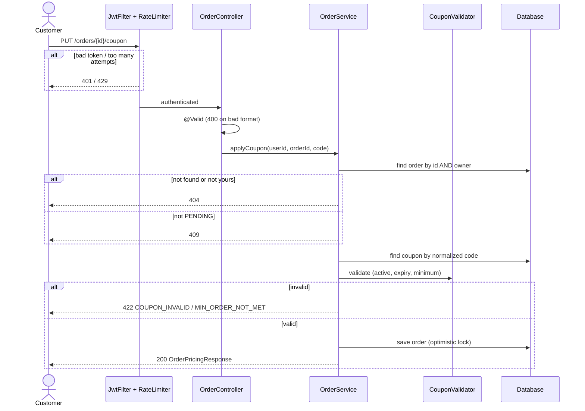

# Example output

**User:** "I'm new on the team. Can you explain how applying a coupon to an order works?"
**Codebase:** Spring Boot 3, Java 17, PostgreSQL, JUnit 5.

---

# How "Apply Coupon to Order" Works

## 1. At a Glance
Customers can type a discount code at checkout to lower the price of an order they haven't paid for yet. The backend checks the code, calculates the discount, and **saves the discount on the order**, so the price is locked in. ✅ **Why it exists:** it was built for marketing's Black Friday campaigns (commit `a91f3c2` "feat(orders): apply discount coupons — SHOP-412").

| | |
|---|---|
| Entry points | `PUT` and `DELETE /api/v1/orders/{orderId}/coupon` |
| Main code | `OrderController`, `OrderService`, `CouponValidator`, `Order` (entity) |
| Data | `orders` (writes `coupon_id`, `discount_amount`), `coupons` (read only) |
| External systems | none; rate limiting is in-memory (Bucket4j) |
| Tests to read first | `ApplyCouponServiceTest` (Group 1 reads like a spec), `ApplyCouponSecurityTest` |

## 2. Entry Points
| Method | URL | Auth | Purpose | Handler |
|---|---|---|---|---|
| PUT | `/api/v1/orders/{orderId}/coupon` | Logged-in customer; 10 req/min per user, 30/min per IP | Apply or replace a coupon | `OrderController.applyCoupon` (`:41`) |
| DELETE | `/api/v1/orders/{orderId}/coupon` | Logged-in customer | Remove the coupon | `OrderController.removeCoupon` (`:52`) |

## 3. Workflow

### 3.1 Step by Step (applying "SUMMER10" to a $120 order)

1. **The request arrives.** `JwtFilter` checks the token and `@RateLimited` counts the attempt *before* the controller runs. A missing or bad token gets 401; too many attempts get 429. (`security/JwtFilter.java`, `OrderController.java:40`)
2. **The input is validated.** `@Valid` checks `couponCode` against `@NotBlank`, `@Size(max=32)`, and an allow-list `@Pattern`. A bad format gets 400 before any database work. (`ApplyCouponRequest.java`)
3. **The order is loaded, but only if it's yours.** `findByPublicIdAndCustomerId(orderId, user.id())` (`OrderService.java:47`). Someone else's order and a non-existent order both give the **same 404**. ✅ Why: so attackers can't discover which order ids exist (test `should_return_identical_404_for_missing_and_foreign_order`).
4. **The status is checked.** Only `PENDING` orders can change; anything else gets 409 `ORDER_NOT_EDITABLE`. (`:51`)
5. **The code is normalized and looked up.** `" summer10 "` becomes `"SUMMER10"` (`:54`). If the code doesn't exist, the response is 422 `COUPON_INVALID`.
6. **The rules are validated.** `CouponValidator.validate` checks that the coupon is active, not expired (using the injected `Clock`), and that the minimum order is met. Every failure *except* the minimum returns the same `COUPON_INVALID`. ✅ Why: decision R2 in the plan, so error messages don't reveal which codes exist.
7. **The discount is calculated.** 10% × 120.00 = 12.00, rounded HALF_UP to 2 decimals, and capped at the subtotal so the total can never go negative. (`Order.applyDiscount`, `Order.java:88`)
8. **Everything is saved in one transaction.** `coupon_id` and `discount_amount` are written together. If someone else changed the order at the same moment, the optimistic lock (`version`) fails and the response is 409 `CONCURRENT_MODIFICATION`.
9. **An audit log is written.** `AuditLogger.log(userId, "COUPON_APPLIED", orderId)`, only on success.
10. **The response is returned.** `OrderPricingResponse` comes back with 200.

**Side effects:** one `UPDATE orders` and one audit log row. No events or emails.
**Transaction:** `OrderService.applyCoupon` is `@Transactional`; steps 3–8 run in one transaction.

### 3.2 Diagram
A sequence diagram, because the request passes through security, controller, service, and database, with a possible failure at each one.



## 4. DTOs (Request & Response)

### ApplyCouponRequest
```json
{ "couponCode": "SUMMER10" }
```
| Field | Type | Required | Validation | Goes to | Meaning |
|---|---|---|---|---|---|
| couponCode | string | yes | not blank, ≤ 32 chars, letters/digits/`-`/`_` | trimmed + uppercased, then matched against `coupons.code` | The code the customer typed. It's normalized so customers don't have to worry about capitals or spaces |

**Deliberately missing:** there is no `discountAmount` or `total` in the request. The server always calculates the price itself; if a client sends those fields, they are ignored (`ApplyCouponSecurityTest` S3). **Don't add them.** They would let customers set their own price.

### OrderPricingResponse
```json
{
  "orderId": "ord_8f2a",
  "subtotal": 120.00,
  "discountAmount": 12.00,
  "total": 108.00,
  "currency": "USD",
  "appliedCoupon": { "code": "SUMMER10", "type": "PERCENTAGE", "value": 10, "description": "10% off summer sale" }
}
```
| Field | Type | Required | Comes from | Meaning |
|---|---|---|---|---|
| orderId | string | yes | `orders.public_id` | The public order id. It is not the database UUID, which is never exposed |
| subtotal | decimal(2) | yes | `orders.subtotal` | The price before discount, so the UI can show it crossed out |
| discountAmount | decimal(2) | yes | `orders.discount_amount` | Money taken off. **Stored, not recalculated**, so it stays the same even if marketing edits the coupon later |
| total | decimal(2) | yes | derived: `subtotal − discountAmount` | What the customer will pay. Never below 0 |
| currency | string | yes | `orders.currency` | ISO code, so the amounts aren't ambiguous |
| appliedCoupon | object / null | no | join via `orders.coupon_id` | `null` when no coupon is applied (e.g. after DELETE) |
| appliedCoupon.code | string | yes | `coupons.code` | Shown as "SUMMER10 applied" |
| appliedCoupon.type | `PERCENTAGE` / `FIXED` | yes | `coupons.type` | Tells the UI to render "10%" or "$10" |
| appliedCoupon.value | decimal | yes | `coupons.value` | The face value: 10 means 10% or $10, depending on `type` |
| appliedCoupon.description | string | no | `coupons.description` | A marketing label for the UI |

**Deliberately missing:** `minOrderAmount`, the coupon's internal id, usage counters, and `customer_id`. They are hidden so campaign rules and internal data don't leak.

### Error responses
```json
{ "code": "COUPON_INVALID", "message": "This code is not valid", "timestamp": "2026-11-04T10:00:00Z" }
```
| Code | HTTP | When |
|---|---|---|
| VALIDATION_ERROR | 400 | Code blank, too long, or containing invalid characters |
| ORDER_NOT_FOUND | 404 | The order doesn't exist **or** isn't yours (identical on purpose) |
| ORDER_NOT_EDITABLE | 409 | The order is paid, cancelled, or shipped |
| CONCURRENT_MODIFICATION | 409 | Someone changed the order at the same moment |
| COUPON_INVALID | 422 | The code is unknown, expired, or inactive (one code on purpose) |
| MIN_ORDER_NOT_MET | 422 | The subtotal is below the coupon's minimum |
| — | 429 | Too many attempts (more than 10/min per user or 30/min per IP) |

## 5. Business Rules & Why
| Rule (in check order) | Where | Why | Test |
|---|---|---|---|
| Must be logged in | `JwtFilter` | ✅ Orders are personal | S1 |
| Max 10 attempts/min per user, 30 per IP | `@RateLimited` | ✅ Stops people guessing codes (R3) | S5 |
| Order must be yours | `OrderService:47` | ✅ Stops IDOR attacks | S2 |
| Order must be PENDING | `OrderService:51` | ✅ A paid price must never change | G3 |
| Coupon must exist, be active, and not be expired | `CouponValidator:15` | ✅ Campaign control | G1 |
| Subtotal ≥ minimum (inclusive) | `CouponValidator:28` | ✅ Marketing rule ("spend $50, get $10") | G2 |
| Discount ≤ subtotal | `Order.java:88` | ✅ The shop never owes the customer money | G4 |
| One coupon per order; a new one replaces the old | `OrderService:62` | ✅ No stacking (product decision) | G5 |
| A failed replace keeps the old coupon | `OrderService:58` | 💭 Validation runs before anything changes, so customers don't lose a working discount | G5 ❌1 |

## 6. Data Touched
- `orders`: reads `status`, `subtotal`, `customer_id`, `version`; writes `coupon_id` and `discount_amount`.
- `coupons`: read only. Many orders can use the same coupon (1 : N via `orders.coupon_id`).
- `coupon_id` uses `ON DELETE RESTRICT`, so a coupon that was ever used can't be deleted. Deactivate it instead.

## 7. Gotchas
1. **"I edited the coupon, but old orders didn't change."** → `discount_amount` is frozen when the coupon is applied. → This is intended. Don't "fix" it by recalculating from the coupon.
2. **"The expiry test passes locally but my new date logic fails."** → Time comes from an injected `Clock`, not `Instant.now()`. → Always use `clock.instant()`. Tests rely on it.
3. **"Why does an expired code say 'not valid' instead of 'expired'?"** → It's one generic error on purpose (security, R2). → Don't add specific messages without checking with the security reviewer.
4. **"The rate limit doesn't work with 3 servers."** → The buckets are in memory per instance. → This is a known limitation, shared with login.
5. **"I can't delete a coupon in the DB."** → It's an FK with RESTRICT. → Set `active = false` instead.

## 8. Try It Yourself
```bash
# run the tests for this feature (needs Docker for Testcontainers)
mvn test -Dtest='ApplyCoupon*Test'
```
```bash
curl -X PUT http://localhost:8080/api/v1/orders/<ORDER_ID>/coupon \
  -H "Authorization: Bearer <YOUR_LOCAL_TOKEN>" \
  -H "Content-Type: application/json" \
  -d '{"couponCode":"SUMMER10"}'
# expected: 200 with discountAmount 12.00 for a 120.00 order (seed data: db/seed/local_coupons.sql)
```
**Breakpoints to follow the flow:** `OrderController.applyCoupon` → `OrderService.java:47` (ownership) → `CouponValidator.validate` → `Order.applyDiscount`.

## 9. Glossary · Check Your Understanding · Next Steps
**Glossary**
- **Coupon**: a marketing code giving a percentage or fixed discount.
- **PENDING**: an order that has been created but not yet paid; the only status that can change.
- **Subtotal**: the sum of the line items before any discount.
- **IDOR / BOLA**: an attack where you access someone else's data by changing an id in the URL.
- **Optimistic lock**: a `version` column that makes a save fail if someone else saved the row first.

**Check your understanding**
<details><summary>1. Marketing changes SUMMER10 from 10% to 20%. What happens to an order that already used it?</summary>Nothing. Its `discount_amount` was stored when the coupon was applied.</details>
<details><summary>2. Why do "not your order" and "order doesn't exist" return the same 404?</summary>So attackers can't find out which order ids exist.</details>
<details><summary>3. A $15 order with a $20 FIXED coupon: what is the total?</summary>$0.00. The discount is capped at the subtotal.</details>

**Open questions for the team**
- ❓ What should happen when a coupon expires between apply and payment? (still undecided, per the change report)

**Where to go next:** checkout/payment (`PaymentService`), where `total` is charged, and the admin coupon management in `admin/coupon/`.

---
Want me to go deeper into any step, explain another flow, or quiz you on this one?
