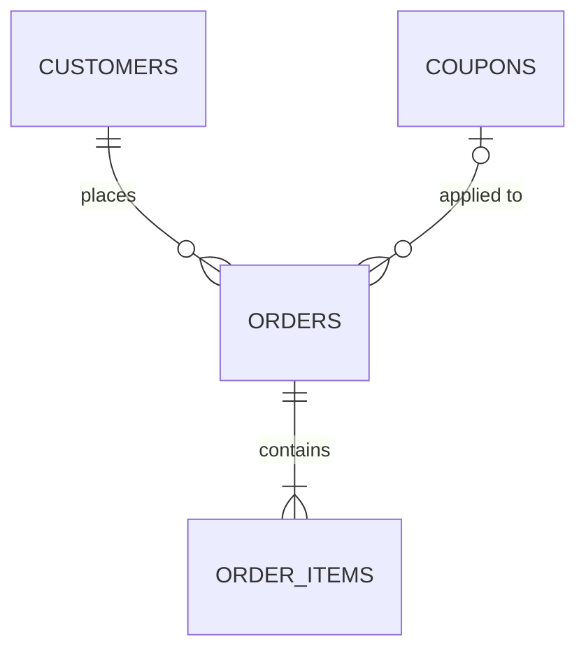
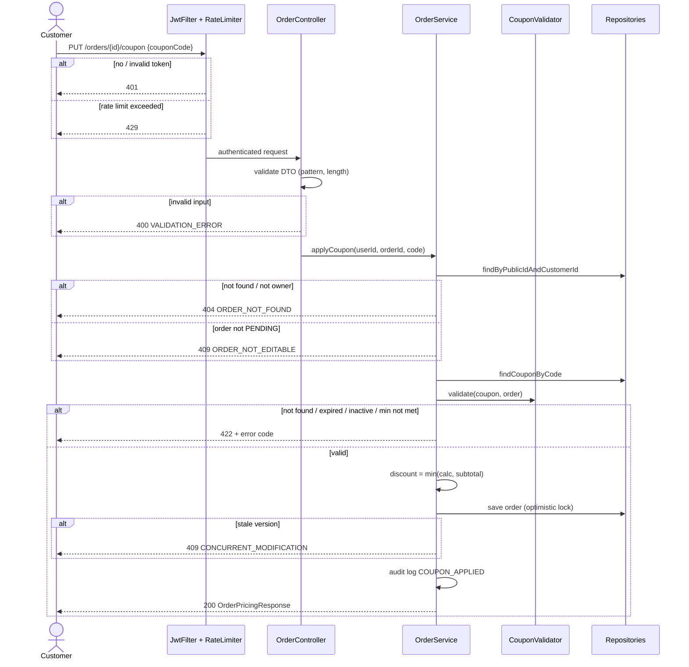

# Example output

**User request:** "Implement: customers can apply a discount coupon to their order before checkout."
**Codebase:** Spring Boot 3, Java 17, JPA, JUnit 5 + Mockito + MockMvc.

---

# Feature Plan: Apply Coupon to Order  (PLAN MODE — no changes made)

## 1. Requirement (User Stories & Acceptance Criteria)

**US1** — As a **customer**, I want to **apply a coupon code to my pending order**, so that **I pay a discounted price**.
**US2** — As a **customer**, I want to **remove an applied coupon**, so that **I can try a different one**.

**Acceptance Criteria**
- **AC1** — Given a pending order and a valid active coupon, When I apply the code, Then the discount is calculated and the new total is returned.
- **AC2** — Given an expired coupon, When I apply it, Then I get 422 `COUPON_EXPIRED` and the total is unchanged.
- **AC3** — Given an order total below the coupon's minimum, When I apply it, Then I get 422 `MIN_ORDER_NOT_MET`.
- **AC4** — Given an order that already has a coupon, When I apply another, Then the new one replaces the old (one coupon per order).
- **AC5** — Given an order that is not PENDING (paid/cancelled), When I apply a coupon, Then I get 409 `ORDER_NOT_EDITABLE`.
- **AC6** — Given an order owned by another customer, When I apply a coupon, Then I get 404 (don't reveal it exists).
- **Proposed AC7** — Discount never makes total negative (capped at order subtotal).

**Out of scope:** creating/managing coupons (admin), stacking multiple coupons, per-user usage limits.

## 2. Codebase Patterns

| Area | Finding | Evidence |
|---|---|---|
| Layering | Controller → Service → Repository, services are `@Transactional` | `order/OrderController.java`, `order/OrderService.java` |
| Naming | `XxxRequest` / `XxxResponse` records in `dto/` package | `order/dto/CreateOrderRequest.java` |
| API style | `/api/v1`, plural nouns, sub-resources for owned things | `OrderController.java:18` `@RequestMapping("/api/v1/orders")` |
| Validation | Jakarta `@NotBlank`, `@Size` on request records | `CreateOrderRequest.java` |
| Errors | `BusinessException(ErrorCode)` → `GlobalExceptionHandler` → `ErrorResponse{code,message,timestamp}` | `common/GlobalExceptionHandler.java` |
| Money | `BigDecimal`, scale 2, `RoundingMode.HALF_UP` | `order/Order.java:35` |
| Auth & security | JWT filter + `@AuthenticationPrincipal UserPrincipal`; rate limiting via Bucket4j `@RateLimited` (used on login); `AuditLogger.log(actor, action, target)` | `OrderController.java:30`, `security/JwtFilter.java`, `auth/AuthController.java:22`, `common/AuditLogger.java` |
| Tests | Unit: Mockito on service; API: `@WebMvcTest`; names `should_X_when_Y` | `OrderServiceTest.java` |

## 3. Schema & Relationships

### 3.1 Existing Tables
| Table | Key columns | Constraints & indexes | Evidence |
|---|---|---|---|
| `orders` | `id` uuid PK, `public_id` varchar, `customer_id` uuid NOT NULL, `status` varchar(enum), `subtotal` numeric(12,2), `currency` char(3), `version` int | FK `customer_id → customers.id`, idx `(customer_id)`, `version` = optimistic lock | `db/migration/V3__orders.sql`, `order/Order.java` |
| `order_items` | `id`, `order_id` NOT NULL, `price` numeric(12,2), `qty` int | FK `order_id → orders.id` ON DELETE CASCADE | `V3__orders.sql` |
| `coupons` | `id` uuid PK, `code` varchar(32), `type` varchar, `value` numeric(12,2), `min_order_amount` numeric(12,2) NULL, `expires_at` timestamptz, `description` varchar NULL, `active` bool | UNIQUE `(code)` | `V7__coupons.sql` (table exists, used only by admin module) |

### 3.2 Relationships
| From | To | Cardinality | FK / join | Owning side & cascade/fetch | Business meaning |
|---|---|---|---|---|---|
| customers | orders | 1 : N | `orders.customer_id` | Order owns FK, LAZY | A customer places many orders; used for the ownership check (AC6) |
| orders | order_items | 1 : N | `order_items.order_id` | Order, cascade ALL, LAZY | Subtotal is the sum of items |
| coupons | orders | 1 : N (new) | `orders.coupon_id` (new) | Order owns FK, no cascade, LAZY | One coupon can be used on many orders; an order has at most one coupon |



**Risks noticed:** loading `order.items` to recompute subtotal would be N+1 — use the stored `orders.subtotal`. There is no cascade from coupons to orders, which is correct: deleting a coupon must not delete orders, so the FK should be `ON DELETE SET NULL` or deletion should be blocked.

### 3.3 Proposed Schema Changes (not applied)
Migration `V12__add_coupon_to_orders.sql`:
| Change | Type | Nullable / default | Why |
|---|---|---|---|
| `orders.coupon_id` | uuid FK → coupons.id, ON DELETE RESTRICT | NULL | Links the applied coupon (one per order, AC4) |
| `orders.discount_amount` | numeric(12,2) | NOT NULL DEFAULT 0 | Freezes the discount at apply time, so a later coupon edit doesn't change a placed order's price |
| index `idx_orders_coupon_id` | — | — | FK lookups and future "orders using coupon X" reports |

Backward-compatible (nullable column + default), so existing rows need no backfill. Rollback: drop the index and the two columns.

## 4. Implementation Idea

### 4.1 Approach & Files Affected
Add a `coupon` package (entity, repository, `CouponValidator`) and extend `OrderService` with `applyCoupon` / `removeCoupon`. The order keeps a reference to the applied coupon and a stored `discountAmount`, so the price the customer saw is frozen even if the coupon is edited later. Validation lives in `CouponValidator` so each rule is unit-testable on its own. Errors reuse `BusinessException` + `ErrorCode`, matching `OrderService`.

**Files that would change (not touched):** new `coupon/CouponRepository.java`, `coupon/CouponValidator.java`, `order/dto/ApplyCouponRequest.java`, `order/dto/OrderPricingResponse.java`, `V12__add_coupon_to_orders.sql`; modified `Order.java`, `OrderService.java`, `OrderController.java`, `ErrorCode.java`.

### 4.2 Endpoints

| Method | URL | Purpose | Success | Errors |
|---|---|---|---|---|
| PUT | `/api/v1/orders/{orderId}/coupon` | Apply / replace coupon | 200 `OrderPricingResponse` | 400, 404, 409, 422 |
| DELETE | `/api/v1/orders/{orderId}/coupon` | Remove coupon | 200 `OrderPricingResponse` | 404, 409 |

Why: the coupon is a **single sub-resource of the order** (one per order), so `/orders/{id}/coupon` (singular) fits better than a verb URL like `/applyCoupon`. **PUT** because applying the same code twice gives the same result (idempotent) and replaces any existing coupon (AC4). DELETE returns the recalculated pricing instead of 204 so the UI can refresh totals without a second call.

### 4.3 DTOs

**ApplyCouponRequest**
```json
{ "couponCode": "SUMMER10" }
```
| Field | Type | Required | Validation | Maps to | Meaning |
|---|---|---|---|---|---|
| couponCode | string | yes | `@NotBlank`, max 32, trimmed, uppercased | `coupons.code` (lookup) | The code the customer typed. Normalized so "summer10 " matches "SUMMER10". |

**OrderPricingResponse**
```json
{
  "orderId": "ord_8f2a",
  "subtotal": 120.00,
  "discountAmount": 12.00,
  "total": 108.00,
  "currency": "USD",
  "appliedCoupon": { "code": "SUMMER10", "type": "PERCENTAGE", "value": 10, "description": "10% off summer sale" }
}
```
| Field | Type | Required | Maps to | Meaning |
|---|---|---|---|---|
| orderId | string | yes | `orders.public_id` | Public order id, so the client confirms which order was updated. |
| subtotal | decimal(2) | yes | `orders.subtotal` | Sum of line items before discount, shown as the "original" price. |
| discountAmount | decimal(2) | yes | `orders.discount_amount` | Money taken off; `0.00` when no coupon. Stored, so it stays fixed. |
| total | decimal(2) | yes | derived | `subtotal − discountAmount`, never below 0 (AC7). What the customer will pay. |
| currency | string (ISO 4217) | yes | `orders.currency` | Makes amounts unambiguous for display. |
| appliedCoupon | object / null | no | via `orders.coupon_id` | `null` after DELETE or when no coupon. |
| appliedCoupon.code | string | yes | `coupons.code` | Normalized code, to show "SUMMER10 applied". |
| appliedCoupon.type | enum `PERCENTAGE`/`FIXED` | yes | `coupons.type` | Lets the UI render "10%" vs "$10". |
| appliedCoupon.value | decimal | yes | `coupons.value` | The coupon's face value (10 = 10% or $10 depending on type). |
| appliedCoupon.description | string | no | `coupons.description` | Human-readable label for the UI. |

Deliberately **not** exposed: coupon internal id, usage counters, `minOrderAmount` (avoid leaking campaign rules — error message says the minimum instead).

**ErrorResponse** (existing)
```json
{ "code": "COUPON_EXPIRED", "message": "Coupon SUMMER10 expired on 2026-09-30", "timestamp": "2026-11-04T10:00:00Z" }
```

## 5. Security Review

| # | Risk (OWASP API) | Where | Mitigation in this plan | Test ref |
|---|---|---|---|---|
| SEC1 | Broken authentication (API2) | both endpoints | Behind the existing `JwtFilter`; no anonymous access | S1 |
| SEC2 | BOLA / IDOR (API1) | `{orderId}` in URL | Ownership checked **in the query** (`findByPublicIdAndCustomerId`). "Not yours" and "doesn't exist" both return the same 404 | S2 |
| SEC3 | Mass assignment (API3) | request body | `ApplyCouponRequest` only has `couponCode`. Unknown fields like `discountAmount`/`total` are ignored; the discount is always computed server-side | S3 |
| SEC4 | Excessive data exposure (API3) | response | No coupon internal id, `customer_id`, `min_order_amount`, or usage counters. Errors carry no stack traces (existing handler) | S3 |
| SEC5 | Injection | `couponCode` | Allow-list pattern `^[A-Z0-9_-]{1,32}$` after normalization; JPA parameter binding only | S4 |
| SEC6 | Coupon brute force / enumeration (API4) | PUT endpoint | `@RateLimited(10/min per user)`, reusing Bucket4j → 429 | S5 |
| SEC7 | Race / double apply (business logic) | `orders` row | Optimistic lock on `orders.version` → 409 | Group 6 |
| SEC8 | Missing audit trail | apply/remove | `AuditLogger.log(userId, "COUPON_APPLIED", orderId)`; the JWT is never logged | S6 |
| — | Function-level auth (API5) | — | Not applicable: customer-only endpoints, no admin action here | — |

## 6. Workflow Diagram

A sequence diagram, chosen because the request passes security checks and several layers, with rejection points at each.



## 7. TDD Test Plan

Write groups in order: 1 → 7, then S1 → S6. Every ❌ changes **one** condition from its group's baseline, and expects **no change to the order** (same total, no DB write).

### Functional groups

### Group 1 — Coupon must be valid (AC1, AC2) · unit
Baseline: Given a PENDING order, subtotal 120; coupon `SUMMER10`, 10%, active, expires tomorrow · When apply "SUMMER10"

| # | Type | Test name | Changed condition (vs baseline) | Expected result (Then) | Demonstrates |
|---|---|---|---|---|---|
| ✅1 | baseline | `should_apply_discount_when_coupon_is_valid` | — | discount 12, total 108, `coupon_id` saved | A valid coupon actually changes what the customer pays, by the right amount |
| ✅2 | edge | `should_apply_when_coupon_expires_exactly_now` | `expiresAt` = now | applied | The expiry instant itself is still valid |
| ✅3 | edge | `should_apply_when_code_has_spaces_and_lowercase` | code " summer10 " | applied | Normalization lets customers type naturally |
| ❌1 | negative | `should_reject_when_code_does_not_exist` | code "NOPE10" | 422 `COUPON_NOT_FOUND`, total 120 | Unknown codes never discount |
| ❌2 | negative | `should_reject_when_coupon_expired_one_second_ago` | `expiresAt` = now − 1s | 422 `COUPON_EXPIRED` | Expiry is enforced at the exact boundary |
| ❌3 | negative | `should_reject_when_coupon_is_inactive` | `active` = false | 422 `COUPON_INACTIVE` | Admin can switch off a coupon instantly, even before expiry |
| ❌4 | negative | `should_return_400_when_code_is_null` | code null | 400 `VALIDATION_ERROR` | A missing field is caught before any DB lookup |
| ❌5 | negative | `should_return_400_when_code_is_blank` | code "   " | 400 | Whitespace-only isn't treated as a code |
| ❌6 | negative | `should_return_400_when_code_exceeds_32_chars` | 33 chars | 400 | Oversized input is rejected (matches the `varchar(32)` column) |

### Group 2 — Minimum order amount (AC3) · unit
Baseline: Given coupon `min_order_amount` = 50.00, subtotal 50.00 · When apply the coupon

| # | Type | Test name | Changed condition (vs baseline) | Expected result (Then) | Demonstrates |
|---|---|---|---|---|---|
| ✅1 | baseline | `should_apply_when_subtotal_equals_minimum` | — | applied | The minimum is inclusive |
| ✅2 | edge | `should_apply_when_coupon_has_no_minimum` | `min_order_amount` = null | applied | A null minimum means "no minimum", not an error |
| ❌1 | negative | `should_reject_when_subtotal_one_cent_below_minimum` | subtotal 49.99 | 422 `MIN_ORDER_NOT_MET` | The boundary is exact to the cent |
| ❌2 | negative | `should_reject_when_order_has_no_items` | subtotal 0.00 | 422 `MIN_ORDER_NOT_MET` | Empty orders can't receive a discount |

### Group 3 — Only PENDING orders are editable (AC5) · unit
Baseline: Given order status PENDING · When apply a valid coupon

| # | Type | Test name | Changed condition (vs baseline) | Expected result (Then) | Demonstrates |
|---|---|---|---|---|---|
| ✅1 | baseline | `should_apply_when_order_is_pending` | — | applied | The normal checkout flow works |
| ❌1 | negative | `should_reject_when_order_is_paid` | status PAID | 409 `ORDER_NOT_EDITABLE` | A paid price can't be changed afterwards |
| ❌2 | negative | `should_reject_when_order_is_cancelled` | status CANCELLED | 409 | Dead orders can't be modified |
| ❌3 | negative | `should_reject_when_order_is_shipped` | status SHIPPED | 409 | Every non-PENDING status is blocked, not just PAID |

### Group 4 — Discount calculation (AC7) · unit
Baseline: Given a FIXED coupon 20, subtotal 50 · When apply the coupon

| # | Type | Test name | Changed condition (vs baseline) | Expected result (Then) | Demonstrates |
|---|---|---|---|---|---|
| ✅1 | baseline | `should_subtract_full_value_when_subtotal_exceeds_coupon` | — | discount 20, total 30 | A fixed coupon takes off exactly its value |
| ✅2 | edge | `should_round_half_up_for_percentage_discount` | 15% of 33.33 | discount 5.00 | Money is rounded consistently with the rest of the codebase |
| ❌1 | negative | `should_cap_discount_at_subtotal_when_coupon_exceeds_it` | coupon value 80 | discount 50, total 0.00 | The total never goes negative |

### Group 5 — Replace & remove (AC4, US2) · unit
Baseline: Given the order already has `SUMMER10` applied · When apply another coupon / remove the coupon

| # | Type | Test name | Changed condition (vs baseline) | Expected result (Then) | Demonstrates |
|---|---|---|---|---|---|
| ✅1 | baseline | `should_replace_existing_coupon_when_applying_new_one` | — | new coupon applied, old one gone | Only one coupon per order; the new one wins |
| ✅2 | edge | `should_reset_discount_when_coupon_removed` | DELETE instead of apply | discount 0, full price | DELETE restores the full price |
| ❌1 | negative | `should_keep_old_coupon_when_new_one_is_invalid` | new code expired | 422; `SUMMER10` still applied | A failed replace doesn't lose the customer's existing discount |
| ❌2 | negative | `should_reject_remove_when_order_is_paid` | status PAID | 409 | Removing is also blocked after payment |

### Group 6 — Concurrency (schema: `orders.version`) · integration (Testcontainers)
Baseline: Given the order version matches · When apply a valid coupon

| # | Type | Test name | Changed condition (vs baseline) | Expected result (Then) | Demonstrates |
|---|---|---|---|---|---|
| ✅1 | baseline | `should_persist_coupon_and_discount_together` | — | `coupon_id` and `discount_amount` both saved | Both are written in one transaction |
| ❌1 | negative | `should_return_409_when_order_modified_concurrently` | stale version | 409 `CONCURRENT_MODIFICATION` | Two simultaneous applies can't overwrite each other |

### Group 7 — Schema integrity · integration
Baseline: Given an order with a coupon applied

| # | Type | Test name | Changed condition (vs baseline) | Expected result (Then) | Demonstrates |
|---|---|---|---|---|---|
| ✅1 | baseline | `should_set_coupon_fk_when_applied` | — | `orders.coupon_id` references the coupon | The link is stored as a real FK |
| ❌1 | negative | `should_block_deleting_coupon_used_by_order` | delete the coupon row | FK violation (RESTRICT) | Order history can't lose its coupon reference |

### Security groups (API level, `@SpringBootTest` + MockMvc with the real security filters)

### Group S1 — Authentication (SEC1)
Baseline: Given a valid JWT for the order's owner · When apply a valid coupon

| # | Type | Test name | Changed condition (vs baseline) | Expected result (Then) | Demonstrates |
|---|---|---|---|---|---|
| ✅1 | baseline | `should_return_200_with_valid_token` | — | 200 | Logged-in owners can apply coupons |
| ❌1 | negative | `should_return_401_when_no_token` | no `Authorization` header | 401, order unchanged | Anonymous users can't touch orders |
| ❌2 | negative | `should_return_401_when_token_expired` | expired JWT | 401 | Old stolen tokens stop working |
| ❌3 | negative | `should_return_401_when_token_signature_invalid` | tampered signature | 401 | Forged tokens are rejected |

### Group S2 — Ownership / IDOR (SEC2, AC6)
Baseline: Given customer A · When A applies a coupon to A's order

| # | Type | Test name | Changed condition (vs baseline) | Expected result (Then) | Demonstrates |
|---|---|---|---|---|---|
| ✅1 | baseline | `should_return_200_when_caller_owns_order` | — | 200 | Owners can change their own orders |
| ❌1 | negative | `should_return_404_when_order_belongs_to_another_customer` | B's orderId | 404, B's order unchanged | Users can't modify other users' orders |
| ❌2 | negative | `should_return_identical_404_for_missing_and_foreign_order` | random orderId vs B's orderId | Same status and body for both | Attackers can't tell which order ids exist |
| ❌3 | negative | `should_return_404_on_delete_of_foreign_order` | DELETE on B's order | 404 | The remove endpoint is protected too, not just apply |

### Group S3 — Mass assignment & data exposure (SEC3, SEC4)
Baseline: Given body `{ "couponCode": "SUMMER10" }` · When apply

| # | Type | Test name | Changed condition (vs baseline) | Expected result (Then) | Demonstrates |
|---|---|---|---|---|---|
| ✅1 | baseline | `should_return_only_documented_fields` | — | response has exactly the DTO fields | No internal ids or `min_order_amount` leak |
| ❌1 | negative | `should_ignore_client_supplied_discount` | body adds `"discountAmount": 999` | discount still 12 | Clients can't set their own discount |
| ❌2 | negative | `should_ignore_client_supplied_total` | body adds `"total": 0` | total still 108 | Clients can't set their own price |
| ❌3 | negative | `should_not_leak_stack_trace_on_error` | force a repository exception | 500 with a generic body only | Errors don't reveal internals |

### Group S4 — Injection (SEC5)
Baseline: Given code "SUMMER10" · When apply. Negatives only: the valid case is G1✅1.

| # | Type | Test name | Changed condition (vs baseline) | Expected result (Then) | Demonstrates |
|---|---|---|---|---|---|
| ❌1 | negative | `should_return_400_for_sql_injection_payload` | `"' OR '1'='1"` | 400, no DB error | SQL payloads are blocked by validation, and binding would block them anyway |
| ❌2 | negative | `should_return_400_for_script_payload` | `"<script>alert(1)</script>"` | 400 | HTML/JS can't be stored or echoed back |
| ❌3 | negative | `should_return_400_for_unicode_lookalike_code` | `"SUMMER１０"` (full-width digits) | 400 | The allow-list rejects tricky characters |

### Group S5 — Brute force protection (SEC6)
Baseline: Given the same user · When they make their 10th attempt within one minute

| # | Type | Test name | Changed condition (vs baseline) | Expected result (Then) | Demonstrates |
|---|---|---|---|---|---|
| ✅1 | baseline | `should_allow_requests_within_rate_limit` | — | 200 | Normal users are never blocked |
| ❌1 | negative | `should_return_429_on_11th_attempt_within_a_minute` | 11th request | 429 with `Retry-After` | Coupon codes can't be guessed by mass trial |
| ❌2 | negative | `should_count_failed_attempts_toward_limit` | 11 invalid codes | 429 | Failed guesses aren't free |

### Group S6 — Audit (SEC8) · unit
Baseline: Given a valid coupon · When apply

| # | Type | Test name | Changed condition (vs baseline) | Expected result (Then) | Demonstrates |
|---|---|---|---|---|---|
| ✅1 | baseline | `should_write_audit_log_when_coupon_applied` | — | one `COUPON_APPLIED` entry with user id | Every price change is traceable to a user |
| ❌1 | negative | `should_not_write_audit_log_when_apply_fails` | expired coupon | No `COUPON_APPLIED` entry | The audit log only records real changes |
| ❌2 | negative | `should_not_log_jwt_token` | any request | Log output has no `Bearer` value | Tokens never end up in the logs |

### Coverage

| AC | Tests |
|---|---|
| AC1 | G1✅1 + G1❌1 |
| AC2 | G1✅2 + G1❌2 |
| AC3 | G2 (2 ✅, 2 ❌) |
| AC4 | G5✅1 + G5❌1 |
| AC5 | G3 (1 ✅, 3 ❌) |
| AC6 | S2 (1 ✅, 3 ❌) |
| AC7 | G4✅1 + G4❌1 |

| Security risk | Tests |
|---|---|
| SEC1 | S1 |
| SEC2 | S2 |
| SEC3 / SEC4 | S3 |
| SEC5 | S4 |
| SEC6 | S5 |
| SEC7 | G6 |
| SEC8 | S6 |

## 8. Questions & Confirmations

**Questions**
1. Should a coupon have a global usage limit (e.g. first 100 uses)? If yes, is a use counted at apply or at payment?
2. Is coupon code matching case-insensitive from the business's point of view?
3. If the cart changes after a coupon is applied and drops below the minimum, should the coupon be removed automatically or blocked at checkout?
4. **Security trade-off:** separate error codes (`COUPON_EXPIRED` vs `COUPON_NOT_FOUND`) are friendlier, but they reveal that a code exists. Is that acceptable with the rate limit in place, or should all invalid codes return one generic error?
5. Is 10 attempts per minute per user the right rate limit? Should there also be a per-IP limit?

**Assumptions to confirm** (default in brackets)
6. One coupon per order; a new one replaces the old [yes].
7. Not-owner returns 404, not 403 [yes].
8. Discount is rounded HALF_UP to 2 decimals [yes].
9. PUT for apply; DELETE returns 200 with the pricing body [yes].
10. The `coupon_id` FK uses ON DELETE RESTRICT [yes].
11. The migration is `V12`, the next free Flyway number [yes].
12. Unknown JSON fields are ignored, not rejected with 400 [yes].

_Plan mode: no files, migrations, or data were changed._

Once you've answered, I'll update the plan and ask for approval before creating the scaffold (Step 9, see `example-scaffold.md`).
