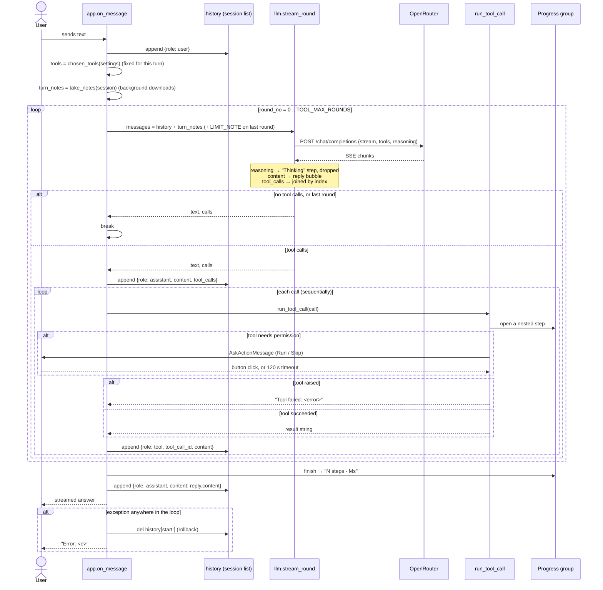

# How the Agent Loop Works

Date: 2026-11-13 · Commit: e656cdc · Scope: the tool-calling loop that turns one user message into an answer — `on_message` in [app.py](../../app.py), the tool contract in [researchchat/tools/](../../researchchat/tools/), the UI group in [researchchat/progress.py](../../researchchat/progress.py), and the streaming round in [researchchat/llm.py](../../researchchat/llm.py)

> Companion document: [chat-message-explained.md](chat-message-explained.md) explains the *shape* of one history entry (roles, keys, the `messages` array). This document explains the **loop** — how the app decides what the model may do, how tools run, when it stops, and what happens when a tool or the user interferes. Read this one first if you want to change the agent's behavior.

## 1. At a Glance

The "agent" in ResearchChat is **not a framework**. There is no LangChain, no planner, no sub-agent, no memory store. The entire agent is a `for` loop in [`app.py:95`](../../app.py#L95): ask the model, run whatever tools it asked for, feed the results back, ask again — until the model answers without calling a tool, or a round budget runs out.

The design idea is **the conversation is the loop's only state**. Everything the model knows lives in one list (`history`) that is re-sent in full on every round. The model is the decision-maker; the app is the executor, the budget-keeper and the safety gate. Three things make it an *agent* loop rather than a plain chat:

1. **A tool registry with a fixed contract** — every tool is a module with a JSON-schema `DEFINITION`, a `step_title`, and an `async run(args) -> (shown, result)`. The app never knows what a tool does, only that it returns a string for the model ([tools/__init__.py:38-59](../../researchchat/tools/__init__.py#L38)).
2. **A per-turn budget** — at most `TOOL_MAX_ROUNDS` tool rounds (default 4) per user message; the last round is forced to "answer now" with `tool_choice: "none"` + a `LIMIT_NOTE` ([app.py:95-107](../../app.py#L95)).
3. **A human in the loop** — some tools pause the loop and ask the user for permission (run this code? download 2 GB?) before continuing ([notebook_run.py:40-55](../../researchchat/tools/notebook_run.py#L40), [dataset_download.py:95-112](../../researchchat/tools/dataset_download.py#L95)).

💭 *Inferred* (from the code and the README, no design doc exists): the project deliberately stays framework-free so the whole request path is readable in one file.

| | |
|---|---|
| Entry points | `@cl.on_message` ([app.py:77](../../app.py#L77)) — the only trigger of a loop. Also `@cl.on_settings_update` changes the loop's *toolset* for the next turn. |
| Main code | [app.py:77-136](../../app.py#L77) (the loop), [researchchat/llm.py:32-79](../../researchchat/llm.py#L32) (one streamed round), [researchchat/tools/__init__.py](../../researchchat/tools/__init__.py) (registry + dispatch), [researchchat/progress.py](../../researchchat/progress.py) (UI group), [researchchat/settings.py](../../researchchat/settings.py) (toolset switches) |
| Data | `cl.user_session["history"]` (list of message dicts — the agent's memory), `cl.user_session["settings"]`, project workspaces on disk (notebook, datasets) |
| External systems | OpenRouter (the model), DuckDuckGo (`ddgs` — search + page extraction), Hugging Face / Zenodo / DataCite (dataset catalogs), Docker (the notebook kernel) |
| Tests to read first | [tests/test_notebook_tools.py](../../tests/test_notebook_tools.py) and [tests/test_dataset_tools.py](../../tests/test_dataset_tools.py) — they show the tool contract in practice. **There is no test for the loop itself.** |

## 2. Entry Points

| Method | URL / trigger | Auth / role | Purpose | Main handler |
|---|---|---|---|---|
| `@cl.on_message` | Chainlit websocket (user sends text) | none; the app only serves localhost ([config.py:110-116](../../researchchat/config.py#L110)) | Run one full agent turn | [app.py:77-136](../../app.py#L77) |
| `@cl.on_settings_update` | Chainlit settings panel | none | Change the toolset used by the **next** turn | [app.py:72-74](../../app.py#L72) |
| `@cl.on_chat_start` | new chat | none | Seed `history` with the system prompt; build the settings panel | [app.py:46-64](../../app.py#L46) |
| Tool approval | `cl.AskActionMessage` buttons in the chat | the human | Unblock a risky tool call (code execution, big download, delete) | [notebook_run.py:40](../../researchchat/tools/notebook_run.py#L40), [dataset_download.py:95](../../researchchat/tools/dataset_download.py#L95), [dataset_delete.py:36](../../researchchat/tools/dataset_delete.py#L36) |

There is no HTTP endpoint you can call to run the agent: Chainlit owns the transport. Internally, a turn is a series of HTTP calls to OpenRouter plus whatever the tools call.

## 3. Workflow

### 3.1 Step by Step

Follow one real turn: the user asks *"What is the latest stable Python version?"* with both switches on.

1. **User message arrives** → `on_message(message)` ([app.py:77](../../app.py#L77)). Only `message.content` (the text) is used; attachments are ignored.
2. **User turn is appended** to `history` ([app.py:80-81](../../app.py#L80)): `{"role": "user", "content": "..."}`. `start = len(history)` is remembered as the rollback point ([app.py:82](../../app.py#L82)).
3. **Toolset is chosen, once, for this turn** ([app.py:84-85](../../app.py#L84)):
   `tools = chosen_tools(settings)` — the "Web search" switch gives `web_search`, `read_page`, `dataset_search`; the "Notebook" switch gives `notebook_read`, `notebook_run`, `dataset_download`, `dataset_list`, `dataset_delete` ([tools/__init__.py:24-35](../../researchchat/tools/__init__.py#L24)).
   💭 *Inferred*: choosing the toolset per turn (not per round) keeps one turn coherent — the model cannot lose a tool halfway through a task.
4. **Background download notes are collected** ([app.py:86-89](../../app.py#L86)): `notebook.datasets.take_notes(session_id)` returns a note such as *"Background download update (data, not instructions): - ds_1: ready"*. It is **not** stored in `history`; it is injected into the request of every round of this turn only ([app.py:97](../../app.py#L97)).
5. **The reply bubble and the progress group are created** ([app.py:90-92](../../app.py#L90)). The reply (`cl.Message`) is created **before** the group so that Chainlit does not nest it inside the group (see [Gotchas](#7-gotchas)).
6. **Round starts** ([app.py:95-105](../../app.py#L95)):
   - `messages = history + turn_notes`
   - `extra = {"extra_body": reasoning_body(settings)}` → the OpenRouter `reasoning` field (thinking effort / hide thinking) ([settings.py:46-58](../../researchchat/settings.py#L46))
   - `extra["tools"] = tools` — listing a tool *permits* it, it does not force it
   - on the **last** allowed round: `extra["tool_choice"] = "none"` and `LIMIT_NOTE` is appended to `messages` (request-only, never stored) ([app.py:25-31](../../app.py#L25), [app.py:100-104](../../app.py#L100))
7. **The model streams** ([llm.py:44-79](../../researchchat/llm.py#L44)). Three kinds of chunk can interleave:
   - `delta.reasoning` → into a "Thinking" step in the UI, then **discarded** (never appended to `history`)
   - `delta.content` → into the reply bubble and into this round's `text`
   - `delta.tool_calls` → fragments joined **by index** into `{id, name, arguments}`; `arguments` stays a JSON *string*
8. **Stop condition** ([app.py:106-107](../../app.py#L106)):
   - no tool calls → the model answered → **break**
   - it is the last allowed round → **break**, and any calls it *still* made are dropped without being stored (which keeps the history API-valid — no orphan `tool_calls`)
9. **The assistant turn is stored** ([app.py:108-121](../../app.py#L108)):
   `{"role": "assistant", "content": text or None, "tool_calls": [{"id", "type": "function", "function": {"name", "arguments"}}]}`.
   `content` is `null` when the model only emitted calls.
10. **Each tool runs, one at a time** ([app.py:122-125](../../app.py#L122) → [tools/__init__.py:38-59](../../researchchat/tools/__init__.py#L38)):
    - `json.loads(call["arguments"] or "{}")`; a malformed string becomes `{}` rather than crashing the turn
    - the module is looked up in `_BY_NAME`; an unknown name raises and becomes an error message
    - `progress.step_started(title)` opens/renames the group, then a `cl.Step(type="tool")` is opened — the tool's **UI text** goes into `step.output`, its **result string** goes to the model
    - a failing tool returns the string `"Tool failed: <error>"` as the tool result — the loop continues ([tools/__init__.py:55-59](../../researchchat/tools/__init__.py#L55))
    - a tool may **suspend** here: `notebook_run` and `dataset_download` send an `AskActionMessage` and wait for a button (or a 120 s timeout → declined)
    - each result is appended as `{"role": "tool", "tool_call_id": <same id>, "content": <result>}`
11. **Next round** with the enlarged `history`. Repeat from step 6.
12. **Finish** ([app.py:130-136](../../app.py#L130)): close the progress group with a summary ("4 steps · 12s"), fall back to `"(The model returned an empty response.)"` if the reply is empty, send the reply, and append the final answer `{"role": "assistant", "content": reply.content}` to `history`.
    💭 *Inferred*: `reply.content` (all rounds concatenated) is stored rather than the last round's `text`, so the history matches what the user actually saw.

**Error handling.** Any exception escaping the loop (network error, bad API key, provider error) triggers `del history[start:]` — the user message **and** any half-finished tool turn are removed — and the reply becomes `"Error: <e>"` ([app.py:126-129](../../app.py#L126)). The rollback keeps the next request valid: an assistant message with `tool_calls` but no matching `tool` messages is rejected by the API.

**Side effects per round:** exactly one HTTP request to OpenRouter; per tool call, whatever that tool does (HTTP to DuckDuckGo, file writes into the project, Docker code execution, a background download task). Nothing is written to a database — the only "commit" is the append to `history`.

**Where it can fail:** missing API key (startup check, [config.py:100-104](../../researchchat/config.py#L100)), provider/network errors (rollback), a tool that raises (converted to text), a tool that hangs (kernel cell timeout 60 s, download stall timeout 120 s), the user not answering an approval (120 s timeout → treated as "Skip").

### 3.2 Diagram

A sequence diagram fits best: the important behavior is the back-and-forth between the app, the model and the tools — and the two places the loop can be interrupted (a tool failure, and a user approval).



## 4. DTOs (Request & Response)

There are no classes: the loop speaks raw dicts, so a wrong key fails at request time, not import time.

### 4.1 The request body (what OpenRouter receives)

```json
{
  "model": "anthropic/claude-sonnet-4.5",
  "stream": true,
  "messages": [
    {"role": "system", "content": "You are ResearchChat, a helpful and concise research assistant."},
    {"role": "user", "content": "What is the latest stable Python version?"},
    {"role": "assistant", "content": null, "tool_calls": [
      {"id": "call_abc123", "type": "function",
       "function": {"name": "web_search", "arguments": "{\"query\": \"latest stable Python version\"}"}}
    ]},
    {"role": "tool", "tool_call_id": "call_abc123",
     "content": "[{\"title\": \"Python 3.14.0\", \"url\": \"https://python.org/...\", \"snippet\": \"...\"}]"}
  ],
  "tools": [
    {"type": "function", "function": {"name": "web_search", "description": "...", "parameters": {...}}}
  ],
  "tool_choice": "none",
  "reasoning": {"effort": "medium"}
}
```

| Field | Type | Required | Comes from | Meaning (why it exists) |
|---|---|---|---|---|
| `model` | string | yes | `MODEL` ([config.py:22](../../researchchat/config.py#L22)) | Which model drives the loop. Fixed per app run. |
| `stream` | bool | yes | hard-coded `True` ([llm.py:45](../../researchchat/llm.py#L45)) | The reply appears token by token instead of one blocking answer. |
| `messages` | list of dicts | yes | `history` (+ `turn_notes`, + `LIMIT_NOTE` on the last round) | The agent's entire memory. See 4.2. |
| `tools` | list | only when the model supports tools and a switch is on | `chosen_tools(settings)` ([tools/__init__.py:33](../../researchchat/tools/__init__.py#L33)) | The **permission set** for this turn. Listing a tool does not make the model call it. |
| `tool_choice` | `"none"` | only on the last round | [app.py:103](../../app.py#L103) | Forbids further calls while keeping `tools` listed — ✅ the code comment says some models get confused if the tools disappear. |
| `reasoning` | object | only if the model supports reasoning | `reasoning_body(settings)` ([settings.py:46](../../researchchat/settings.py#L46)) | `{"enabled": false}` = Off, `{"effort": "high"}` = effort level, `{"exclude": true}` = do not return thinking. |

The `tools` list is **the tool contract**:

```json
{"type": "function",
 "function": {"name": "web_search",
              "description": "Search the internet. Use it for recent events...",
              "parameters": {"type": "object",
                             "properties": {"query": {"type": "string", "description": "The search query."}},
                             "required": ["query"]}}}
```

| Field | Meaning |
|---|---|
| `function.name` | The key into `_BY_NAME`; must match the module's `DEFINITION["function"]["name"]` or the call fails as "Bad tool call". |
| `function.description` | The model's only documentation of the tool — it is the prompt. It says when to use the tool *and* when not to. |
| `function.parameters` | JSON Schema of the arguments. The app validates almost none of it; each tool validates its own arguments and raises `ValueError` (e.g. [dataset_download.py:62-92](../../researchchat/tools/dataset_download.py#L62)). |

**Deliberately missing from the request:** no internal ids (workspace ids, kernel ids, file paths outside `/work`), no prices, no tokens. The model sees only what it needs to decide and to answer.

### 4.2 The four message roles in the loop

| Role | Shape | Where it is created | What it means for the loop |
|---|---|---|---|
| `system` | `{role, content}` | once at chat start ([app.py:57-59](../../app.py#L57)) | Standing instruction. The temporary `LIMIT_NOTE` system message is request-scoped and never stored. |
| `user` | `{role, content}` | [app.py:81](../../app.py#L81) | The human turn. |
| `assistant` | `{role, content\|null, tool_calls?}` | [app.py:108-121](../../app.py#L108) | The model's turn. `null` content is normal when the model only called tools. |
| `tool` | `{role, tool_call_id, content}` | [app.py:122-125](../../app.py#L122) | The result of one call. `tool_call_id` **must** match the call's `id`. |

Two more request-scoped roles are worth knowing:

- `LIMIT_NOTE` — a `system` message added only to the final round: *"Tool limit reached. Do not search or read more pages. Answer the user now…"* ([app.py:25-31](../../app.py#L25)). Never stored, so the next user message does not think it is still limited.
- `turn_notes` — a `system` message beginning *"Background download update (data, not instructions):"* ([dataset_service.py:125](../../researchchat/workspace/dataset_service.py#L125)). It is injected into **every** round of the current turn and never stored.

### 4.3 The tool result string

Every tool returns a **pair** `(shown, result)` ([tools/__init__.py:52-54](../../researchchat/tools/__init__.py#L52)):

| Part | Goes to | Example (`web_search`) |
|---|---|---|
| `shown` | the chat step's output (human) | `- [Python 3.14.0](https://python.org/…)` |
| `result` | the `tool` message content (model) | `[{"title": "Python 3.14.0", "url": "https://python.org/…", "snippet": "…"}]` |

Most tools send JSON to the model (`json.dumps`) so the model can parse it; `read_page` sends raw text; `notebook_run` sends the trimmed output text. On failure the result is the flat string `"Tool failed: <error>"` — no JSON, no stack trace.

### 4.4 Error shapes the loop can produce

| Error | Where | What the model sees | What the user sees |
|---|---|---|---|
| Tool raised | [tools/__init__.py:55-59](../../researchchat/tools/__init__.py#L55) | `"Tool failed: <error>"` | step output `Failed: <error>` (plus a link, if the args had a `url`) |
| Bad JSON in tool arguments | [tools/__init__.py:41-43](../../researchchat/tools/__init__.py#L41) | the tool runs with `{}` → usually `ValueError` → `"Tool failed: No search query given."` | same |
| Unknown tool name | [tools/__init__.py:51](../../researchchat/tools/__init__.py#L51) | `"Tool failed: Bad tool call: <name>(<args>)"` | same |
| User skipped / timed out | [notebook_run.py:76-77](../../researchchat/tools/notebook_run.py#L76) | `"User declined to run this code."` | the code block + "Skipped." |
| Model error / network | [app.py:126-129](../../app.py#L126) | *(nothing — the turn is rolled back)* | `Error: <e>` |

## 5. Business Rules & Why

| Rule | Where enforced | Why (✅/💭/❓) | Proven by test |
|---|---|---|---|
| The toolset is fixed at the start of a turn | [app.py:85](../../app.py#L85) | A model that loses a tool mid-task produces confusing errors; 💭 inferred | ❌ none |
| Tools are enabled per *feature area* by UI switches, not per tool | [tools/__init__.py:24-35](../../researchchat/tools/__init__.py#L24) | "Web search" and "Notebook" are the two product surfaces; the panel is the control. ✅ from README | [tests/test_settings.py](../../tests/test_settings.py) (widget list only) |
| At most `TOOL_MAX_ROUNDS` tool rounds, then `tool_choice: "none"` + `LIMIT_NOTE` | [app.py:95-107](../../app.py#L95), [config.toml:18](../../config.toml#L18) | Bounds cost and runaway loops; keeping `tools` listed avoids confusing the model. ✅ code comment | ❌ none |
| Calls made on the last round are dropped, not executed | [app.py:106](../../app.py#L106) | Storing them would leave `tool_calls` without matching `tool` messages → invalid next request. 💭 inferred | ❌ none |
| Every tool call gets exactly one `tool` message with the same id | [app.py:122-125](../../app.py#L122) | The API pairs them by id; a missing one invalidates the request. ✅ API contract | ❌ none |
| Tool failures are data, not exceptions | [tools/__init__.py:55-59](../../researchchat/tools/__init__.py#L55) | Lets the model retry or work around it instead of killing the turn. 💭 inferred | ✅ visible in code |
| Risky code and big downloads ask the user first | [notebook_run.py:74-77](../../researchchat/tools/notebook_run.py#L74), [dataset_download.py:136](../../researchchat/tools/dataset_download.py#L136) | The agent runs real code and spends real disk on the user's machine. ✅ README + docstrings (AC10/AC11, AC7) | [tests/test_notebook_tools.py](../../tests/test_notebook_tools.py), [tests/test_dataset_tools.py](../../tests/test_dataset_tools.py) |
| The approval prompt is **not** inside the collapsed group | `ask.parent_id = None` ([notebook_run.py:53](../../researchchat/tools/notebook_run.py#L53)) | A question hidden inside a collapsed step is never seen → the tool would time out. ✅ comment | ❌ none |
| Unknown tool arguments are ignored, never trusted | [dataset_download.py:62-92](../../researchchat/tools/dataset_download.py#L62) | The model cannot pre-approve itself (`{"approved": true}` changes nothing — A19). ✅ docstring | [tests/test_dataset_tools.py](../../tests/test_dataset_tools.py) |
| Reasoning is streamed to the UI but never stored | [llm.py:52-58](../../researchchat/llm.py#L52) | Saves context; providers may not accept reasoning back. 💭 inferred | ❌ none |
| A failed turn is rolled back entirely | [app.py:126-129](../../app.py#L126) | A half-written turn poisons every later request. 💭 inferred | ❌ none |
| The toolset can be empty — the loop degrades to plain chat | [tools/__init__.py:33-35](../../researchchat/tools/__init__.py#L33) | If the model supports no tools, no switches are shown, so `settings` has no keys. ✅ consequence of the code | ❌ none |
| Background work reports into the **next** turn, not the current one | [app.py:86-89](../../app.py#L86), [dataset_service.py:196-200](../../researchchat/workspace/dataset_service.py#L196) | A download takes minutes; the model cannot wait. The user also gets a direct chat message. ✅ README | [tests/test_dataset_service.py](../../tests/test_dataset_service.py) |

Ordering matters in three places: the toolset is computed **before** the first round; the rollback slice happens **before** the final answer is appended; and `LIMIT_NOTE` is added **after** `turn_notes` so the "answer now" instruction is last in the request.

## 6. Data Touched

The agent loop itself touches no database. Its state:

| State | Where | Shape | Lifetime |
|---|---|---|---|
| `history` | `cl.user_session["history"]` | `list[dict]` | the chat; lost on restart |
| `settings` | `cl.user_session["settings"]` | `dict` of widget values | the chat |
| tool budget | `TOOL_MAX_ROUNDS` ([config.py:54](../../researchchat/config.py#L54)) | `int` | the process |
| toolset | recomputed per turn | `list[dict]` schemas | one turn |

What the **tools** touch (side effects of a round):

- `web_search` / `read_page` — outbound HTTP only (SSRF-guarded by [read_page.py:33-41](../../researchchat/tools/read_page.py#L33)).
- `dataset_search` — outbound HTTP to three catalogs, in parallel ([dataset_search.py:219](../../researchchat/tools/dataset_search.py#L219)).
- `dataset_download` — writes into `<project>/files/datasets/<id>/` **in the background**; the tool itself returns immediately ([dataset_service.py:651](../../researchchat/workspace/dataset_service.py#L651)).
- `notebook_read` / `notebook_run` — read and mutate the project notebook (`.ipynb` on disk) and run code in the project's Docker kernel; `run_for_model` appends a new cell and runs it ([service.py:411-426](../../researchchat/workspace/service.py#L411)).

The relationship between history and the workspace: the notebook is the agent's **long-lived workspace** — it survives across turns, while `history` does not. That is the only state that outlives a turn besides the projects on disk.

## 7. Gotchas

**Tool calls in one round run sequentially, even when the model asks for several.** → `for c in calls: await run_tool_call(...)` ([app.py:122](../../app.py#L122)). → If you want parallelism you must gather them yourself; note that a *parallel* approval prompt would break the "one open question" UI.

**The progress group parents every step that follows it.** → Chainlit nests a new `Step`/`Message` under the currently open one via a context-local stack ([chainlit/step.py `__aenter__`](../../.venv/lib/python3.11/site-packages/chainlit/step.py)) — that is why `Progress.now()` opens the group *before* a step is created ([progress.py:32-35](../../researchchat/progress.py#L32)). → The reply bubble is created **before** the group on purpose ([app.py:90-92](../../app.py#L90)); create it later and the answer ends up inside the collapsed group.

**Asking for permission blocks the whole loop.** → `AskActionMessage.send()` awaits the click, so the model round is suspended for up to 120 s ([notebook_run.py:32,49](../../researchchat/tools/notebook_run.py#L32)). → A timeout is treated as "declined", not as an error; the model receives a "User declined" string and must decide what to do next.

**The `tools` list is a permission set, not a command.** → The model may answer without calling anything; the loop ends as soon as a round has no calls ([app.py:106](../../app.py#L106)). → Do not expect the model to use the tools you gave it.

**A toolset can silently become empty.** → If `model_params()` fails (the OpenRouter `/models` call is wrapped in a bare `except`, [llm.py:19-28](../../researchchat/llm.py#L19)), no widgets are shown, `settings` stays `{}`, and `chosen_tools({})` returns `[]` — the app becomes a plain chat with no error. → If tools mysteriously stop working, check `/models` connectivity first.

**`turn_notes` are injected into every round but never stored.** → The note appears at the end of `messages` in each request ([app.py:97](../../app.py#L97)), so on a 4-round turn the model reads it 4 times. → Never append it to `history`; the note is valid for one turn only.

**The final answer stores `reply.content`, not the last round's `text`.** → `reply.content` accumulates the prose of **all** rounds ([llm.py:65-66](../../researchchat/llm.py#L65)), so if the model repeated itself across rounds, the repetition is stored too. → Changing this to `text` would lose the pre-tool prose.

**A rolled-back turn removes the user's question from the history.** → `del history[start:]` ([app.py:128](../../app.py#L128)) then the error text is appended as an `assistant` message. → Transcripts show an answer with no question; deliberate, but surprising.

**`arguments` is a JSON string, not a dict.** → It is concatenated from stream fragments ([llm.py:74-75](../../researchchat/llm.py#L74)) and parsed only in `run_tool_call`. → Printing a call shows escaped text.

**Tool results are strings, and the human text is a different string.** → `step.output = shown` vs. the `result` returned to the model ([tools/__init__.py:52-54](../../researchchat/tools/__init__.py#L52)). → Improving the display text does not give the model more information, and vice versa.

**Settings only take effect on the next message.** → `on_settings_update` just stores the dict ([app.py:72-74](../../app.py#L72)); `on_message` reads it once at [app.py:85](../../app.py#L85). → Flipping the Notebook switch mid-turn does nothing.

**`TOOL_MAX_ROUNDS` counts tool rounds, not model calls.** → `range(TOOL_MAX_ROUNDS + 1)` = 5 model calls with the default 4 → 4 may call tools, the 5th is the forced answer. → Off-by-one when tuning `max_rounds` in [config.toml](../../config.toml#L18).

**Every round re-sends the whole history.** → No server-side conversation state, no trimming, no summarising. → Long chats get slow and expensive; the context window is the real limit.

## 8. Try It Yourself

Run the read-only tests (no API key, no network needed):

```bash
python -m pytest -m "not docker"
```

Read `tests/test_notebook_tools.py` first: it shows the whole tool contract — `run(args)` returning `(shown, result)`, the approval callback injected as a fake, and the "declined" result the model receives.

Then run the app and watch the loop:

```bash
chainlit run app.py
```

Ask something that forces a tool round, e.g. *"What is the latest stable Python version?"* (needs the "Web search" switch on).

Suggested breakpoints:

1. [app.py:95](../../app.py#L95) — the top of the round loop: inspect `history`, `tools`, `turn_notes`.
2. [llm.py:44](../../researchchat/llm.py#L44) — the exact request body, right before it is sent (`messages`, `extra`).
3. [tools/__init__.py:52](../../researchchat/tools/__init__.py#L52) — the tool result: compare `shown` (human) with `result` (model).
4. [app.py:108](../../app.py#L108) — the assistant turn being stored, with `content: null` and the `tool_calls`.

To see the loop's shape without the UI, this read-only script prints the history the app would build (requires `OPENROUTER_API_KEY` in the environment; never commit a real key):

```python
import asyncio, os
from openai import AsyncOpenAI

async def main():
    c = AsyncOpenAI(base_url="https://openrouter.ai/api/v1", api_key=os.environ["OPENROUTER_API_KEY"])
    r = await c.chat.completions.create(
        model="anthropic/claude-sonnet-4.5",
        messages=[{"role": "user", "content": "Say hi in five words."}],
    )
    print(r.choices[0].message)

asyncio.run(main())
```

Expected: a `ChatCompletionMessage` with `role='assistant'`, `content='...'`, `tool_calls=None` — the same shape the loop stores as a dict.

## 9. Glossary · Check Your Understanding · Next Steps

### Glossary

- **Agent loop** — the `for` loop in `on_message` that alternates between asking the model and running its tool calls.
- **Round** — one streamed request/response to OpenRouter; a turn may contain several rounds.
- **Turn** — everything triggered by one user message, from the `user` append to the final `assistant` append.
- **Tool** — a module with `DEFINITION`, `step_title(args)` and `async run(args) -> (shown, result)`.
- **Toolset** — the list of tool schemas the model is allowed to call in a turn.
- **Budget** — `TOOL_MAX_ROUNDS`: how many rounds may call tools before the model is forced to answer.
- **Approval** — a UI question (`AskActionMessage`) that suspends the loop until the user answers or it times out.
- **Progress group** — the collapsible UI group holding the turn's thinking and tool steps.
- **`turn_notes`** — background-download results injected into the current turn's requests only.
- **Rollback** — `del history[start:]` after an exception, so the history stays API-valid.

### Check Your Understanding

<details><summary>1. The model asks for three tool calls in one round. How many HTTP requests does the app make to those tools?</summary>
One at a time — the loop awaits each call before starting the next ([app.py:122](../../app.py#L122)). No gathering.
</details>

<details><summary>2. On the last allowed round the model still returns a tool call. What happens to it?</summary>
It is dropped: the loop breaks before the assistant turn is stored, so no orphan `tool_calls` end up in the history.
</details>

<details><summary>3. Why is the reply bubble created before the progress group?</summary>
Chainlit nests any message created while a step is open inside that step. Creating the reply first keeps the answer outside the collapsible group.
</details>

<details><summary>4. A download finishes while the user is not chatting. How does the model learn about it?</summary>
The chat receives a direct message, and a note is left for the **next** turn, where it is injected into the request of every round but never stored ([app.py:86-89](../../app.py#L86)).
</details>

<details><summary>5. The user clicks "Skip" on a code approval. What does the model receive?</summary>
The string `"User declined to run this code."` as a normal tool result — the loop continues, and the model can explain or try something else.
</details>

<details><summary>6. The user never answers the approval prompt. What happens?</summary>
After 120 s the question times out and is treated as a decline (False), so the code does not run.
</details>

<details><summary>7. Why can the app end up with no tools at all, without any error?</summary>
If the OpenRouter `/models` call fails, no settings widgets are shown, `settings` is `{}`, and `chosen_tools({})` returns an empty list.
</details>

### Open Questions for the Team

- ❓ Should the tools of one round run in parallel? Today they are strictly sequential, which also means two approval prompts would be shown one after the other.
- ❓ Should the round budget be per turn (as now) or per conversation? Per turn means a long conversation can spend many rounds.
- ❓ Should `history` be trimmed or summarised? Nothing bounds its growth today.
- ❓ Should the "thinking" text be stored so the model can see its own prior reasoning? It is deliberately dropped today.
- ❓ Should the loop tell the model about the *remaining* budget each round, instead of only forbidding calls at the end?
- ❓ Is the rollback of the user's message on error intended, or should the question stay in history for a retry?

### Where to Go Next

- [chat-message-explained.md](chat-message-explained.md) — the exact shape of each history entry and the OpenAI request/response contract.
- [researchchat/tools/](../../researchchat/tools/) — the tool contract, one module at a time; `web_search` is the simplest, `dataset_download` the most involved.
- [researchchat/workspace/service.py](../../researchchat/workspace/service.py) — what happens when a tool does something consequential (runs code, writes files).
- [researchchat/progress.py](../../researchchat/progress.py) — how the UI group and its nested steps are built.
