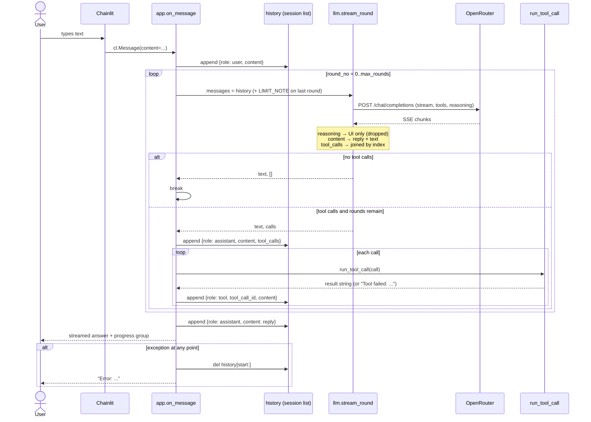

# How a Chat Message Works — What Is Inside One Message

Date: 2026-11-11 · Commit: 5197cea · Scope: the `on_message` → OpenRouter loop; the shape and lifecycle of one entry in the chat history

## 1. At a Glance

When you type a message in the ResearchChat UI, Chainlit hands your text to `on_message` as a `cl.Message`. That object is only the **envelope**: the app reads `.content` (the text) and drops everything else (app.py:62). From that point on, "a message" means a **plain Python dict** in the per-chat `history` list — not a Chainlit object.

`history` is exactly the `messages` array you see in the OpenAI Chat Completions API. It starts with one `system` message (app.py:39-41), and every user turn, assistant answer and tool result is appended to it. `stream_round` sends that list to OpenRouter unchanged (llm.py:44-46). So the question "what is inside one message?" has three answers depending on the role: a `system`/`user` message is `{role, content}`, an assistant turn may add `tool_calls`, and a tool result is `{role: "tool", tool_call_id, content}`.

The key design idea: **the conversation is the list**. There is no database and no message class — the model's memory is literally the `history` list held in `cl.user_session`, and it is re-sent in full on every round and every new user message.

| | |
|---|---|
| Entry points | `@cl.on_message` (app.py:59) — fired when the user sends text in the chat |
| Main code | [app.py:59-113](../../app.py#L59), [llm.py:32-79](../../researchchat/llm.py#L32), [settings.py:46-58](../../researchchat/settings.py#L46), [tools/__init__.py:28-49](../../researchchat/tools/__init__.py#L28) |
| Data | `cl.user_session["history"]` (a list of message dicts) and `cl.user_session["settings"]`; no persistent storage |
| External systems | OpenRouter (`https://openrouter.ai/api/v1`) via the `openai` SDK; tool providers (DuckDuckGo, web pages, dataset catalogs) |
| Tests to read first | There is **no test for the message loop**. The closest contracts are [tests/test_read_page.py](../../tests/test_read_page.py) and [tests/test_dataset_search.py](../../tests/test_dataset_search.py), which show what a tool returns |

## 2. Entry Points

| Method | URL / trigger | Auth / role | Purpose | Main handler |
|---|---|---|---|---|
| UI message | `@cl.on_message` (Chainlit websocket) | none — localhost only (app.py:18) | Take the user's text, run the model + tools, stream the reply | [app.py:59](../../app.py#L59) |
| Settings change | `@cl.on_settings_update` | none | Stores the gear-icon settings in the session | [app.py:54](../../app.py#L54) |
| Chat start | `@cl.on_chat_start` | none | Seeds `history` with the system prompt and builds the settings panel | [app.py:31](../../app.py#L31) |

There is no HTTP endpoint you call directly: Chainlit owns the transport. Internally, each `on_message` call is a loop of HTTP requests to OpenRouter (llm.py:44).

## 3. Workflow

### 3.1 Step by Step

1. **User sends text.** Chainlit calls `on_message(message: cl.Message)` (app.py:60). The hook uses `message.content` — a plain string. Attachments/elements in the UI (`cl.Message.elements`) are **not** forwarded to the model (app.py:62). 💭 Inferred: text-only chat was the original scope (initial commit `08a807e`).
2. **The user message is appended to history** (app.py:62):
   `{"role": "user", "content": "<what you typed>"}`.
   `start = len(history)` (app.py:63) remembers where this turn began, so a failure can roll it back.
3. **Build the request extras** (app.py:65-81): the selected tools (`chosen_tools`) and the reasoning options (`reasoning_body`). On the last allowed round, `tool_choice: "none"` is added and a temporary `LIMIT_NOTE` system message is appended **to the request only**, not to `history` (app.py:20-26, 77-81).
4. **Stream one model round** (llm.py:44): `client.chat.completions.create(model=MODEL, messages=messages, stream=True, **extra)`. The full `history` is sent every time.
5. **Parse each chunk** (llm.py:47-75). Three things can arrive interleaved:
   - `delta.reasoning` → streamed into a "Thinking" step in the UI **and then discarded** — it is never stored in history.
   - `delta.content` → streamed into the reply bubble and accumulated into `text`.
   - `delta.tool_calls` → fragments joined by `index` into `{id, name, arguments}` objects. Arguments arrive as a JSON **string** in pieces, which is why they are concatenated, not parsed here.
6. **If the model called no tools, stop** (app.py:83-84). The accumulated `text` is not appended yet.
7. **If it called tools**, append the assistant turn to history exactly as the API expects it back (app.py:85-98): `{role: "assistant", content: text or None, tool_calls: [...]}`. Then run each call and append one `tool` message per call (app.py:99-102):
   `{"role": "tool", "tool_call_id": "<same id>", "content": "<string result>"}`.
   Each tool runs inside a visible Chainlit step (tools/__init__.py:38-49); on failure the step shows `Failed: …` but the **string** `"Tool failed: …"` is what goes to the model.
8. **Loop** back to step 4 with the enlarged history, up to `TOOL_MAX_ROUNDS` tool rounds plus one final answer (app.py:72; default `max_rounds = 4` → `range(5)`).
9. **On any exception**, delete everything this turn added *after* `start` — including the user message and any half-finished tool turn — and show `Error: …` (app.py:103-106). This is deliberate: a half-turn (an assistant `tool_calls` without matching `tool` messages) would make the next request invalid.
10. **Finish the UI**: close the progress group with a summary, substitute a fallback if the reply is empty, send the reply, then append the final answer to history (app.py:107-113).

**Transaction boundaries:** there are none in the DB sense. The only state is the in-memory list; each `history.append` is immediate and visible to the next request. A turn is "committed" only by finishing the loop; failures roll back by slicing `history[start:]`.

**Where it can fail:** missing/invalid `OPENROUTER_API_KEY` (client construction / 401 at first call), network errors, a model that never stops calling tools (capped by `tool_choice: none`), a tool raising (turned into a `tool` message, not a crash), and malformed tool arguments (`json.JSONDecodeError` → `{}` at tools/__init__.py:31-33).

### 3.2 Diagram

A sequence diagram is the right fit: the important behavior is the back-and-forth between the app and OpenRouter, and where each dict is appended.



## 4. DTOs: What Is Inside One Message

There are two shapes worth learning: the **HTTP request body** sent to OpenRouter, and the **message dicts** inside it. The app never defines classes for these — they are raw dicts, so a typo in a key fails at request time, not at import time.

### 4.1 The request body

Example of the **second** request in a turn: the first request made the model call `web_search`, and now the search result is in history so the model can answer. (The final assistant answer does not exist yet — it is what this request is about to produce.)

```json
{
  "model": "anthropic/claude-sonnet-4.5",
  "stream": true,
  "messages": [
    {"role": "system", "content": "You are ResearchChat, a helpful and concise research assistant."},
    {"role": "user", "content": "What is the latest stable Python version?"},
    {"role": "assistant", "content": null, "tool_calls": [
      {"id": "call_abc123", "type": "function",
       "function": {"name": "web_search", "arguments": "{\"query\": \"latest stable Python version\"}"}}
    ]},
    {"role": "tool", "tool_call_id": "call_abc123",
     "content": "1. Python 3.14.0 released 2025-10-07 — https://python.org/..."}
  ],
  "tools": [
    {"type": "function", "function": {"name": "web_search", "description": "...", "parameters": {"...": "..."}}}
  ],
  "reasoning": {"effort": "medium"}
}
```

| Field | Type | Required | Where it comes from | Meaning (why it exists) |
|---|---|---|---|---|
| `model` | string | yes | `MODEL` in config.py:21 (`config.toml` or `.env` override) | Which model answers. Fixed per app run, not per message. |
| `stream` | bool | yes | hard-coded `True` (llm.py:45) | Makes the reply appear token by token instead of one blocking response. |
| `messages` | list of dicts | yes | `history`, plus `LIMIT_NOTE` on the last round | The entire conversation. See 4.2. |
| `tools` | list | only if a tool switch is on | `chosen_tools(settings)` (tools/__init__.py:23-25) | Tells the model which functions it may call. Listing a tool does not force it to call one. |
| `tool_choice` | string | only on the last round | `"none"` (app.py:80) | Forbids further calls while keeping `tools` listed; without `tools` some models get confused by a bare instruction. |
| `reasoning` | object | only if the model supports it | `reasoning_body(settings)` (settings.py:46-58) | Controls thinking effort and whether reasoning is returned. `{"enabled": false}` for "Off"; `exclude: true` hides it from the response. |

### 4.2 The four message roles

A message is **one dict in `messages`**. Its keys depend on `role`:

#### `system` — the app's standing instruction

```json
{"role": "system", "content": "You are ResearchChat, a helpful and concise research assistant."}
```

| Field | Type | Required | Comes from | Meaning |
|---|---|---|---|---|
| `role` | `"system"` | yes | literal | Marks instructions rather than conversation. |
| `content` | string | yes | `SYSTEM_PROMPT` (config.toml:9) | Sets persona and brevity. Seeded once at chat start (app.py:39-41), so it survives every turn. |

A second, temporary `system` message (`LIMIT_NOTE`, app.py:20-26) appears only on the final allowed round. It is **not** stored, so the next user message does not see "tool limit reached".

#### `user` — what the human typed

```json
{"role": "user", "content": "What is the latest stable Python version?"}
```

| Field | Type | Required | Comes from | Meaning |
|---|---|---|---|---|
| `role` | `"user"` | yes | literal | The human turn. |
| `content` | string | yes | `message.content` (app.py:62) | The question to answer. Only this field of the Chainlit message is used; no attachments, no author, no message id. |

#### `assistant` — the model's turn

Two variants exist, and the difference matters:

```json
{"role": "assistant", "content": "Python 3.14 is the latest stable release."}
```

```json
{"role": "assistant", "content": null, "tool_calls": [
  {"id": "call_abc123", "type": "function",
   "function": {"name": "web_search", "arguments": "{\"query\": \"latest stable Python version\"}"}}
]}
```

| Field | Type | Required | Comes from | Meaning |
|---|---|---|---|---|
| `role` | `"assistant"` | yes | literal | The model turn. |
| `content` | string \| null | yes (can be `null`) | `text` accumulated from `delta.content` (llm.py:59-66); `text or None` at app.py:88 | The visible answer. It is `null` when the model only emitted tool calls and no prose. The API rejects `null`/missing content inconsistently if `tool_calls` is also absent, so the app always writes the final answer back as a plain string (app.py:113). |
| `tool_calls` | list | only when calling tools | joined from stream deltas (llm.py:68-75) | The model's requests to run functions. Must be echoed back verbatim so the following `tool` messages can be matched. |
| `tool_calls[].id` | string | yes | `tc.id` from the stream | Correlates each call with its result. |
| `tool_calls[].type` | `"function"` | yes | literal (app.py:92) | Only function calls are used. |
| `tool_calls[].function.name` | string | yes | `tc.function.name`, concatenated across chunks | Which tool module to run (`_BY_NAME` lookup, tools/__init__.py:34). |
| `tool_calls[].function.arguments` | string (JSON) | yes | `tc.function.arguments`, concatenated across chunks | A **string**, not an object — exactly what the API returns. Parsed only when the tool runs (tools/__init__.py:31). Empty → `{}`. |

Note what is **deliberately missing** from the stored assistant message: the reasoning/thinking text. It is streamed to a UI step (llm.py:52-58) but never persisted, so on the next turn the model does not see its own prior chain of thought.

#### `tool` — a tool's result

```json
{"role": "tool", "tool_call_id": "call_abc123",
 "content": "1. Python 3.14.0 released 2025-10-07 — https://python.org/..."}
```

| Field | Type | Required | Comes from | Meaning |
|---|---|---|---|---|
| `role` | `"tool"` | yes | literal | Marks this as a tool result, not human input. |
| `tool_call_id` | string | yes | `c["id"]` from the assistant's call (app.py:101) | Must match a `tool_calls[].id`; the API uses it to pair request and result. |
| `content` | string | yes | return value of the tool's `run()` (tools/__init__.py:42-44) | The data the model reasons over. Always a string; structured data is serialised by the tool. On failure this is `"Tool failed: <error>"`, so the model can recover instead of the request crashing. |

The human-readable text shown in the UI (`step.output = shown`) is a **different** string, chosen for the reader; only `result` goes to the model.

#### What is *not* a message

- `progress` / `cl.Step` objects — UI only.
- `reply` (`cl.Message(content="")`) — the streaming surface; its text is copied into history once at the end (app.py:113), not while streaming.
- The `LIMIT_NOTE` dict — request-scoped.

### 4.3 The streaming response shape

The response is not one object; it is a stream of chunks, each shaped like:

```json
{"choices": [{"delta": {"content": "Python "}}]}
{"choices": [{"delta": {"reasoning": "The user wants..."}}]}
{"choices": [{"delta": {"tool_calls": [{"index": 0, "id": "call_abc", "function": {"name": "web_search", "arguments": "{\"query\":"}}]}}]}
{"choices": [{"delta": {"tool_calls": [{"index": 0, "function": {"arguments": "\"latest python\"}"}}]}}]}
```

| Field | Meaning |
|---|---|
| `choices` | Usually one choice. Empty choices are skipped (llm.py:48-49) — some providers send keep-alive chunks. |
| `delta.content` | A text fragment to append to the reply. |
| `delta.reasoning` | A thinking fragment, only on reasoning models; shown, never stored. |
| `delta.tool_calls` | Fragments of calls; `index` groups them, `id` appears once, `name`/`arguments` must be concatenated. |

Because `arguments` is assembled from fragments, a call is only valid once the stream ends — which is why joining happens in the loop and parsing happens later in `run_tool_call`.

## 5. Business Rules & Why

| Rule | Where enforced | Why | Proven by test |
|---|---|---|---|
| The system prompt is seeded once per chat and never re-added | app.py:39-41 | Resending it every turn would duplicate instructions; keeping it first gives the model stable behavior. 💭 inferred — not documented | ❌ none |
| Only `message.content` is sent, not the whole `cl.Message` | app.py:62 | The OpenAI schema accepts text; Chainlit metadata would be an unknown field. ✅ clear from the dict shape | ❌ none |
| A tool-calling assistant turn is stored with `content=None` if it said nothing | app.py:88 | The API requires the assistant turn to precede `tool` results, and `null` is the valid "no prose" value. ✅ implied by the API contract | ❌ none |
| Every tool call must be answered by exactly one `tool` message with the same id | app.py:99-102 | Otherwise the next request is invalid ("tool_calls must be followed by tool messages"). | ❌ none |
| Tool errors become text, not exceptions | tools/__init__.py:45-49 | The model can retry or work around a failure; one bad URL shouldn't kill the turn. 💭 inferred from the `"Tool failed:"` wording | ✅ behavior visible in the code path; no unit test for the wrapper |
| The turn is rolled back on error | app.py:103-106 | A half-written turn poisons every later request; slicing to `start` keeps the history API-valid. | ❌ none |
| At most `TOOL_MAX_ROUNDS` tool rounds, then `tool_choice="none"` | app.py:72-84, config.toml:18 | Prevents runaway loops and bills. Keeping tools listed avoids a model that "forgot" its tools mid-task (comment at app.py:78-79). ✅ comment | ❌ none |
| `LIMIT_NOTE` is request-scoped, not stored | app.py:81 | The limit is about this turn only; persisting it would tell the model it can never search again. 💭 inferred | ❌ none |
| Reasoning is shown but not stored | llm.py:52-58 (no append) | Saves tokens/context and matches providers that don't accept reasoning back. 💭 inferred | ❌ none |
| The final answer stored is `reply.content`, appended **after** `reply.send()` | app.py:109-113 | `reply.content` is the aggregate of all rounds, so history matches what the user actually saw rather than just the last round's `text`. 💭 inferred, subtle | ❌ none |

Ordering matters in one place: the rollback slice happens **before** the fallback/append, so an error reply is the only thing stored from a failed turn.

## 6. Data Touched

No database. The state is:

- `cl.user_session["history"]` — `list[dict]`, one entry per message, in conversation order. Read/written at app.py:61, 62, 81, 85-102, 105, 113.
- `cl.user_session["settings"]` — `dict` from the settings panel; decides `tools` and `reasoning` (app.py:65, 55-56).
- Module-level `_model_params` cache in llm.py:12 — which request parameters the model supports; fetched once per process (llm.py:15-29).

The relationship is simply ordered: `system → user → (assistant → tool*) → assistant`. No ids beyond `tool_call_id`, no timestamps, no persistence — restart the app or the chat and the history is gone.

## 7. Gotchas

**An assistant message can legitimately have `content: null`.** → It happens whenever the model calls a tool without speaking first. → Don't "fix" it by writing `""`; echo `null` when `tool_calls` is present (app.py:88 already does this).

**Thinking is displayed but thrown away.** → `reasoning` only goes to `cl.Step` (llm.py:53-58); there is no `history.append` for it. → If you add a feature that needs prior reasoning, you must store it yourself, and check whether the model accepts it back.

**The tool-limit note is not in history.** → `LIMIT_NOTE` is added to `messages` for one request only (app.py:81). → Don't look for it in `history` when debugging; also don't append it, or the next turn will believe it is still limited.

**Tool arguments are a JSON string, not a dict.** → They are concatenated from stream fragments (llm.py:75) and parsed only in `run_tool_call` (tools/__init__.py:31). → If you inspect a call, `call["arguments"]` prints as escaped text; `json.loads` it before use.

**`text` and `reply.content` are different accumulators.** → `text` is this round's output; `reply.content` accumulates across all rounds and is what gets sent and stored. → Appending `text` to history instead of `reply.content` would lose earlier prose after a tool round.

**Errors delete the user message too.** → `del history[start:]` (app.py:105) removes the user entry and any tool turn; then app.py:113 appends the error text as an assistant message. → So after a failure the history is `…, assistant: "Error: …"` with no matching user question. Deliberate, but surprising when reading transcripts.

**`range(TOOL_MAX_ROUNDS + 1)` means 5 model calls with the default 4.** → The extra iteration is the final answer round. → Off-by-one when tuning `max_rounds`.

**The whole history is re-sent every round and every turn.** → No server-side conversation state is used. → Cost and latency grow with conversation length; there is no trimming anywhere.

**Tool results are strings, and the UI text is separate.** → `run_tool_call` returns `result` for the model but sets `step.output = shown` for humans (tools/__init__.py:42-44). → Changing a tool's display text does not change what the model reads, and vice versa.

**Settings only take effect on the next message.** → `on_settings_update` just stores the dict (app.py:54-56); `on_message` reads it at line 65. → Mid-turn setting changes are ignored.

## 8. Try It Yourself

Run the read-only tests (no API key, no network):

```bash
python -m pytest -m "not docker"
```

Read `tests/test_read_page.py` first — it is the clearest example of the tool contract `run(args) -> (shown, result)` that produces a `tool` message's `content`.

Then run the app and watch the history take shape:

```bash
chainlit run app.py
```

Suggested breakpoints:

1. [app.py:62](../../app.py#L62) — inspect `history` before the user entry is appended: you should see only the system message.
2. [llm.py:44](../../researchchat/llm.py#L44) — inspect `messages` and `extra` right before the HTTP call. This is the exact request body.
3. [app.py:85](../../app.py#L85) — only hit when the model calls a tool; inspect `text` and `calls` to see the assistant turn being built.
4. [app.py:113](../../app.py#L113) — inspect the final `history`; confirm reasoning is absent and the last entry is the assistant answer.

To see a full request/response pair without the UI, you can use the OpenAI SDK with a placeholder key pattern like this (never commit a real key):

```python
# read-only illustration; requires OPENROUTER_API_KEY in the environment
import asyncio, os
from openai import AsyncOpenAI

async def main():
    c = AsyncOpenAI(base_url="https://openrouter.ai/api/v1", api_key=os.environ["OPENROUTER_API_KEY"])
    r = await c.chat.completions.create(
        model="anthropic/claude-sonnet-4.5",
        messages=[{"role": "user", "content": "Say hi in five words."}],
    )
    print(r.choices[0].message)

asyncio.run(main())
```

Expected: a `ChatCompletionMessage` with `role='assistant'`, `content='...'`, and `tool_calls=None` — the same shape the app stores as a dict.

## 9. Glossary · Check Your Understanding · Next Steps

### Glossary

- **History** — the in-memory `list[dict]` that is sent as `messages`; the app's entire conversation memory.
- **Message** — one dict in that list, identified by its `role`: `system`, `user`, `assistant`, or `tool`.
- **Role** — who produced the entry; determines which other keys are legal.
- **Tool call** — the model's structured request to run a function: an `id`, a `name`, and JSON-string `arguments`.
- **Tool result** — the `role: "tool"` message paired to a call by `tool_call_id`.
- **Round** — one streamed request/response to OpenRouter; a user turn may contain several rounds.
- **Turn** — everything triggered by one user message, from the `user` append to the final `assistant` append.
- **Reasoning / thinking** — hidden tokens some models emit; shown in a UI step, never stored.
- **SSE / streaming** — chunks arrive incrementally; `content`, `reasoning`, and `tool_calls` can interleave.
- **`extra`** — the optional request fields (`tools`, `tool_choice`, `reasoning`) merged into the SDK call.

### Check Your Understanding

<details><summary>1. What exactly is sent as `messages` on the second tool round?</summary>
The whole `history` list: system, user, the assistant message with `tool_calls`, and the `tool` result(s) — plus `LIMIT_NOTE` only if this is the final allowed round.
</details>

<details><summary>2. Where does the model's thinking text go?</summary>
Into a `cl.Step` named "Thinking" in the UI. It is never appended to `history`, so the next request does not contain it.
</details>

<details><summary>3. Why is the assistant tool-calling message stored with <code>content: null</code>?</summary>
Because the model emitted no prose, only calls. `null` is the API-valid way to say "this assistant turn had no text"; the following `tool` messages supply the content the model will read.
</details>

<details><summary>4. A tool raises a <code>ValueError</code>. What does the model receive?</summary>
The string `"Tool failed: <error>"` as a normal `tool` message. The exception does not propagate to `on_message`, so the turn continues.
</details>

<details><summary>5. Your turn fails halfway through a tool round. What does history look like afterwards?</summary>
Everything from the user message onward is removed (`del history[start:]`), then the error text is appended as an `assistant` message. So the failed user question is gone, and an assistant error answer remains.
</details>

<details><summary>6. How many model calls happen for one user message with the default settings?</summary>
At most 5: up to 4 rounds that may call tools, plus one final answer round where `tool_choice` is `none`.
</details>

### Open Questions for the Team

- ❓ Should reasoning be persisted (and sent back) for models that support it? Storing it would improve continuity but increase token cost.
- ❓ Is dropping the user message on error intentional, or should the question remain in history for a retry?
- ❓ Should `history` ever be trimmed or summarised? Nothing currently bounds its growth.
- ❓ Are attachments/elements from the UI meant to be supported later? Only `.content` is read today.
- ❓ Should tool budget reset per turn or be shared across a conversation? It is per turn now.

### Where to Go Next

- Read [researchchat/tools/__init__.py](../../researchchat/tools/__init__.py) to see how a tool definition becomes a `tools` entry and how `run_tool_call` builds the `tool` message.
- Read [researchchat/settings.py](../../researchchat/settings.py) to see how UI switches become the `reasoning` and `tools` request fields.
- Then follow the *notebook* flow (`researchchat/workspace/service.py`) — it is where a tool does something more consequential than reading text, and it uses the same message loop.
