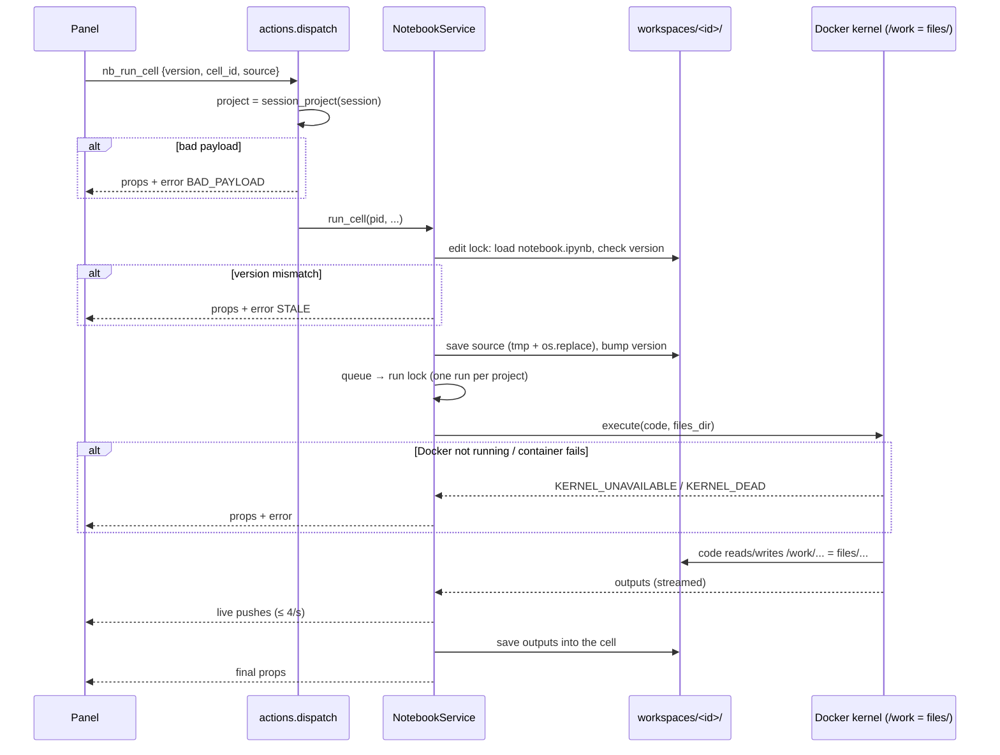

# How the Project Workspace Folder Works
Date: 2026-11-12 · Commit: 5197cea (plus uncommitted NB-3 scaffold) · Scope: the `workspaces/` folder: projects, notebooks, files, and how the Docker kernel uses them

## 1. At a Glance

`workspaces/` is where ResearchChat keeps your work on disk. Each **project** gets its own folder with a notebook (`notebook.ipynb`), a name (`project.json`) and a working-files folder (`files/`). When notebook code runs, `files/` is mounted into an isolated Docker container at `/work`. That gives you and the model a shared place to put data, and it's the only part of your computer the code can see.

Why it exists:
- ✅ **To keep work across restarts.** The chat lives in memory, the notebook is saved to disk ([store.py:1-7](../../researchchat/workspace/store.py#L1), [notebook-workspace-plan.md](../plans/done/notebook-workspace-plan.md)).
- ✅ **To keep code in a sandbox.** Only the project's `files/` folder is mounted into the container ([kernels.py:207-238](../../researchchat/workspace/kernels.py#L207)).
- ✅ **To keep projects separate.** Each one has its own notebook, files and kernel. The project always comes from the chat session ([actions.py:1-4](../../researchchat/workspace/actions.py#L1)).

| | |
|---|---|
| Entry points | chat start (`open_for_session`), panel actions `nb_*`, model tools `notebook_read` / `notebook_run` |
| Main code | [store.py](../../researchchat/workspace/store.py) (disk), [service.py](../../researchchat/workspace/service.py) (locks + panel data), [kernels.py](../../researchchat/workspace/kernels.py) (Docker), [actions.py](../../researchchat/workspace/actions.py) (panel callbacks) |
| Data | `workspaces/<id>/project.json`, `notebook.ipynb`, `files/`, `workspaces/.kernels/<id>/kernel.json` |
| External systems | Docker (one container per project), the `researchchat-kernel:1` image |
| Tests to read first | [tests/test_workspace_store.py](../../tests/test_workspace_store.py), [tests/test_workspace_service.py](../../tests/test_workspace_service.py) |

**Folder layout**

```
workspaces/                  (config.toml [notebook] workspaces_dir; in .gitignore)
  .kernels/<project>/        kernel.json: ports + secret key for the running container (app-internal)
  default/                   one folder per project; the folder name is the project id
    project.json             {"name": "Default", "created_at": "2026-11-11T03:31:02+00:00"}
    notebook.ipynb           the notebook in the right-side panel
    files/                   your data; the kernel sees it as /work
    datasets.json            (NB-3, in progress) list of downloaded datasets
    .dataset-partial/        (NB-3, in progress) unfinished downloads, hidden from the kernel
```

## 2. Entry Points

| Trigger | Who | Purpose | Handler |
|---|---|---|---|
| Chat starts | user opens the app | create `default` on first run, open the panel on the chat's project | [actions.py `open_for_session`](../../researchchat/workspace/actions.py), [store.py `ensure_default_project`](../../researchchat/workspace/store.py#L109) |
| `nb_create_project` / `nb_switch_project` / `nb_list_projects` | project bar | create a project folder / point this chat at another project | [actions.py `dispatch`](../../researchchat/workspace/actions.py) |
| `nb_add_cell`, `nb_update_cell`, `nb_run_cell`, … | panel | edit or run the notebook | `NotebookService` methods |
| `notebook_read` / `notebook_run` tools | the model | read the notebook / add and run a code cell | [tools/notebook_run.py](../../researchchat/tools/notebook_run.py) |
| first chat after app start | app | remove kernel containers left from a previous run | [app.py](../../app.py), [kernels.py `cleanup_leftovers`](../../researchchat/workspace/kernels.py#L395) |
| every 60 s | reaper task | stop kernels idle longer than `kernel_idle_minutes` | [kernels.py `_reap`](../../researchchat/workspace/kernels.py#L390) |

There is no HTTP API. The panel calls `callAction({name, payload})`, and Chainlit routes that to `cl.action_callback`.

## 3. Workflow

### 3.1 Step by Step: running a cell that reads a file

Say you put `sales.csv` into `workspaces/default/files/` and run `pd.read_csv("sales.csv")`.

1. **The panel sends `nb_run_cell`** `{version, cell_id, source}` ([actions.py `dispatch`](../../researchchat/workspace/actions.py)).
   - `read_payload` checks each field against the `FIELDS` allow-list and drops anything else. The project comes from the chat session (`session_project`), **never from the payload**, so a crafted payload can't reach another project.
2. **The source is saved first** (`run_cell`, [service.py:259](../../researchchat/workspace/service.py#L259)).
   - `_change` takes the project's **edit lock**, loads the notebook, compares `version` (`STALE` if the panel is out of date), saves, bumps the version and pushes the new state to every open panel.
   - The write goes to `notebook.ipynb.tmp` and then `os.replace`, so a crash never leaves half a file ([store.py:149](../../researchchat/workspace/store.py#L149)).
3. **The cell waits its turn** (`_run`, [service.py:272](../../researchchat/workspace/service.py#L272)).
   - It joins `_queued` and takes the **run lock**: one run per project at a time, later runs wait in order.
4. **The kernel gets the files folder** ([service.py `_run`](../../researchchat/workspace/service.py#L272) → `kernels.execute`).
   - `files_dir = project_dir(pid) / "files"` is passed to the kernel registry.
5. **The container starts on first use** ([kernels.py:207](../../researchchat/workspace/kernels.py#L207)):
   - `files/` is bind-mounted at `/work` (read-write), and `/work` is the working directory. That's why `read_csv("sales.csv")` works with a relative path.
   - `.kernels/<id>/kernel.json` is mounted read-only at `/conn`.
   - Hardening: `--user 1000`, read-only root filesystem (only `/tmp` and `/work` are writable), all capabilities dropped, memory, CPU and process limits, ports bound to `127.0.0.1` only.
   - Docker not running → `KERNEL_UNAVAILABLE`. Container failed → `KERNEL_DEAD`.
6. **Output streams live.** `on_output` collects outputs and pushes to the panels at most every 0.25 s.
7. **The result is saved** into the cell (outputs, `[n]`, status) through `_change` again. If the cell was deleted while it ran, the result is dropped.
8. **Files the code writes** (e.g. `df.to_parquet("clean.parquet")`) land in `workspaces/default/files/clean.parquet` on your disk.

### 3.2 Diagram

A sequence diagram, because a cell run crosses four layers: panel, service, disk and Docker.



## 4. DTOs (Request & Response)

**`project.json`** (on disk)
```json
{"name": "Tokyo Housing", "created_at": "2026-11-11T03:31:02+00:00"}
```
| Field | Type | Meaning |
|---|---|---|
| `name` | str, 1–80 chars | display name, any text and any language |
| `created_at` | ISO 8601 UTC | when the project was made |

The **id is not stored in the file**: it's the folder name. `slugify("Tokyo Housing!!")` gives `tokyo-housing`, which must match `^[a-z0-9][a-z0-9-]{0,39}$`. A duplicate gets `-2`, `-3`, and so on ([store.py:52-81](../../researchchat/workspace/store.py#L52)).

**`notebook.ipynb`**: a standard nbformat 4.5 notebook, plus `metadata.researchchat.version` (an int) and a per-cell `metadata.researchchat.status`. You can open it in Jupyter too.

**`nb_run_cell` payload** (panel → server)
```json
{"version": 12, "cell_id": "a1b2c3d4", "source": "import pandas as pd\npd.read_csv('sales.csv').head()"}
```
| Field | Type | Meaning |
|---|---|---|
| `version` | int (not bool) | the notebook version the panel last saw; a mismatch means STALE |
| `cell_id` | str | stable nbformat cell id |
| `source` | str ≤ 100 KB | the code as typed, saved before it runs |

`project_id` is **deliberately missing**: the project always comes from the chat session.

**`NotebookProps`** (server → panel; [service.py:83](../../researchchat/workspace/service.py#L83)): `project {id, name}`, `version`, `kernel` (off / starting / idle / busy / dead / unavailable), `running_cell_id`, `cells[]`, `error {code, message} | null`. The NB-3 scaffold adds `datasets` and `datasets_rev` to the type, but they aren't sent yet.

**Error codes** ([workspace/__init__.py](../../researchchat/workspace/__init__.py)):

| Code | When |
|---|---|
| `NOT_FOUND` | unknown project or cell; a bad project id |
| `STALE` | the panel's version is out of date |
| `BAD_NAME` | project name empty or longer than 80 characters |
| `BAD_PAYLOAD` | missing or wrongly typed action field |
| `TOO_LARGE` / `BAD_TYPE` / `NOT_CODE` | cell over 100 KB / bad cell type / ran a note |
| `KERNEL_UNAVAILABLE` / `KERNEL_DEAD` / `TIMEOUT` | Docker off / container crashed / cell over `cell_timeout_seconds` |

## 5. Business Rules & Why

| Rule | Where | Why | Test |
|---|---|---|---|
| A project folder must resolve directly under `workspaces/` | `project_dir` [store.py:60](../../researchchat/workspace/store.py#L60) | ✅ path traversal: an id like `../x` can't escape | `test_project_name_becomes_safe_slug` |
| The project comes from the session, never from a payload | [actions.py:1-4](../../researchchat/workspace/actions.py#L1) | ✅ SEC2 in the plan | `test_switch_to_missing_project_is_rejected` |
| An existing folder is never reused | `create_project` (`mkdir(exist_ok=False)`) | 💭 so a new project can't inherit an old project's files | `test_duplicate_name_gets_unique_id` |
| Notebook writes are atomic | `save_notebook` | ✅ a crash mid-write can't corrupt the notebook | `test_save_is_atomic_when_write_fails` |
| Every edit carries a version | `_change` | ✅ two panels can't overwrite each other silently | service tests |
| One run per project at a time | `_run_lock` | 💭 a kernel runs one thing at a time anyway; this keeps the order clear | service tests |
| Only `files/` is visible to code | `--mount … target=/work` | ✅ sandbox: `notebook.ipynb`, `project.json` and (NB-3) `datasets.json` are out of the code's reach | kernel tests (Docker) |
| The app only serves localhost | `check_local_host` [config.py](../../researchchat/config.py) | ✅ anyone who reaches the app can run code | `tests/test_config.py` |

## 6. Data Touched

- `project.json`: read when listing projects, written once at creation.
- `notebook.ipynb`: read and written on every edit and run, under the edit lock.
- `files/`: never read by the app itself; only by the code in the kernel.
- `.kernels/<id>/kernel.json`: written when a container starts, deleted when it stops or at startup cleanup. It holds a secret key, but it never leaves your machine.

There is no database: each folder *is* a project. Deleting a folder deletes the project, and there's no delete button yet.

## 7. Gotchas

- **The `workspaces/` folder vs. the `researchchat/workspace/` package.** One holds the data, the other the code. Names differ by one letter, so check which one you're editing.
- **Relative paths in notebook code resolve to `/work` = `files/`.** `open("../notebook.ipynb")` fails because the parent folder isn't mounted. When you add a new kind of file, decide whether code should see it: inside `files/` means it can, next to `files/` means it can't (NB-3 puts `datasets.json` outside on purpose).
- **The container filesystem is read-only except `/work` and `/tmp`.** A `pip install` or a write to home fails, by design. Add packages to `docker/kernel-requirements.txt` and rebuild the image.
- **Files written in the kernel are owned by uid 1000.** On Linux, if your user isn't uid 1000, you may not be able to edit or delete them without `sudo`.
- **`version` changes on every save, including the save that stores run results.** Panels must use the latest version they received or their next edit is `STALE`; the panel's `newer()` picks the highest version.
- **The project id is the folder name and can't be renamed.** Only `name` in `project.json` can change. Renaming the folder by hand changes the id, and open chats lose their project.
- **Tests run without Docker.** `FakeKernels` in [conftest.py](../../tests/conftest.py) stands in for the containers. The real-Docker tests are marked `docker` and skipped when Docker isn't available.

## 8. Try It Yourself

```bash
.venv/bin/python -m pytest -q tests/test_workspace_store.py
```
```bash
.venv/bin/python -m pytest -q -m "not docker" tests/test_workspace_service.py
```

Read `test_new_project_has_empty_notebook_and_files_dir` first.

Hands-on:
1. Start the app, copy any CSV into `workspaces/default/files/`, and run `import pandas as pd; pd.read_csv("yourfile.csv").head()` in the panel.
2. Run `open("out.txt", "w").write("hi")`, then look for `workspaces/default/files/out.txt`.
3. Create a project from the project bar and watch the new folder appear under `workspaces/`.

Breakpoints: `actions.dispatch` → `NotebookService._change` → `NotebookService._run` → `KernelRegistry._start_container`.

## 9. Glossary · Check Your Understanding · Next Steps

**Glossary**
- **Project**: one folder under `workspaces/`, with its own notebook, files and kernel.
- **Project id**: the folder name, a lowercase slug.
- **Kernel**: the Python process that runs cells, inside a Docker container (one per project).
- **`/work`**: how the kernel sees the project's `files/` folder.
- **Panel / props**: the right-side Notebook UI, and the JSON state (`NotebookProps`) the server sends it.
- **Version**: a counter in the notebook metadata, used to reject stale edits.

**Check your understanding**

<details><summary>1. Model code runs <code>os.remove("../notebook.ipynb")</code>. What happens?</summary>
It fails. Only <code>files/</code> is mounted, at <code>/work</code>, so the notebook isn't visible to the container.
</details>

<details><summary>2. Two browser tabs show the same project and both edit cell A. Who wins?</summary>
The first save bumps the version. The second carries the old version, gets <code>STALE</code>, and receives the latest notebook instead.
</details>

<details><summary>3. Why doesn't the <code>nb_run_cell</code> payload include <code>project_id</code>?</summary>
So a page or the model can't pick another project. The server always uses the chat session's project.
</details>

<details><summary>4. You create two projects both named "Sales". What are their folders?</summary>
<code>sales</code> and <code>sales-2</code>.
</details>

**Open questions for the team**
- ❓ Should there be a delete-project or rename-id action, or is editing the folders by hand the intended way?
- ❓ Is the uid 1000 file ownership a problem on team machines (Linux users with another uid)?

**Where to go next**
- [chat-message-explained.md](chat-message-explained.md): how a chat message reaches the model and its tools.
- [NB-3 plan](../plans/done/NB-3-dataset-download-plan.md): how datasets will be downloaded into `files/datasets/`.
- [kernels.py](../../researchchat/workspace/kernels.py): container lifecycle, idle reaping and output caps.
