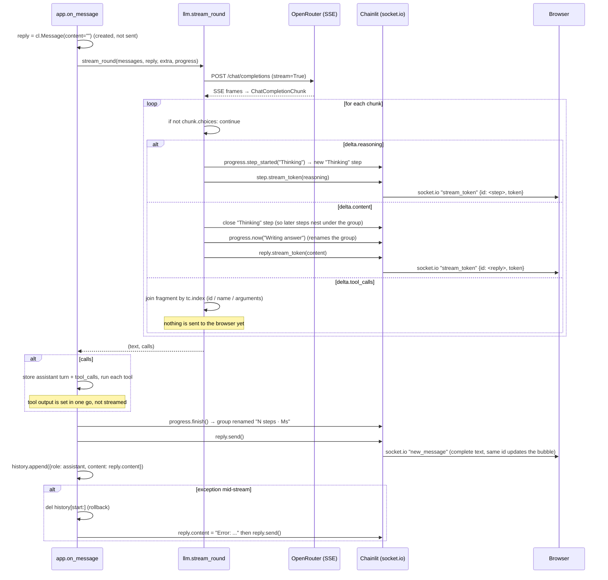

# How the Streaming Response Works

Date: 2026-11-13 · Commit: e656cdc · Scope: the path a model response takes from OpenRouter's SSE stream to the text on your screen — [researchchat/llm.py](../../researchchat/llm.py), [app.py](../../app.py), [researchchat/progress.py](../../researchchat/progress.py) and the Chainlit socket.io events underneath

> Companion documents: [agent-loop-explained.md](agent-loop-explained.md) explains the loop that calls the stream; [chat-message-explained.md](chat-message-explained.md) explains the message/role shapes. This document is about **one round**: the bytes, the chunks, the three output channels, and how they reach the browser.

## 1. At a Glance

When the app asks OpenRouter for an answer, it sets `stream=True`, so the provider does **not** send one JSON body — it sends a sequence of Server-Sent Events, each a small JSON "chunk" holding a piece of the answer, a piece of the model's thinking, or a piece of a tool call. The `openai` SDK parses those SSE frames and hands the app a `ChatCompletionChunk` object per event.

The app's job in `stream_round` ([llm.py:32-79](../../researchchat/llm.py#L32)) is to **route each chunk into one of three channels**, because a chunk can carry any of them:

| Channel | Where it goes in the UI | Stored in the history? |
|---|---|---|
| `delta.reasoning` (the model's thinking) | a collapsible "Thinking" step | ❌ no — discarded |
| `delta.content` (the answer) | the reply bubble, token by token | ✅ yes, at the end of the turn |
| `delta.tool_calls` (a function request) | nothing yet — it is *assembled* | ✅ yes, as the assistant turn |

✅ **Confirmed** by the code and the README: "streaming" in this project means *the answer appears in the chat while the model is still writing it*, and the thinking is shown in a separate step above it.

💭 *Inferred* (from the code's structure, no design doc): the three channels are handled by one loop rather than three, because the provider interleaves them freely — a chunk can carry thinking *and* content, and tool-call fragments arrive while prose is still streaming.

| | |
|---|---|
| Entry points | `stream_round(messages, reply, extra, progress)` ([llm.py:32](../../researchchat/llm.py#L32)) — called once per round from `on_message` ([app.py:105](../../app.py#L105)) |
| Main code | [researchchat/llm.py:32-79](../../researchchat/llm.py#L32) (the chunk router), [app.py:90-92, 130-136](../../app.py#L90) (the reply bubble and the finalisation), [researchchat/progress.py](../../researchchat/progress.py) (the group that holds the thinking) |
| Data | `reply.content` (the accumulated answer), `text` (this round's answer), `calls` (the assembled tool calls) — all in memory |
| External systems | OpenRouter (`https://openrouter.ai/api/v1`) over HTTP/SSE; the browser over Chainlit's socket.io channel |
| Tests to read first | There is **no test for the streaming code**. The closest is [tests/test_settings.py](../../tests/test_settings.py) (the request fields). The stream itself is only exercised by running the app. |

## 2. Entry Points

| Method | URL / trigger | Auth / role | Purpose | Main handler |
|---|---|---|---|---|
| `stream_round(...)` | called by `on_message` once per round | none | Open one streaming request, route its chunks to the UI, return `(text, calls)` | [llm.py:32-79](../../researchchat/llm.py#L32) |
| `client.chat.completions.create(stream=True)` | `POST /api/v1/chat/completions` | OpenRouter API key ([config.py:21](../../researchchat/config.py#L21)) | The upstream SSE stream | [llm.py:44-46](../../researchchat/llm.py#L44) |
| `reply.stream_token(token)` | socket.io event `stream_token` | none (localhost only) | Append one token to the reply bubble in the browser | [llm.py:66](../../researchchat/llm.py#L66) → [chainlit/message.py:177](../../.venv/lib/python3.11/site-packages/chainlit/message.py#L177) |
| `thinking.stream_token(reasoning)` | socket.io event `stream_token` (a step) | none | Append one token to the "Thinking" step | [llm.py:58](../../researchchat/llm.py#L58) → [chainlit/step.py:413](../../.venv/lib/python3.11/site-packages/chainlit/step.py#L413) |
| `reply.send()` | socket.io event `new_message` | none | Finalise the bubble with the complete text | [app.py:134](../../app.py#L134) → [chainlit/message.py:159](../../.venv/lib/python3.11/site-packages/chainlit/message.py#L159) |

There is no HTTP endpoint of your own here: the app is the *client* of OpenRouter's SSE endpoint and the *server* of Chainlit's socket.io channel.

## 3. Workflow

### 3.1 Step by Step

1. **The reply bubble is created, empty** ([app.py:91](../../app.py#L91)): `reply = cl.Message(content="")`.
   💭 *Inferred*: it is created **before** the progress group on purpose — Chainlit nests any message created while a step is open inside that step, so creating it afterwards would bury the answer inside the collapsed group.
   Note it is **not sent yet**: nothing reaches the browser until the first token arrives.
2. **The progress group is created empty** ([app.py:92](../../app.py#L92)): `progress = Progress()`. The group itself is only opened when the first step needs it ([progress.py:25-27](../../researchchat/progress.py#L25)).
3. **The request goes out** ([llm.py:44-46](../../researchchat/llm.py#L44)):
   `await client.chat.completions.create(model=MODEL, messages=messages, stream=True, **extra)`.
   The SDK returns an `AsyncStream`: an async iterator over `ChatCompletionChunk` objects, rebuilt from the provider's SSE frames ([openai/_streaming.py:140-167](../../.venv/lib/python3.11/site-packages/openai/_streaming.py#L140)). `extra` carries `tools`, `tool_choice` and the OpenRouter `reasoning` field.
4. **The chunk loop starts** ([llm.py:47](../../researchchat/llm.py#L47)): `async for chunk in stream:`.
5. **Keep-alive chunks are skipped** ([llm.py:48-49](../../researchchat/llm.py#L48)): `if not chunk.choices: continue`. Some providers send empty frames; without this guard `chunk.choices[0]` would raise `IndexError`.
6. **Thinking channel** ([llm.py:51-58](../../researchchat/llm.py#L51)):
   - `reasoning = getattr(delta, "reasoning", None)` — `reasoning` is an **OpenRouter extension**, not part of the OpenAI schema; the SDK's models allow extra fields ([openai/_models.py:148-151](../../.venv/lib/python3.11/site-packages/openai/_models.py#L148)), so `getattr` finds it. On a model without thinking, the attribute is simply absent.
   - The **first** thinking token opens the group and a "Thinking" step: `progress.step_started("Thinking")` (which opens/renames the group) and then `cl.Step(name="Thinking", type="llm")` entered manually.
   - Each token goes to `thinking.stream_token(reasoning)` → the browser shows it inside the step, and Chainlit appends it to `step.output` ([chainlit/step.py:413-430](../../.venv/lib/python3.11/site-packages/chainlit/step.py#L413)).
   - **The text is never stored in `history`** — the model does not see its own thinking on the next turn.
7. **Answer channel** ([llm.py:59-66](../../researchchat/llm.py#L59)):
   - If a "Thinking" step is open, it is **closed first** (`await thinking.__aexit__(...)`) — otherwise the next step created would be nested *inside* the Thinking step (Chainlit parents a new step to the currently open one).
   - `if not text and progress.group is not None: await progress.now("Writing answer")` — the group's title becomes "Writing answer" (only if a group already exists; a plain answer never opens one).
   - `text += delta.content` (this round's accumulator) and `await reply.stream_token(delta.content)` (the browser).
8. **Tool-call channel** ([llm.py:67-75](../../researchchat/llm.py#L67)):
   - Fragments are joined **by index**: `calls.setdefault(tc.index, {"id": "", "name": "", "arguments": ""})`.
   - `call["id"] = tc.id or call["id"]` — the id arrives once, in the first fragment.
   - `call["name"] += tc.function.name or ""` and `call["arguments"] += tc.function.arguments or ""` — both are **concatenated**, because the provider splits the JSON argument string across chunks.
   - **Nothing is shown in the UI yet**: a tool call is only known to be complete when the stream ends.
9. **The stream ends** → the `finally` block closes a still-open Thinking step ([llm.py:76-78](../../researchchat/llm.py#L76)) and `stream_round` returns `(text, calls)` — the calls sorted by index so their order is stable ([llm.py:79](../../researchchat/llm.py#L79)).
10. **Back in the loop** ([app.py:106-125](../../app.py#L106)): if there were no calls, the round is the final answer; otherwise the assistant turn is stored and the tools run (see [agent-loop-explained.md](agent-loop-explained.md)).
    Tool output is **not streamed**: a tool returns a finished string that is set on the step in one go (`step.output = shown`, [tools/__init__.py:53](../../researchchat/tools/__init__.py#L53)).
11. **The turn ends** ([app.py:130-136](../../app.py#L130)): the group is closed with a summary title ("4 steps · 12s"), an empty reply is replaced by a fallback, `reply.send()` finalises the bubble, and the answer is appended to `history`.

**Transaction boundaries:** streaming has none — the answer is written to `history` only once, at the end of the turn. If the stream fails halfway, `on_message` rolls the whole turn back ([app.py:126-129](../../app.py#L126)), so a half-written answer never reaches the history.

**Where it can fail:** no API key or an invalid one (401 at the first chunk), a provider error mid-stream (the `finally` still closes the Thinking step, then the exception propagates), an empty response (the `"(The model returned an empty response.)"` fallback), and a provider that streams `reasoning` for a model whose SDK objects do not carry the field (handled by `getattr`).

### 3.2 Diagram

A sequence diagram fits best: the interesting part is how one upstream SSE stream becomes three different things in the browser, and where the browser events are emitted.



## 4. DTOs (Request & Response)

### 4.1 The upstream request

Same body as the non-streaming case (see [chat-message-explained.md](chat-message-explained.md) §4.1), plus:

| Field | Type | Required | Comes from | Meaning |
|---|---|---|---|---|
| `stream` | bool | yes | hard-coded `True` ([llm.py:45](../../researchchat/llm.py#L45)) | Makes the provider answer with SSE frames instead of one body. |
| `extra_body.reasoning` | object | only for reasoning models | `reasoning_body(settings)` ([settings.py:46](../../researchchat/settings.py#L46)) | OpenRouter's own extension: effort level and whether thinking is returned at all. It rides in `extra_body` because it is not part of the OpenAI schema. |

The response is **not** one JSON object but a stream of frames like:

```
data: {"choices":[{"delta":{"content":"Python "}}]}

data: {"choices":[{"delta":{"reasoning":"The user wants the latest stable"}}]}

data: {"choices":[{"delta":{"tool_calls":[{"index":0,"id":"call_abc","function":{"name":"web_search","arguments":"{\"query\":"}}]}}]}

data: {"choices":[{"delta":{"tool_calls":[{"index":0,"function":{"arguments":"\"latest python\"}"}}]}}]}
```

Each frame becomes one `ChatCompletionChunk`:

| Field | Type | Meaning (why it exists) |
|---|---|---|
| `chunk.choices` | list | Usually one choice. **May be empty** on keep-alive frames — skipped at [llm.py:48](../../researchchat/llm.py#L48). |
| `choices[0].delta.content` | string \| null | The next piece of the visible answer. |
| `choices[0].delta.reasoning` | string (extra field) | The next piece of the model's thinking. OpenRouter extension; absent on models without it. |
| `choices[0].delta.tool_calls` | list | Fragments of function calls. |
| `tool_calls[].index` | int | **The grouping key**: fragments of the same call share an index. Without it you cannot tell two parallel calls apart. |
| `tool_calls[].id` | string | Present in the first fragment only; kept with `or` ([llm.py:72](../../researchchat/llm.py#L72)). |
| `tool_calls[].function.name` | string | The tool name; concatenated across fragments ([llm.py:74](../../researchchat/llm.py#L74)). |
| `tool_calls[].function.arguments` | string (JSON) | The arguments as a **JSON string, split across fragments**; concatenated ([llm.py:75](../../researchchat/llm.py#L75)). It is parsed only later, in `run_tool_call` ([tools/__init__.py:41](../../researchchat/tools/__init__.py#L41)). |

**Deliberately missing:** no usage/token accounting — the streamed response never carries `usage`, so the app cannot show token counts; no `finish_reason` handling — the app decides "the model is done" by the stream ending, not by a finish reason.

### 4.2 The browser events (Chainlit socket.io)

Each UI update is a socket.io event. These are the names the frontend listens for ([chainlit/frontend/dist/assets/index-*.js](../../.venv/lib/python3.11/site-packages/chainlit/frontend/dist/assets/index-B2u6IBgX.js)):

| Event | Emitted by | Payload | Frontend behaviour |
|---|---|---|---|
| `stream_start` | `Message.stream_token` on the first token ([chainlit/message.py:192-195](../../.venv/lib/python3.11/site-packages/chainlit/message.py#L192)); `Step.stream_token` likewise | the full step/message dict | Registers the message/step in the tree by id (the same code path as `new_message`). |
| `stream_token` | every token ([chainlit/emitter.py:433-437](../../.venv/lib/python3.11/site-packages/chainlit/emitter.py#L433)) | `{id, token, isSequence, isInput}` | **Appends** `token` to `content` (messages) or `output` (steps) of the element with that id; `isSequence: true` would *replace* it. |
| `new_message` | `Message.send()` ([app.py:134](../../app.py#L134)) | the complete message dict | If the id already exists → **update**; otherwise add. This is why the final `send()` fills the bubble instead of duplicating it. |
| `update_message` | `Step.update()` — e.g. `progress.now()` renaming the group | the step dict | Updates the step's name/output in place. |
| `ask` / `ask_timeout` | `AskActionMessage.send()` | the question + action buttons | The approval prompt in the chat. |

**The key idea:** the browser never sees the model's raw stream. It sees *tokens addressed by id* — "append this to element X". Chainlit owns that translation, and the app only decides **which element** a token belongs to.

### 4.3 The three accumulators

While one round streams, three different strings grow. They are easy to confuse:

| Accumulator | Where | What it holds | Who reads it |
|---|---|---|---|
| `reply.content` | inside Chainlit's `Message` ([chainlit/message.py:188](../../.venv/lib/python3.11/site-packages/chainlit/message.py#L188)) | **Every** content token of **every** round of the turn | the browser; and it is what is appended to `history` at the end ([app.py:136](../../app.py#L136)) |
| `text` | local to `stream_round` ([llm.py:40](../../researchchat/llm.py#L40)) | only the content tokens of **this** round | stored in the assistant tool-calling turn ([app.py:112](../../app.py#L112)) |
| `call["arguments"]` | local to `stream_round` ([llm.py:71](../../researchchat/llm.py#L71)) | the JSON arguments of one tool call, still a string | parsed in `run_tool_call` |

## 5. Business Rules & Why

| Rule | Where enforced | Why (✅/💭/❓) | Proven by test |
|---|---|---|---|
| One HTTP request per round, `stream=True` | [llm.py:44-46](../../researchchat/llm.py#L44) | The user sees the answer as it is written instead of after a long silence. ✅ README ("streams back thinking and the answer") | ❌ none |
| Chunks with no choices are skipped | [llm.py:48-49](../../researchchat/llm.py#L48) | Providers send keep-alive frames; without the guard the loop would crash on `choices[0]`. 💭 inferred | ❌ none |
| Thinking is shown but never stored | [llm.py:52-58](../../researchchat/llm.py#L52) (no append to `history`) | Saves context and tokens; not every provider accepts reasoning back. 💭 inferred | ❌ none |
| The Thinking step is closed before any other step is created | [llm.py:61-62](../../researchchat/llm.py#L61) | Chainlit parents a new step to the **currently open** one, so an open Thinking step would swallow the tool steps. ✅ Chainlit's `local_steps` stack ([chainlit/step.py:459-470](../../.venv/lib/python3.11/site-packages/chainlit/step.py#L459)) | ❌ none |
| Tool-call fragments are joined by `index` | [llm.py:69-71](../../researchchat/llm.py#L69) | The provider sends no other correlation key for parallel calls; `id` arrives only in the first fragment. ✅ API shape | ❌ none |
| Tool arguments are concatenated, never parsed during streaming | [llm.py:75](../../researchchat/llm.py#L75) | The JSON is incomplete until the stream ends. ✅ obvious from the format | ❌ none |
| The answer is written to `history` only once, at the end of the turn | [app.py:136](../../app.py#L136) | A half-streamed turn must not become part of the memory. 💭 inferred | ❌ none |
| The reply bubble is created before the progress group | [app.py:90-92](../../app.py#L90) | Chainlit nests a message created while a step is open inside that step. ✅ Chainlit behaviour ([chainlit/message.py:53-56](../../.venv/lib/python3.11/site-packages/chainlit/message.py#L53)) | ❌ none |
| Tool output is not streamed | [tools/__init__.py:53](../../researchchat/tools/__init__.py#L53) | Tools return a finished value; there is nothing to stream token by token. 💭 inferred | ❌ none |
| A plain answer opens no progress group | [llm.py:63](../../researchchat/llm.py#L63) (`progress.group is not None`) | A collapsible group for a one-line answer is noise. 💭 inferred | ❌ none |

Ordering matters: the "Writing answer" rename happens only on the **first** content token of a round (`not text`), and it happens **after** the Thinking step is closed.

## 6. Data Touched

No database. The streaming path touches:

| Data | Where | Shape | Notes |
|---|---|---|---|
| `reply.content` | `cl.Message` object | `str` | Grows with every content token; the source of truth for the final answer. |
| `text` | local variable in `stream_round` | `str` | Reset per round. |
| `calls` | local variable in `stream_round` | `dict[int, dict]` | Keyed by tool-call index; returned sorted by index. |
| `thinking.output` | the "Thinking" step | `str` | Grows with reasoning tokens; never copied into `history`. |
| `history` | `cl.user_session["history"]` | `list[dict]` | Written twice per turn at most (the assistant tool turn, the final answer). |

Nothing here is persisted: the streamed answer lives in the DOM of one browser tab and in the in-memory session list.

## 7. Gotchas

**The "Thinking" text is on your screen but gone from the model's memory.** → It is streamed into a step and never appended to `history` ([llm.py:52-58](../../researchchat/llm.py#L52)). → If you add a feature that needs prior reasoning, you must store it yourself.

**The answer bubble can contain the prose of *several* rounds, and the history duplicates it.** → `reply` is one message object streamed in every round, so `reply.content` is the concatenation of all rounds' prose ([llm.py:66](../../researchchat/llm.py#L66)). → The final stored assistant message is `reply.content` ([app.py:136](../../app.py#L136)), while the earlier prose was *already* stored once as the tool-calling turn's `content` ([app.py:112](../../app.py#L112)). If the model said "Let me search for that." before calling a tool, that sentence appears **twice** in the history. 💭 *Inferred* from the code; worth confirming with a real transcript.

**`text` and `reply.content` are not the same string.** → `text` is one round; `reply.content` is the whole turn. → Storing `text` instead of `reply.content` would lose the pre-tool prose in the final answer.

**A tool call is only valid after the stream ends.** → The `arguments` string is incomplete until then ([llm.py:75](../../researchchat/llm.py#L75)). → Never try to execute a call "as soon as you see the name".

**The tool name is concatenated, so a provider that repeats it breaks the lookup.** → `call["name"] += tc.function.name or ""` ([llm.py:74](../../researchchat/llm.py#L74)). → Most providers send the name once; one that repeats it yields `web_searchweb_search` → "Bad tool call" in the step ([tools/__init__.py:51](../../researchchat/tools/__init__.py#L51)).

**The reply bubble only appears when the first content token arrives.** → `reply` is never sent up-front; `stream_start` is emitted by the first `stream_token` ([chainlit/message.py:192-195](../../.venv/lib/python3.11/site-packages/chainlit/message.py#L192)). → On a slow model the user sees the group ("Thinking") before any answer text.

**A reasoning-only model produces an empty bubble.** → If the model streams thinking but no content, the fallback `"(The model returned an empty response.)"` is what the user sees ([app.py:132-133](../../app.py#L132)). → Note the thinking is *not* copied into the answer.

**The group title changes several times during a turn.** → "Thinking" → "Web search: …" → "Writing answer" → "4 steps · 12s" ([progress.py:19-44](../../researchchat/progress.py#L19)). → Each rename is a separate socket.io `update_message`; the title is not a log, only the current state.

**The final `reply.send()` re-sends the whole message.** → It emits `new_message` with the complete content; the frontend updates the existing bubble because the id already exists. → Don't read the duplicate event as a bug.

**Tool output appears all at once.** → `step.output = shown` is one update after the tool finished ([tools/__init__.py:53](../../researchchat/tools/__init__.py#L53)). → A long-running tool looks frozen; the group title is what shows progress.

**The stream is per round, not per turn.** → A turn with four tool rounds opens **four** HTTP streams and streams into **one** bubble. → The bubble is not reset between rounds.

**Errors mid-stream lose the whole turn, not just the answer.** → The `finally` in `stream_round` closes the Thinking step ([llm.py:76-78](../../researchchat/llm.py#L76)), then `on_message` rolls the history back ([app.py:128](../../app.py#L128)). → The partially typed text stays on screen but never enters the history.

## 8. Try It Yourself

There is no unit test for the streaming code, so exercise it by running the app:

```bash
chainlit run app.py
```

Ask something that makes the model think *and* answer, e.g. *"What is the latest stable Python version?"* with the "Web search" switch on. Watch for: the "Thinking" step appearing, the answer streaming in, and the group title changing.

To see the raw upstream stream without the UI (read-only; needs `OPENROUTER_API_KEY` in the environment — never commit a real key):

```python
import asyncio, os
from openai import AsyncOpenAI

async def main():
    c = AsyncOpenAI(base_url="https://openrouter.ai/api/v1", api_key=os.environ["OPENROUTER_API_KEY"])
    stream = await c.chat.completions.create(
        model="anthropic/claude-sonnet-4.5",
        messages=[{"role": "user", "content": "Say hi in five words."}],
        stream=True,
    )
    async for chunk in stream:
        if not chunk.choices:
            continue
        delta = chunk.choices[0].delta
        print(repr(delta.content), getattr(delta, "reasoning", None), delta.tool_calls)

asyncio.run(main())
```

Expected: one line per chunk, `content` pieces of a few characters each. That is exactly what `stream_round` iterates over.

Suggested breakpoints:

1. [llm.py:47](../../researchchat/llm.py#L47) — the chunk loop: inspect `chunk.choices[0].delta` for each frame.
2. [llm.py:59-66](../../researchchat/llm.py#L59) — the content channel: watch `text` grow while `reply.content` grows in parallel.
3. [llm.py:67-75](../../researchchat/llm.py#L67) — the tool-call channel: watch `call["arguments"]` fill up as fragments arrive.
4. [chainlit/message.py:177](../../.venv/lib/python3.11/site-packages/chainlit/message.py#L177) — the Chainlit side: the first call emits `stream_start`, every later one emits `stream_token`.

## 9. Glossary · Check Your Understanding · Next Steps

### Glossary

- **SSE (Server-Sent Events)** — a text protocol where the server sends a stream of `data:` frames; OpenRouter uses it for streaming answers.
- **Chunk** — one parsed SSE frame, a `ChatCompletionChunk` with a `delta` (the increment).
- **Delta** — the *difference* the chunk adds: some text, some reasoning, or part of a tool call.
- **Channel** — one of the three destinations a chunk can go to: reasoning step, reply bubble, or tool-call assembler.
- **Round** — one streamed request/response; a turn can contain several.
- **Reply bubble** — the Chainlit `Message` the answer streams into (`reply`).
- **Step** — a collapsible element in the chat; the "Thinking" step and each tool step are steps.
- **`stream_start` / `stream_token`** — the socket.io events that create an element and append tokens to it.
- **`tool_calls[].index`** — the fragment-grouping key for a function call.

### Check Your Understanding

<details><summary>1. Where does the model's thinking text end up, and where does it <em>not</em> end up?</summary>
Into the "Thinking" step in the chat (and into `step.output`). It never reaches `history`, so the next request does not contain it.
</details>

<details><summary>2. A tool call's arguments arrive as <code>{"query</code> and then <code>": "python"}</code>. When can the tool be run?</summary>
Only after the stream ends and the fragments have been concatenated into a JSON string — then `run_tool_call` parses it.
</details>

<details><summary>3. The model says "Let me check." and then calls a tool, then answers. What does the history contain?</summary>
The assistant turn with `content: "Let me check."` plus its `tool_calls`, the tool result, and finally an assistant turn whose content is `reply.content` — which is "Let me check." **plus** the final answer. The sentence appears twice in the history.
</details>

<details><summary>4. Why is the "Thinking" step closed before the answer starts streaming?</summary>
Chainlit nests a new step under the currently open one; leaving the Thinking step open would put the answer's siblings (tool steps) inside it.
</details>

<details><summary>5. The user sees nothing for ten seconds, then a "Thinking" step appears, then the answer. Why is there no bubble at first?</summary>
The reply is not sent up front. The bubble is created by the first content token (`stream_start`), so until the model produces answer text there is only the group and its steps.
</details>

<details><summary>6. The stream fails halfway. What happens to the typed text and to the history?</summary>
The typed text stays on screen (the browser already has it) but the turn is rolled back: `del history[start:]` and the reply becomes `Error: …`. The partial answer never enters the history.
</details>

### Open Questions for the Team

- ❓ Is the duplicated prose in the history (round 1's text repeated inside the final `reply.content`) intended? It is visible to the model on the next turn.
- ❓ Should `usage`/token counts be captured? The streamed response does not carry them.
- ❓ Should the "Thinking" step be collapsible by default, or shown expanded when the model is reasoning a lot?
- ❓ Should a tool's output be streamed in chunks when it is long (e.g. a long page read), or is one-shot output acceptable?
- ❓ Should the round budget be communicated to the model *during* the round, so it plans its searches?

### Where to Go Next

- [agent-loop-explained.md](agent-loop-explained.md) — the loop that surrounds this stream: budget, tool dispatch, rollback.
- [chat-message-explained.md](chat-message-explained.md) — the `messages` array and the role shapes.
- [researchchat/progress.py](../../researchchat/progress.py) — the collapsible group and its nested steps.
- [researchchat/settings.py](../../researchchat/settings.py) — how the "Thinking effort" switch becomes the `reasoning` request field.
