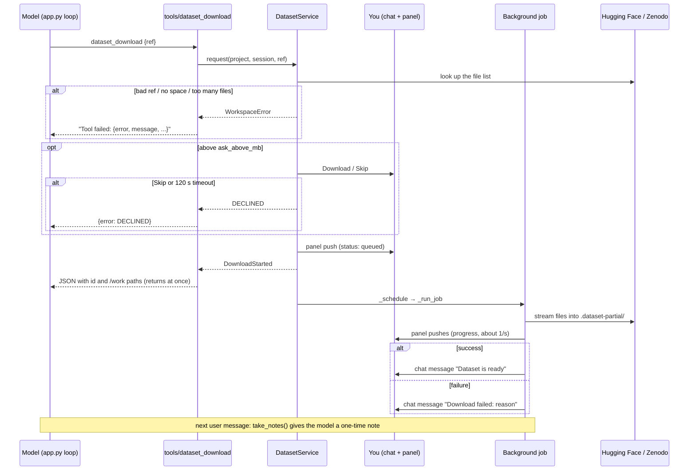

# How the App Uses the `researchchat/workspace/` Package
Date: 2026-11-12 · Commit: e7c0bfb (plus uncommitted changes on `feat/NB-3-dataset-download`) · Scope: the `researchchat/workspace/` code package and the three places the app calls it: `app.py`, the Notebook panel, and the model's tools

> This report is about the **code package**. For the **data folder** `workspaces/` (project folders, the notebook file, how a cell run reaches Docker) see [project-workspace-explained.md](project-workspace-explained.md).

## 1. At a Glance

`researchchat/workspace/` is the back end of the right-side **Notebook panel**. It owns everything about a **project**: its notebook, its Docker **kernel** (the Python process that runs cells) and its downloaded datasets. The rest of the app never touches notebooks or datasets directly. It goes through two objects built once in [actions.py](../../researchchat/workspace/actions.py): `service` (notebooks) and `datasets` (downloads).

Who uses it:
- **You**, through the Notebook panel (edit cells, run them, switch projects, delete a dataset).
- **The model**, through five tools (`notebook_read`, `notebook_run`, `dataset_download`, `dataset_list`, `dataset_delete`).
- **The app itself**, at chat start, chat end and on every message.

Why it exists: ✅ to give each project one notebook, one Docker kernel and one files folder ([\_\_init\_\_.py:1](../../researchchat/workspace/__init__.py#L1), [notebook-workspace-plan.md](../plans/notebook-workspace-plan.md)).

| | |
|---|---|
| Entry points | `app.py` hooks, panel actions (`nb_*`, `ds_*`), model tools in `researchchat/tools/` |
| Main code | [actions.py](../../researchchat/workspace/actions.py) (wiring + panel actions), [service.py](../../researchchat/workspace/service.py) (notebooks), [dataset_service.py](../../researchchat/workspace/dataset_service.py) (downloads), [panel.py](../../researchchat/workspace/panel.py) (live updates) |
| Data | `workspaces/<project>/notebook.ipynb`, `project.json`, `datasets.json`, `files/` |
| External systems | Docker (kernels), Hugging Face and Zenodo (dataset files) |
| Tests to read first | [tests/test_workspace_service.py](../../tests/test_workspace_service.py), [tests/test_notebook_tools.py](../../tests/test_notebook_tools.py), [tests/test_dataset_tools.py](../../tests/test_dataset_tools.py) |

### Module map

| File | Job | Called by |
|---|---|---|
| [\_\_init\_\_.py](../../researchchat/workspace/__init__.py) | `ErrorCode` and `WorkspaceError`, shared by every module | everything |
| [actions.py](../../researchchat/workspace/actions.py) | Builds the shared objects, registers the panel actions, tracks open chats | `app.py`, the tools |
| [service.py](../../researchchat/workspace/service.py) | `NotebookService`: edits and runs cells under locks, builds the panel's data (`NotebookProps`) | `actions.py`, notebook tools |
| [store.py](../../researchchat/workspace/store.py) | Reads and writes projects and `notebook.ipynb` on disk | `service.py`, `actions.py` |
| [kernels.py](../../researchchat/workspace/kernels.py) | `KernelRegistry`: one Docker container per project | `service.py`, `app.py` (cleanup) |
| [panel.py](../../researchchat/workspace/panel.py) | `PanelRegistry`: opens the sidebar panel and pushes new data to every open one | `actions.py` |
| [risk.py](../../researchchat/workspace/risk.py) | Flags risky code before the model's code runs | `tools/notebook_run.py` |
| [dataset_service.py](../../researchchat/workspace/dataset_service.py) | `DatasetService`: checks, queues and runs background downloads | `actions.py`, dataset tools, `app.py` |
| [dataset_sources.py](../../researchchat/workspace/dataset_sources.py) | Turns a ref like `hf:org/name` into a list of files, and streams them safely | `dataset_service.py` |
| [datasets_store.py](../../researchchat/workspace/datasets_store.py) | Reads and writes `datasets.json` and the dataset folders | `dataset_service.py` |

**The key design idea:** `actions.py` is the only file that knows about both Chainlit and the services. It creates the objects at import time and passes them into each other ([actions.py:29-80](../../researchchat/workspace/actions.py#L29)):

```python
kernels = KernelRegistry()
panels = PanelRegistry()
service = NotebookService(kernels, notify=panels.push)
chats = ChatRegistry()
datasets = DatasetService(..., root=service.root, props=service.props, notify=panels.push, send=chats.send)
service.datasets = datasets.panel_state
```

So `NotebookService` and `DatasetService` never import Chainlit. They get "push to the panels" and "send a chat message" as plain functions. That's why the tests can run them with fakes.

## 2. Entry Points

There is no HTTP API of your own. Everything goes through Chainlit.

### 2.1 `app.py` lifecycle hooks

`app.py` imports the package as `notebook` ([app.py:20](../../app.py#L20)). That import also registers the panel actions (see 2.2).

| Hook | Call | Purpose |
|---|---|---|
| first `on_chat_start` after the app starts | `notebook.kernels.cleanup_leftovers()` ([app.py:53](../../app.py#L53)) | remove kernel containers left by an earlier run |
| same | `notebook.datasets.startup_cleanup()` ([app.py:55](../../app.py#L55)) | mark downloads cut off by an earlier run as failed |
| every `on_chat_start` | `notebook.open_for_session()` ([app.py:63](../../app.py#L63)) | pick this chat's project, open the panel, register the chat |
| `on_chat_end` | `notebook.close_for_session()` ([app.py:69](../../app.py#L69)) | forget this chat's panel, chat and pending notes |
| every `on_message` | `notebook.datasets.take_notes(session_id)` ([app.py:88](../../app.py#L88)) | tell the model, once, which downloads finished since the last turn |

### 2.2 Panel actions (you → server)

The panel ([Notebook.jsx](../../public/elements/Notebook.jsx)) calls `callAction({name, payload})` ([Notebook.jsx:282](../../public/elements/Notebook.jsx#L282)). Chainlit routes that to one shared callback, registered for every name in `FIELDS` ([actions.py:229-230](../../researchchat/workspace/actions.py#L229)).

| Action | Payload | Handler |
|---|---|---|
| `nb_add_cell` | `version`, `after_id`?, `type`? | `service.add_cell` |
| `nb_update_cell` | `version`, `cell_id`, `source` | `service.update_cell` |
| `nb_delete_cell`, `nb_duplicate_cell`, `nb_clear_cell_outputs` | `version`, `cell_id` | same-named `service` method |
| `nb_move_cell` | `version`, `cell_id`, `direction` | `service.move_cell` |
| `nb_reorder_cell` | `version`, `cell_id`, `before_id`? | `service.reorder_cell` |
| `nb_run_cell` | `version`, `cell_id`, `source` | `service.run_cell` |
| `nb_run_all`, `nb_clear_outputs` | `version` | `service.run_all`, `service.clear_outputs` |
| `nb_interrupt`, `nb_restart` | `version` | `service.interrupt`, `service.restart` |
| `nb_list_projects` | none | `service.list_projects` |
| `nb_switch_project` | `project_id` | `switch_project` |
| `nb_create_project` | `name` | `create_and_switch` |
| `ds_delete`, `ds_cancel` | `dataset_id` | `datasets.delete`, `datasets.cancel` |

The full list is `FIELDS` in [actions.py:85-103](../../researchchat/workspace/actions.py#L85); the routing is `dispatch` ([actions.py:149](../../researchchat/workspace/actions.py#L149)).

### 2.3 Model tools (model → server)

`app.py` asks `chosen_tools(settings)` which tools the model gets, and runs each call with `run_tool_call` ([app.py:85](../../app.py#L85), [app.py:124](../../app.py#L124)). The five workspace tools sit behind the **Notebook** switch in the settings panel ([tools/\_\_init\_\_.py:26](../../researchchat/tools/__init__.py#L26)).

| Tool | Calls | Asks you first? |
|---|---|---|
| `notebook_read` | `service.read_for_model` | no, it's read-only |
| `notebook_run` | `risk.check`, then `service.run_for_model` | yes, when the code looks risky (Run / Skip) |
| `dataset_download` | `datasets.request` | yes, above `ask_above_mb` (Download / Skip) |
| `dataset_list` | `datasets.list_for_model` | no |
| `dataset_delete` | `datasets.describe`, then `datasets.delete` | always (Delete / Keep) |

Each tool finds the shared objects the same way ([notebook_run.py:68-72](../../researchchat/tools/notebook_run.py#L68)):

```python
from researchchat.workspace import actions
svc = svc or actions.service
project_id = project_id or actions.session_project(cl.user_session)
```

## 3. Workflow

### 3.1 Step by Step

**A. A chat opens**

1. Chainlit calls `on_chat_start` ([app.py:46](../../app.py#L46)).
2. On the first chat only, two cleanup tasks start in the background: old kernel containers and interrupted downloads.
3. `open_for_session` ([actions.py:233](../../researchchat/workspace/actions.py#L233)) runs:
   - `session_project` reads `project_id` from the chat session. If it's empty, it creates the `default` project and stores its id ([actions.py:107](../../researchchat/workspace/actions.py#L107)).
   - `service.props(pid)` loads the notebook and builds `NotebookProps`.
   - `panels.open` shows a `Notebook` custom element in the sidebar and remembers "this chat shows this project" ([panel.py:50](../../researchchat/workspace/panel.py#L50)).
   - `chats.register` remembers the session, so a background download can message this chat later.

**B. You edit a cell in the panel**

1. The panel waits 600 ms after you stop typing, then calls `nb_update_cell` ([Notebook.jsx:1080](../../public/elements/Notebook.jsx#L1080)).
2. `_callback` ([actions.py:219](../../researchchat/workspace/actions.py#L219)) marks your chat as "skip", so the result isn't also pushed back to you.
3. `handle` → `dispatch` → `read_payload` checks the fields against `FIELDS`. A wrong type gives `BAD_PAYLOAD`.
4. `service.update_cell` → `_change` ([service.py:230](../../researchchat/workspace/service.py#L230)): take the edit lock, load, compare versions, apply, bump the version, save, push to the other panels.
5. The new `NotebookProps` goes back as the action's reply. A rejected action returns the latest props with `error` set, so the panel always has fresh data.

**C. The model downloads a dataset** (the flow that uses the most of the package)

1. The model calls `dataset_download` with `{"ref": "hf:org/name"}`. `run_tool_call` runs the tool inside a visible chat step ([tools/\_\_init\_\_.py:38](../../researchchat/tools/__init__.py#L38)).
2. `read_args` checks `ref`, `files` and `update`. Unknown keys are dropped, so the model can't send `{"approved": true}` to skip the prompt ([dataset_download.py:62](../../researchchat/tools/dataset_download.py#L62)).
3. `datasets.request` ([dataset_service.py:278](../../researchchat/workspace/dataset_service.py#L278)):
   - waits for the startup cleanup to finish,
   - checks that the project exists (`NOT_FOUND`),
   - parses the ref (`BAD_REF`, `UNSUPPORTED_SOURCE`),
   - under the project lock, works out which files are still needed and checks the disk (`NO_FILES`, `TOO_MANY_FILES`, `NO_SPACE`).
4. If the download is large, the lock is released and you see **Download / Skip** in the chat. Skip or no answer in 120 s gives `DECLINED`. After Download, everything is checked again.
5. `_enqueue` ([dataset_service.py:393](../../researchchat/workspace/dataset_service.py#L393)) sets the record to `queued`, saves `datasets.json`, pushes the panel, and **returns at once**. The model gets the dataset id and the `/work/datasets/<id>/` paths.
6. `_schedule` starts the job when a slot is free (`parallel_downloads`), in a fresh context so it doesn't carry the chat's Chainlit context ([dataset_service.py:532](../../researchchat/workspace/dataset_service.py#L532)).
7. `_run_job` streams each file into `.dataset-partial/` (hidden from the kernel), then moves it into `files/datasets/<id>/`. Progress is pushed to the panel about once a second.
8. `_finish_ready` or `_finish_failed` updates the record, pushes the panel and calls `_tell`:
   - `chats.send` posts "Dataset **X** is ready…" in the chat that started it,
   - if that worked, a one-line note is stored for that chat.
9. On your next message, `take_notes` hands that note to the model as a system message for that turn only. It is never added to `history` ([app.py:86-89](../../app.py#L86)).

Side effects: writes to `datasets.json` and `files/datasets/`, HTTPS calls to Hugging Face or Zenodo, panel pushes, one chat message.

### 3.2 Diagram

A sequence diagram, because the download crosses the model, a tool, the service, a background job and the panel.



## 4. DTOs (Request & Response)

**`NotebookProps`** (server → panel, [service.py:90](../../researchchat/workspace/service.py#L90)). Every push and every action reply has this shape, with two exceptions: `nb_list_projects` returns `{projects, current}`, and `handle` falls back to a bare `{error}` when it can't load the project.

```json
{
  "project": {"id": "tokyo-housing", "name": "Tokyo Housing"},
  "version": 12,
  "kernel": "idle",
  "running_cell_id": null,
  "cells": [{"id": "a1b2c3d4", "type": "code", "source": "1 + 1", "execution_count": 3, "status": "done",
             "outputs": [{"kind": "result", "text": "2", "image": ""}]}],
  "error": null,
  "datasets": [{"id": "hf-org--name", "name": "org/name", "source": "huggingface", "status": "downloading",
                "done_bytes": 52000000, "size_bytes": 143800000, "file_count": 1, "path": "/work/datasets/hf-org--name"}],
  "datasets_rev": 7
}
```

The dataset entry is shortened; the full field list is `DatasetProps` at [service.py:70](../../researchchat/workspace/service.py#L70).

| Field | Type | Comes from | Meaning |
|---|---|---|---|
| `project` | `{id, name}` | `project.json` + folder name | which project the panel shows |
| `version` | int | `notebook.ipynb` metadata | sent back with every edit; a mismatch is `STALE` |
| `kernel` | off / starting / idle / busy / dead / unavailable | `kernels.status` | the status dot; enables Stop and Restart |
| `running_cell_id` | str or null | `service._running` | which cell shows the spinner |
| `cells[]` | list | the notebook | id, type, source, `[n]`, status and outputs |
| `error` | `{code, message}` or null | the rejected action | the red banner |
| `datasets[]` | list of `DatasetProps` | `datasets.panel_state` | the cards in the Datasets tab |
| `datasets_rev` | int | `DatasetService.rev` | lets the panel keep the newest dataset list |

**Action payloads** are in the table in 2.2. `project_id` is **deliberately missing** from every action except `nb_switch_project`: the project always comes from the chat session, so a crafted payload can't reach another project.

**`dataset_download` arguments** (model → tool)

```json
{"ref": "zenodo:7395559", "files": ["*.csv"], "update": false}
```

| Field | Type | Required | Validation | Meaning |
|---|---|---|---|---|
| `ref` | str | yes | non-empty; `hf:owner/name`, `zenodo:<number>`, or an `https` dataset page on huggingface.co or zenodo.org ([dataset_sources.py:70](../../researchchat/workspace/dataset_sources.py#L70)) | which dataset, taken from `dataset_search` |
| `files` | list of str | no | 1–20 items, each ≤ 200 chars, no `..`, no leading `/` | only fetch these names or patterns |
| `update` | bool | no | must be true or false | fetch the newest version of a dataset you already have |

**Errors.** Panel actions return `NotebookProps` with `error` set. Tools turn a `WorkspaceError` into JSON for the model: `{"error": code, "message": …, …details}` ([dataset_download.py:115](../../researchchat/tools/dataset_download.py#L115)). The codes are listed in [\_\_init\_\_.py:7-29](../../researchchat/workspace/__init__.py#L7).

## 5. Business Rules & Why

| Rule | Where enforced | Why | Proven by test |
|---|---|---|---|
| The project comes from the chat session, never from the payload | `session_project`, `dispatch` | ✅ SEC2 in the plan ([actions.py:3](../../researchchat/workspace/actions.py#L3)) | `test_payload_project_id_is_ignored` |
| Unknown payload fields are dropped; `True` isn't accepted as a version | `read_payload` | ✅ comment at [actions.py:128](../../researchchat/workspace/actions.py#L128) | `tests/test_dataset_service.py` (G9❌1, line 850) |
| Every edit carries a version | `_change` | ✅ two panels can't overwrite each other silently | `test_concurrent_edits_one_wins_one_stale` |
| Risky model code needs a click | `risk.check` + `ask_approval` | ✅ "a speed bump, not a wall": Docker is the real protection ([risk.py:1-5](../../researchchat/workspace/risk.py#L1)) | `test_risky_code_skip_runs_nothing` |
| The model can't approve its own download | `read_args` ignores unknown keys | ✅ A19 in the tool docstring | `test_model_cannot_skip_approval_with_arguments` |
| A model delete always asks | `dataset_delete.run` | ✅ AC26 | `test_model_delete_declined_keeps_dataset` |
| A download returns before it ends | `_enqueue` | ✅ AC1/AC2: the chat isn't blocked by a big file | `test_download_tool_returns_before_download_ends` |
| Dataset tools need the Notebook switch | `chosen_tools` | ✅ datasets land in the project's files, so they share the switch | `test_dataset_tools_are_behind_notebook_switch` |
| The app only serves localhost | `check_local_host` ([app.py:23](../../app.py#L23)) | ✅ anyone who reaches the app can run code | `test_startup_refuses_non_local_host` |

## 6. Data Touched

- `workspaces/<id>/notebook.ipynb`: read and written by `store.py`, only through `NotebookService`.
- `workspaces/<id>/project.json`: written once when a project is created.
- `workspaces/<id>/datasets.json`: read and written by `datasets_store.py`, only through `DatasetService`. It sits next to `files/`, not in it, so notebook code can't edit it.
- `workspaces/<id>/files/datasets/<dataset>/`: finished files. The kernel sees them at `/work/datasets/<dataset>/`.
- `workspaces/<id>/.dataset-partial/`: files still downloading, hidden from the kernel.
- In memory only: which chat shows which project (`PanelRegistry`), open chats (`ChatRegistry`), the download queue and pending notes (`DatasetService`). A restart loses these.

There is no database. The folder layout is explained in [project-workspace-explained.md](project-workspace-explained.md).

## 7. Gotchas

- **Importing `actions.py` has side effects → it builds the shared objects and registers every panel action at import time → keep that in mind before importing it from a new module.** The tools import it inside `run()`; 💭 inferred reason: so a tool can be loaded and tested with its own `svc` without pulling in the app's objects.
- **The cleanups run on the first chat, not when the app starts → there is no app-start hook in use → a download requested right away waits for `startup_cleanup`** (up to 60 s, `READY_WAIT_SECONDS`).
- **An edit is not pushed back to the chat that made it → Chainlit recompiles the custom element on every props change, which would lose your cursor while typing ([panel.py:24-27](../../researchchat/workspace/panel.py#L24)) → new edit actions must be added to `EDIT_ACTIONS`**, and their reply must carry the full props.
- **The panel remounts on every push → so `Notebook.jsx` keeps its state on `window.__rcNotebook`, not in React state ([Notebook.jsx:16-19](../../public/elements/Notebook.jsx#L16)) → put anything that must survive a push in `S`.**
- **Adding a panel action needs three edits → `FIELDS`, `dispatch`, and a `call("…")` in `Notebook.jsx` → an action missing from `FIELDS` is never registered with Chainlit, so the panel's call does nothing useful.**
- **`handle` can return the code `INTERNAL` → it's a plain string, not in `ErrorCode` ([actions.py:203](../../researchchat/workspace/actions.py#L203)) → don't assume every code the panel sees is listed in `ErrorCode`.**
- **A finished-download note is stored only if the chat message was sent → a closed chat gets neither ([dataset_service.py:669](../../researchchat/workspace/dataset_service.py#L669)) → the panel and `dataset_list` are the reliable source of status.**
- **`service.datasets` is set after `NotebookService` is built → the two services need each other, so one link is added afterwards ([actions.py:80](../../researchchat/workspace/actions.py#L80)) → a `NotebookService` built without it (as in tests) sends an empty dataset list.**
- **Don't run a second server from this folder to try things out → Chainlit deletes `.files/` when a server stops, which breaks the one you're using ([app.py:36-43](../../app.py#L36)).**

## 8. Try It Yourself

```bash
.venv/bin/python -m pytest -q -m "not docker" tests/test_workspace_service.py tests/test_notebook_tools.py tests/test_dataset_tools.py
```

Read `test_payload_project_id_is_ignored` and `test_download_tool_returns_before_download_ends` first.

Hands-on, in the app you already have running:
1. Open two browser tabs. Add a cell in one and watch it appear in the other (the push).
2. Turn on the Notebook switch and ask the model to "run `print(1+1)` in the notebook" (`notebook_run`).
3. Ask it to run `import os; os.remove("x")` and look at the Run / Skip prompt (`risk.check`).

Breakpoints:
- panel path: `actions._callback` → `actions.dispatch` → `NotebookService._change` → `PanelRegistry.push`
- model path: `tools.run_tool_call` → `notebook_run.run` → `NotebookService.run_for_model`
- download path: `DatasetService.request` → `_enqueue` → `_run_job` → `_tell`

## 9. Glossary · Check Your Understanding · Next Steps

**Glossary**
- **Project**: one folder under `workspaces/` with its own notebook, files and kernel.
- **Kernel**: the Python process that runs cells, inside a Docker container.
- **Panel**: the Notebook UI in the right sidebar ([Notebook.jsx](../../public/elements/Notebook.jsx)).
- **Props / `NotebookProps`**: the JSON state the server sends the panel.
- **Action**: a named call from the panel to the server (`nb_*`, `ds_*`).
- **Push**: the server re-sending props to every open panel of a project.
- **Tool**: a function the model can call during a chat turn.
- **Ref**: a dataset address such as `hf:org/name` or `zenodo:7395559`.
- **Note**: a one-time system message telling the model a download finished.

**Check your understanding**

<details><summary>1. Why do the tools import <code>actions</code> inside <code>run()</code> and not at the top of the file?</summary>
💭 Inferred: importing <code>actions.py</code> builds the shared services and registers Chainlit callbacks. Importing it late means a tool only touches them when no <code>svc</code> and <code>project_id</code> were passed in, as tests do.
</details>

<details><summary>2. You type in a cell. Why doesn't your own panel get a push?</summary>
<code>_callback</code> sets <code>skip_session</code> for edit actions. A push would recompile the element and lose your cursor; you get the new props as the action's reply.
</details>

<details><summary>3. The model sends <code>{"ref": "hf:a/b", "approved": true}</code>. Is the Download / Skip prompt skipped?</summary>
No. <code>read_args</code> only reads <code>ref</code>, <code>files</code> and <code>update</code>; the approval comes from the chat buttons.
</details>

<details><summary>4. A download finishes after you closed the chat. What does the model learn next time?</summary>
Nothing from a note: the chat message couldn't be sent, so no note was stored. It can still see the dataset with <code>dataset_list</code>.
</details>

**Open questions for the team**
- ❓ Should the two cleanups move to an app-start hook, so the first download doesn't wait on the first chat?
- ❓ Should `INTERNAL` be added to `ErrorCode`?

**Where to go next**
- [project-workspace-explained.md](project-workspace-explained.md): the `workspaces/` folder and the cell-run flow into Docker. One line there is now out of date: it says `datasets` and `datasets_rev` "aren't sent yet", but `_props` sends them ([service.py:222](../../researchchat/workspace/service.py#L222)).
- [chat-message-explained.md](chat-message-explained.md): how a chat message reaches the model and its tools.
- [NB-3 plan](../plans/NB-3-dataset-download-plan.md): the rules behind dataset downloads.
- `public/custom.js`: the project bar that talks to the panel through `rc:*` window events (not covered here).
