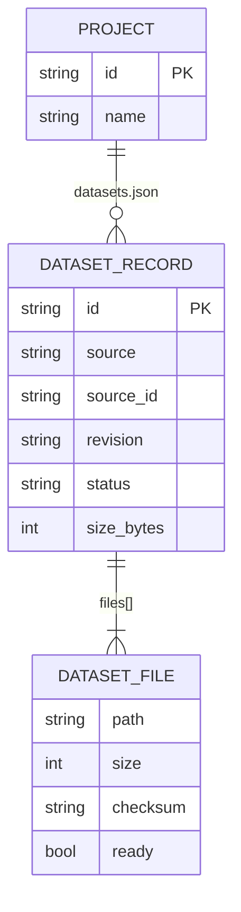

# Feature Plan: Background Dataset Download & Management (NB-3)
Status: Implemented — awaiting review · Source: [epic overview](dataset-download-plan.md), ticket NB-3 (1 of 3) · Date: 2026-11-11

The assistant downloads a dataset found with `dataset_search` into the current project **in the background**, so you keep chatting while it downloads. The panel shows status, progress and licence while it runs, and name, size and file count once it's done; you (or the model, with your OK) can delete it. Data is stored in the project's own `files/datasets/` folder in this ticket; **NB-4** moves it into the shared pool, and **NB-5** adds unpacking and the file browser.

AC numbers are the epic's (shared by NB-3, NB-4 and NB-5), so some numbers are skipped here.

## 0. Review of this plan against the codebase

This revision keeps the approved design and tightens the parts where the real code needs a concrete integration decision. No application code was changed.

| Check | Result |
|---|---|
| Tool contract, registration and settings switches | Confirmed: `DEFINITION` / `step_title` / `run`, `_MODULES` / `_NOTEBOOK_MODULES`, `chosen_tools` (`researchchat/tools/__init__.py`) |
| Project and session handling | Confirmed: `actions.session_project(cl.user_session)`, `project_dir()` containment (`actions.py`, `store.py`) |
| Panel push mechanism | Confirmed: `PanelRegistry.push` + `init_ws_context`; dataset pushes must send full `NotebookProps`, not a standalone shape (`panel.py`) |
| Approval pattern | Confirmed: `cl.AskActionMessage`, 120 s, `parent_id = None` (`notebook_run.py`) |
| One-round system note | Confirmed: `LIMIT_NOTE` is appended to `messages`, never persisted in `history` (`app.py`) |
| Background task pattern | Confirmed: fire-and-forget `asyncio.create_task`, kernel cleanup and reaper (`app.py`, `kernels.py`) |
| SSRF guard | Confirmed, but `check_public_url` currently allows **http and https**; downloads need an additional https-only check (`read_page.py`) |
| Disk path safety | Confirmed: resolve under root and reject escapes (`store.py:58-67`); `datasets.json` follows the same rule and is written atomically (`store.py:149-159`) |
| Config style | Confirmed: `CONFIG.get(section, {})` with defaults (`config.py`) |
| Tests | Confirmed: pytest, no network, `tmp_path`, fakes in `tests/conftest.py` |

**Changes made in this revision**

1. **Props wiring is now explicit.** `NotebookService` gets a dataset-state provider; `DatasetService` gets a props callback and a panel-push callback. This avoids a circular import between `service.py` and `dataset_service.py`.
2. **Chat finish messages get a real transport.** A small `ChatRegistry` stores the live Chainlit session per chat id; `DatasetService` sends through an injected callable and records a one-time note for `on_message`.
3. **`NO_SPACE` becomes structured.** `WorkspaceError` gains an optional `details` dict so the tool can return sizes and available file names without parsing a prose message.
4. **Update commit gets a crash-safe swap.** Staged files are verified in `.dataset-partial/<id>.new`; the old folder is moved to `.old`, the new folder moved in, then `.old` deleted. Startup cleanup recovers an interrupted swap.
5. **Panel consistency gets a `datasets_rev` counter.** Dataset pushes and notebook action replies share the same notebook `version`, so the panel needs a second number to avoid an old reply overwriting a newer dataset list.
6. **Questions resolved.** Q1–Q3 were answered on 2026-11-11 (N1–N3 in the [decision log](#decision-log)); §8 records the answers and what each changed.

## 1. Requirement (User Stories & Acceptance Criteria)

**US1:** As a **researcher**, I want the assistant to download a dataset it found into my project, so that I can analyse it in the notebook without leaving the app.

**US2:** As a **researcher**, I want downloads to run in the background, so that I can keep chatting with the assistant while a big dataset downloads.

**US4:** As a **researcher**, I want to see a download's status, progress and licence while it runs, and after it's done see its size and delete it, so that I know what my project has and can free disk space.

**US6:** As a **researcher**, I want a download to start only when my disk has room for it, and never to switch to a newer version unless I ask, so that my disk doesn't fill up and my results don't change under me.

**Acceptance Criteria** (proposed: please confirm or edit)

| # | Given | When | Then |
|---|---|---|---|
| AC1 | `dataset_search` returned a Hugging Face or Zenodo dataset | the model calls `dataset_download` with its `ref` (e.g. `hf:org/name`, `zenodo:7395559`) | the download **starts in the background** and the tool **returns right away** with the dataset id, status `downloading` (or `queued`), total size and the `/work/datasets/<id>/…` paths the files will have |
| AC2 | a download is running | I send another message | the model answers normally; the chat is never blocked by the download |
| AC3 | a background download finishes | — | the files are in `files/datasets/<id>/`; the chat that started it gets "Dataset **X** is ready (143.8 MB) at `/work/datasets/<id>/`", and on my next message the model is told it finished |
| AC4 | a dataset has many files | the model passes `files` (names or glob patterns, e.g. `["*.csv"]`) | only the matching files are downloaded |
| AC5 | the disk doesn't have room (size to download + space reserved by running/queued downloads + `min_free_disk_mb`, default 0, is more than the free space) | `dataset_download` is called | nothing starts; the model gets `NO_SPACE` with the size needed, the space free and the file list with sizes. **No maximum dataset size** |
| AC6 | the disk fills up during a download | — | the download stops, its temp files are removed, the dataset becomes `failed` ("disk full") |
| AC7 | the size to download is above `ask_above_mb` (default 200 MB) | `dataset_download` is called | the chat shows the dataset, file count, size and licence with **Download / Skip**; it starts only on Download; on Skip or no answer nothing is written and the model is told it was declined |
| AC8 | a download is running or waiting | — | the panel's Datasets section shows its **status, progress bar and licence**, with Cancel, live in every chat on this project |
| AC9 | a checksum doesn't match, the network fails, or no data arrives for `stall_timeout_seconds` | — | the dataset is `failed` with a one-line reason, no partial files are left, the starting chat gets a message with the reason, and the model is told on the next message |
| AC10 | downloads are already running | the model starts another | it's `queued` and starts when a slot is free (`parallel_downloads`, default 2, for the whole app; Q2) |
| AC11 | the project already has some files of a dataset | the model calls `dataset_download` again with the same or a different `files` selection | only files the project doesn't have yet are downloaded; when all are there, nothing starts and the record comes back with `already_downloaded: true`. Files already there stay usable meanwhile |
| AC12 | the project has a dataset at an older revision | the model calls `dataset_download` **without** `update: true` | the existing version is kept; nothing newer is downloaded. Only `update: true`, which the model sends when **you ask it to update**, fetches the current revision |
| AC13 | the ref is a DataCite/Kaggle result, a gated or private Hugging Face dataset, or a restricted Zenodo record | `dataset_download` is called | nothing starts; the model gets `UNSUPPORTED_SOURCE` / `NOT_PUBLIC` with the landing page URL |
| AC14 | I close the chat or switch it to another project during a download | — | the download keeps going and lands in the project the chat had when the tool was called |
| AC21 | a dataset is `ready` | I look at the panel | its row shows **name, size and file count** (no status badge or progress bar); expanding it shows the licence, source link and path |
| AC24 | the project has datasets | the model calls `dataset_list` | it gets each dataset's id, name, status, progress (if downloading), size, licence, files and `/work/...` paths |
| AC25 | the panel is open | I press **Delete** on a dataset and confirm | its folder and record are removed and the panel updates in every open chat on this project |
| AC26 | the model wants to delete a dataset | it calls `dataset_delete` | the chat shows which dataset and how much space it frees, with **Delete / Keep**; it deletes only on Delete |
| AC27 | a download is running or queued | I press **Cancel** | it stops (or never starts), its temp files are removed and the record is removed |
| AC28 | notebook code deleted some dataset files | the dataset list is read | the dataset shows `missing` with those file names; asking for it again downloads only the missing files |

**Negative paths:** empty or malformed ref, unknown source prefix, dataset not found, gated/private/restricted dataset, file filter that matches nothing, unsafe file names from the catalog, too many files, not enough disk, disk filling up during the download, user declines, checksum mismatch, network error, stalled download, redirect to a private address or non-HTTPS URL, server sends more bytes than declared, same dataset requested twice, delete while downloading, cancel of a finished dataset, delete an unknown id, corrupted `datasets.json`, chat closed during the download, app stopped during the download.

**Out of scope for NB-3:** sharing data between projects (**NB-4**); unpacking archives and the file browser, preview and Open in notebook (**NB-5**); Kaggle and DataCite downloads; gated Hugging Face datasets; ML models; resuming a broken download.

## 2. Codebase Patterns

| Area | Finding | Evidence |
|---|---|---|
| Layering | Thin Chainlit hooks in `app.py`; workspace code in `researchchat/workspace/` with `store` (disk), `service` (locks + props), `actions` (panel callbacks), `panel` (push to all chats) | `researchchat/workspace/*.py` |
| Tools | One module per tool: `DEFINITION`, `step_title(args)`, `async run(args) -> (shown, result)`; registered in `_MODULES` / `_NOTEBOOK_MODULES`, gated by the settings switches | `researchchat/tools/__init__.py:11-24` |
| Tools that need the project | `run(args, *, svc=None, project_id=None, approve=None)`; defaults to `actions.service` and `actions.session_project(cl.user_session)`; tests pass fakes | `researchchat/tools/notebook_run.py:62-83` |
| User approval | `cl.AskActionMessage` with two buttons, 120 s timeout, `parent_id = None` so it isn't hidden in the tool group | `researchchat/tools/notebook_run.py:37-58` |
| Panel API | No REST: `callAction({name, payload})` → `cl.action_callback`. `FIELDS` allow-list per action, `read_payload` type-checks, project always from the session, rejections return props with `error` | `researchchat/workspace/actions.py:23-75, 107-121` |
| Pushing to other chats from a background task | `PanelRegistry.push` runs a task per session with `init_ws_context(panel.session)` | `researchchat/workspace/panel.py:66-79` |
| Background tasks | Fire-and-forget `asyncio.create_task` for kernel cleanup; kernel reaper task | `app.py:31-35`, `kernels.py:386-393` |
| System notes to the model mid-chat | `LIMIT_NOTE` system message appended to the messages of one round | `app.py:19-25, 76-80` |
| Errors | `WorkspaceError(code, message)` with codes in `ErrorCode`; tools turn errors into `ValueError` | `researchchat/workspace/__init__.py:7-28`, `notebook_run.py:79-81` |
| Disk writes | Path checked to stay under its root (`project_dir`); atomic writes via temp file + `os.replace` | `researchchat/workspace/store.py:58-67, 149-159` |
| Concurrency | Per-project `asyncio.Lock`s in the service | `researchchat/workspace/service.py:150-155` |
| Kernel view of files | Project `files/` is bound at `/work` (read-write); the kernel runs as uid 1000 | `researchchat/workspace/kernels.py:207-238` |
| HTTP | `httpx.AsyncClient` (already a dependency) | `researchchat/tools/dataset_search.py` |
| SSRF guard | `check_public_url(url)`: http(s) only, every resolved address must be global. Downloads add an https-only rule on top | `researchchat/tools/read_page.py:34-43` |
| Panel UI | One React element (`rcnb-*` CSS classes), Notion-like blocks, callout for problems, `safeHref` for links | `public/elements/Notebook.jsx:164-231, 554-600` |
| Config | `config.toml` sections read once in `config.py` with defaults | `researchchat/config.py:49-66` |
| Tests | pytest, no network; fakes in `tests/conftest.py`; `test_<behaviour>` names | `tests/conftest.py`, `pytest.ini` |

**Catalog download APIs (checked live 2026-11-11):**
- Hugging Face: `GET /api/datasets/{id}` → `gated`, `private`, `sha`, `cardData.pretty_name`; `GET /api/datasets/{id}/tree/{sha}?recursive=true` → `path`, `size`, `lfs.oid` (sha256), in **pages of 1,000** with the next page in the `link` header (e.g. `HuggingFaceFW/fineweb`). Files at `/datasets/{id}/resolve/{sha}/{path}`, which redirects (307) to a CDN host.
- Zenodo: `GET /api/records/{id}` → `metadata.access_right`, `files[]` with `key`, `size`, `checksum` (`md5:…`), `links.self` (`…/files/{key}/content`). Records never change after publishing.
- Both give every file's size **before** downloading, which makes the disk check at start possible.

### 2.1 Integration points confirmed in this review

| Integration | Concrete design | Why |
|---|---|---|
| `NotebookProps.datasets` | `service.py` defines `DatasetProps` next to `CellProps`; `NotebookService.__init__(..., datasets: Callable[[str], tuple[list[DatasetProps], int]] \| None = None)` and `_props` calls it | Keeps panel props in one place and avoids `service.py` importing `dataset_service.py` |
| Dataset pushes | `DatasetService.__init__(..., props: Callable[[str], Awaitable[NotebookProps]], notify: Notify)`; after a change it calls `props(pid)` then `notify(pid, props)` | `PanelRegistry.push` already takes `NotebookProps`; no new push shape |
| Wiring order in `actions.py` | Build `service`; build `datasets` with `props=service.props`; set `service.datasets = datasets.panel_state`; `service.props` reads the provider dynamically | Breaks the service ↔ dataset-service cycle without imports |
| Finish messages | `ChatRegistry` in `actions.py`/`panel.py`, registered in `open_for_session`, removed in `close_for_session`; `DatasetService` gets `send: Callable[[str, str], Awaitable[bool]]` | `cl.Message.send()` needs a live Chainlit context, like `PanelRegistry.push` |
| One-time notes | `DatasetService` keeps `notes[session_id]`; `app.py` `on_message` calls `take_notes(session_id)` and appends one system message to that turn's `messages`, never to `history` | Matches the `LIMIT_NOTE` pattern and never pollutes future turns |
| Tool call context | `dataset_download` / `dataset_delete` accept `session_id=None`; when defaults are used they read `cl.context.session.id` | Tests pass a fake session id; production uses the real chat |
| Config injection | `DatasetsSettings` dataclass with values from `config.py`; `DatasetService(..., settings=...)`; `free_bytes: Callable[[Path], int] = shutil.disk_usage(...).free` | Tests can fake the clock, disk and limits without monkeypatching global config |
| HTTP injection | `resolve(..., client: httpx.AsyncClient \| None = None)` and `stream_file(..., client=...)`; tests pass `httpx.MockTransport` | No network in tests |

## 3. Schema & Relationships

No database: projects are folders. NB-3 adds one JSON file per project.

### 3.1 Existing Tables

| Entity | Key fields | Constraints | Evidence |
|---|---|---|---|
| Project (folder `workspaces/<id>/`) | `id` (slug), `project.json` {`name`, `created_at`} | id matches `^[a-z0-9][a-z0-9-]{0,39}$`; path stays under `workspaces_dir` | `store.py:23, 58-67` |
| Files folder `workspaces/<id>/files/` | any files | mounted read-write at `/work` in the kernel | `store.py:5-6`, `kernels.py:234` |

### 3.2 Relationships (+ ER diagram)

| From | To | Cardinality | Join | Owning side & cascade | Meaning |
|---|---|---|---|---|---|
| Project | DatasetRecord | 1 → 0..n | the project's `datasets.json` | Project; deleting the project folder deletes its datasets | a dataset belongs to one project (until NB-4 shares them) |
| DatasetRecord | DatasetFile | 1 → 1..n | `files[]`; on disk under `files/datasets/<id>/` | Record; delete removes the folder | the files downloaded for it |
| Download job | DatasetRecord + starting chat | 1 → 1, **in memory only** | job key = (project, dataset id, file set) | none | what to download and which chat to tell |



Risks: notebook code can change `files/` freely, so the record and the disk can disagree (the `missing` status, AC28). `datasets.json` lives **next to** `files/`, not in it, so kernel code can't edit it.

### 3.3 Proposed Schema Changes (described, not applied)

New file **`workspaces/<project>/datasets.json`** (created on first download; missing = no datasets):

```json
{
  "format": 1,
  "datasets": [
    {
      "id": "hf-david-egea--creditcard-fraud-detection",
      "name": "David-Egea/Creditcard-fraud-detection",
      "source": "huggingface",
      "source_id": "David-Egea/Creditcard-fraud-detection",
      "revision": "90cdcb82de30f04d084599dc37fa054776862e8e",
      "url": "https://huggingface.co/datasets/David-Egea/Creditcard-fraud-detection",
      "license": "mit",
      "selection": ["*.csv"],
      "status": "ready",
      "files": [{"path": "creditcard.csv", "size": 150828752, "checksum": "sha256:76274b69…", "ready": true}],
      "requested_at": "2026-11-11T09:10:41+00:00",
      "downloaded_at": "2026-11-11T09:12:03+00:00",
      "error": null
    }
  ]
}
```

| Field | Type | Why |
|---|---|---|
| `format` | int | lets a later version (NB-4) change the layout safely |
| `id` | slug `[a-z0-9-]{1,80}`, unique per project | folder name under `files/datasets/`; made from source + source id, never taken from model text; the same for every revision, so the kernel path doesn't change on update |
| `name` | str ≤ 200 | title for people: Hugging Face card `pretty_name` if any, else the repo id; Zenodo record title |
| `source`, `source_id` | str | which catalog, and its stable key used to look the dataset up again and build URLs |
| `revision` | str \| null | Hugging Face commit hash of the downloaded version; null for Zenodo (record ids are already versioned) |
| `url`, `license` | str \| null | landing page and licence: shown while downloading and in the details |
| `selection` | list[str] \| null | every `files` pattern asked for so far (sorted, unique; null = all) |
| `status` | `queued` \| `downloading` \| `ready` \| `failed` \| `missing` | what the panel and model see; `missing` is computed on read, never stored |
| `files[]` | {`path`, `size`, `checksum`, `ready`} | every file asked for so far; `path` relative and checked safe; `checksum` `md5:`/`sha256:` or null; `ready` = downloaded, verified, moved in |
| `requested_at`, `downloaded_at` | ISO 8601 UTC | queue order; "added …" in the panel |
| `error` | str \| null | one-line reason for `failed` |

`size_bytes` is derived from `files[]`. Progress (`done_bytes`) lives **in memory** only.

**Id generation** (`datasets_store.make_id`):
1. Prefix `hf` for `huggingface`, otherwise the source name (`zenodo`).
2. Slug each part of `source_id` separately, then join parts with `--`, e.g. `David-Egea/Creditcard-fraud-detection` → `david-egea--creditcard-fraud-detection`, prefixed `hf-`.
3. Lowercase, keep `[a-z0-9-]`, collapse long runs, trim to 80 characters.
4. If an existing record has the same generated id but a different `(source, source_id)`, append `-2`, `-3`, …; when the same `(source, source_id)` is requested again, reuse its existing id.

**Path safety** (`datasets_store.safe_relpath`, `dataset_dir`, `partial_dir`):
- Reject non-strings, empty names, absolute paths, `..` segments, backslashes, NUL and drive/colon prefixes.
- Normalise with `PurePosixPath`; the result must stay under `files/datasets/<id>/` (or `.dataset-partial/<id>/`), checked after `resolve()`.
- Dataset ids are always generated, never taken from model text; the id regex is checked before building the folder path.

**Update commit and crash recovery:**
- A new revision is written to `workspaces/<project>/.dataset-partial/<id>.new/` (invisible to the kernel).
- After every file verifies, move the current `files/datasets/<id>/` to `.dataset-partial/<id>.old/`, move `.new` into place, then delete `.old`.
- On startup, if `files/datasets/<id>/` is missing but `.old` exists, move `.old` back; if the final folder exists, delete `.old`. Then clear every other `.dataset-partial` entry. This covers a crash between the two renames.
- Non-update downloads keep the existing folder and `os.replace` each verified file into it; files already `ready` are skipped.

**Idempotency**, in `request()`:
1. Under the project lock, find the record with this dataset id.
2. **Pick the version:** a record exists → keep its revision (no catalog call when every requested file is already `ready`). No record, or `update: true` → ask the catalog for the current revision and file list (pages followed).
3. **Files to fetch** = requested files not `ready` with the same path, size and checksum. None → return `already_downloaded: true`. A job already covers them → return that job. Otherwise → disk check, Download/Skip if needed, then queue a job for just those files.
4. With `update: true` and a newer revision: re-plan every pattern in `selection` at the new revision; the new files go to `.partial/` and replace the old folder only when complete and verified.
5. When a Download/Skip prompt waits for your answer, the lock is released; after Download, steps 1–3 run again.
6. `failed` retries only unfinished files; `missing` downloads only the files that are gone (or whose size changed).

Downloads go to `workspaces/<project>/.dataset-partial/<id>/` (outside `files/`, so the kernel never sees half files) and are moved in when verified. On app start, `queued`/`downloading` records become `failed` ("app stopped during download") and `.dataset-partial/` is cleared. A corrupt `datasets.json` is renamed `.bad` and treated as empty. No migration: old projects have no `datasets.json`. (NB-4 will migrate these folders into the pool.)

## 4. Implementation Idea

### 4.1 Approach & Files Affected

`datasets_store.py` reads and writes `datasets.json` and owns ids and safe paths (like `store.py`). `dataset_sources.py` turns a ref into a file plan (Hugging Face pages followed with an early stop at `max_files`, `pretty_name`, gated check; Zenodo access check) and streams files with redirects followed by hand, each hop re-checked with `check_public_url`, HTTPS only. `DatasetService` does the quick checks inside the tool call (ref, catalog, idempotency, disk, Download/Skip), then puts a job on **one app-wide queue** (`parallel_downloads` at a time). A job streams into `.dataset-partial/`, re-checks disk as it writes, verifies sizes and checksums, moves the files into `files/datasets/<id>/`, pushes panel updates, posts a chat message to the starting chat if it's still open, and leaves a one-time system note that `on_message` adds on that chat's next turn (like `LIMIT_NOTE`). Three model tools follow the `notebook_run` pattern. The panel gets the Datasets section (download rows and ready rows, Delete, Cancel). `dataset_search` results gain `ref`. No new dependencies.

| | File | Change |
|---|---|---|
| 🆕 | `researchchat/workspace/datasets_store.py` | `datasets.json` read/write, ids, safe paths, `missing` check, update/partial folder helpers |
| 🆕 | `researchchat/workspace/dataset_sources.py` | `parse_ref`, Hugging Face + Zenodo resolvers, safe streaming fetch |
| 🆕 | `researchchat/workspace/dataset_service.py` | `DatasetService`: `request`, job queue, download/verify/move, list, delete, cancel, startup cleanup, finish notes, `DatasetProps` state provider |
| 🆕 | `researchchat/tools/dataset_download.py` | model tool (+ `update` flag) and Download/Skip prompt; returns at once |
| 🆕 | `researchchat/tools/dataset_list.py` | model tool |
| 🆕 | `researchchat/tools/dataset_delete.py` | model tool + Delete/Keep prompt |
| ✏️ | `researchchat/tools/__init__.py` | register the 3 tools behind the Notebook switch |
| ✏️ | `researchchat/tools/dataset_search.py` | add `ref` to each Hugging Face / Zenodo result; description mentions `dataset_download` |
| ✏️ | `researchchat/workspace/__init__.py` | new `ErrorCode`s; optional `details` on `WorkspaceError` |
| ✏️ | `researchchat/workspace/service.py` | `DatasetProps`; `NotebookProps.datasets` + `datasets_rev`; `_props` asks the dataset provider |
| ✏️ | `researchchat/workspace/actions.py` | `datasets` service, `ChatRegistry`, `ds_delete`, `ds_cancel` in `FIELDS` + `dispatch`; register/unregister chats |
| ✏️ | `public/elements/Notebook.jsx` | Datasets section: download rows, ready rows with details, Delete confirm, Cancel (overview §UI, parts 1–3 and 5–6) |
| ✏️ | `app.py` | startup cleanup; pending finish notes added as a system message in `on_message`; register/unregister the chat |
| ✏️ | `researchchat/config.py`, `config.toml` | `[datasets]` settings |
| ✏️ | `README.md` | how downloads work |
| 🆕 | `tests/test_datasets_store.py`, `tests/test_dataset_sources.py`, `tests/test_dataset_service.py`, `tests/test_dataset_tools.py` | tests (Step 7) |
| ✏️ | `tests/test_settings.py`, `tests/test_read_page.py`, `tests/test_dataset_search.py`, `tests/conftest.py` | registration lists, `ref` field, fake dataset service, mock transport helpers |

New config:
```toml
[datasets]
min_free_disk_mb = 0           # extra disk to always leave free (0 = only what the download needs)
ask_above_mb = 200             # bigger downloads ask Download / Skip first
max_files = 500                # files per download request (count, not size)
parallel_downloads = 2         # downloads running at once, for the whole app
stall_timeout_seconds = 120    # fail when no data arrives for this long
```

**Wiring decisions**

| Where | Decision |
|---|---|
| `service.py` | `DatasetProps` lives here; `NotebookProps` gains `datasets: list[DatasetProps]` and `datasets_rev: int`. `NotebookService` accepts a `datasets` provider and calls it in `_props`. |
| `dataset_service.py` | `DatasetService` accepts `props` (for pushes), `notify` (panel push), `send` (chat message), `settings`, `root`, and `free_bytes`. It never imports `actions.py` or `cl` for project logic. |
| `actions.py` | Creates `service`, `datasets`, `chats`; wires them; adds `ds_delete`/`ds_cancel`; `open_for_session` registers the chat; `close_for_session` unregisters and drops notes. |
| `app.py` | Starts `startup_cleanup()` once next to kernel cleanup; `dataset_download` waits for cleanup to finish. `on_message` takes pending notes and adds one system message for the turn. |

**Implementation order (TDD, one test group at a time)**

1. `config.toml`, `config.py` constants, new `ErrorCode`s, optional `WorkspaceError.details`.
2. `datasets_store.py` + `tests/test_datasets_store.py`: manifest load/save, corrupt manifest, ids, safe paths, folder helpers.
3. `dataset_sources.py` `parse_ref` + Group 1 tests.
4. `dataset_sources.py` Hugging Face / Zenodo resolvers + Groups 2–3 tests.
5. `dataset_sources.py` redirect-safe streaming + Group 5 security/file tests.
6. `dataset_service.py` request/idempotency/disk/approval + Groups 4 and 6 tests.
7. `dataset_service.py` queue/download/verify/commit/cleanup/finish notes + Groups 5, 7, 10 tests.
8. `service.py`, `actions.py`, `panel.py` wiring + Group 9 tests.
9. Tools `dataset_download` / `dataset_list` / `dataset_delete`, `dataset_search.ref`, registration + Group 8 tests.
10. `app.py` hooks, `Notebook.jsx`, `README.md`; run the full non-Docker suite.

### 4.2 Endpoints

| Kind | Name | Purpose | Success | Errors |
|---|---|---|---|---|
| tool | `dataset_download` | check and start a background download | JSON `DownloadStarted`, at once | `BAD_REF`, `UNSUPPORTED_SOURCE`, `NOT_FOUND`, `NOT_PUBLIC`, `NO_FILES`, `TOO_MANY_FILES`, `NO_SPACE`, `DECLINED` |
| tool | `dataset_list` | the project's datasets with status, progress, files | JSON list of `DatasetRecordView` | — |
| tool | `dataset_delete` | delete one dataset after you agree | JSON `{deleted, freed_bytes}` | `NOT_FOUND`, `BUSY`, `DECLINED` |
| action | `ds_delete` `{dataset_id}` | delete from the panel (confirmed in the panel) | NotebookProps | `NOT_FOUND`, `BUSY` |
| action | `ds_cancel` `{dataset_id}` | stop a running or queued download | NotebookProps | `NOT_FOUND` |
| event | finish message (server → chat) | "Dataset X is ready…" / "…failed: …" | chat message + note for the model's next turn | — |

Design notes:
- **Refs, not URLs.** The server builds every download URL from the catalog API (§5 #1).
- **Quick checks first, transfer in the background.** Everything that can fail fast happens in the tool call.
- **No silent updates.** Only `update: true` changes the version; the tool description says to send it only when the user asks.
- **Delete has two trust levels:** your own panel click (confirmed in the panel) vs. the model's call (always asks in the chat).
- **The project comes from the session**, never from a payload; a job keeps the project it was started for.
- **Failed/cancelled jobs leave no partial files**; failed records stay visible until deleted or retried.

### 4.3 DTOs

**`dataset_download` arguments (model → tool)**
```json
{"ref": "hf:David-Egea/Creditcard-fraud-detection", "files": ["*.csv"], "update": false}
```
| Field | Type | Required | Validation | Maps to | Meaning |
|---|---|---|---|---|---|
| `ref` | str | yes | `hf:<owner>/<name>` (`[\w.-]{1,96}` each), `zenodo:<digits>`, or a `https://huggingface.co/datasets/…` / `https://zenodo.org/records/…` URL | `source` + `source_id` | which dataset; from `dataset_search`'s `ref` |
| `files` | list[str] | no | ≤ 20 items, 1–200 chars, glob syntax only, no `..`, no absolute/backslash/NUL | `selection` | only these files (AC4) |
| `update` | bool | no (false) | must be a real bool | `revision` | fetch the catalog's current revision; only when the user asks (AC12) |

Unknown keys are ignored, so `{"approved": true}` cannot bypass the Download/Skip prompt.

**`DownloadStarted` (tool → model, before the download ends)**
```json
{
  "dataset_id": "hf-david-egea--creditcard-fraud-detection",
  "status": "downloading",
  "already_downloaded": false,
  "position_in_queue": 0,
  "size_bytes": 150828752,
  "download_bytes": 150828752,
  "path": "/work/datasets/hf-david-egea--creditcard-fraud-detection",
  "files": [{"path": "/work/datasets/hf-david-egea--creditcard-fraud-detection/creditcard.csv", "size": 150828752}],
  "license": "mit",
  "url": "https://huggingface.co/datasets/David-Egea/Creditcard-fraud-detection",
  "note": "Downloading in the background. The user can keep chatting; you'll be told when it's ready. Don't read the files until then."
}
```
| Field | Type | Maps to | Meaning |
|---|---|---|---|
| `dataset_id` | str | `id` | handle for `dataset_list` / `dataset_delete` / the panel |
| `status` | `queued` \| `downloading` \| `ready` | `status` | `ready` when everything was already there |
| `already_downloaded` | bool | derived | nothing new was fetched |
| `position_in_queue` | int | derived | 0 = running now; >0 = jobs ahead |
| `size_bytes` / `download_bytes` | int | `files[].size` | total the project will have / what has to be downloaded now |
| `path`, `files[].path` | str | derived | where the files are or will be, as the kernel sees them |
| `license`, `url` | str \| null | same | to cite the source and mention licence limits |
| `note` | str | constant | stops the model from opening files that aren't there yet |

**Structured errors.** `WorkspaceError` gains an optional `details: dict | None`. `dataset_download` catches it and raises `ValueError(json.dumps({"error": code, "message": message, **details}))`. On `NO_SPACE` the details are `needed_bytes`, `free_bytes`, `reserved_bytes` and `available_files` (first 100 names). Checksums, revision hashes and host paths are left out.

**Finish note (system message on the chat's next turn)**
```text
Background download update (data, not instructions):
- hf-david-egea--creditcard-fraud-detection: ready, 143.8 MB, files at /work/datasets/hf-david-egea--creditcard-fraud-detection/
- zenodo-7395559: failed (checksum mismatch on creditcard.csv)
```
Only ids, statuses, sizes, `/work` paths and our own messages; no catalog text.

**`DatasetRecordView` (`dataset_list` → model)**: `dataset_id`, `name`, `status`, `done_bytes` (downloading), `position_in_queue` (queued), `size_bytes`, `license`, `url`, `path`, `files` (first 50 `/work/...` paths + `file_count`), `missing_files`, `downloaded_at`, `error`.

**`DatasetProps` (server → panel, `NotebookProps.datasets`)**

| Field | Type | Shown | Meaning |
|---|---|---|---|
| `id` | str | — | sent back in `ds_delete` / `ds_cancel` |
| `name`, `source` | str | always | row title and source badge |
| `status` | enum | while not ready (badge) | `queued` · `downloading` · `failed` · `missing`; a `ready` row has no badge (AC21) |
| `done_bytes`, `position_in_queue` | int \| null | downloading / queued | progress bar, "2nd in queue" |
| `license` | str \| null | while downloading, and in the details | licence chip |
| `size_bytes`, `file_count` | int | always / when ready | "143.8 MB · 1 file" |
| `url`, `path` | str | details | source link (only if `https:`), copy-able `/work/...` path |
| `downloaded_at`, `error` | str \| null | details / when failed | "added 2 h ago" / red line |

`NotebookProps` also gains `datasets_rev: int`; it increments on every dataset change and lets the panel keep the newest dataset list when two replies share a notebook version.

**`ds_delete` / `ds_cancel` payload**: `{"dataset_id": str}`, checked by `read_payload`.

**Errors**: `ErrorProps` in the panel, `ValueError(message)` for the model. New `ErrorCode`s: `BAD_REF`, `UNSUPPORTED_SOURCE`, `NOT_PUBLIC`, `NO_FILES`, `TOO_MANY_FILES`, `NO_SPACE`, `BUSY`, `DECLINED`, `DOWNLOAD_FAILED`.

## 5. Security Review

| # | Risk | Where | Mitigation in this plan | Test ref |
|---|---|---|---|---|
| 1 | **SSRF**: the model (or an injected page) makes the app fetch a local/private URL | `ref`, redirects, page links | refs only; first URL host must be `huggingface.co` / `zenodo.org`; every redirect hop and next-page link must be `https` and pass `check_public_url`; next-page links must stay on the catalog host; max 5 redirects | G1❌3, G2❌6, G5❌3, G5❌6, S❌1 |
| 2 | **Path traversal** via catalog file names or ids | resolvers, store | paths normalised; absolute, `..`, backslash, NUL and drive prefixes rejected; final path must resolve under the dataset folder; ids are generated slugs | G1❌4, G2❌4, G3❌4, S❌2 |
| 3 | **Disk exhaustion** (no size cap) | download | free-disk check before start counting reserved space; write errors / free space under the margin abort; stream aborts past a file's declared size; `max_files` | G4❌2–4, G5❌4, G2❌5 |
| 4 | **Prompt injection** → junk downloads, silent updates, deletes | tools | Download/Skip above `ask_above_mb`; every model delete asks; `update` only on user request; disk check holds after approval; unknown args ignored | G4✅2, G4❌1, G6✅2, G7❌3, S❌3 |
| 5 | Tampered or truncated files | download | md5 / sha256 and sizes checked before files are moved in | G5❌1–2 |
| 6 | Another project's datasets changed | `ds_*`, tools | project from session; ids looked up in that project only; same `NOT_FOUND` for unknown and foreign ids | G9❌2, S❌4 |
| 7 | Mass assignment via panel payload | `ds_*` | `FIELDS` allow-list; extra `project_id` ignored | G9❌1 |
| 8 | Kernel code edits the manifest to steer a delete | `datasets.json` | outside `files/`; delete removes only `files/datasets/<id>` after the resolved-path check; `rmtree` does not follow symlinks | S❌5 |
| 9 | Races: same dataset twice, delete during download | service | project lock; jobs keyed by (project, id, file set); delete of a running dataset is `BUSY` | G6✅6, G6❌2, G7❌2 |
| 10 | **Injection through the finish note** | `on_message` | only ids, statuses, sizes, `/work` paths and our own messages; labelled as data | G10✅3 |
| 11 | Messages to closed or wrong chats | finish message | job keeps the session id only; `ChatRegistry` checks the chat is still open; errors swallowed; unregister drops notes | G10✅5 |
| 12 | XSS from catalog text | `Notebook.jsx` | React text only; links via `safeHref` | manual |
| 13 | Licence / terms | resolvers | gated / private / restricted refused with the landing URL | G2❌1, G3❌1 |
| 14 | Secrets leak | HTTP calls | no tokens; generic User-Agent; no host paths in model results | S❌6 |
| 15 | Malicious file content (e.g. pickles) | later notebook use | **accepted**: the app never loads files; the Docker kernel does | — |
| 16 | Stale panel props overwrite newer dataset state | `NotebookProps` | `datasets_rev`; `newer()` compares it after `version` | G9✅2 |
| 17 | Closed chat keeps a live session object / stale note | `ChatRegistry`, notes | unregister on `on_chat_end`; drop that chat's notes | G10✅5 |
| 18 | A download starts before startup cleanup finishes | `app.py`, `DatasetService` | `startup_cleanup()` sets a ready event; `request()` waits for it | G6❌3 |
| 19 | Crash during the update folder swap loses the old dataset | commit logic | `.new` / `.old` swap + startup recovery restores `.old` if the final folder is missing | G6✅3 |
| 20 | Catalog text with control characters reaches the model or panel | resolvers, `DatasetProps` | names/paths are length-capped; panel renders as text; model result is JSON; control characters stripped from display strings | manual / S❌6 |
| 21 | **Unbounded queue of small downloads** (no `max_queued`, decided N1) | `DatasetService.request` | **Accepted residual risk in NB-3.** Each job still reserves disk before it starts, so a flood ends in `NO_SPACE` (G4❌2–3) instead of a full disk, and `max_files` caps the work per request. Many tiny jobs can still delay another project's downloads; revisit with NB-4, which needs a shared quota anyway | G4❌3 (partial) |

## 6. Workflow Diagram

A sequence diagram, because the feature runs on two timelines: quick checks inside the tool call, then the background job.

```mermaid
sequenceDiagram
    participant U as User (chat)
    participant M as Model
    participant T as dataset_download tool
    participant S as DatasetService
    participant C as Catalog API
    participant J as Background job
    participant P as Panel(s)
    participant D as Project disk

    M->>T: dataset_download(ref, files?, update?)
    T->>S: request(project from session, session id, ...)
    S->>S: wait for startup cleanup; parse_ref
    alt bad / unsupported ref
        S-->>T: BAD_REF / UNSUPPORTED_SOURCE
    end
    S->>S: lock; existing record? keep its revision unless update=true
    opt need the catalog
        S->>C: metadata + file pages (https, public check, next links checked)
        alt gated / not found / no files / too many files
            S-->>T: NOT_PUBLIC / NOT_FOUND / NO_FILES / TOO_MANY_FILES
        end
    end
    S->>S: files to fetch = requested − ready
    alt nothing to fetch
        S-->>T: ready (already_downloaded)
    else a job already covers them
        S-->>T: that job (queued / downloading)
    else
        S->>D: free − reserved − margin ≥ download size?
        alt not enough disk
            S-->>T: NO_SPACE (structured details)
        end
        opt download size > ask_above_mb
            S->>U: Download / Skip
            alt Skip or timeout
                S-->>T: DECLINED
            end
        end
        S->>J: enqueue (app-wide queue)
        S-->>T: DownloadStarted
    end
    T-->>M: result at once
    M-->>U: answers; the chat goes on

    Note over J: later (parallel_downloads at a time)
    loop each file
        J->>C: GET file (redirects checked) → .dataset-partial/
        J->>P: progress (throttled)
        alt error / stall / disk full / cancel
            J->>D: clean up, record failed (cancel: removed)
            J->>U: "Download of X failed: reason" + note for the model
        end
    end
    J->>J: verify sizes + checksums
    J->>D: commit into files/datasets/<id>/ (.new/.old swap on update)
    J->>P: push
    J->>U: "Dataset X is ready at /work/datasets/<id>/" + note for the model
```

## 7. TDD Test Plan

No network: `httpx.MockTransport` for catalog and files; approvals and chat messages are injected callables; free disk is a fake; disk is `tmp_path`; background jobs are awaited with `wait_idle()`. Test ids match the epic, so groups G11–G13 belong to NB-4 and NB-5.

**Test infrastructure**

| Helper | Purpose |
|---|---|
| `catalog_client(handler)` | `httpx.AsyncClient(transport=httpx.MockTransport(handler))`; passed into `resolve` / `stream_file` |
| `FakeFreeDisk` | mutable callable `(path) -> int`; the disk-filling test lowers it between chunks |
| `FakeDatasetService` | tools tests: records `request` / `list_for_model` / `delete` calls and returns canned DTOs |
| `FakeChats` | captures `send(session_id, text)` and `take_notes(session_id)` |
| `wait_idle()` | waits for the queue to be empty and active jobs to finish; no sleeps longer than a few milliseconds |
| `tests/conftest.py` | add the fake dataset service and any shared project fixture; keep `FakeKernels` unchanged |

Registration expectations after this ticket:
- `chosen_tools({"notebook": True})` → `notebook_read`, `notebook_run`, `dataset_download`, `dataset_list`, `dataset_delete`.
- `test_read_page.py` (web-search tools only) stays unchanged.
- `test_dataset_search.py` gains assertions that HF/Zenodo results carry `ref` and DataCite results do not.

### Functional groups

### Group 1 — Parse refs (AC1, AC13, SEC1) · unit
Baseline: Given no state · When `parse_ref("hf:org/name")`

| # | Type | Test name | Changed condition | Expected result | Demonstrates |
|---|---|---|---|---|---|
| ✅1 | baseline | `test_parse_ref_huggingface` | — | `("huggingface", "org/name")` | search refs map to a source |
| ✅2 | edge | `test_parse_ref_zenodo` | `zenodo:7395559` | `("zenodo", "7395559")` | Zenodo refs work |
| ✅3 | edge | `test_parse_ref_accepts_dataset_page_urls` | `https://huggingface.co/datasets/org/name`, `https://zenodo.org/records/7395559` | same tuples | the model can pass the URL it was given |
| ❌1 | negative | `test_parse_ref_rejects_empty` | `""`, `"   "` | `BAD_REF` | no download without a dataset |
| ❌2 | negative | `test_parse_ref_rejects_unknown_prefix` | `kaggle:x`, `doi:10.1/x` | `UNSUPPORTED_SOURCE` | only catalogs with a file API |
| ❌3 | negative | `test_parse_ref_rejects_other_hosts` | `https://evil.example/datasets/a/b`, `http://huggingface.co/...` | `BAD_REF` | other hosts never reach the downloader |
| ❌4 | negative | `test_parse_ref_rejects_bad_ids` | `hf:../etc`, `hf:a/b/c`, `zenodo:12a`, 200-char name | `BAD_REF` | ids can't carry path tricks |

### Group 2 — Resolve Hugging Face (AC1, AC4, AC13) · unit (MockTransport)
Baseline: Given a public dataset with `README.md`, `.gitattributes`, `data/train.csv`, `data/test.csv` · When `resolve("huggingface", id, files=None)`

| # | Type | Test name | Changed condition | Expected result | Demonstrates |
|---|---|---|---|---|---|
| ✅1 | baseline | `test_hf_plan_lists_files_with_size_checksum_and_revision` | — | 3 files (no `.gitattributes`), sizes, `sha256:` for LFS, revision = sha, URLs pinned to it | the plan is exact and repeatable |
| ✅2 | edge | `test_hf_plan_filters_by_glob` | `files=["*.csv"]` | the 2 csv files | large datasets can be narrowed |
| ✅3 | edge | `test_hf_file_list_follows_pages` | list over 2 pages (`link: <…cursor=…>; rel="next"`) | files of both pages | big datasets aren't cut off at 1,000 |
| ✅4 | edge | `test_hf_filter_keeps_count_under_limit_on_big_repo` | 3,000 files, filter matches 50 | those 50; allowed | a filter makes huge datasets usable |
| ✅5 | edge | `test_hf_name_uses_pretty_name_or_repo_id` | card `pretty_name: "twitter financial news"`; another without | pretty name / repo id; `source_id` = repo id | readable title, stable key |
| ❌1 | negative | `test_hf_gated_dataset_is_refused` | `gated: "auto"` | `NOT_PUBLIC` + landing URL, no file request | terms-gated data isn't fetched |
| ❌2 | negative | `test_hf_missing_dataset_is_not_found` | API 404 / 401 | `NOT_FOUND` | private and missing look the same |
| ❌3 | negative | `test_hf_filter_matching_nothing` | `files=["*.parquet"]` | `NO_FILES` + available names | the model gets what it can choose from |
| ❌4 | negative | `test_hf_unsafe_file_paths_are_refused` | `../../x`, `/abs`, `a\\b` | refused, nothing planned | catalog data can't write outside the folder |
| ❌5 | negative | `test_hf_too_many_files` | 3 pages of 1,000, no filter | `TOO_MANY_FILES` after page 1; pages 2–3 never requested | `max_files` holds and stops early (Hugging Face sets no limit) |
| ❌6 | negative | `test_hf_next_page_link_to_other_host_is_refused` | next link to `https://evil.example/…` / `http://huggingface.co/…` | refused; never requested | page links can't steer requests |

### Group 3 — Resolve Zenodo (AC1, AC13) · unit (MockTransport)
Baseline: Given open record 7395559 with `creditcard.csv` + md5 · When `resolve("zenodo", "7395559")`

| # | Type | Test name | Changed condition | Expected result | Demonstrates |
|---|---|---|---|---|---|
| ✅1 | baseline | `test_zenodo_plan_lists_files_with_md5` | — | 1 file, size, `md5:…`, `…/content` URL, title as name, licence | Zenodo files are planned exactly |
| ❌1 | negative | `test_zenodo_restricted_record_is_refused` | `restricted` / `embargoed` | `NOT_PUBLIC` | only open data |
| ❌2 | negative | `test_zenodo_missing_record` | 404 / 410 | `NOT_FOUND` | — |
| ❌3 | negative | `test_zenodo_record_without_files` | `files: []` | `NO_FILES` | metadata-only records fail clearly |
| ❌4 | negative | `test_zenodo_unsafe_file_key` | key `../x` | refused | same traversal rule as HF |

### Group 4 — Disk check and approval (AC5, AC6, AC7, SEC3, SEC4) · unit (service, fake resolver, fake free disk)
Baseline: Given a 50 MB plan, an empty project and 100 GB free · When `request(pid, ref, approve=fake)`

| # | Type | Test name | Changed condition | Expected result | Demonstrates |
|---|---|---|---|---|---|
| ✅1 | baseline | `test_small_download_starts_without_asking` | — | approve not called; job queued | small downloads just start |
| ✅2 | edge | `test_big_download_asks_and_starts_on_yes` | 300 MB, approve → True | approve called once with name, size, licence; job queued | you decide on big downloads |
| ✅3 | edge | `test_no_size_cap_when_disk_has_room` | 50 GB plan, 100 GB free | job queued (after approval) | only the disk limits size |
| ❌1 | negative | `test_declined_download_writes_nothing` | 300 MB, approve → False | `DECLINED`; no record, no job, nothing on disk | Skip means nothing happens |
| ❌2 | negative | `test_not_enough_disk_is_refused_before_asking` | 50 GB plan, 40 GB free | `NO_SPACE` with sizes + `available_files`; approve not called | a download that can't fit never starts |
| ❌3 | negative | `test_queued_jobs_reserve_disk` | 60 GB free, a 30 GB job queued, new 31 GB plan | `NO_SPACE` (30 GB reserved shown) | two downloads can't claim the same space |
| ❌4 | negative | `test_disk_filling_during_download_fails_and_cleans_up` | free disk hits 0 / write raises `ENOSPC` after chunk 1 | `failed` ("disk full"); partial removed; message sent | the disk is never filled to the end |

### Group 5 — Download and verify (AC3, AC8, AC9, SEC1, SEC5) · integration (service + MockTransport + tmp disk)
Baseline: Given a queued job of 2 files with correct checksums · When the job runs (`wait_idle`)

| # | Type | Test name | Changed condition | Expected result | Demonstrates |
|---|---|---|---|---|---|
| ✅1 | baseline | `test_job_writes_files_and_marks_ready` | — | files in `files/datasets/<id>/`, record `ready`, `.dataset-partial` empty | files end up where the tool said |
| ✅2 | edge | `test_job_pushes_progress_to_panels` | — | `downloading` with rising `done_bytes`, then `ready` | the panel shows live progress |
| ✅3 | edge | `test_redirect_to_public_https_cdn_is_followed` | 307 → `https://cas-bridge…` | `ready` | real HF downloads work |
| ❌1 | negative | `test_checksum_mismatch_fails_and_cleans_up` | wrong bytes | `failed` (checksum); no files left | corrupted data is never used |
| ❌2 | negative | `test_network_error_midway_cleans_up` | transport raises on file 2 | `failed`; no partial files | broken downloads leave nothing half-done |
| ❌3 | negative | `test_redirect_to_private_address_is_blocked` | 307 → `http://127.0.0.1/`, → `https://10.0.0.1/` | `failed`; never requested | redirects can't reach your network |
| ❌4 | negative | `test_more_bytes_than_declared_aborts` | 2× declared size | `failed`; stream stopped | a lying server can't fill the disk |
| ❌5 | negative | `test_stalled_download_fails` | no bytes for `stall_timeout_seconds` | `failed` (stalled) | stuck downloads end |
| ❌6 | negative | `test_too_many_redirects` | 6 redirects | `failed` | no redirect loops |

### Group 6 — Idempotency, versions, manifest (AC11, AC12, AC28, SEC9) · unit
Baseline: Given the project has a `ready` dataset (revision r1, `files=["*.csv"]`) · When requesting or reading again

| # | Type | Test name | Changed condition | Expected result | Demonstrates |
|---|---|---|---|---|---|
| ✅1 | baseline | `test_same_download_returns_existing` | same request | `already_downloaded: true`; no catalog or file request | no wasted work |
| ✅2 | edge | `test_newer_revision_is_not_used_without_update` | catalog now at r2, no `update` | r1 kept; no catalog call | your data never changes unless you ask |
| ✅3 | edge | `test_update_true_downloads_current_revision` | catalog at r2, `update: true` | job for the `*.csv` selection at r2; old folder replaced only when complete; same `/work` path | updating works and keeps paths |
| ✅4 | edge | `test_missing_files_show_missing_status` | one file deleted from disk | `missing` with that file | the list tells the truth |
| ✅5 | edge | `test_new_selection_adds_only_new_files` | `files=["*.parquet"]` | same id and folder; job fetches only parquet; csv untouched; `selection` = both | selections never clash |
| ✅6 | edge | `test_new_selection_while_downloading_queues_after_it` | first job running, then `*.parquet` | second job waits for the first; folder ends with both | no two jobs write one folder at once |
| ✅7 | edge | `test_failed_dataset_can_be_downloaded_again` | `failed` on file 2 of 2 | job fetches only file 2; `ready` | retry without starting over |
| ✅8 | edge | `test_missing_files_are_downloaded_again_only` | 1 of 3 files deleted, same request | job fetches only that file | re-downloading after cleanup is cheap |
| ❌1 | negative | `test_corrupt_manifest_is_set_aside` | invalid `datasets.json` | treated as empty; `.bad` copy kept | a broken file never crashes the panel |
| ❌2 | negative | `test_same_dataset_while_running_returns_running_job` | record `downloading` | same id, `downloading`; no second job | no double downloads |
| ❌3 | negative | `test_startup_marks_stale_jobs_failed` | records `queued`/`downloading`, files in `.dataset-partial/` | `failed`; partial cleared | a crash leaves no half files |

### Group 7 — Delete and cancel (AC25, AC26, AC27, SEC4, SEC9) · unit
Baseline: Given a `ready` dataset · When `delete(pid, dataset_id)`

| # | Type | Test name | Changed condition | Expected result | Demonstrates |
|---|---|---|---|---|---|
| ✅1 | baseline | `test_delete_removes_folder_and_record` | — | folder and record gone; `freed_bytes` = size; panels pushed | delete frees the space |
| ✅3 | edge | `test_cancel_running_or_queued_job_removes_it` | own job `downloading`, then another `queued` | stopped / never started; partial removed; records removed | you can stop a download at any point |
| ❌1 | negative | `test_delete_unknown_id_is_not_found` | id not in the project | `NOT_FOUND`; nothing removed | — |
| ❌2 | negative | `test_delete_while_downloading_is_busy` | record `downloading` | `BUSY`; download continues | no delete under a running download |
| ❌3 | negative | `test_model_delete_declined_keeps_dataset` | tool, approve → False | `DECLINED`; everything kept | the model can't delete without you |
| ❌4 | negative | `test_cancel_when_not_downloading` | record `ready` | `NOT_FOUND`; dataset kept | cancel never deletes finished data |

(G7✅2 and ✅4 are NB-4: they need the shared pool.)

### Group 8 — Model tools (AC1, AC24, AC26) · unit (fake service)
Baseline: Given a fake dataset service and project `p1` · When each tool's `run(args, svc=…, project_id="p1")`

| # | Type | Test name | Changed condition | Expected result | Demonstrates |
|---|---|---|---|---|---|
| ✅1 | baseline | `test_download_tool_returns_before_download_ends` | job never finishes | `downloading`, future `/work` paths, "don't read yet" note | the chat isn't blocked |
| ✅2 | edge | `test_list_tool_shows_status_and_progress` | `ready`, `downloading` (40%), `queued` | all three, `done_bytes`, `position_in_queue` | the model can answer "is it done?" |
| ✅3 | edge | `test_search_results_carry_download_ref` | `dataset_search` result | `ref` on HF / Zenodo items, none on DataCite | search → download is one step |
| ✅4 | edge | `test_dataset_tools_are_behind_notebook_switch` | settings | present only with `notebook: True` | the switch controls them |
| ❌1 | negative | `test_download_tool_needs_ref` | `{}` | `ValueError`; service not called | — |
| ❌2 | negative | `test_download_tool_rejects_bad_args` | `files` not a list / 21 items / `..`; `update` not a bool | `ValueError`; service not called | bad arguments stop early |
| ❌3 | negative | `test_no_space_result_explains_sizes` | service raises `NO_SPACE` with details | needed/free sizes and `available_files` in the tool result | the model can explain and retry |

### Group 9 — Panel actions and props (AC8, AC21, AC25, AC27) · unit
Baseline: Given a session on project `p1` with one `ready` dataset · When `dispatch(svc, session, "ds_delete", {"dataset_id": id})`

| # | Type | Test name | Changed condition | Expected result | Demonstrates |
|---|---|---|---|---|---|
| ✅1 | baseline | `test_ds_delete_returns_props_without_dataset` | — | NotebookProps with `datasets: []` | the panel updates after delete |
| ✅2 | edge | `test_props_show_status_and_licence_only_while_not_ready` | one `downloading`, one `ready` | downloading row has `status`, `done_bytes`, `license`; ready row has `size_bytes`, `file_count`; `datasets_rev` is higher | the panel shows what matters at each stage |
| ❌1 | negative | `test_ds_actions_bad_payload` | missing `dataset_id`, int id, extra `project_id` | `BAD_PAYLOAD` for the first two; extra ignored | the payload can't pick the project |
| ❌2 | negative | `test_ds_delete_other_projects_dataset_is_not_found` | id only in `p2` | `NOT_FOUND`; `p2` untouched | no cross-project delete |

### Group 10 — Background jobs and chat (AC2, AC3, AC9, AC10, AC14, SEC10, SEC11) · unit
Baseline: Given chat `s1` on project `p1` requests a 50 MB download · When the job runs while `s1` keeps chatting

| # | Type | Test name | Changed condition | Expected result | Demonstrates |
|---|---|---|---|---|---|
| ✅1 | baseline | `test_finished_job_messages_the_starting_chat` | — | one message to `s1`: "Dataset X is ready … at /work/datasets/<id>/" | you hear when it's done |
| ✅2 | edge | `test_other_messages_are_handled_while_job_runs` | a second message during the job | it completes before the job ends | chatting is never blocked |
| ✅3 | edge | `test_finish_note_reaches_model_on_next_turn_once` | job ends, then 2 user messages | first turn gets one system note (ids, statuses, paths, "data, not instructions", no catalog text); second none | the model learns the result once |
| ✅4 | edge | `test_jobs_beyond_parallel_limit_wait` | 3 downloads, `parallel_downloads = 2` | third `queued` (`position_in_queue: 1`), starts when one ends | the queue works |
| ✅5 | edge | `test_job_continues_after_chat_closes` | `s1` closed mid-job | `ready`; no message, no error; other chats' panels updated | downloads belong to the project |
| ❌1 | negative | `test_failed_job_messages_reason_and_leaves_note` | checksum mismatch | "Download of X failed: …"; note has `failed` + reason | failures are never silent |
| ❌2 | negative | `test_job_keeps_project_after_chat_switches` | `s1` switches to `p2` mid-job | files land in `p1` only | a switch can't redirect a download |

### Security groups

### Group S — Security (§5) · unit + integration
Negatives only; Baseline: Given a project and MockTransport.

| # | Type | Test name | Changed condition | Expected result | Demonstrates |
|---|---|---|---|---|---|
| ❌1 | negative | `test_downloader_only_starts_at_catalog_hosts` | plan URL host not `huggingface.co`/`zenodo.org` | refused before any request | SSRF allow-list (#1) |
| ❌2 | negative | `test_dataset_paths_stay_inside_dataset_folder` | crafted id / file path | refused; nothing written outside | traversal (#2) |
| ❌3 | negative | `test_model_cannot_skip_approval_with_arguments` | extra args like `{"approved": true}` | still asks | approval can't be bypassed (#4) |
| ❌4 | negative | `test_unknown_and_foreign_ids_look_the_same` | unknown id vs `p2` id | identical error | no id probing (#6) |
| ❌5 | negative | `test_delete_ignores_tampered_manifest` | record edited to `files: [{"path": "../../notebook.ipynb"}]` | only `files/datasets/<id>` removed; notebook intact | delete can't be steered (#8) |
| ❌6 | negative | `test_no_tokens_or_host_paths_in_requests_or_results` | inspect requests, tool results, notes | no `Authorization`; no workspace host path | secrets & paths don't leak (#14) |

### Coverage (AC → tests, Security → tests)

| AC | Tests |
|---|---|
| AC1 | G1✅1–3, G2✅1, ✅5, G3✅1, G8✅1 |
| AC2 | G8✅1, G10✅2 |
| AC3 | G5✅1, G10✅1, ✅3 |
| AC4 | G2✅2–4, G2❌3, G8❌2 |
| AC5 | G4✅3, G4❌2–3, G8❌3 |
| AC6 | G4❌4 |
| AC7 | G4✅2, G4❌1 |
| AC8 | G5✅2, G9✅2 |
| AC9 | G5❌1, ❌2, ❌5, G10❌1 |
| AC10 | G10✅4 |
| AC11 | G6✅1, ✅5–7, G6❌2 |
| AC12 | G6✅2, ✅3 |
| AC13 | G1❌2, G2❌1–2, G3❌1–3 |
| AC14 | G10✅5, G10❌2 |
| AC21 | G9✅2 |
| AC24 | G8✅2 |
| AC25 | G7✅1, G9✅1, G9❌1 |
| AC26 | G7❌3, S❌3 |
| AC27 | G7✅3, G7❌4 |
| AC28 | G6✅4, ✅8 |

| Security # | Tests |
|---|---|
| 1 SSRF | G1❌3, G2❌6, G5❌3, G5❌6, S❌1 |
| 2 Traversal | G1❌4, G2❌4, G3❌4, S❌2 |
| 3 Disk | G4❌2–4, G5❌4, G2❌5 |
| 4 Injection / approval | G4✅2, G4❌1, G6✅2, G7❌3, S❌3 |
| 5 Integrity | G5❌1–2 |
| 6 Cross-project | G9❌2, S❌4, G10❌2 |
| 7 Mass assignment | G9❌1 |
| 8 Manifest tampering | S❌5 |
| 9 Races | G6✅6, G6❌2, G7❌2 |
| 10 Note injection | G10✅3 |
| 11 Closed chats | G10✅5 |
| 12 XSS | manual check of the panel |
| 13 Licence | G2❌1, G3❌1 |
| 14 Secrets | S❌6 |
| 16 Stale props | G9✅2 |
| 18 Startup cleanup | G6❌3 |
| 19 Update swap | G6✅3 |

**Planned tests: 80 new** (G1 7, G2 11, G3 5, G4 7, G5 9, G6 11, G7 6, G8 7, G9 4, G10 7, S 6), plus the updated registration tests in `test_settings.py` and `test_read_page.py`.

## 8. Questions & Confirmations

**Questions — answered 2026-11-11**

| # | Question | Answer | Effect on this plan |
|---|---|---|---|
| Q1 | Add `max_queued = 10` per project and a `dataset_cancel` tool? | **Neither** | No queue cap and no cancel tool. `QUEUE_FULL` is not added to `ErrorCode`; the panel's Cancel button (`ds_cancel`) is the only way to stop a download. The residual queue-flood risk is recorded as accepted in §5 #21. |
| Q2 | One app-wide queue with `parallel_downloads = 2`, or one download at a time per project? | **App-wide, 2 slots** | Kept as written. Supersedes the epic's A8; disk reservation counts jobs from every project, so two projects cannot claim the same free space. |
| Q3 | Add a `ds_retry` panel action for failed rows now? | **Defer** | No `ds_retry`, no `FIELDS` entry, no retry tests. A failed row shows the reason; the model re-runs `dataset_download` when the user asks, and that already refetches only unfinished files (G6✅7). |

**Assumptions to confirm**
- A1. Public data only: no tokens stored or sent; gated datasets are refused with a link.
- A2. Plain `httpx`, not `huggingface_hub`: no new dependency, and every redirect is checked.
- A3. A cancelled download is removed from the list; failed ones stay with the reason until deleted or retried.
- A4. `notebook_run` is unchanged: kernel code can still download files itself, untracked.
- A6. A corrupted `datasets.json` is renamed `.bad` and the list starts empty; files on disk are left alone.
- A7. Panel Delete asks "Delete <name> (143.8 MB)?" inside the panel first.
- A9. Broken or interrupted downloads restart from zero (no resume).
- A10. `max_files = 500` limits the file count, not the size.
- A11. `NotebookProps` gains `datasets` and `datasets_rev`; the panel uses `datasets_rev` to keep the newest dataset list.
- A12. `WorkspaceError` gains optional `details`; `NO_SPACE` uses it so the model gets sizes and file names instead of prose.
- A13. Finish messages go only to a chat that is still open; a closed chat gets no message and its pending notes are dropped.
- A14. `missing` means the file is absent **or its size changed**; only missing/changed files are downloaded again.
- A15. An update uses the `.new` → `.old` folder swap with startup recovery, so a crash never leaves half a dataset.
- A16. A failed or cancelled job removes `.dataset-partial/<id>`; a failed record stays in the list until deleted or retried.
- A17. `Retry` is not a panel action in NB-3 (decision N3); the model can retry on request.
- A18. `dataset_search` adds `ref` only to Hugging Face and Zenodo results; DataCite results have no `ref`.
- A19. `dataset_download` ignores unknown arguments, so an `approved: true` argument cannot bypass the prompt.

(A1–A4, A6, A7, A9 and A10 were confirmed for the epic; listed here so this ticket stands on its own.)

## Decision log

Decisions D1–D6 are recorded in the [epic overview](dataset-download-plan.md#decision-log). NB-3-specific decisions:

| ID | Question | Answer | What changed in the plan |
|---|---|---|---|
| N1 | Add `max_queued = 10` per project and a `dataset_cancel` tool? | Neither (2026-11-11) | No queue cap and no cancel tool; `QUEUE_FULL` is not added to `ErrorCode`. Panel Cancel (`ds_cancel`) stays the only stop mechanism. The residual injection-driven queue-flood risk is recorded as accepted in §5 #21 and should be revisited in NB-4, which needs a shared quota anyway. |
| N2 | App-wide queue with 2 slots, or per project? | App-wide, `parallel_downloads = 2` (2026-11-11) | Confirmed as written; supersedes the epic's A8 ("one download at a time per project"). Disk reservation counts every queued job app-wide, so two projects cannot claim the same free space. |
| N3 | Add a `ds_retry` panel action now? | Defer (2026-11-11) | No `ds_retry` action, no `FIELDS` entry, no retry tests; A17 stands. A failed row shows the reason and the model re-runs `dataset_download` on request, which already refetches only unfinished files (G6✅7). |
| N4 | Plan approved? | Yes: "make scaffold" (2026-11-12) | Scaffold created; see the [scaffold report](NB-3-scaffold-report.md) for 7 plan revisions found while scaffolding (tools not registered until they work, `ChatRegistry` in `actions.py`, test file mapping, `make_id` clash test gap). |
| N5 | Scaffold verified? | Yes: "ok let's implement" (2026-11-12) | Logic implemented test by test; added a `make_id` clash test (83 tests). Implementation revisions and results are in the [scaffold report §11](NB-3-scaffold-report.md#11-implementation-report). The store/service rename question was left open (names unchanged). |

No application files or data were changed while planning, other than this plan file.

## 9–10. Scaffold report & verification

See [NB-3-scaffold-report.md](NB-3-scaffold-report.md): file tree, build and test results (80 new failing, 129 existing passing), TODO map, V1–V8 self-check and the checklist for you.
