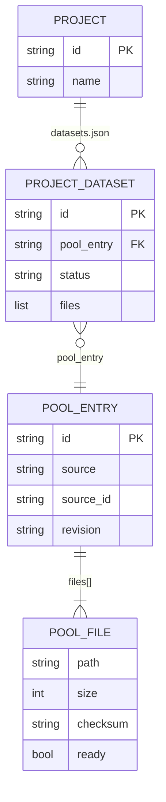

# Feature Plan: Shared Dataset Pool (NB-4)
Status: Draft — awaiting answers · Source: [epic overview](dataset-download-plan.md), ticket NB-4 (2 of 3) · Depends on: [NB-3](NB-3-dataset-download-plan.md) · Date: 2026-11-11

Downloaded data moves into one **pool** shared by all projects. When a project asks for data that's already in the pool, nothing is downloaded: the files appear in its `/work/datasets/<id>/` within a second. Kernels see pooled data **read-only**, so one project's code can't change another project's data. Deleting removes a dataset from one project; the bytes leave the pool when no project uses them. Datasets downloaded under NB-3 are moved into the pool once, on the first start after this ticket ships.

AC and test numbers are the epic's (shared by NB-3, NB-4 and NB-5).

## 1. Requirement (User Stories & Acceptance Criteria)

**US3:** As a **researcher**, I want data that's already downloaded for one project to be reused by my other projects, so that I don't download or store the same data twice.

**Acceptance Criteria** (proposed: please confirm or edit)

| # | Given | When | Then |
|---|---|---|---|
| AC15 | project A downloaded dataset X | the model in project B asks for X (same files, or a subset) | **nothing is downloaded**; X's files appear in B at `/work/datasets/<id>/` within a second, status `ready`, and the tool says `from_pool: true`. No disk space is needed and no Download/Skip is asked |
| AC16 | project B asks for files of X that A didn't download | — | only the missing files are downloaded into the pool; B sees everything it asked for, A still sees only what A asked for |
| AC17 | projects A and B ask for the same files at the same time | — | they're downloaded **once**; both projects get them when it finishes |
| AC18 | notebook code tries to change or delete a pooled file in place | — | it can't: pooled data is read-only in the kernel (copy it to edit it). Removing the dataset's folder from `/work/datasets/` only makes the dataset show as `missing` in that project |
| AC25 (extends NB-3) | a dataset is used by other projects too | I press **Delete** | the confirm says "Also used by 2 other projects: frees 0 MB here"; it's removed from this project only. When no project uses it any more, it's removed from the pool and the space is freed |
| AC27 (extends NB-3) | another project waits for the same shared download | I press **Cancel** | it's cancelled for this project only; the download keeps going for the other project |
| AC28 (extends NB-3) | notebook code deleted some dataset files from `/work/datasets/` | the model asks for the dataset again | the files are **put back from the pool** without downloading |
| AC29 | projects have datasets downloaded under NB-3 (stored in their own `files/datasets/`) | the app starts for the first time with NB-4 | each dataset is moved into the pool and replaced by links; the same dataset and revision in two projects is stored once; `/work/datasets/<id>/...` paths stay the same |
| AC30 | the model in project B asks for X, and the pool has an **older** revision of X | it calls `dataset_download` without `update: true` | the pooled version is used (no catalog call); `update: true` fetches the current one into a new pool entry, and only B switches to it |

**Negative paths:** pooled file changed on disk outside the app, link pointing outside the pool, cancel of a shared download, delete of the last user while another project starts linking, corrupt pool index, NB-3 data with missing or changed files during migration, migration interrupted.

**Out of scope for NB-4:** a page to manage the whole pool across projects (each project manages its own datasets; the pool cleans itself up, Q1); deduplicating identical files across different datasets; unpacking and preview (**NB-5**).

## 2. Codebase Patterns

Same as [NB-3 §2](NB-3-dataset-download-plan.md#2-codebase-patterns), plus:

| Area | Finding | Evidence |
|---|---|---|
| Hidden folders in `workspaces/` | Project ids must start with a letter or digit, and `list_projects` skips anything else, so `workspaces/.dataset-pool/` can never be a project | `store.py:23, 107-115` |
| Kernel container | Runs as uid 1000 with a read-only root; mounts are only `files/` at `/work` (read-write) and `/conn` (read-only). Mounts are fixed when the container starts | `researchchat/workspace/kernels.py:207-238` |
| Restarting kernels | `cleanup_leftovers()` removes this app's containers on start, so every kernel after an app restart gets the new mounts | `kernels.py:395`, `app.py:31-35` |
| Symlinks in a bind mount | A relative or absolute symlink inside `/work` is resolved **inside the container**, so a link to `/pool/...` works there while it dangles on the host | Docker bind mount behaviour |

## 3. Schema & Relationships

### 3.1 Existing Tables

| Entity | Key fields | From | Evidence |
|---|---|---|---|
| Project | `id`, `project.json` | NB-1 | `store.py` |
| `datasets.json` format 1 | full dataset record (name, source, revision, licence, `files[]` with checksums) | NB-3 | [NB-3 §3.3](NB-3-dataset-download-plan.md#33-proposed-schema-changes-described-not-applied) |
| `files/datasets/<id>/` | the downloaded files themselves | NB-3 | same |

### 3.2 Relationships (+ ER diagram)

| From | To | Cardinality | Join | Owning side & cascade | Meaning |
|---|---|---|---|---|---|
| Project | ProjectDataset | 1 → 0..n | `datasets.json` | Project; deleting a project removes its links, and the pool cleans up unused entries | which datasets this project uses, and which files |
| ProjectDataset | PoolEntry | n → 1 | `pool_entry` id | PoolEntry is shared; deleted only when no ProjectDataset points to it | one stored copy serves many projects |
| PoolEntry | PoolFile | 1 → 1..n | `files[]` in the pool index; on disk in `.dataset-pool/<entry>/` | PoolEntry | the bytes, with size and checksum |
| ProjectDataset | PoolFile | n ↔ n by path | `files[]` in the project record | none: unlinking never deletes pool files | a project sees only the files it asked for |
| Download job | PoolEntry + waiting projects | 1 → n, **in memory only** | job key = (entry, files) | none | one job serves several projects (AC17) |



Risks: a writable pool would let one project corrupt every project's data, so it's mounted **read-only** (AC18). Cleanup racing with a new link could delete data a project just linked, so both happen under one pool lock. The pool index can be rebuilt from the projects' `datasets.json` files and the folders in `.dataset-pool/` (A6).

### 3.3 Proposed Schema Changes (described, not applied)

**Layout**
```
workspaces/
  .dataset-pool/                 shared data; mounted read-only at /pool in every kernel
    hf-david-egea--creditcard-fraud-detection@90cdcb8/creditcard.csv
  .dataset-pool.json             pool index (not visible to kernels)
  .dataset-partial/              downloads in progress, now app-wide (replaces each project's .dataset-partial/)
  <project>/
    datasets.json                format 2 (below)
    files/datasets/<id>/...      symlinks → /pool/<entry>/<path>
```

**Pool index `workspaces/.dataset-pool.json`**
```json
{
  "format": 1,
  "entries": [
    {
      "id": "hf-david-egea--creditcard-fraud-detection@90cdcb8",
      "source": "huggingface",
      "source_id": "David-Egea/Creditcard-fraud-detection",
      "revision": "90cdcb82de30f04d084599dc37fa054776862e8e",
      "name": "David-Egea/Creditcard-fraud-detection",
      "url": "https://huggingface.co/datasets/David-Egea/Creditcard-fraud-detection",
      "license": "mit",
      "files": [{"path": "creditcard.csv", "size": 150828752, "checksum": "sha256:76274b69…",
                 "ready": true, "mtime_ns": 1762851123000000000}],
      "created_at": "2026-11-11T09:12:03+00:00"
    }
  ]
}
```

| Field | Type | Why |
|---|---|---|
| `id` | `<dataset-id>@<first 7 of revision>` (Zenodo: `zenodo-7395559`) | pool folder name; one entry per dataset **version**, so projects on different revisions coexist (AC30) |
| `source`, `source_id`, `revision`, `name`, `url`, `license` | as in NB-3 | moved here from `datasets.json` so they're stored once |
| `files[]` | {`path`, `size`, `checksum`, `ready`, `mtime_ns`} | the stored files; `mtime_ns` lets the app notice a file changed on disk (§5 #16) |
| `created_at` | ISO 8601 UTC | "downloaded …" in details |

**Project `datasets.json` format 2** (migrated from format 1, AC29)
```json
{"format": 2, "datasets": [{
  "id": "hf-david-egea--creditcard-fraud-detection",
  "pool_entry": "hf-david-egea--creditcard-fraud-detection@90cdcb8",
  "selection": ["*.csv"], "files": ["creditcard.csv"], "status": "ready",
  "requested_at": "2026-11-11T09:10:41+00:00", "linked_at": "2026-11-11T09:12:03+00:00", "error": null}]}
```

| Field | Change from format 1 | Why |
|---|---|---|
| `pool_entry` | new | which pooled version this project uses; changes only with `update: true` |
| `files` | now just paths | sizes and checksums live in the pool entry |
| `name`, `source`, `source_id`, `revision`, `url`, `license` | removed (read from the pool entry) | stored once |
| `downloaded_at` → `linked_at` | renamed | when this project got the files (may be long after the pool did) |

**Kernel change:** every kernel gets `--mount type=bind,source=<workspaces>/.dataset-pool,target=/pool,readonly`. New pool entries appear in running kernels at once.

**Request flow** (replaces NB-3 §3.3 steps 1–3):
1. Under the **pool lock**, find the project's record and the pool entries for this dataset.
2. Version: the project's own → else the pool's newest → else (or `update: true`) the catalog's current one.
3. Pooled files the project doesn't see yet → check size + `mtime_ns` (re-verify the checksum if changed), then link. Files missing from the pool → disk check, Download/Skip, then join an existing job for them or queue a new one.
4. A job, when done, moves files into the pool entry and links them into **every** project waiting for them.

**Cleanup:** deleting a project's dataset (or a whole project) removes its links and record; under the pool lock, a pool entry no project's `datasets.json` points to is deleted (Q1).

**Migration (AC29),** once, on the first start with NB-4, before any job runs:
1. For each project's `datasets.json` format 1, for each dataset: key = (source, source_id, revision).
2. If the pool has no entry for the key → **move** (`os.rename`, same disk, instant) the `ready` files whose size still matches into `.dataset-pool/<entry>/`; verify checksums of moved files in the background and mark bad ones not ready.
3. If the pool already has it (another project's copy) → delete this project's copies of files the pool already holds, move the rest.
4. Replace `files/datasets/<id>/` with symlinks to `/pool/<entry>/…`; files that were already gone become `missing`.
5. Write `datasets.json` format 2; keep `datasets.json.v1` as a backup.
Each project is migrated under its own step so a crash mid-way resumes: a format 2 file means "done", and a pool entry already holding the file means "already moved".

## 4. Implementation Idea

### 4.1 Approach & Files Affected

`dataset_pool.py` owns the pool index and pool lock, linking files into projects as symlinks, "used by" counts, cleanup, rebuild and migration. `DatasetService` switches from per-project storage to "pool entry + links": `request()` checks the pool first, jobs are keyed by (entry, files) and carry a set of waiting projects, cancel removes one project from a job's waiting set (the job stops only when none are left). `kernels.py` adds the read-only `/pool` mount. `datasets_store.py` reads format 1 and 2 and writes format 2. The panel adds the "also used by" line to details and the delete confirm. No new dependencies.

| | File | Change |
|---|---|---|
| 🆕 | `researchchat/workspace/dataset_pool.py` | pool index, lock, link/unlink, `still_used_by`, cleanup, rebuild, migration from format 1 |
| ✏️ | `researchchat/workspace/dataset_service.py` | pool-first `request`; shared jobs with waiting projects; per-project cancel; app-wide `.dataset-partial/` |
| ✏️ | `researchchat/workspace/datasets_store.py` | format 2 (`pool_entry`, file paths only); read format 1 for migration |
| ✏️ | `researchchat/workspace/kernels.py` | read-only `/pool` mount |
| ✏️ | `researchchat/tools/dataset_download.py`, `dataset_list.py`, `dataset_delete.py` | `from_pool`, `shared_with`, `still_used_by` in results |
| ✏️ | `researchchat/workspace/service.py` | `DatasetProps.shared_with` |
| ✏️ | `public/elements/Notebook.jsx` | "Also used by N other projects" in details and the delete confirm |
| ✏️ | `app.py` | run the migration once at start, before jobs |
| ✏️ | `README.md` | the pool, read-only data, where bytes live |
| 🆕 | `tests/test_dataset_pool.py` | tests (Step 7) |
| ✏️ | `tests/test_dataset_service.py`, `tests/test_workspace_kernels.py` | shared jobs, pool mount |

### 4.2 Endpoints

No new tools or actions; changed results:

| Kind | Name | Change |
|---|---|---|
| tool | `dataset_download` | can return `ready` with `from_pool: true` at once (no job) |
| tool | `dataset_list` | each dataset has `shared_with` (number of other projects using it) |
| tool / action | `dataset_delete`, `ds_delete` | result adds `still_used_by`; `freed_bytes` is 0 while others use it |
| action | `ds_cancel` | cancels for this project; the job continues while other projects wait |

### 4.3 DTOs

| DTO | Field | Type | Meaning |
|---|---|---|---|
| `DownloadStarted` | `from_pool` | bool | files were linked from the pool; nothing fetched |
| `DownloadStarted` | `download_bytes` | int | 0 when everything came from the pool |
| `DatasetRecordView`, `DatasetProps` | `shared_with` | int | other projects using the same pool entry |
| delete results | `still_used_by` | int | projects still using it after this delete; when > 0, `freed_bytes` is 0 |

Pool entry ids, revisions and host paths are not exposed; the model and the panel only see dataset ids and `/work` paths.

## 5. Security Review

| # | Risk | Where | Mitigation in this plan | Test ref |
|---|---|---|---|---|
| 9 | Races: two projects request the same files; cleanup of the last user while another project links | service, pool | one pool lock for the index, linking and cleanup; jobs keyed by (entry, files) so a second request joins; cleanup re-checks users under the lock | G11✅3, G7✅4, G11❌5 |
| 12 | **Shared data corrupted by one project** | pool | pool mounted **read-only** in kernels; projects see pooled files only through symlinks into that mount | G11✅4, G11❌3 (docker) |
| 16 | Pooled file changed on disk (outside the app) reused as if correct | linking | size and `mtime_ns` compared before linking; a change triggers a checksum re-check, a bad file is downloaded again | G11❌1 |
| 23 | Links pointing at host files | link creation | link targets built only as `/pool/<entry id>/<checked path>`; entry ids are generated slugs; the app never follows project symlinks on the host (it reads pool paths directly; delete uses `unlink`, and `rmtree` doesn't follow links) | G11❌2, S❌5 |
| 24 | Migration loses or mixes up data | migration | `os.rename` within one disk (no copy); size check before moving, checksum check after; `datasets.json.v1` backup; resumable per project | G14 |
| 21 | Every kernel can read every pooled dataset | `/pool` mount | **accepted** (A12): one local user, public data; `/work/datasets/` still shows only the project's own datasets | — |

## 6. Workflow Diagram

A sequence diagram of the pool-first request, because the main change is which branch a request takes before any download.

```mermaid
sequenceDiagram
    participant M as Model (project B)
    participant S as DatasetService
    participant PL as Pool (index + lock)
    participant J as Job (maybe started by project A)
    participant K as B's kernel

    M->>S: dataset_download(ref, files)
    S->>PL: lock; B's record? pool entries for this dataset?
    alt every requested file is in the pool
        PL->>PL: size + mtime same? (else re-verify checksum)
        PL->>K: symlinks in /work/datasets/<id>/ → /pool/<entry>/…
        S-->>M: ready, from_pool: true (no download, no prompt)
    else a job already fetches the missing files
        S->>J: add B to its waiting projects
        S-->>M: downloading / queued
    else
        S->>S: disk check, Download/Skip, queue job (entry, files, {B})
        S-->>M: DownloadStarted
    end
    Note over J: when the job ends
    J->>PL: move files into the entry, mark ready
    J->>PL: link into every waiting project (A and B)
```

## 7. TDD Test Plan

### Functional groups

### Moved from the epic into NB-4 (they need the pool)

| # | Type | Test name | Changed condition | Expected result | Demonstrates |
|---|---|---|---|---|---|
| G4✅4 | edge | `test_pooled_files_need_no_space_and_no_prompt` | all files already in the pool, 0 bytes free | linked, `ready`, `from_pool: true`; approve and free-disk not called | reuse is instant and free (AC15) |
| G6✅9 | edge | `test_missing_files_are_relinked_from_pool` | 1 of 3 links deleted, same request | re-linked; no download (replaces NB-3's G6✅8 behaviour when the pool has the file) | cleanup in the notebook is cheap to undo (AC28) |
| G7✅2 | edge | `test_delete_keeps_pool_data_used_by_other_project` | `p2` uses the same entry | `p1` links and record gone; entry kept; `freed_bytes: 0`, `still_used_by: 1`; `p2` unchanged | deleting in one project never breaks another (AC25) |
| G7✅4 | edge | `test_cancel_shared_job_keeps_it_for_other_project` | `p2` waits for the same job | `p1` record removed; job continues; `p2` gets `ready` | cancel is per project (AC27) |
| G7✅5 | edge | `test_delete_last_user_removes_pool_data` | only `p1` uses the entry | links, record and pool entry gone; `freed_bytes` = size | the pool cleans itself up (AC25) |

### Group 11 — Shared pool (AC15–AC18, AC30, SEC9, SEC12, SEC16, SEC23) · unit + 1 docker
Baseline: Given project `p1` has dataset X `ready` in the pool · When project `p2` requests X

| # | Type | Test name | Changed condition | Expected result | Demonstrates |
|---|---|---|---|---|---|
| ✅1 | baseline | `test_second_project_links_pool_files_without_download` | — | `p2` gets symlinks to `/pool/<entry>/…` + record `ready`, `from_pool: true`; no HTTP request | the pool saves the download |
| ✅2 | edge | `test_second_project_downloads_only_files_pool_lacks` | `p2` asks `["*.csv", "*.json"]`, pool has only csv | job fetches only json; `p2` sees both; `p1` still sees only csv | each project sees what it asked for |
| ✅3 | edge | `test_two_projects_requesting_same_files_share_one_job` | `p1` and `p2` request X (not pooled) at once | one job; each file fetched once; both `ready` | no duplicate downloads |
| ✅4 | edge | `test_kernel_mounts_pool_read_only` | build the `docker run` arguments | contains `target=/pool,readonly`; still only `files/` at `/work` | the pool can't be changed from a kernel |
| ✅5 | edge | `test_older_pooled_revision_is_reused_without_update` | pool has r1, catalog at r2, `p2` asks without `update` | `p2` linked to r1; no catalog call; with `update: true` a new entry r2 is made and only `p2` switches | no silent version changes across projects (AC30) |
| ❌1 | negative | `test_changed_pool_file_is_rechecked_before_linking` | pooled file's size or `mtime_ns` differs | checksum re-checked; bad file downloaded again before `p2` is linked | changed data is never reused blindly |
| ❌2 | negative | `test_links_never_point_outside_pool` | crafted entry id / path | refused; no symlink created | links can't expose host files |
| ❌3 | negative | `test_kernel_cannot_write_pooled_files` (`@docker`) | in the kernel: write to and delete `/work/datasets/<id>/creditcard.csv` | both fail (read-only file system); pool file unchanged | one project can't corrupt another's data (AC18) |
| ❌4 | negative | `test_corrupt_pool_index_is_rebuilt` | `.dataset-pool.json` invalid | rebuilt from projects' `datasets.json` + pool folders; `.bad` copy kept; nothing deleted | a broken index never loses data |
| ❌5 | negative | `test_cleanup_waits_for_a_project_linking_at_the_same_time` | `p1` deletes its last use while `p2` links the same entry | entry kept, `p2` linked | cleanup can't delete data someone just started using |

### Group 14 — Migration from NB-3 (AC29, SEC24) · unit
Baseline: Given projects with NB-3 `datasets.json` format 1 and real files in `files/datasets/<id>/` · When `migrate()` runs on start

| # | Type | Test name | Changed condition | Expected result | Demonstrates |
|---|---|---|---|---|---|
| ✅1 | baseline | `test_migration_moves_files_into_pool_and_links_them` | one project, one dataset | files in `.dataset-pool/<entry>/`; symlinks in `files/datasets/<id>/`; `datasets.json` format 2 + `.v1` backup; same `/work` paths | old downloads keep working |
| ✅2 | edge | `test_same_dataset_in_two_projects_is_stored_once` | `p1` and `p2` both have X at the same revision | one pool entry; `p2`'s duplicate files removed; both linked | migration frees duplicate space |
| ✅3 | edge | `test_migration_is_safe_to_run_twice` | run `migrate()` again | no changes, no errors | restarts don't redo or break anything |
| ❌1 | negative | `test_migration_marks_gone_or_changed_files` | one file deleted, one with a different size | deleted → `missing`; changed → not moved, left in place, not ready in the pool | migration never puts wrong data in the pool |
| ❌2 | negative | `test_migration_resumes_after_a_crash` | crash after project 1 of 2 | next start migrates project 2 only; project 1 untouched | an interrupted migration finishes cleanly |
| ❌3 | negative | `test_migration_skips_corrupt_manifest` | `p2/datasets.json` invalid | `p2` skipped and logged (A6 rule); `p1` migrated | one broken project doesn't block the rest |

### Security groups

| # | Type | Test name | Changed condition | Expected result | Demonstrates |
|---|---|---|---|---|---|
| S❌5 (updated) | negative | `test_delete_ignores_tampered_manifests` | record edited to `files: ["../../notebook.ipynb"]`, `pool_entry: "../x"` | only `files/datasets/<id>` links and the real entry handled; notebook intact | delete can't be steered (#8, #23) |

### Coverage (AC → tests, Security → tests)

| AC | Tests |
|---|---|
| AC15 | G4✅4, G11✅1 |
| AC16 | G11✅2 |
| AC17 | G11✅3, G7✅4 |
| AC18 | G11✅4, G11❌3 |
| AC25 (pool part) | G7✅2, G7✅5 |
| AC27 (pool part) | G7✅4 |
| AC28 (pool part) | G6✅9 |
| AC29 | G14✅1–3, G14❌1–3 |
| AC30 | G11✅5 |

| Security # | Tests |
|---|---|
| 9 Races | G11✅3, G7✅4, G11❌5 |
| 12 Shared data | G11✅4, G11❌3 |
| 16 Changed pool files | G11❌1 |
| 23 Links | G11❌2, S❌5 |
| 24 Migration | G14✅1–3, G14❌1–3 |
| 21 | accepted risk |

**Planned tests: 21 new** (5 moved, G11 10, G14 6) plus S❌5 updated and the kernel argument test in `test_workspace_kernels.py`. One (G11❌3) needs Docker.

## 8. Questions & Confirmations

**Questions**
1. **Pool cleanup:** when the last project deletes a dataset, remove it from the pool right away (default), or keep it as a cache until you clear it (would need a "clear unused data" button)?
2. **Migration:** move NB-3 datasets into the pool automatically on the first start (default), or leave old datasets where they are and only pool new downloads?

**Assumptions to confirm**
- A11. Pooled data is read-only in the kernel; to change a file, code copies it into `/work` first.
- A12. Every kernel can read the whole pool at `/pool`, but a project's `/work/datasets/` shows only its own datasets.
- A14. Workspaces live on one disk, so moving files into the pool is a rename (no copy, no extra space). If `os.rename` fails across disks, the migration copies, verifies, then deletes.

## Decision log

Decisions D1–D6 are recorded in the [epic overview](dataset-download-plan.md#decision-log).

No files or data were changed while planning, other than the plan files.
