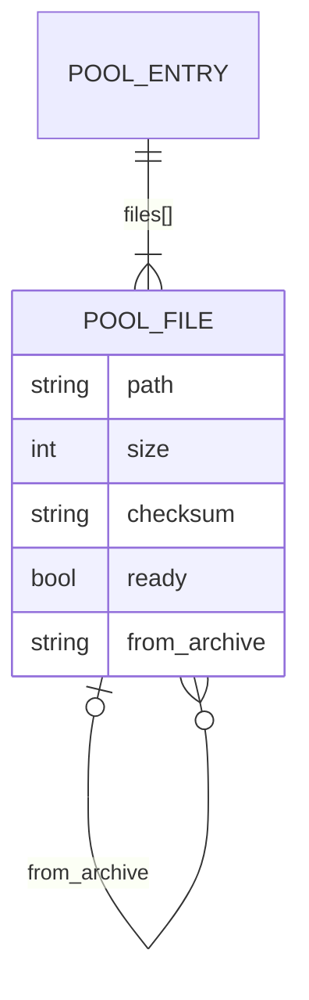
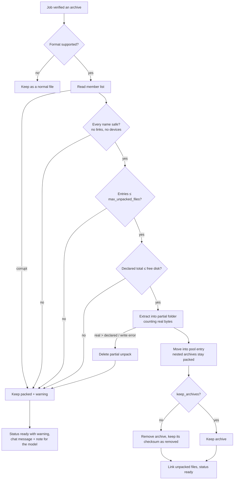

# Feature Plan: Unpack Archives & Browse Dataset Contents (NB-5)
Status: Draft — awaiting answers · Source: [epic overview](dataset-download-plan.md), ticket NB-5 (3 of 3) · Depends on: [NB-3](done/NB-3-dataset-download-plan.md), [NB-4](done/NB-4-dataset-pool-plan.md) · Date: 2026-11-11

Archives in a downloaded dataset are **unpacked automatically**, safely, inside the pool. In the panel you can **look at the data inside** a ready dataset: its file tree with sizes, the first rows of a CSV/TSV/JSONL file, the first lines of a text file, and **Open in notebook**, which adds a cell that loads the file.

AC and test numbers are the epic's (shared by NB-3, NB-4 and NB-5).

## 1. Requirement (User Stories & Acceptance Criteria)

**US4 (rest of it):** As a **researcher**, I want to look at the data inside a downloaded dataset, so that I know what it contains before I analyse it.

**US5:** As a **researcher**, I want archives (`.zip`, `.tar.gz`, …) unpacked automatically, so that the files are ready to use.

**Acceptance Criteria** (proposed: please confirm or edit)

| # | Given | When | Then |
|---|---|---|---|
| AC19 | a downloaded file is `.zip`, `.tar`, `.tar.gz`/`.tgz`, `.tar.bz2`, `.tar.xz` or a single-file `.gz` | the download finishes | the dataset shows `unpacking` with progress; the archive is unpacked into a folder with its name (e.g. `images.zip` → `images/`), the archive is removed (Q1), and the dataset shows the unpacked files |
| AC20 | an archive is unsafe (paths leaving the folder, links, device files), corrupt, has more than `max_unpacked_files` entries, unpacks to more than its headers declared, or there isn't enough disk for its unpacked size | unpacking runs | nothing unsafe is written; the archive is **kept packed**, the dataset is `ready` with a warning ("not unpacked: …"), and the starting chat and the model are told |
| AC22 | a dataset is `ready` | I open it in the panel | I see its **file tree** (folders, file names, sizes); clicking a CSV/TSV/JSONL file shows its **first 20 rows as a table**, a text file its first lines; other formats (Parquet, images, …) say "No preview here: open it in the notebook" |
| AC23 | I'm looking at a file | I press **Open in notebook** | a new code cell is added that loads it (`pd.read_csv("/work/datasets/…")`, `pd.read_parquet(…)`, …); it isn't run until I press Run |

**Negative paths:** zip slip, tar symlinks / hard links / devices, archive bomb (real size above declared), too many entries, not enough disk to unpack, corrupt archive, archive inside an archive, preview of a path outside the dataset, preview of a dataset that isn't ready, binary file named `.csv`, huge first line or cell, folder with thousands of files, a file name with quotes in Open in notebook, stale notebook version.

**Out of scope for NB-5:** previews of Parquet, Excel or images in the panel (the notebook does those, A13); unpacking archives inside archives; `.7z` and `.rar` (no standard-library support); editing files from the panel.

## 2. Codebase Patterns

Same as [NB-3 §2](done/NB-3-dataset-download-plan.md#2-codebase-patterns) and [NB-4 §2](done/NB-4-dataset-pool-plan.md#2-codebase-patterns), plus:

| Area | Finding | Evidence |
|---|---|---|
| Archive support | Python 3.14 has `zipfile`, `tarfile` with extraction filters (`filter="data"` refuses absolute paths, `..`, links outside, devices), `gzip`, `bz2`, `lzma` | `.venv` (`tarfile.data_filter` present) |
| Preview libraries | the app has **no `pandas` or `pyarrow`**; `csv` and `json` from the standard library are enough for CSV/TSV/JSONL | `requirements.txt` |
| Kernel libraries | `pandas`, `numpy`, `matplotlib`; **no `pyarrow`**, so `pd.read_parquet` fails today | `docker/kernel-requirements.txt` |
| Adding a cell from the server | `NotebookService.add_cell` + `update_cell`, versioned under the edit lock | `researchchat/workspace/service.py:210-215` |
| Wide content in the panel | code and output boxes scroll sideways on their own; the panel never does (NB-1 AC14) | `public/elements/Notebook.jsx`, `docs/plans/done/notebook-workspace-plan.md` AC14 |

## 3. Schema & Relationships

### 3.1 Existing Tables

The pool index and project `datasets.json` format 2 from [NB-4 §3.3](done/NB-4-dataset-pool-plan.md#33-proposed-schema-changes-described-not-applied).

### 3.2 Relationships (+ ER diagram)

No new entities. A pool file can now come **out of** an archive: `PoolFile.from_archive` points to the archive's path in the same entry.



Risk: if the archive is removed after unpacking, the "already downloaded" check can't compare its checksum any more. So the archive's entry stays in `files[]` with `removed: true` and its checksum, and its unpacked files count as "this archive is present" (§3.3).

### 3.3 Proposed Schema Changes (described, not applied)

Pool entry `files[]` items get three optional fields:

| Field | Type | Why |
|---|---|---|
| `from_archive` | str \| null | for unpacked files: the archive they came from (e.g. `images.zip`); `checksum` is null for them (the archive's checksum covers them) |
| `removed` | bool (default false) | the archive itself after unpacking with `keep_archives = false`; keeps its size and checksum so idempotency still works |
| `unpack_warning` | str \| null | on an archive that was kept packed: why ("not enough disk: needs 9.4 GB, 6.1 GB free") |

Project status gains `unpacking`. Project `files` lists what the project sees: the unpacked files instead of a removed archive. The "files to fetch" rule from NB-3/NB-4 treats an archive as present when it's `ready`, or `removed` with all its unpacked files `ready`.

Unpacking happens in `.dataset-partial/<entry>/unpack/` and is moved into the pool entry only when complete; a crash leaves the archive as it was, and the next start retries the unpack (not the download).

## 4. Implementation Idea

### 4.1 Approach & Files Affected

After a job verifies its files, it hands archives to `unpack.py`: it reads the archive's member list, checks every name like a catalog path, refuses links and devices, checks the declared total against free disk and the entry count against `max_unpacked_files`, then extracts into the partial folder while counting real bytes and aborting past the declared total. Archives found inside the unpacked files are left packed. On success the unpacked files join the pool entry and the archive is removed (or kept, by config); on any refusal the archive stays packed with a warning. `dataset_preview.py` lists a folder from the pool index (no disk walk) and reads at most 256 KB of a file with `csv`/`json` to build a table or text preview, after a binary check. Open in notebook builds a cell from a fixed template with the path as a Python string literal and adds it through `NotebookService`. The panel gets the expanded view (file tree + preview + buttons). `pyarrow` is added to the kernel image (Q2).

| | File | Change |
|---|---|---|
| 🆕 | `researchchat/workspace/unpack.py` | safe unpacking of zip / tar / gz with all §5 checks and progress callbacks |
| 🆕 | `researchchat/workspace/dataset_preview.py` | folder listing, CSV/TSV/JSONL/text previews, binary check, "Open in notebook" code builder |
| ✏️ | `researchchat/workspace/dataset_service.py` | unpack step in jobs; `unpacking` status and progress; warnings in finish messages and notes |
| ✏️ | `researchchat/workspace/dataset_pool.py` | `from_archive`, `removed`, `unpack_warning`; archive-present rule |
| ✏️ | `researchchat/workspace/actions.py` | `ds_files`, `ds_preview`, `ds_open_in_notebook` in `FIELDS` + `dispatch` |
| ✏️ | `researchchat/workspace/__init__.py` | `NOT_READY` error code |
| ✏️ | `researchchat/tools/dataset_download.py` | note: "archives are unpacked after downloading, so file names may change" |
| ✏️ | `public/elements/Notebook.jsx` | expanded dataset view: file tree, table/text preview, Open in notebook (overview §UI, part 4); unpacking row and warning row |
| ✏️ | `researchchat/config.py`, `config.toml` | `max_unpacked_files`, `preview_rows`, `keep_archives` |
| ✏️ | `docker/kernel-requirements.txt` | `pyarrow` (one-time image rebuild) |
| ✏️ | `README.md` | unpacking rules, previews |
| 🆕 | `tests/test_unpack.py`, `tests/test_dataset_preview.py` | tests (Step 7) |

New config:
```toml
max_unpacked_files = 10000     # entries per archive
preview_rows = 20              # rows shown in a table preview
keep_archives = false          # keep the .zip after unpacking it (Q1)
```

### 4.2 Endpoints

| Kind | Name | Purpose | Success | Errors |
|---|---|---|---|---|
| action | `ds_files` `{dataset_id, dir}` | one folder of the file tree | `FileListing` | `NOT_FOUND`, `NOT_READY` |
| action | `ds_preview` `{dataset_id, path}` | first rows / lines of one file | `FilePreview` | `NOT_FOUND`, `NOT_READY` |
| action | `ds_open_in_notebook` `{version, dataset_id, path}` | add a code cell that loads the file (not run) | NotebookProps | `NOT_FOUND`, `NOT_READY`, `STALE` |

Design notes:
- **Previews run in the app, not the kernel**, with the standard library only, so browsing never touches your notebook's variables or waits for a running cell.
- **Folder listings come from the pool index**, so a dataset with 10,000 files opens instantly; at most 500 entries per folder are sent.
- **Open in notebook only adds the cell**: you decide when to run it, like any other cell.
- **The model doesn't get preview tools**: it can read files in the notebook with `notebook_run`, which already has its own safety rules.

### 4.3 DTOs

**`ds_files`**
```json
{"dataset_id": "zenodo-1234567", "dir": "images"}
→ {"dir": "images", "entries": [{"name": "train", "kind": "dir", "size": 512000000, "count": 8000},
                                {"name": "labels.csv", "kind": "file", "size": 120400}], "truncated": false}
```
| Field | Type | Meaning |
|---|---|---|
| `dataset_id` | str | a dataset of the session's project |
| `dir` | str | folder relative to the dataset (`""` = top), checked like any path |
| `entries[]` | {`name`, `kind`, `size`, `count`} | `kind` `dir`/`file`; folders show total size and file count from the pool index |
| `truncated` | bool | more than 500 entries in this folder |

**`ds_preview`**
```json
{"dataset_id": "zenodo-7395559", "path": "creditcard.csv"}
→ {"path": "creditcard.csv", "kind": "table", "columns": ["Time", "V1", "Amount", "Class"],
   "rows": [["0", "-1.36", "149.62", "0"]], "total_rows": null, "truncated": true}
```
| Field | Type | Meaning |
|---|---|---|
| `kind` | `table` \| `text` \| `none` | how the panel draws it; `none` comes with `message` ("No preview here: open it in the notebook") |
| `columns`, `rows` | list[str], list[list[str]] | first `preview_rows` rows of CSV/TSV/JSONL; every cell a string cut to 200 characters |
| `lines` | list[str] | text: first 50 lines, each cut to 500 characters |
| `total_rows` | int \| null | null: at most 256 KB is read, so the file isn't counted |
| `truncated` | bool | more rows, lines or characters exist |

**`ds_open_in_notebook`**: `{"version": int, "dataset_id": str, "path": str}`. The cell comes from a fixed template per type, the path inserted with `repr()`:

| File type | Cell |
|---|---|
| `.csv`, `.tsv` | `import pandas as pd` / `df = pd.read_csv('…', sep=…)` / `df.head()` |
| `.parquet` | `pd.read_parquet('…')` (needs `pyarrow`, Q2) |
| `.jsonl`, `.json` | `pd.read_json('…', lines=True)` / `pd.read_json('…')` |
| `.png`, `.jpg` | `import matplotlib.pyplot as plt, matplotlib.image as mpimg` / `plt.imshow(mpimg.imread('…'))` |
| other | `print(open('…', errors='replace').read(2000))` |

**`DatasetProps` additions**: `status` may be `unpacking` with `done_files` / `total_files`; `warnings: list[str]` for archives kept packed.

## 5. Security Review

| # | Risk | Where | Mitigation in this plan | Test ref |
|---|---|---|---|---|
| 13 | **Zip slip / tar links / devices** | `unpack.py` | every member name checked like a catalog path (no absolute, `..`, backslash, NUL); tar extracted with `filter="data"` and links, hard links and devices refused on top; one bad member aborts the whole unpack | G12❌1–2 |
| 14 | **Archive bombs** | `unpack.py` | declared total checked against free disk first; real bytes counted while writing, abort past the declared total; `max_unpacked_files`; archives inside archives not unpacked | G12❌3–5, ❌7 |
| 15 | **Code injection via Open in notebook** | `ds_open_in_notebook` | fixed templates; the path inserted with `repr()`; only paths from the dataset's file list; the cell is never run automatically | G13✅4, G13❌5 |
| 17 | XSS from file contents in previews | `Notebook.jsx` | rows, cells and lines rendered as React text; nothing as HTML | G13❌3 + manual |
| 18 | Resource use by previews | `ds_preview`, `ds_files` | ≤ 256 KB read, `preview_rows` rows, 50 lines, cell and line caps, 500 entries per folder; listing from the index, not the disk | G13❌4 |
| 25 | Preview reads files outside the dataset | `ds_preview` | path must be in the dataset's file list for the session's project and resolve inside the pool entry; anything else is `NOT_FOUND` | G13❌1 |

## 6. Workflow Diagram

A flowchart, because unpacking is mostly a chain of checks where any failure has the same safe outcome: keep the archive packed and warn.



## 7. TDD Test Plan

### Functional groups

### Group 12 — Unpacking (AC19, AC20, SEC13, SEC14) · unit (real archives built in `tmp_path`)
Baseline: Given a downloaded, verified `images.zip` (3 files) and plenty of disk · When the job unpacks it

| # | Type | Test name | Changed condition | Expected result | Demonstrates |
|---|---|---|---|---|---|
| ✅1 | baseline | `test_zip_is_unpacked_into_folder_named_after_it` | — | `images/a.png`, `images/b.png`, `images/c.txt` in the pool and linked; `images.zip` removed but kept in the index as `removed` | archives are ready to use |
| ✅2 | edge | `test_tar_variants_and_single_gz_are_unpacked` | `.tar.gz`, `.tgz`, `.tar.bz2`, `.tar.xz`, `data.csv.gz` | folders for tars; `data.csv` for the gz | every listed format works |
| ✅3 | edge | `test_keep_archives_keeps_the_archive` | `keep_archives = true` | archive and folder both there | the setting works |
| ❌1 | negative | `test_zip_slip_aborts_and_keeps_archive` | member `../../evil.py` or `/abs` | nothing written outside; nothing unpacked; archive kept; warning | zip slip can't write anywhere |
| ❌2 | negative | `test_tar_links_and_devices_are_refused` | symlink, hard link, char device members | refused; archive kept; warning | links can't point at host files |
| ❌3 | negative | `test_not_enough_disk_to_unpack_keeps_archive` | declared unpacked size > free disk | not unpacked; `ready` with "not enough disk" warning | unpacking never fills the disk |
| ❌4 | negative | `test_archive_bomb_aborts_on_real_size` | headers declare 1 MB, data inflates to 50 MB | aborted at the declared size; partial unpack removed; archive kept; warning | lying headers don't help a bomb |
| ❌5 | negative | `test_too_many_archive_entries` | 10,001 entries | not unpacked; warning | `max_unpacked_files` holds |
| ❌6 | negative | `test_corrupt_archive_is_kept_with_warning` | truncated zip | `ready` with warning; archive kept | a bad archive doesn't fail the download |
| ❌7 | negative | `test_nested_archives_are_not_unpacked` | `outer.zip` contains `inner.zip` | `outer/inner.zip` stays packed | unpacking is one level only |

### Group 13 — Browse and preview (AC22, AC23, SEC15, SEC17, SEC18, SEC25) · unit
Baseline: Given a `ready` dataset with `creditcard.csv`, `notes.txt`, `data.parquet`, `img.png`, `sub/x.csv` · When `ds_preview` / `ds_files` / `ds_open_in_notebook`

| # | Type | Test name | Changed condition | Expected result | Demonstrates |
|---|---|---|---|---|---|
| ✅1 | baseline | `test_ds_files_lists_folder_with_sizes` | `dir=""` | 4 files + `sub` folder (size, count) | you can see what's inside |
| ✅2 | edge | `test_ds_preview_csv_first_rows` | `creditcard.csv` (100 rows) | `kind: table`, header + 20 rows, `truncated: true` | a quick look at tabular data |
| ✅3 | edge | `test_ds_preview_text_first_lines` | `notes.txt` | `kind: text`, ≤ 50 lines | text files preview too |
| ✅4 | edge | `test_open_in_notebook_adds_unrun_load_cell` | `creditcard.csv`, current version | new last cell `pd.read_csv('/work/datasets/<id>/creditcard.csv')`; not executed; version +1 | one click from data to analysis |
| ✅5 | edge | `test_unsupported_format_points_to_notebook` | `data.parquet`, `img.png` | `kind: none` + "open it in the notebook" | the panel never pretends to read binaries |
| ❌1 | negative | `test_preview_path_outside_dataset_is_not_found` | `../../datasets.json`, `/etc/passwd`, another dataset's file | `NOT_FOUND`; nothing read | previews can't read other files |
| ❌2 | negative | `test_preview_of_not_ready_dataset` | dataset `downloading` or `unpacking` | `NOT_READY` | no previews of half files |
| ❌3 | negative | `test_preview_of_binary_disguised_as_csv` | `fake.csv` with NUL bytes | `kind: none` | binary data never reaches the table |
| ❌4 | negative | `test_preview_caps_size_and_lengths` | 10 MB first line; 5,000-char cell; folder with 2,000 entries | ≤ 256 KB read; cells cut to 200 chars; 500 entries + `truncated` | previews stay small and fast |
| ❌5 | negative | `test_open_in_notebook_escapes_path` | file named `a'); import os; os.system('x').csv` | the name appears only inside a string literal; the cell parses with `ast` to one `read_csv` call | file names can't inject code |

### Coverage (AC → tests, Security → tests)

| AC | Tests |
|---|---|
| AC19 | G12✅1–3 |
| AC20 | G12❌1–7 |
| AC22 | G13✅1–3, ✅5, G13❌1–4 |
| AC23 | G13✅4, G13❌5 |

| Security # | Tests |
|---|---|
| 13 Zip slip / links | G12❌1–2 |
| 14 Bombs | G12❌3–5, ❌7 |
| 15 Code injection | G13✅4, G13❌5 |
| 17 XSS | G13❌3 + manual |
| 18 Preview resources | G13❌4 |
| 25 Preview paths | G13❌1 |

**Planned tests: 20 new** (G12 10, G13 10).

## 8. Questions & Confirmations

**Questions**
1. **Archives after unpacking:** remove the archive to save space (`keep_archives = false`, default), or keep both?
2. **Parquet:** add `pyarrow` to the kernel image so Open in notebook works for Parquet files (Hugging Face stores many datasets as Parquet)? It needs a one-time image rebuild. Default: yes.

**Assumptions to confirm**
- A13. The panel previews CSV, TSV, JSONL and text only; Parquet, Excel and images are opened in the notebook.
- A15. `.7z` and `.rar` are left packed (no standard-library support); a warning says so.

## Decision log

Decisions D1–D6 are recorded in the [epic overview](dataset-download-plan.md#decision-log).

No files or data were changed while planning, other than the plan files.
