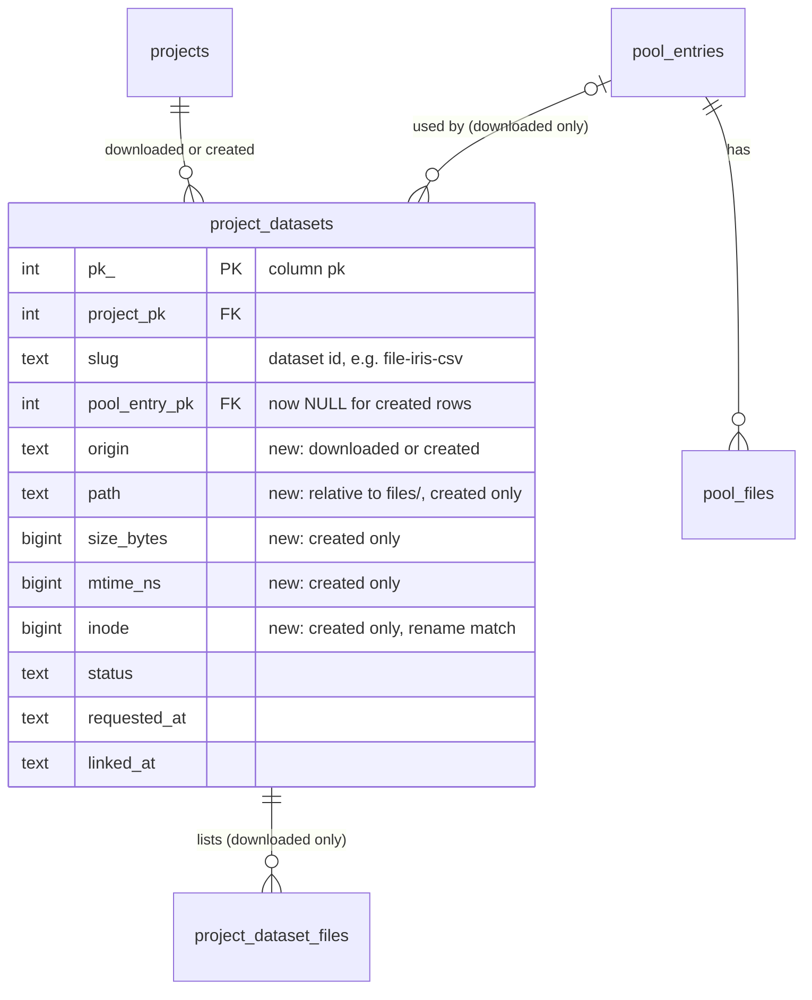
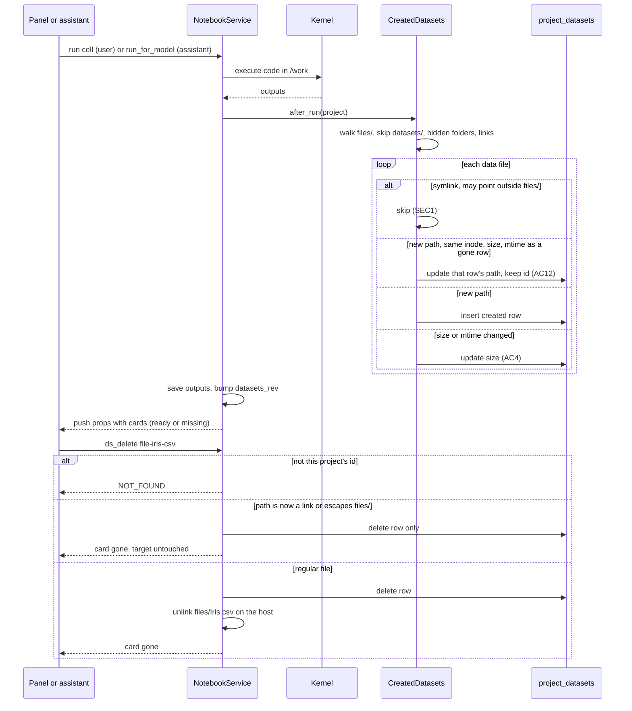
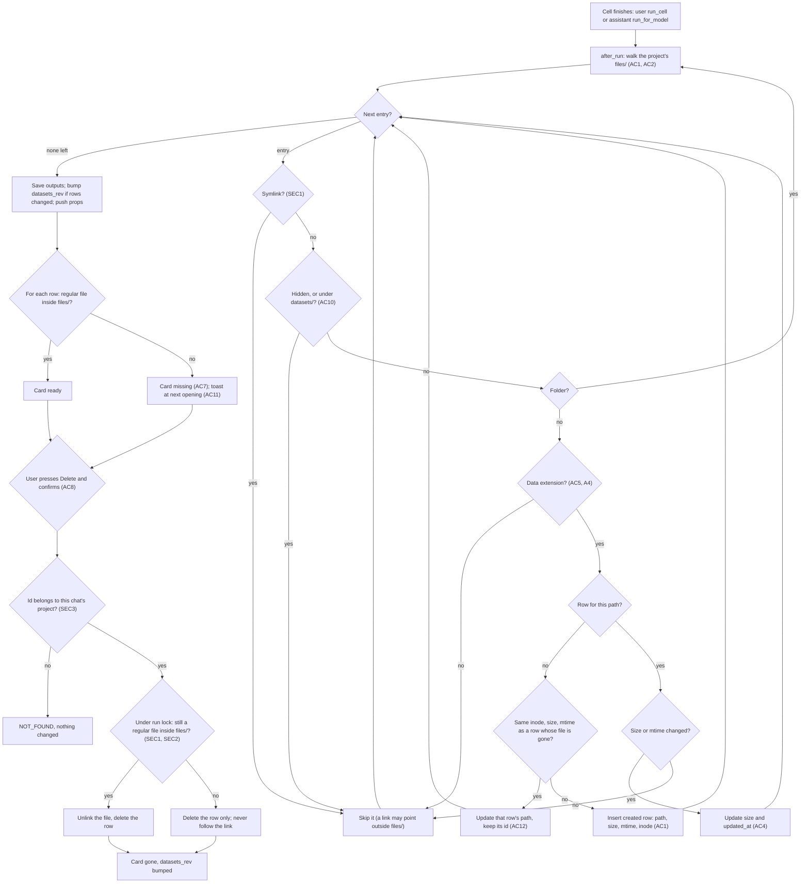

# Feature Plan: Show data files created in the notebook in the Datasets tab

Status: Implemented — awaiting review · Branch: `feat/PCD-1-created-datasets` · Source: [STORY-01](../tasks/02-project-created-datasets/STORY-01-list-created-datasets.md) · Epic: [Project-created datasets](../requirements/02-project-created-datasets/README.md) · Date: 2026-11-16

## 1. Requirement (User Stories & Acceptance Criteria)

**User Story** (copied from the story):
As a **researcher working in a project**, I want **every data file created in my notebook, by the assistant or by my own code, to show up in the Datasets tab**, so that **I can see what data my project has, find its path, and load it again without asking where the file went**.

**Acceptance Criteria** (copied as-is, numbering kept; short form here, full text in the story):

| AC | Given / When / Then (short) |
|---|---|
| AC1 | Assistant's notebook code saves `Iris.csv` in the working folder → in the same turn the tab shows a card: name, size, `ready`, path `/work/Iris.csv`, no page reload |
| AC2 | The user's own cell saves `results.csv` → after the cell finishes, a card appears exactly as in AC1 |
| AC3 | Downloaded `hf-scikit-learn--iris` and created `Iris.csv` are in one list; the created one is labelled **"Created by myself"**, no source / licence / "shared with"; downloaded unchanged |
| AC4 | Saving `Iris.csv` again at the same path → still exactly one card, size updated |
| AC5 | A cell saves `Iris.csv`, `plot.png`, `model.pkl` → only `Iris.csv` gets a card (CSV, TSV, JSON/JSONL, Parquet, Excel) |
| AC6 | "Copy load code" / insert-into-notebook on a created dataset → code loads `/work/Iris.csv` and runs without error |
| AC7 | Notebook code deletes or renames the file → card shows `missing`; `dataset_list` reports `missing` |
| AC8 | Delete on a created card → confirmation says the file is removed permanently and the app keeps no other copy; Confirm removes file + card, Cancel changes nothing |
| AC9 | After the assistant saves `Iris.csv`, `dataset_list` includes it with `/work/Iris.csv` |
| AC10 | A file written outside the working folder, or a link pointing outside it → no card, no other project changes; pool links under `/work/datasets/…` still show as downloaded datasets only |
| AC11 | A listed created file was deleted/renamed outside the tab → when the user opens the workspace (chat start or switch), one notification per opening says it can't be found; the card keeps `missing` until deleted |

**Added AC** (approved 2026-11-16, see Decision log; the story file is deliberately **not** updated, D5):
- **AC12** — *A rename keeps the same card under the new name.* Given `Iris.csv` is listed, When notebook code renames or moves it to another data-file path inside the working folder (e.g. `iris_v2.csv`, `out/Iris.csv`), Then the same card (same id) shows the new name and path, status `ready`; no `missing` card and no second card. A rename to a non-data name or into a skipped folder (hidden, `datasets/`) counts as removed (AC7).
  *This replaces the "or renames" part of AC7 and AC11 for renames the app can detect* (same file on disk: same inode, size and mtime). A rename the app can't match (the file was also changed in the same run) still behaves as AC7: old card `missing`, new card.
- **AC13** — *A file saved again after Delete gets a new card.* Given the user deleted `Iris.csv` from the tab, When code saves `Iris.csv` again, Then a new card appears (AC1 rule; the tab mirrors the folder).

**Out of scope** (from the story): reusing a downloaded dataset (STORY-04); file tree / preview (NB-5); new catalogs, pasted links, uploads; sharing created files between projects; blocking kernel reads of pool datasets (STORY-03); checking a created file is real data.
**Also out of scope here:** scan limits for very large working folders (already a "Later sprints" item in the backlog, see A9); files written by a background thread *after* the cell finished (picked up at the next run).

**Dependencies:** builds on NB-3/NB-4 storage and the NB-7 SQLite storage, which is merged into `main` (PR #11, `62e13ab`). Work happens on `feat/PCD-1-created-datasets`, created from `origin/main` on 2026-11-16 (D1). The "in-flight download-summary work" the story names isn't in the tree: no `download_summary.py`, and `actions.py` / `dataset_service.py` have no uncommitted changes (`git status`, 2026-11-16).

## 2. Codebase Patterns

| Area | What the code does | Evidence |
|---|---|---|
| Architecture / layering | Chainlit action callbacks → `actions.dispatch` → services (`NotebookService`, `DatasetService`) → storage modules (`store.py`, `datasets_store.py`). Services get collaborators injected; `actions.py` is the only composition root | `researchchat/workspace/actions.py:29-80`, `dataset_service.py:216-251` (comment "Only stores dependencies") |
| Cross-service wiring | NotebookService doesn't import DatasetService; a callable is injected after both are built | `service.py:176-181` (`datasets: DatasetState`), `actions.py:80` |
| Naming | storage modules `*_store.py`; tools `researchchat/tools/<noun>_<verb>.py` with `DEFINITION`, `step_title`, `run`; TypedDict views `*Props` (panel) and `*View` (model) | `tools/dataset_list.py`, `service.py:65-99`, `dataset_service.py:107` |
| API (panel ↔ server) | No HTTP: panel calls `callAction(name, payload)`; payload fields allow-listed in `FIELDS`; project always from the session, never the payload | `actions.py:85-104`, `actions.py:107-132` |
| Panel props | Full `NotebookProps` pushed to every open panel of a project; `datasets_rev` bumps on each dataset change so the panel keeps the newest list | `service.py:91-99`, `dataset_service.py:262-264` |
| Validation | Hand-written: payload type check in `read_payload`; ids by regex `DATASET_ID_RE`; paths by `safe_relpath` / `path_inside`; symlinks refused by comparing `resolve()` | `actions.py:116-132`, `datasets_store.py:38,67-78,108-114` |
| Errors | `WorkspaceError(ErrorCode.X, message)`; `actions.handle` turns it into props with `error` set; tools turn it into `ValueError` | `workspace/__init__.py:7-30`, `actions.py:192-204`, `tools/notebook_run.py:79-80` |
| Persistence | SQLite via SQLAlchemy Core tables + Alembic (`researchchat/db/migrations/versions/000N_*.py`); integer `pk` internal, `slug` public; named constraints for batch mode; "missing" is computed on read, never stored | `db/schema.py:1-38`, `0001_initial_schema.py`, `datasets_store.py:46` |
| Locks | Per-project `run` lock serialises runs; dataset changes under the pool lock | `service.py:190-194,300`, `dataset_service.py:254-255` |
| Auth & security | Local single-user app; server binds localhost only (`check_local_host`). Kernel is a container with only `files/` at `/work` read-write; the DB lives outside every mount so kernel code can't edit it | `app.py:26`, `kernels.py:4,256-270`, `datasets_store.py:7-9` |
| Chat messages from the server | `cl.Message(...).send()` in the session's context; `ChatRegistry.send` for background jobs | `actions.py:34-63`, `tools/notebook_run.py:46-60` |
| Toast notifications | Chainlit 2.12.0 has a built-in toast: `await cl.context.emitter.send_toast(message, type)` (`type` ∈ ToastType, e.g. `"warning"`). Not used in the app yet; AC11 uses it (D4) | `.venv/…/chainlit/emitter.py:468-473` |
| Testing | pytest, function tests named `test_<behaviour_in_words>`; `root` = tmp workspace; `FakeKernels` instead of Docker; `@pytest.mark.docker` for real kernels; panel: Vitest + Testing Library (`*.test.tsx`) | `tests/conftest.py:69-90`, `tests/test_dataset_service.py:241-568`, `public/panel/src/components/DatasetCard.test.tsx` |

## 3. Schema & Relationships

### 3.1 Existing Tables

| Table | Key columns | Constraints & indexes | Evidence |
|---|---|---|---|
| `projects` | `pk` int PK, `slug` text unique, `name`, `created_at` text ISO | `uq_projects_slug`, name length check | `db/schema.py:40-48` |
| `project_datasets` | `pk`, `project_pk` FK, `slug`, `pool_entry_pk` FK **NOT NULL**, `position`, `selection` JSON, `status` ∈ queued/downloading/ready/failed, `requested_at`, `linked_at`, `error` | unique (`project_pk`,`slug`); FK project CASCADE; FK pool entry RESTRICT | `db/schema.py:79-94` |
| `pool_entries` / `pool_files` | catalog dataset + files; `source` ∈ huggingface/zenodo | `ck_pool_entries_source_known` | `db/schema.py:50-77` |

`project_datasets` can't hold a created file as is: `pool_entry_pk` is NOT NULL (`db/schema.py:85`). Created files go into this table anyway (D2), so §3.3 makes it nullable and adds an `origin` column. Three things in today's code must then be scoped to downloaded rows:
- `save_project_datasets` **deletes every row of the project** before writing the downloaded list back (`datasets_store.py:189`). Unscoped, every download, cancel or delete would wipe all created rows. → delete only `origin = 'downloaded'` rows (G10❌1).
- `load_project_datasets` inner-joins `pool_entries` (`datasets_store.py:206`), so created rows (NULL pool entry) already drop out; an explicit `origin = 'downloaded'` filter makes that intended, not accidental (G10❌5).
- `DatasetPool.projects_using` inner-joins too (`dataset_pool.py:270-271`), so "shared with" counts are unaffected.
Every downloaded-dataset path in `DatasetService` (`_entry`, `_size`, `_missing`, `delete`, `_users_by_entry`) keeps working on `ProjectDataset`, which never holds a created row.

### 3.2 Relationships (+ ER diagram)

| From | To | Cardinality | FK / join | Owning side & cascade | Business meaning |
|---|---|---|---|---|---|
| `projects` | `project_datasets` | 1 → 0..n | `project_datasets.project_pk` | CASCADE | downloaded datasets of a project |
| `pool_entries` | `project_datasets` | 0..1 → 0..n | `pool_entry_pk` (now nullable) | RESTRICT | one shared pooled version, used by many projects; created rows have none |
| `projects` | `project_datasets` with `origin = 'created'` | 1 → 0..n | `project_datasets.project_pk` | CASCADE | data files the project's own code wrote; `pool_entry_pk` is NULL |



Created files are **not** connected to `pool_entries`: the pool holds catalog downloads shared between projects, and a created file is written by one project's own code into its own `files/` folder. Other workspaces can't reach it either: each kernel mounts only its own `files/` (`kernels.py:267-270`) and every query is by `project_pk`.

Risks: none of N+1 (one query per project); CASCADE on project delete is wanted (the files go with the project folder anyway); the replace-all save above (G10❌1).

### 3.3 Proposed Schema Changes

Changes to **`project_datasets`** (described, not applied; D2):

| Column | Change | Type | Null | Default | Why |
|---|---|---|---|---|---|
| `pool_entry_pk` | NOT NULL → **nullable** | Integer FK, RESTRICT kept | yes | — | a created file has no pool entry |
| `origin` | 🆕 | Text | no | `'downloaded'` | which kind of row: decides card layout (AC3) and which code path owns it |
| `path` | 🆕 | Text | yes | NULL | created only: POSIX path relative to `files/` (`Iris.csv`, `out/results.csv`); kernel path is `/work/<path>` |
| `size_bytes` | 🆕 | BigInteger | yes | NULL | created only: size at the last scan (AC1, AC4) |
| `mtime_ns` | 🆕 | BigInteger | yes | NULL | created only: detects "saved again" without reading the file (AC4); part of the rename match (AC12) |
| `inode` | 🆕 | BigInteger | yes | NULL | created only: a rename keeps the inode, so (inode, size, mtime_ns) finds the card of a renamed file (AC12) |

Existing columns used by created rows: `slug` = the id (`file-iris-csv`, stored at insert and kept on rename, D3/A3), `status` = always `'ready'` (missing is computed), `requested_at` = first seen, `linked_at` = last change, `position` = after the downloaded rows, `selection` / `error` = NULL. No `project_dataset_files` rows.

Constraints:
- `CheckConstraint("origin IN ('downloaded', 'created')", name="origin_known")`
- `CheckConstraint(name="origin_shape")`: `(origin = 'downloaded' AND pool_entry_pk IS NOT NULL AND path IS NULL) OR (origin = 'created' AND pool_entry_pk IS NULL AND path IS NOT NULL AND size_bytes IS NOT NULL AND mtime_ns IS NOT NULL AND length(path) BETWEEN 1 AND 1024)` — a row is always one kind or the other, never half of each.
- `UniqueConstraint("project_pk", "path")` — one card per path (AC4), the upsert key. SQLite allows many NULLs in a unique index, so downloaded rows are unaffected.
- Existing `uq (project_pk, slug)` keeps created ids unique within a project.

Status is **not stored** for created rows: `ready` when `files/<path>` is a regular file inside `files/` (not a link), else `missing` — same rule as today ("missing is computed on read", `datasets_store.py:46`).

Migration: `researchchat/db/migrations/versions/0002_created_datasets.py`, `down_revision = "0001"`. Uses `op.batch_alter_table("project_datasets")` because SQLite can't alter a column's nullability in place (the named constraints from `NAMING_CONVENTION` make the table rebuild safe, `db/schema.py:24-31`). **Foreign keys must be off during the rebuild:** every connection runs `PRAGMA foreign_keys=ON` (`researchchat/db/engine.py:23`), and batch mode drops the old `project_datasets`, which would cascade-delete every `project_dataset_files` row. The migration turns foreign keys off around the batch (outside the transaction) and runs `PRAGMA foreign_key_check` after (G10✅2, ✅3). Existing rows get `origin = 'downloaded'` from the server default; no other backfill (files already in `files/` show up on the first scan, A6). **Downgrade** deletes `origin = 'created'` rows (their files stay on disk), drops the new columns and constraints, and makes `pool_entry_pk` NOT NULL again. Runs automatically at start via `database_for` (`app.py:17`).

## 4. Implementation Idea

### 4.1 Approach & Files Affected

After every cell run (assistant's or user's), `NotebookService._run` calls an injected `after_run(project_id)` hook *before* it pushes the final props. The hook is `CreatedDatasets.sync(project_id)`: it walks `files/` (skipping `files/datasets/`, hidden folders and every symlink), keeps files with a data extension, and upserts `origin = 'created'` rows of `project_datasets` (new path → insert; changed size/mtime → update; a new path whose inode, size and mtime match a row whose file is gone → that row's path is updated, same id (AC12); rows whose file is still gone are kept and read as `missing`). Because the scan runs inside the run, the same push that shows the cell's output also shows the new card (AC1/AC2), and `run_for_model` returns only after it, so a following `dataset_list` sees it (AC9).

`CreatedDatasets` is a new small service composed into `DatasetService` (not a subclass, no `if pool_entry is None` branches spread through the download code): `panel_state` and `list_for_model` append its rows; `delete` asks it first whether the id is a created file. It reuses the NB-3 path rules (`safe_relpath`, `resolve()` compare) from `datasets_store.py`. Created rows are read and written by a new `created_datasets_store.py` on the same table (filtered by `origin`), so `datasets_store.py` only gains the `origin = 'downloaded'` scoping from §3.1. The panel adds an `origin` field to tell the two kinds apart (AC3), its own delete text (AC8) and load code from a file path (AC6). AC11 is a Chainlit toast (`send_toast(…, "warning")`) sent from `open_for_session` and after `nb_switch_project`.

**Files affected** (the scaffold parks the migration and `schema.py` change, leaves `tests/test_panel_ui.py` and `public/build/*` alone: see the scaffold report §9.5 and D9)

| | File | Change |
|---|---|---|
| 🆕 | `researchchat/db/migrations/versions/0002_created_datasets.py` | `project_datasets`: nullable `pool_entry_pk`, `origin`, `path`, `size_bytes`, `mtime_ns`, `inode`, constraints |
| ✏️ | `researchchat/db/schema.py` | same columns and constraints on `project_datasets` |
| ✏️ | `researchchat/workspace/datasets_store.py` | load and replace-all save scoped to `origin = 'downloaded'` |
| 🆕 | `researchchat/workspace/created_datasets_store.py` | load / insert / update / rename / delete created rows; id making |
| 🆕 | `researchchat/workspace/created_datasets.py` | `CreatedDatasets`: `sync`, `panel_rows`, `model_views`, `delete`, `missing_names`; folder scan |
| ✏️ | `researchchat/workspace/dataset_service.py` | compose `CreatedDatasets`; include its rows in `panel_state`, `list_for_model`; route `delete`; `origin` in views |
| ✏️ | `researchchat/workspace/service.py` | `AfterRun` hook param, called in `_run` before `save_result`; `origin` in `DatasetProps` |
| ✏️ | `researchchat/workspace/actions.py` | wire hook; missing-file toast in `open_for_session` and after `nb_switch_project` |
| ✏️ | `researchchat/tools/dataset_list.py` | description + line format for created files |
| ✏️ | `researchchat/config.py` | `CREATED_DATA_EXTENSIONS` constant (A4) |
| ✏️ | `public/panel/src/types.ts` | `origin` on `DatasetProps` |
| ✏️ | `public/panel/src/components/DatasetCard.tsx` | "Created by myself" label, hide licence/source/shared, delete and missing texts |
| ✏️ | `public/panel/src/lib/loadCode.ts` | created file → load from `d.path` |
| ✏️ | `public/build/notebook-panel.js`, `.css` | rebuilt bundle (generated) |
| 🆕 | `tests/test_created_datasets.py` | scan + listing rules (unit, no kernel) |
| 🆕 | `tests/test_created_datasets_store.py` | created-row storage and constraints |
| ✏️ | `tests/test_database.py` | migration 0002 up / down |
| ✏️ | `tests/test_datasets_store.py` | downloaded save keeps created rows |
| ✏️ | `tests/test_dataset_tools.py`, `tests/test_workspace_service.py`, `tests/test_panel_ui.py` | hook, `dataset_list`, toast |
| ✏️ | `public/panel/src/components/DatasetCard.test.tsx`, `public/panel/src/lib/actions.test.tsx` | card + load code |

### 4.2 Endpoints

No HTTP endpoints; the "API" is Chainlit actions and one model tool.

| Kind | Name | Purpose | Success | Errors |
|---|---|---|---|---|
| panel action (existing) | `ds_delete {dataset_id}` | delete a created file + its card (AC8) | props without the card | `NOT_FOUND` unknown id / another project's id; `BAD_PAYLOAD` bad type |
| model tool (existing) | `dataset_list` | lists created files too (AC9) | lines + JSON views | — |
| server push (existing) | `NotebookProps.datasets` | carries created rows (AC1–AC5, AC7) | — | — |
| toast (new) | missing-file notice, `send_toast(text, "warning")` | AC11 | one toast per opening | none (silent when nothing is missing) |

Why reuse `ds_delete`: one Delete button, one action; the id prefix `file-` can't clash with catalog ids (`hf-`, `zenodo-`), so routing is by lookup, not by payload flag. No new action → no new allow-list entry (`FIELDS`).

### 4.3 DTOs

**`DatasetProps` (server → panel)** — existing shape, one field added, values for a created file:

```json
{"id": "file-iris-csv", "name": "Iris.csv", "origin": "created", "source": "created",
 "status": "ready", "size_bytes": 4551, "file_count": 1, "path": "/work/Iris.csv",
 "files": [{"path": "Iris.csv", "size": 4551}], "requested_at": "2026-11-16T09:12:03Z",
 "downloaded_at": "2026-11-16T09:12:03Z", "license": null, "url": null, "shared_with": 0,
 "done_bytes": null, "position_in_queue": null, "error": null}
```

| Field | Type | Req | Validation / Format | Maps to | Meaning |
|---|---|---|---|---|---|
| `origin` 🆕 | `"downloaded" \| "created"` | yes | enum | `project_datasets.origin` | tells the card which layout to use: catalog details vs "Created by myself" (AC3) |
| `id` | str | yes | `file-[a-z0-9-]{1,75}` | `project_datasets.slug` | sent back in `ds_delete`; kept on rename (AC12) |
| `name` | str | yes | ≤ 200 chars | basename of `project_datasets.path` | card title, the name the user typed in code; changes on rename |
| `source` | str | yes | `"created"` | constant | badge text slot; panel maps `created` → "Created by myself" |
| `status` | `"ready" \| "missing"` | yes | | derived (file on disk) | AC1, AC7 |
| `size_bytes` | int | yes | ≥ 0 | `project_datasets.size_bytes` | card size; updated on re-save (AC4) |
| `path` | str | yes | `/work/<path>` | derived from `project_datasets.path` | copy-able path, used by load code (AC6) |
| `files` | list | yes | one item `{path: basename-relative, size}` | derived | keeps the existing card file list working |
| `requested_at` / `downloaded_at` | ISO str | yes | | `requested_at` / `linked_at` | sort newest; "added 2 h ago" |
| `license`, `url`, `error`, `done_bytes`, `position_in_queue` | null | — | always null | — | not applicable to own files (AC3) |
| `shared_with` | int | yes | always 0 | — | created files are never shared (out of scope) |

Downloaded rows get `origin: "downloaded"`; nothing else about them changes.

**`DatasetRecordView` (model, `dataset_list`)** — add `origin`; for created files `path` = `/work/Iris.csv`, `files` = `[path]`, `missing_files` = `[path]` when missing, licence/url/shared null/0. Tool line: `- Iris.csv · ready · 4.6 KB · created in this project · \`/work/Iris.csv\``.

Not exposed: the internal `pk`, `project_pk`, `mtime_ns`, `inode`, and the host path (`workspaces/<project>/files/…`).

Errors keep the existing shape `{"code": "...", "message": "..."}` (`service.py:57-59`).

## 5. Security Review

| # | Risk | Where | Mitigation in this plan | Test ref |
|---|---|---|---|---|
| SEC1 | Symlink escape: kernel code makes `files/evil.csv → /etc/passwd` or a link to another project's folder; the scan would list it and **Delete would remove the target** | scan, `ds_delete` | scan uses `os.scandir` with `follow_symlinks=False`, skips every symlink (file or folder); delete re-checks at delete time that `files/<path>` is a regular non-link file and `path_inside(files/, path)` holds, then `unlink()`s the path itself (never `rmtree`, never follows) | G6❌1–❌4, S1❌1–❌3 |
| SEC2 | TOCTOU: file swapped for a link between scan and delete | `ds_delete` | check `is_symlink()` and `resolve()` immediately before `unlink`, under the project's run lock so no cell runs between check and delete | S1❌4 |
| SEC3 | Cross-project delete/read (IDOR) by sending another project's `file-…` id | `ds_delete` | project from the session only (existing, `actions.py:158`); lookup is by (`project_pk`, id) | S2❌1 |
| SEC4 | Path from a DB row is trusted: a hand-edited row `path = ../../other/files/x.csv` | load rows | DB sits outside the kernel mount (kernel can't edit it); rows still validated with `safe_relpath` on read, bad rows skipped and logged (same as `_project_dataset_from_row`) | S1❌5 |
| SEC5 | Load-code injection: a file named `a"); import os; os.system("…` becomes code the user runs (AC6) | `loadCode.ts` | path quoted with `JSON.stringify` (existing pattern, `loadCode.ts:51`), which is a valid Python string literal for these names | G5❌1, G5✅2 |
| SEC6 | XSS through a file name in the card or the toast | card, AC11 toast | React escapes text (existing); the toast text is plain, with newlines and control characters stripped and each name capped at 80 chars | S3❌1–❌2 |
| SEC7 | Resource use: a loop writes 50,000 CSVs; scan time and card count | scan after every run | accepted for this story (backlog "Later sprints" item); scan never reads file contents, only `stat` (A9) | G7✅1 |
| SEC8 | Pool links listed twice / pool deleted through a created card | `files/datasets/` | scan skips the top-level `datasets/` folder (AC10) | G6❌5 |
| SEC9 | Prompt injection via file names in `dataset_list` | model tool | names are data in the tool result, already the case for catalog names; length-capped at 200 (`NAME_MAX`) | G8❌2 |
| SEC10 | Rename match adopts the wrong card (a new file takes over a deleted file's id) | scan | match needs inode **and** size **and** mtime_ns to be equal; a reused inode has a new mtime | G11❌5 |
| — | Authentication / roles | | not applicable: local single-user app, localhost only (`app.py:26`) | — |

## 6. Workflow Diagram

Two views of the same flow. The **sequence diagram** shows who calls whom (panel, notebook service, kernel, scan, database) and in what order; its `alt` frames are the "one of these branches happens" choices. The **flowchart** shows the decision rules in detail: which files a scan lists, whether a row is inserted or updated, how a card's status is decided, and what Delete may remove.

### 6.1 Sequence diagram



### 6.2 Flowchart (decision rules)



## 7. TDD Test Plan

Python tests use `root` (tmp workspace) and `FakeKernels`; toasts are checked with a fake emitter that records `send_toast` calls; files are written straight into `root/<project>/files/` to stand in for kernel code. Panel tests use Vitest.

### Functional groups

### Group 1 — A new data file gets a card (AC1, AC2) · unit
Baseline: Given project `p` with an empty `files/` · When `Iris.csv` (4551 bytes) is written and `sync(p)` runs

| # | Type | Test name | Changed condition | Expected result | Demonstrates |
|---|---|---|---|---|---|
| ✅1 | baseline | `test_new_csv_is_listed_as_created_and_ready` | — | one row: name `Iris.csv`, size 4551, `ready`, path `/work/Iris.csv`, origin `created` | a file saved by code becomes a dataset |
| ✅2 | edge | `test_file_in_subfolder_is_listed_with_its_folder` | file at `out/results.csv` | path `/work/out/results.csv` | data in folders isn't lost |
| ✅3 | edge | `test_name_with_spaces_and_quotes_is_listed` | file `my "iris" data.csv` | listed, name unchanged | odd names still show |
| ✅4 | edge | `test_empty_csv_is_listed_with_zero_size` | 0-byte file | listed, size 0 | an empty result is still visible |
| ❌1 | negative | `test_nothing_listed_when_no_file_written` | no file | no rows, no DB write | no phantom cards |

### Group 2 — Runs trigger the scan before the push (AC1, AC2, AC9) · unit (FakeKernels)
Baseline: Given project `p`, a fake kernel whose code writes `Iris.csv` · When `run_for_model(p, code)` runs

| # | Type | Test name | Changed condition | Expected result | Demonstrates |
|---|---|---|---|---|---|
| ✅1 | baseline | `test_assistant_run_pushes_card_in_same_turn` | — | the final pushed props contain the `Iris.csv` card; `datasets_rev` bumped | AC1 without reload |
| ✅2 | edge | `test_user_cell_run_pushes_card` | `run_cell` instead of `run_for_model` | same | user code counts (AC2) |
| ✅3 | edge | `test_dataset_list_after_run_includes_file` | then call `dataset_list` | result has `/work/Iris.csv` | the assistant sees it (AC9) |
| ✅4 | edge | `test_failed_cell_still_lists_written_file` | code writes then raises | card present | partial work isn't hidden |
| ❌1 | negative | `test_run_that_writes_nothing_does_not_bump_rev` | no file written | `datasets_rev` unchanged | quiet runs don't re-render the tab |
| ❌2 | negative | `test_scan_error_does_not_fail_the_run` | scan raises `OSError` | cell result returned, error logged | a scan problem never breaks the notebook |

### Group 3 — Saving again updates, never duplicates (AC4) · unit
Baseline: Given `Iris.csv` listed with size 4551 · When it is rewritten with 9000 bytes and `sync` runs

| # | Type | Test name | Changed condition | Expected result | Demonstrates |
|---|---|---|---|---|---|
| ✅1 | baseline | `test_resave_updates_size_and_keeps_one_card` | — | one row, size 9000, `updated_at` newer, same id | AC4 |
| ✅2 | edge | `test_resave_many_times_in_one_turn_keeps_one_card` | 5 writes, then one sync | one row | loops don't multiply cards |
| ✅3 | edge | `test_unchanged_file_writes_nothing` | file not rewritten | no DB write, rev unchanged | scans are cheap when nothing changed |
| ❌1 | negative | `test_same_path_twice_is_rejected_by_unique_constraint` | insert the same (`project_pk`, `path`) directly | `IntegrityError` | the DB itself guards against duplicates |

### Group 4 — Only data files count (AC5, A4) · unit
Baseline: Given an empty `files/` · When `Iris.csv`, `plot.png`, `model.pkl` are written and `sync` runs

| # | Type | Test name | Changed condition | Expected result | Demonstrates |
|---|---|---|---|---|---|
| ✅1 | baseline | `test_only_data_files_are_listed` | — | only `Iris.csv` | AC5 |
| ✅2 | edge | `test_every_data_extension_is_listed` | one file per extension in A4 (`.csv .tsv .json .jsonl .parquet .xlsx .xls`, `.csv.gz`, `.tsv.gz`) | all listed | the list in A4 is complete |
| ✅3 | edge | `test_extension_match_ignores_case` | `IRIS.CSV` | listed | Windows-style names work |
| ❌1 | negative | `test_image_is_not_listed` | only `plot.png` | none | |
| ❌2 | negative | `test_pickle_is_not_listed` | only `model.pkl` | none | |
| ❌3 | negative | `test_file_without_extension_is_not_listed` | `data` | none | |
| ❌4 | negative | `test_hidden_and_checkpoint_folders_are_skipped` | `.ipynb_checkpoints/x.csv`, `.cache/y.csv` | none | tool clutter isn't a dataset |

### Group 5 — Load code (AC6, SEC5) · panel (Vitest) + one docker test
Baseline: Given a created card `{path: "/work/Iris.csv", files: [{path: "Iris.csv"}]}` · When load code is built

| # | Type | Test name | Changed condition | Expected result | Demonstrates |
|---|---|---|---|---|---|
| ✅1 | baseline | `loads a created csv from its work path` | — | `df = pd.read_csv("/work/Iris.csv")` | AC6 |
| ✅2 | edge | `quotes a name with spaces and quotes safely` | `/work/my "iris".csv` | path inside one JSON string literal | SEC5 |
| ✅3 | edge | `uses the right reader per extension` | `.parquet`, `.jsonl`, `.xlsx` | `read_parquet`, `read_json(lines=True)`, `read_excel` | |
| ✅4 | edge | `test_created_csv_load_code_runs_in_kernel` (`@pytest.mark.docker`) | real kernel | runs without error, `df.shape` > 0 | the code truly works |
| ❌1 | negative | `injection in a file name stays a string` | name `a"); import os #.csv` | no code outside the literal | file names can't run code |
| ❌2 | negative | `downloaded card load code is unchanged` | origin `downloaded` | same output as today | no regression |

### Group 6 — Only the project's own files (AC10, SEC1, SEC8) · unit
Baseline: Given project `p` · When a file is placed as described and `sync(p)` runs

| # | Type | Test name | Changed condition | Expected result | Demonstrates |
|---|---|---|---|---|---|
| ✅1 | baseline | `test_regular_file_inside_files_is_listed` | regular `Iris.csv` | listed | |
| ❌1 | negative | `test_symlink_to_outside_file_is_not_listed` | `evil.csv → /etc/hosts` | not listed | no escape via links |
| ❌2 | negative | `test_symlink_to_other_projects_file_is_not_listed` | link to `q/files/x.csv` | not listed; project `q` rows unchanged | projects stay apart |
| ❌3 | negative | `test_symlinked_folder_is_not_walked` | `out → /tmp/dir` containing CSVs | nothing listed | folders behind links are skipped |
| ❌4 | negative | `test_symlink_inside_files_is_not_listed` | `b.csv → a.csv` (both inside) | only `a.csv` | one rule for all links, simpler and safe |
| ❌5 | negative | `test_pool_links_are_not_listed_as_created` | CSV under `files/datasets/hf-x/` | not created; downloaded card unchanged | no duplicates with downloads |
| ❌6 | negative | `test_other_project_is_not_scanned` | write in `q/files/` and sync `p` | no rows for either | scan scope is one project |

### Group 7 — Missing and the toast (AC7, AC11) · unit + session
Baseline: Given `Iris.csv` listed · When the file is removed and the list is read

| # | Type | Test name | Changed condition | Expected result | Demonstrates |
|---|---|---|---|---|---|
| ✅1 | baseline | `test_deleted_file_shows_missing` | — | card `missing`; `dataset_list` `missing`, `missing_files` = `[/work/Iris.csv]` | AC7 |
| ✅2 | edge | `test_file_back_at_same_path_is_ready_again` | file recreated | `ready`, same id | no stuck missing |
| ✅3 | edge | `test_open_workspace_toasts_missing_files_once` | `open_for_session` | one `send_toast(…, "warning")` naming `Iris.csv` | AC11 |
| ✅4 | edge | `test_switch_project_toasts_for_new_project` | `nb_switch_project` to a project with a missing file | one toast | AC11 on switch |
| ✅5 | edge | `test_several_missing_files_share_one_toast` | 3 files gone | one toast naming all 3 | no toast storm |
| ❌1 | negative | `test_no_toast_when_nothing_missing` | all files present | no toast | no noise |
| ❌2 | negative | `test_toast_not_repeated_within_one_opening` | later runs/props in the same chat | no second toast | once per opening |
| ❌3 | negative | `test_missing_file_is_not_dropped_by_scan` | sync after delete | row kept | card stays until the user deletes it |
| ❌4 | negative | `test_file_replaced_by_link_shows_missing` | `Iris.csv` replaced by a link | `missing` | a link never counts as the file |

### Group 8 — One list, two kinds (AC3, AC9) · unit + panel
Baseline: Given downloaded `hf-scikit-learn--iris` and created `Iris.csv` · When `panel_state` / `list_for_model` / the card render

| # | Type | Test name | Changed condition | Expected result | Demonstrates |
|---|---|---|---|---|---|
| ✅1 | baseline | `test_panel_state_has_both_kinds_in_one_list` | — | 2 rows, origins `downloaded` and `created` | AC3 |
| ✅2 | edge | `created card shows Created by myself and no licence or source` (Vitest) | — | label shown; no licence, source link, "Also used by" | AC3 |
| ✅3 | edge | `downloaded card looks as before` (Vitest) | origin downloaded | snapshot unchanged | no regression |
| ✅4 | edge | `test_dataset_list_line_says_created_in_this_project` | | line format as §4.3 | the model knows the file's origin |
| ❌1 | negative | `test_created_id_never_clashes_with_catalog_id` | created `hf.csv` | id `file-hf-csv` | Delete hits the right one |
| ❌2 | negative | `test_long_file_name_is_capped_in_views` | 500-char name | name ≤ 200 | the tab and model aren't flooded |

### Group 9 — Delete warns and removes only the file (AC8) · unit + panel
Baseline: Given created `Iris.csv` listed · When `ds_delete file-iris-csv` runs

| # | Type | Test name | Changed condition | Expected result | Demonstrates |
|---|---|---|---|---|---|
| ✅1 | baseline | `test_delete_created_removes_file_and_row` | — | file gone, row gone, rev bumped | AC8 Confirm |
| ✅2 | edge | `created delete confirm says the app keeps no copy` (Vitest) | — | text says permanently removed, no other copy, can recreate | AC8 wording |
| ✅3 | edge | `cancel keeps the card` (Vitest) | Cancel | no `ds_delete` call | AC8 Cancel |
| ✅4 | edge | `test_delete_missing_created_removes_card` | file already gone | row gone, no error | user can clear a missing card |
| ✅5 | edge | `test_file_saved_again_after_delete_gets_new_card` | after delete, code saves `Iris.csv` again, then sync | one new `ready` card | AC13 |
| ❌1 | negative | `test_delete_unknown_id_is_not_found` | id `file-nope` | `NOT_FOUND`, nothing changed | |
| ❌2 | negative | `test_delete_created_does_not_touch_other_files` | sibling `Iris2.csv` | sibling still there | delete is exact |

### Group 10 — Storage: both kinds in one table (A1/D2, §3.3) · integration (real SQLite in `root`)
Baseline: Given a migrated database with project `p`, a downloaded row `hf-x` and a created row `file-iris-csv` · When storage functions run

| # | Type | Test name | Changed condition | Expected result | Demonstrates |
|---|---|---|---|---|---|
| ✅1 | baseline | `test_created_row_round_trips` | — | load returns path, size, mtime, inode, id as saved | created rows are stored faithfully |
| ✅2 | edge | `test_migration_0002_marks_existing_rows_downloaded` | upgrade a 0001 database with rows | every old row `origin = 'downloaded'`, pool entry kept, every `project_dataset_files` row intact | upgrade loses nothing |
| ✅3 | edge | `test_migration_0002_downgrade_drops_created_rows_only` | downgrade to 0001 | created rows gone, downloaded rows and their `project_dataset_files` intact, `pool_entry_pk` NOT NULL again; files on disk untouched | rollback is safe |
| ❌1 | negative | `test_saving_downloaded_datasets_keeps_created_rows` | `save_project_datasets(p, [...])` | `file-iris-csv` row still there | a download can't wipe created cards |
| ❌2 | negative | `test_created_row_with_pool_entry_is_rejected` | created row with `pool_entry_pk` set | `IntegrityError` (`origin_shape`) | a row is one kind only |
| ❌3 | negative | `test_downloaded_row_without_pool_entry_is_rejected` | downloaded row, NULL pool entry | `IntegrityError` | downloads keep their pool link |
| ❌4 | negative | `test_created_row_without_path_is_rejected` | created row, NULL path | `IntegrityError` | a created card always has a file path |
| ❌5 | negative | `test_load_project_datasets_returns_no_created_rows` | load downloaded datasets | only `hf-x` | download code never sees created rows |
| ❌6 | negative | `test_unknown_origin_is_rejected` | `origin = 'uploaded'` | `IntegrityError` (`origin_known`) | |

### Group 11 — A rename keeps the card (AC12, SEC10) · unit
Baseline: Given `Iris.csv` listed as `file-iris-csv` · When it is renamed to `iris_v2.csv` (`os.rename`, contents unchanged) and `sync` runs

| # | Type | Test name | Changed condition | Expected result | Demonstrates |
|---|---|---|---|---|---|
| ✅1 | baseline | `test_renamed_file_keeps_its_card_with_new_name` | — | one row, id `file-iris-csv`, name `iris_v2.csv`, path `/work/iris_v2.csv`, `ready`; no `missing` row | AC12 |
| ✅2 | edge | `test_file_moved_into_subfolder_keeps_its_card` | moved to `out/Iris.csv` | same id, path `/work/out/Iris.csv` | moves count as renames |
| ✅3 | edge | `test_renamed_file_gets_no_toast` | then `open_for_session` | no toast | a rename isn't a loss |
| ❌1 | negative | `test_rename_to_non_data_name_shows_missing` | renamed to `iris.txt` | card `missing`, no new card | AC5 still applies |
| ❌2 | negative | `test_move_into_hidden_folder_shows_missing` | moved to `.old/Iris.csv` | card `missing` | skipped folders still skipped |
| ❌3 | negative | `test_copy_keeps_original_and_adds_card` | copied (new inode), original kept | original `ready`, copy gets its own card | a copy isn't a rename |
| ❌4 | negative | `test_rename_and_edit_in_one_run_is_missing_plus_new_card` | renamed and rewritten before sync | old `missing`, new card | unmatched renames fall back to AC7 |
| ❌5 | negative | `test_new_file_on_reused_inode_is_not_a_rename` | old file deleted, new file reuses its inode with another mtime | old `missing`, new card | a stranger can't take over a card (SEC10) |

### Security groups

### Group S1 — Delete never follows links (SEC1, SEC2, SEC4) · unit
Baseline: Given created `Iris.csv` listed, and a victim file outside `files/` · When `ds_delete` runs after the change below

| # | Type | Test name | Changed condition | Expected result | Demonstrates |
|---|---|---|---|---|---|
| ❌1 | negative | `test_delete_when_file_became_link_keeps_target` | `Iris.csv` replaced by link → victim | victim intact; link and row removed | Delete can't destroy outside files |
| ❌2 | negative | `test_delete_when_parent_folder_became_link_keeps_target` | `out/` replaced by link, row `out/x.csv` | victim intact; row removed | folder links too |
| ❌3 | negative | `test_delete_link_to_other_project_keeps_its_file` | link → `q/files/x.csv` | `q`'s file intact | projects can't harm each other |
| ❌4 | negative | `test_delete_holds_run_lock` | a run is in progress | delete waits until the run ends | no swap between check and unlink |
| ❌5 | negative | `test_tampered_row_path_is_skipped` | row path `../../q/files/x.csv` | row ignored + logged; delete → `NOT_FOUND` | DB rows aren't trusted blindly |

### Group S2 — Project isolation (SEC3) · unit (actions.dispatch)
Baseline: Given `Iris.csv` created in project `q`, the chat on project `p` · When `ds_delete` is sent

| # | Type | Test name | Changed condition | Expected result | Demonstrates |
|---|---|---|---|---|---|
| ❌1 | negative | `test_delete_other_projects_created_file_is_not_found` | id of `q`'s file | `NOT_FOUND`; `q`'s file and row intact | ids can't cross projects |
| ❌2 | negative | `test_payload_project_field_is_ignored` | payload adds `project_id: "q"` | same as ❌1 | project comes from the session |

### Group S3 — Names are shown as text (SEC6, SEC9) · panel + unit
Baseline: negatives only (injection payloads), no baseline row.

| # | Type | Test name | Changed condition | Expected result | Demonstrates |
|---|---|---|---|---|---|
| ❌1 | negative | `file name with html renders as text` (Vitest) | `.csv` | literal text, no element | no XSS |
| ❌2 | negative | `test_toast_strips_newlines_and_caps_names` | name with `\n`, control characters, 300 chars | one line, name ≤ 80 chars | toast text can't be broken or flooded |

### Coverage (AC → tests, Security → tests)

| AC | Tests |
|---|---|
| AC1 | G1✅1–✅4, G1❌1, G2✅1 |
| AC2 | G2✅2, G2❌1 |
| AC3 | G8✅1–✅3, G8❌1 |
| AC4 | G3✅1–✅3, G3❌1 |
| AC5 | G4✅1–✅3, G4❌1–❌4 |
| AC6 | G5✅1–✅4, G5❌1–❌2 |
| AC7 | G7✅1–✅2, G7❌3–❌4, G11❌1–❌2, G11❌4 |
| AC8 | G9✅1–✅4, G9❌1–❌2 |
| AC13 | G9✅5 |
| AC9 | G2✅3, G8✅4, G8❌2 |
| AC10 | G6✅1, G6❌1–❌6 |
| AC11 | G7✅3–✅5, G7❌1–❌2, G11✅3, S3❌2 |
| AC12 | G11✅1–✅3, G11❌1–❌5 |
| Storage (§3.3) | G10✅1–✅3, G10❌1–❌6 |

| Risk | Tests |
|---|---|
| SEC1 | G6❌1–❌4, S1❌1–❌3 |
| SEC2 | S1❌4 |
| SEC3 | S2❌1–❌2 |
| SEC4 | S1❌5 |
| SEC5 | G5✅2, G5❌1 |
| SEC6 | S3❌1–❌2 |
| SEC7 | G3✅3 (no-change scan writes nothing); limits deferred (A9) |
| SEC8 | G6❌5 |
| SEC9 | G8❌2 |
| SEC10 | G11❌5 |

Count: 83 tests (73 Python incl. 1 docker, 10 Vitest).

## 8. Questions & Confirmations

All questions are answered (see Decision log). Nothing is open.

### Out of scope — follow-up
- **Story file not updated (D5).** STORY-01 still says a rename shows `missing` (AC7, AC11), uses 5 points, and asks the dev to confirm the extension list. This plan overrides those (AC12, A10, A4). Update the story later if you want it to match.
- **Scan limits for very large working folders** — already in the backlog's "Later sprints" table (A9).

### Assumptions (all accepted 2026-11-16)

**A2 — Scan after every run, inside `_run`, before the final push.**
- *Context:* user cells never call a tool (AC2), and the kernel writes straight to `files/` (`kernels.py:267`).
- *Decision:* injected `after_run` hook in `NotebookService` (like `datasets`, `service.py:181`). The scan only looks for data files to show as datasets; it does nothing else.
- *Why:* deterministic, no new dependency, and it gives AC1's "same turn" for free.

**A3 — Ids look like `file-iris-csv`** (kept, D3).
- *Context:* ids must match `^[a-z0-9][a-z0-9-]{0,79}$` (`datasets_store.py:38`), so `Iris.csv` can't be an id.
- *Decision:* `file-` + slug of the path, `-2`, `-3` on clashes. Because created rows now live in `project_datasets`, whose `slug` is NOT NULL, the id is **stored at insert** and kept on rename (so after a rename the id still says `iris-csv`; only the name changes).
- *Why:* the prefix can't clash with catalog ids (`hf-`, `zenodo-`), so `ds_delete` works unchanged, and a stored id never shifts.

**A4 — Data extensions: `.csv .tsv .json .jsonl .parquet .xlsx .xls`, plus `.csv.gz .tsv.gz`, case-insensitive**, as `CREATED_DATA_EXTENSIONS` in `config.py`; every one has a load-code reader (`loadCode.ts:30-38`).

**A5 — Skip hidden folders/files (name starts with `.`), the top-level `datasets/` folder, and every symlink.**

**A6 — Also scan once when a panel opens**, so files already in `files/` before this ships (the `default` project's `Iris.csv`) show without running a cell.

**A7 — Delete removes the file on the host and the row**; a link is unlinked, never followed; parent folders are left alone.

**A8 — One sort order** for both kinds (`requested_at`).

**A9 — No scan limits in this story** (backlog "Later sprints" item).

**A10 — Estimate 8 points**, not 5: a table migration, a new service with rename matching, panel changes and 83 tests. Not written into the story (D5).

## Decision log

| # | Question | Answer (2026-11-16) | What changed in the plan |
|---|---|---|---|
| D1 | Q1 — which branch? | New branch for the story, from `main` | NB-7 is already merged into `main` (PR #11), so the SQLite storage is there. Created `feat/PCD-1-created-datasets` from `origin/main`; §1 Dependencies updated |
| D2 | A1 — new table or new columns? | New columns on `project_datasets` | `created_files` table dropped; §3 now makes `pool_entry_pk` nullable and adds `origin`, `path`, `size_bytes`, `mtime_ns`, `inode`; new migration `0002_created_datasets.py` (batch mode); `save_project_datasets` / `load_project_datasets` scoped to downloaded rows; new Group 10 |
| D3 | Q2 — rename behaviour | Same card, new name | AC12 rewritten; `inode` column; rename branch in both diagrams; SEC10; new Group 11; old rename test removed from Group 7 |
| D4 | Q3 — re-save after delete | Yes, it's a new file with a new card | AC13 accepted; G9✅5 added |
| D5 | Q4 — notification | Use the built-in toast | AC11 = `cl.context.emitter.send_toast(text, "warning")` (Chainlit 2.12.0); Group 7 and S3❌2 now check toasts |
| D6 | Q5 — update the story file? | No, leave it | Story untouched; differences listed under "Out of scope — follow-up" |
| D7 | A3 — ids | Keep `file-iris-csv` | Kept; now stored in `slug` because of D2 |
| D8 | A2, A4–A10 | Accepted | Marked accepted |
| D9 | Scaffold: where does migration 0002 go? | Park it outside `versions/` | DDL in `docs/plans/PCD-1-0002_created_datasets.py.draft`; `schema.py` and the chain stay at 0001 until the first implementation step, because `database_for()` upgrades every workspace (and the real `researchchat.db`) to head |
| D10 | Scaffold verified | "Verified, implement" | Implemented test-first; `engine.py` gained foreign-keys-off migrations (outside the file list, see report §11.2) |

## 9–10. Scaffold report & verification

See [PCD-1-scaffold-report.md](PCD-1-scaffold-report.md): file tree, build and test results, TODO map, deviations, the V1–V8 self-check, and §11 Implementation (results and changes beyond the scaffold).

---

Diagram check: both diagrams render (`check_mermaid.sh`). In the ER diagram the primary key is drawn as `pk_`, because Mermaid treats a bare `pk` as its PK keyword; the real column is `pk` (§3.3).

Planning (Steps 1–8) changed no files other than this plan, apart from creating the branch `feat/PCD-1-created-datasets` (D1), which you asked for. The scaffold (Step 9) changes are listed in the scaffold report.
