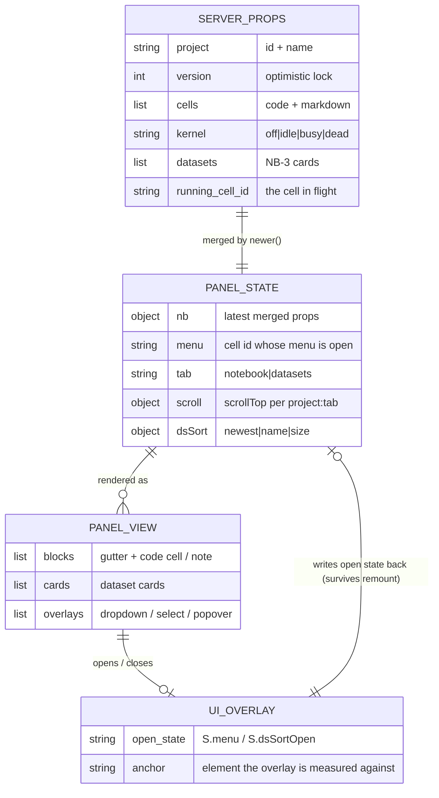

# Feature Plan: Analyst Panel UI Refresh (shadcn look)
Status: Implemented — manual checks pending (see scaffold report §11) · Source: chat request (no ticket) · Date: 2026-11-12

The right-side **Notebook panel** and the **project dropdown** are re-skinned to look exactly like Chainlit's own shadcn interface: the same cards, buttons, badges, dropdowns, shadows, animations and font as the chat area next to it.

**"Analyst panel"** = the right-side workspace panel (`public/elements/Notebook.jsx`) plus the project picker (`public/custom.js`). That is the surface where the research analyst (the model) and the researcher work together. It is called "Notebook" in the UI today (`researchchat/workspace/panel.py:20`).

## 1. Requirement (User Stories & Acceptance Criteria)

**US1:** As a **researcher**, I want the Notebook panel to look like the chat beside it, so that the app reads as one product instead of two bolted together.

**US2:** As a **researcher**, I want the panel's boxes (dataset cards, code cells, notes, empty states) to have one consistent shape — radius, border, shadow, background — so that I can tell what is a container and what is content at a glance.

**US3:** As a **researcher**, I want every dropdown (block actions, dataset sort, project picker) to look and behave like Chainlit's own menus, so that my mouse and keyboard habits carry over.

**US4:** As a **researcher**, I want the panel's text to use the same typeface as the chat, so that nothing jumps when I look from one to the other.

**US5:** As a **researcher**, I want light and dark mode to both look right in the panel, so that status colours stay readable in either theme.

**Acceptance Criteria** (all proposed, please confirm or edit)

| # | Given | When | Then |
|---|---|---|---|
| AC1 | the panel is open | I compare it with the chat area | both use the same typeface (`var(--font-sans)` for text, `var(--font-mono)` for code) and the same 12px corner radius scale (`--radius`) |
| AC2 | a dataset card is shown | I look at it | it is a shadcn `Card` (rounded-lg, `bg-card`, 1px `hsl(var(--border))` border, `shadow-sm`) — the same card the chat uses for messages |
| AC3 | a code cell is shown | I look at it | it uses the same radius and border as a card, a muted background, and a `shadow-sm`; long lines still scroll sideways and never wrap (AC14 of NB-1) |
| AC4 | I open a block's action menu | it opens | it is a shadcn dropdown: popover background, 1px border, 10px radius, `shadow-md`, 4px padding, 14px items, arrow-key navigation, Enter to run, Escape to close |
| AC5 | I open the dataset **sort** control | it opens | it is a shadcn select (custom trigger + popover list), not the operating system's native dropdown |
| AC6 | I open the **project** dropdown | it opens | it is in the panel header, next to the project name, and it is the same shadcn dropdown as AC4 — same background, border, radius, shadow, item hover and open/close animation |
| AC7 | I hover a button, badge or menu item | — | the hover state is Chainlit's own (`hover:bg-accent` / `hover:text-accent-foreground`), not a hand-written colour |
| AC8 | a cell is running, or a dataset is downloading | I watch | the status dot, badge and progress bar use semantic colours that stay legible in **both** light and dark mode |
| AC9 | the panel is in dark mode | I look at any element | no hard-coded light-mode colour is visible; every colour comes from a theme variable |
| AC10 | a menu or popover opens or closes | — | it animates exactly like Chainlit's own menus (fade + zoom, 150 ms) and the animation is skipped when the OS asks for reduced motion |
| AC11 | the panel is narrow (under 620px / 380px) | — | the existing container-query rules still apply; nothing is cut off and controls still collapse to icons |
| AC12 | I use only the keyboard | I tab through the panel | the focus ring looks like Chainlit's (`ring-2 ring-ring ring-offset-2`) on every focusable control, and it is visible in both themes. Those three classes are purged from Chainlit's CSS (§2.3), so the ring is hand-written CSS and stays out of the Group C allowlist |

**Negative paths:** a menu opens while the panel is being remounted by a server push (must not close or lose its open state); a menu opens while a cell is running and output is streaming in every 0.25 s (must stay usable); a dropdown is opened near the bottom of the viewport (must flip, not overflow); the browser asks for reduced motion (no animation); a component is imported that Chainlit's build does not contain (must fail loudly in tests, not silently lose its styling); a menu is open while a Radix overlay would otherwise lock the page (must not make the app un-clickable).

**Out of scope for this ticket:** the chat area, the gear-menu settings panel, the progress steps, the notebook engine and the datasets engine (no server-side change at all); adding a JavaScript build step, npm packages or a test runner for the front end (D8); changing Chainlit's own global theme colours or fonts (D7).

## 2. Codebase Patterns

### 2.1 The front end has no build step

| Area | Finding | Evidence |
|---|---|---|
| How `Notebook.jsx` is loaded | Chainlit compiles it in the browser at runtime with `react-runner` + `sucrase`; there is no `package.json`, no `node_modules`, no bundler, no TypeScript | `.venv/.../chainlit/frontend/dist/assets/index-B2u6IBgX.js` (source map → `src/components/Elements/CustomElement/Renderer.tsx`) |
| How `custom.js` is loaded | served as a static file and run as a classic script via `custom_js` | `.chainlit/config.toml:134` |
| Can the panel import shadcn components? | **Yes.** The custom element's scope contains `import: Imports`, and `Imports` maps `@/components/ui/*` to Chainlit's own shadcn modules — **28 of the 35** shadcn files. The 7 that are **not** importable are `alert-dialog`, `calendar`, `radio-group`, `resizable`, `sidebar`, `slider` and `sonner` (the last is exposed separately as the `sonner` key). Everything this ticket needs — `card`, `badge`, `button`, `progress`, `dropdown-menu`, `select`, `separator`, `skeleton`, `input`, `textarea`, `label`, `tooltip`, `popover` — is available | `src/components/Elements/CustomElement/Imports.ts`; `src/components/Elements/CustomElement/Renderer.tsx` |
| Proof the mechanism works | the panel already does `import { useEffect, useRef, useState } from "react"` and `import { ArrowDown, … } from "lucide-react"`, both resolved from that same map | `public/elements/Notebook.jsx:5-6` |
| `cn` (the class-merging helper) | **not** in the map — the panel cannot import it. Not needed: shadcn components merge `className` internally | `src/components/Elements/CustomElement/Imports.ts` |
| Extra front-end packages | none may be added (no npm, no bundler); everything must come from what Chainlit already ships | `requirements.txt`, no `package.json` in the repo |

### 2.2 The panel is remounted on every server push — the single most important constraint

| Area | Finding | Evidence |
|---|---|---|
| Push rate during a run | the server pushes notebook props every 0.25 s while a cell executes | `researchchat/workspace/service.py:30` (`PUSH_INTERVAL = 0.25`), used at `:317` |
| What a push does | the server re-sends the sidebar element with a **new key**, so Chainlit recompiles the JSX and React **unmounts and remounts** the whole panel | `researchchat/workspace/panel.py:36-41` (`key: f"nb-{next(_keys)}"`) |
| How the codebase copes today | every piece of state that must survive a push (open menu, caret, unsaved text, scroll) lives on `window.__rcNotebook` (`S`), never in React state | `public/elements/Notebook.jsx:16-18` and `19-42` |
| Consequence for this ticket | a Radix `DropdownMenu`/`Select` that keeps its open state in React would close on every push. **The open state must be controlled from `S`.** | same |

### 2.3 Chainlit's Tailwind stylesheet is pre-built — only the classes Chainlit uses exist

| Area | Finding | Evidence |
|---|---|---|
| Where the CSS lives | one pre-built file, `index-BtjwbfYI.css` (106 KB), compiled from Chainlit's own source | `.venv/.../chainlit/frontend/dist/assets/index-BtjwbfYI.css` |
| Consequence | Tailwind purged every class Chainlit does not use. **1 171 class selectors exist**; a utility that Chainlit happens not to use (e.g. `w-56`, `shadow-xl`, `bg-destructive/10`, `border-destructive/30`, `font-sans`, `ring-2`, `ring-offset-2`, `line-clamp-1`) **silently does nothing** | verified against the built file |
| What does exist | every class the shadcn components themselves use — `card` 15/15, `badge` 24/24, `button` 44/44, `dropdown-menu` 50/50, `select` 60/60, `progress` 5/5, `separator` 6/6, `skeleton` 3/3, `tabs` 26/26, `tooltip` 19/19, `popover` 18/18, `switch` 28/28, `input` 22/22, `textarea` 16/16 — plus all the `data-[state=open]:…` animation variants. Verified **absent**: `w-56`, `max-w-sm`, `shadow-xl`, `shadow-2xl`, `bg-destructive/10`, `border-destructive/30`, `bg-primary/10`, `border-primary/20`, `font-sans`, `antialiased`, `ring-2`, `ring-ring`, `ring-offset-2`, `line-clamp-1`, `border-dashed`, `divide-y`, `space-between`, `opacity-90`, `duration-100`, `top-full`, `scale-95` | same |
| Escape hatch | the panel already ships ~185 lines of hand-written CSS in a `<style>` block, so anything Tailwind lacks can be written by hand | `public/elements/Notebook.jsx:95-280` (panel) and `709-745` (datasets) |

### 2.4 Where the panel's CSS sits in the cascade

| Area | Finding | Evidence |
|---|---|---|
| Chainlit's stylesheet | in `<head>` | `.venv/.../chainlit/frontend/dist/assets/index-B2u6IBgX.js` → `index.html` |
| The panel's `<style>` | rendered inside the React tree, i.e. in `<body>` — **later in document order**, so at equal specificity it beats Chainlit's utility classes | `public/elements/Notebook.jsx:1440-1441` |
| Why `custom_css` is not used | Chainlit injects `custom_css` **before** its own stylesheet, so it would lose ties; the in-body `<style>` is the better position | `.venv/.../chainlit/server.py:408-409`, `index.html` |
| Radix portals | `cl_shadowRootElement` is never assigned in the main app, so Radix's `Portal` falls back to `document.body` — popovers escape the panel's `overflow: auto` correctly | `src/App.tsx` (global declaration only), `@radix-ui/react-portal` source |

### 2.5 Existing panel surfaces that the refresh touches

| Surface | Today | File:line |
|---|---|---|
| Panel CSS | hand-written, Notion-flavoured, `font-family: ui-sans-serif, …` | `Notebook.jsx:96` |
| Dataset CSS | hand-written, 8px radii, no shadows | `Notebook.jsx:709-745` |
| Block action menu | hand-rolled `<div role="menu">`, absolute at `left:26px`, own 3-layer shadow, no arrow-key navigation | `Notebook.jsx:556-579`, CSS at `145-149` |
| Dataset sort | **native `<select>`** | `Notebook.jsx:987-989` |
| Fallback project picker | **native `<select>`** (only when `custom.js` cannot place the pill) | `Notebook.jsx:1643` |
| Project pill + menu (vanilla DOM, no React) | 999px-radius pill, hand-written menu with its own shadow and animation | `custom.js:41-59`, `185-221`, `256-317` |
| Dataset card | hand-written box, 8px radius, 1px border, no shadow | `Notebook.jsx:816-916`, CSS at `716-717` |
| Code cell box | hand-written, 5px radius, `hsl(var(--muted))` background, no border or shadow | `Notebook.jsx:161`, CSS at `161`, `176`, `229-232` |
| Status colours | 25 hard-coded hex values (`#2383e2`, `#e03e3e`, `#d9730d`, `#0f7b6c`, `#eb5757`, `#b42318`, `#9b9a97`) that ignore light/dark mode | `Notebook.jsx:85-90`, `104`, `119-120`, `132`, `136`, `149`, `169`, `172-173`, `184`, `194`, `217-219`, `231`, `724-737` |
| Fonts | panel uses a system stack; Chainlit loads Inter and defines `--font-sans` / `--font-mono` | `Notebook.jsx:96`, `170`, `175`, `183`, `194-195`, `729`, `741`; `custom.js:43`, `48` |
| Scrollbars | global `::-webkit-scrollbar` rules in `custom.js` (already theme-coloured) | `custom.js:88-103` |
| Reduced motion | already honoured in both files | `Notebook.jsx:277-279`, `custom.js:104-107` |
| Accessibility | `role=menu`/`menuitem`, `role=tablist`/`tab`/`tabpanel`, `aria-selected`, `aria-controls`, arrow-key tab navigation, `aria-haspopup`, `aria-expanded` | `Notebook.jsx:556-579`, `1431-1436`, `1458-1481` |
| Security rules to preserve | dataset/catalog text is React text only (never raw HTML); links go through `safeHref()` (http/https only); `custom.js` uses `textContent` for user-supplied names | `Notebook.jsx:292-294`, `custom.js:196` |

### 2.6 Test conventions

| Area | Finding | Evidence |
|---|---|---|
| Framework | `pytest`, plain functions, no classes | `pytest.ini`, `tests/test_workspace_service.py` |
| Layout | one file per area, `tests/test_<area>.py` | `tests/` |
| Style | descriptive snake_case names, one behaviour per test, no fixtures beyond `tmp_path` | `tests/test_config.py`, `tests/test_settings.py` |
| Markers | `@pytest.mark.docker` for anything needing the kernel image | `pytest.ini`, `tests/conftest.py` |
| Front-end tests | **none exist.** There is no JS test runner and no browser automation | `tests/` contains only Python |

### 2.7 What Radix changes (D3) and what moving the picker costs (D6)

Radix's `DropdownMenu` and `Select` are not just styled divs; they are behaviour-heavy, and three of their behaviours interact badly with this panel.

| Area | Finding | Consequence | Evidence |
|---|---|---|---|
| **Where the overlay is drawn** | both components render their content through a `Portal` into `document.body` (Chainlit passes `container={window.cl_shadowRootElement}`, which the main app never assigns, so it falls back to `document.body`) | the overlay is **outside** the panel's DOM subtree, so the panel's own scoped CSS (`.rcnb-menu`, `.rcds-sort`) no longer applies to it. The overlay must carry Chainlit's classes instead — which is what we want anyway | `src/components/ui/dropdown-menu.tsx`, `src/components/ui/select.tsx`; `src/App.tsx` (the global is declared but never assigned) |
| **Modal mode locks the page** | `DropdownMenu` defaults to `modal: true`, which renders `MenuRootContentModal`: it calls `hideOthers()` (marks the rest of the page `aria-hidden`) and sets `pointer-events: none` on `<body>` while open. `Select` always does this — it has no `modal` option at all | a Radix overlay in default mode makes the app un-clickable behind it. For `DropdownMenu` we pass `modal={false}`; for `Select` we rely on Radix's own `RemoveScroll` + `hideOthers` behaviour, which is what Chainlit's own selects already do | `MenuRootContentModal` in `@radix-ui/react-menu`; `SelectContentImpl` in `@radix-ui/react-select` |
| **Open state is controllable** | both accept `open` / `onOpenChange` and use `useControllableState` | the open state can live in `S` and survive the remount — the same trick the panel already uses for the hand-rolled menu | `useControllableState` in both packages |
| **But the DOM is rebuilt** | on remount the portal node is destroyed and recreated, so the entrance animation replays and Radix's `currentItemId` (the keyboard-highlighted item, held in React state) resets to `null` | this is the trade-off in Question 2 / D4 | `MenuContentImpl` (`useState(null)` for `currentItemId`) |
| **A `Select` needs a hidden native `<select>`** | Radix's `Select` renders a visually-hidden native `<select>` to stay form-compatible, and syncs it by dispatching a `change` event | harmless here: the panel is not inside a `<form>`, and the sort value is already held in `S.dsSort` | `BubbleSelect` in `@radix-ui/react-select` |

**Moving the picker into React (D6)** — what it costs and what it buys:

| Area | Effect |
|---|---|
| The picker becomes a Radix `DropdownMenu` | the same component, the same look and the same keyboard behaviour as the block menu and the dataset sort — no fourth hand-written menu |
| The panel already has everything it needs | the project list is already loaded via `nb_list_projects` and stored in `S.projects`; `nb_switch_project` and `nb_create_project` already exist and are already called by the panel (`Notebook.jsx:1229-1243`). **No server change.** |
| The `rc:*` event bridge disappears | `rc:switch-project`, `rc:create-project`, `rc:projects` and `rc:projects-request` exist **only** because the picker was outside React (`custom.js:9-12`, `Notebook.jsx:9-12`). Four events, two listeners and a `MutationObserver` all go away |
| The pill moves | it is no longer under the message box; it becomes a control in the panel header, next to the project name the panel already shows (`Notebook.jsx:1447`) — assumption A7 |
| `custom.js` shrinks | it keeps only the sidebar-collapse toggle (`Ctrl+\`), the scrollbar styling and the `#side-view-title > button` rule. The `MutationObserver` that re-injected the pill after every Chainlit re-render (`custom.js:344-353`) is no longer needed for the picker |
| The fallback picker disappears | the panel's fallback `<select>` at the bottom (`Notebook.jsx:1640-1648`) exists only because `custom.js` might fail to place the pill; with the picker in React there is nothing to fall back from |

## 3. Schema & Relationships

### 3.1 Existing Tables

**No database is involved.** This ticket changes no Python data model, no file format and no server behaviour. The panel's state lives in two places:

| Store | Kind | Fields | Evidence |
|---|---|---|---|
| `NotebookProps` (server → panel) | typed dict, serialised into the element's props | `project`, `cells[]`, `kernel`, `datasets[]`, `running_cell_id`, `version`, `datasets_rev`, `error` | `researchchat/workspace/service.py:34-80` |
| `S` = `window.__rcNotebook` | plain JS object, survives remounts | `nb`, `drafts`, `editing`, `focus`, `menu`, `projects`, `dsOpen`, `dsConfirm`, `dsFilter`, `dsSort`, `tab`, `scroll`, `busy`, `copied`, … | `public/elements/Notebook.jsx:19-42` |
| React local state | ephemeral, lost on every push | `SourceBox` caret, `NoteCell` editing flag | `public/elements/Notebook.jsx:442-534`, `666-690` |

**Schema change: none.** No migration, no file format change, no new action.

### 3.2 Relationships (+ ER diagram)

The UI's data flow, which the refresh must not break:



**Risks to watch.** The `PANEL_STATE → UI_OVERLAY → PANEL_STATE` loop is the fragile edge: the overlay's open state must live in `S` (which survives a remount), not in the overlay's own React state (which does not). A dropdown that keeps its open flag internally would close four times a second while a cell runs.

### 3.3 Proposed Schema Changes (described, not applied)

**None.** No table, column, index or file format changes. The only new *code* artefacts are CSS custom properties scoped to the panel (see §4.1) and one new test file.

## 4. Implementation Idea

### 4.1 Approach & Files Affected

**Approach.** Six phases, each independently reviewable and each touching one surface:

1. **Tokens and fonts.** Replace the panel's hand-written palette with semantic CSS custom properties defined once on `.rcnb` (light and dark variants, keyed off the `.dark` class that Chainlit puts on `<html>`), and switch every `font-family` to `var(--font-sans)` / `var(--font-mono)`. This kills all 25 hard-coded hex values and the font mismatch in one stroke.
2. **Boxes.** Replace the hand-written dataset card, code-cell box, note box, empty states and callout with Chainlit's shadcn `Card` (and the matching radius/border/shadow recipe for the boxes that must stay plain), so every container shares one shape.
3. **Controls.** Replace the hand-written buttons, badges, status tags, search field and progress bar with shadcn `Button`, `Badge`, `Input` and `Progress`.
4. **Dropdowns (Radix).** Replace the hand-rolled block menu with Radix `DropdownMenu`; replace the native `<select>`s with Radix `Select`. Both are **controlled from `S`**, so the open state survives the remount; `DropdownMenu` uses `modal={false}` so Radix never locks the page, while `Select` has no such option and keeps Radix's default, as Chainlit's own selects do (§2.7). A rebuilt overlay skips its entrance animation and gets its highlighted item back (D4 = C + highlight restore).
5. **Project picker (into React).** Move the picker out of `public/custom.js` and into the panel as a Radix `DropdownMenu`, driven by the project list the panel already loads (§2.7). `public/custom.js` keeps the sidebar-collapse toggle and the scrollbar styling.
6. **Effects, focus and tests.** Align entrance/exit animations, hover transitions and focus rings with Chainlit's; add the static invariant tests.

**Files that would change**

| File | Change | Phase |
|---|---|---|
| `public/elements/Notebook.jsx` | rewrite the `CSS` block (tokens, radius scale, shadows, motion) and the `DS_CSS` block; import shadcn `Card`/`Badge`/`Button`/`Input`/`Progress`/`DropdownMenu`/`Select`; rewrite `BlockMenu`, `DatasetCard`, the sort control and the fallback picker; add the project picker to the panel header; add `S.dsSortOpen`; drive `DropdownMenu`'s `open` from the existing `S.menu` | 1-4, 5, 6 |
| `public/custom.js` | **remove** the project pill, its menu, the `rc:*` event bridge and the `MutationObserver` re-injection of the pill; **keep** the sidebar-collapse toggle, the scrollbar styling and the `#side-view-title > button` rule; use `--font-sans` for the toggle | 5, 6 |
| `tests/test_panel_ui.py` | **new** — static invariant tests (§7) | 6 |
| `requirements.txt`, `researchchat/**`, `config.toml` | **unchanged** | — |
| `.chainlit/config.toml` | **unchanged** (`custom_css` deliberately not used — see §2.4) | — |

**New CSS custom properties** (defined on `.rcnb`, so they cannot leak into the chat). Values are literal CSS, because a custom property cannot hold a Tailwind class name:

| Property | Meaning | Light | Dark |
|---|---|---|---|
| `--rc-radius` | container corner radius | `var(--radius)` (12px) | same |
| `--rc-shadow` | resting elevation | `0 1px 2px 0 rgb(0 0 0 / .05)` | same |
| `--rc-shadow-lift` | hover elevation | `0 4px 6px -1px rgb(0 0 0 / .1), 0 2px 4px -2px rgb(0 0 0 / .1)` | same |
| `--rc-info` | running / downloading | `hsl(199 89% 48%)` | `hsl(199 89% 62%)` |
| `--rc-warn` | starting / queued | `hsl(30 95% 45%)` | `hsl(38 92% 60%)` |
| `--rc-ok` | ready / saved | `hsl(168 72% 32%)` | `hsl(168 62% 45%)` |
| `--rc-danger` | failed / error | `hsl(var(--destructive))` | same |

The shadow values are copied verbatim from Chainlit's own `shadow-sm` and `shadow-md` rules in `index-BtjwbfYI.css`, so the panel's elevation matches the chat's exactly.

Semantic colours are defined **per theme** rather than taken from Chainlit's `--chart-*` tokens, because those are meant for charts and their values change meaning between light and dark (e.g. `--chart-3` is blue in light but orange in dark).

### 4.2 Endpoints

**No endpoint changes.** The panel talks to the server only through the existing `nb_*` actions, and none of them change:

| Action | Purpose | Unchanged |
|---|---|---|
| `nb_list_projects` / `nb_switch_project` / `nb_create_project` | project picker | ✔ |
| `nb_add_cell` / `nb_update_cell` / `nb_delete_cell` / `nb_move_cell` / `nb_reorder_cell` / `nb_duplicate_cell` | notebook editing | ✔ |
| `nb_run_cell` / `nb_run_all` / `nb_interrupt` / `nb_restart` / `nb_clear_outputs` / `nb_clear_cell_outputs` | kernel control | ✔ |
| `ds_cancel` / `ds_delete` | datasets | ✔ |

The in-page `rc:switch-project`, `rc:create-project`, `rc:projects` and `rc:projects-request` window events (`public/custom.js:9-12`, `public/elements/Notebook.jsx:9-12`) are **removed** with the picker move (D6, test E❌5).

### 4.3 DTOs

**No DTO changes.** `NotebookProps` (`researchchat/workspace/service.py:34-80`) is the panel's only server contract and is not touched. For reference, the fields the UI refresh reads:

| Field | Type | Required | Validation | Maps to | Meaning |
|---|---|---|---|---|---|
| `project` | `{id, name}` | yes | server-generated | `workspaces/<id>` | which workspace is shown; `name` is rendered as the panel title |
| `version` | int | yes | optimistic lock | notebook metadata | sent back with every edit; a mismatch is `STALE` |
| `cells[]` | list | yes | — | `.ipynb` | each has `id`, `type`, `source`, `execution_count`, `status`, `outputs[]` |
| `kernel` | enum | yes | `off\|starting\|idle\|busy\|dead\|unavailable` | kernel registry | drives the status dot and the Run button's disabled state |
| `datasets[]` | list | yes | — | `datasets.json` | each has `id`, `name`, `source`, `status`, `size_bytes`, `done_bytes`, `files[]`, `license` |
| `running_cell_id` | string \| null | yes | — | — | the cell currently executing; drives the running glow |
| `error` | `{code, message}` \| null | yes | — | — | the red callout banner |

## 5. Security Review

The refresh introduces no new server surface, no new data flow and no new user input. The risks are therefore **regressions** in the existing front-end rules, not new attack surface.

| # | Risk | Where (endpoint/field) | Mitigation in this plan | Test ref |
|---|---|---|---|---|
| 1 | XSS — dataset/catalog names and licence strings become HTML | `datasets[].name`, `datasets[].license`, `files[].path` | keep rendering them as React text children only; never `dangerouslySetInnerHTML`; shadcn components render children as text, so no new escape hatch is created | E✅1, E❌1 |
| 2 | XSS — project names | `projects[].name` | the picker moves into React (D6), so names are rendered as React text children like everything else; `public/custom.js` no longer builds DOM from project names at all, which removes the `textContent`-vs-`innerHTML` question from that file entirely | E✅3, E❌4 |
| 3 | `javascript:` / `data:` URLs via the dataset "Source page" link | `datasets[].url` | keep routing every href through `safeHref()`, which allows only `http(s)://`; the refresh must not add a second, unguarded link | E✅2, E❌2 |
| 4 | The page becomes un-clickable behind an open overlay | Radix `DropdownMenu` in `modal` mode sets `pointer-events: none` on `<body>` and hides the rest of the page from screen readers; `Select` always does this | pass `modal={false}` on `DropdownMenu`; for `Select`, accept Radix's behaviour (it is what Chainlit's own selects do) but ensure the overlay is not left open by a remount — the D4 freeze handles that | M1, M2 |
| 5 | Overlay escapes the panel and covers the chat | Radix `Portal` → `document.body` | this is Chainlit's own mechanism for every dialog, popover and select in the app, and `z-50` matches; the overlay is positioned by Radix against its trigger, so it stays anchored to the panel | M4 |
| 6 | Supply-chain via a new font/theme file | `public/theme.json`, `public/custom.css` | **not used** — no new external stylesheet, no new CDN, no new file fetched by the browser. Fonts come from the Inter link Chainlit already loads (D7) | E✅4, E❌3 |
| 7 | A new dependency sneaking in | `requirements.txt`, `package.json` | no new Python or npm dependency; only components Chainlit already bundles (D8) | D❌2 |
| 8 | Inline `style` overriding the theme and breaking dark mode | panel CSS | semantic colours are CSS variables with explicit dark values, not inline styles | A✅1, A✅3 |
| 9 | The picker move leaves a stale event bridge | `public/custom.js`, `public/elements/Notebook.jsx` | the `rc:*` events and both their listeners are removed together; a test asserts no `rc:` event name survives in either file | E❌5 |

**Accepted risk:** Radix `DropdownMenu` in `modal` mode sets `pointer-events: none` on `<body>` while open. Combined with a remount every 0.25 s during a run, that could momentarily freeze the page. Mitigation: `modal={false}` (see §4.1 phase 4), which drops the body lock entirely.

## 6. Workflow Diagram

Chosen: a **sequence diagram**, because the crux of this ticket is the interaction between the server's 0.25 s pushes, the remount, and the overlay's open state — a timing problem that a flowchart would hide.

```mermaid
sequenceDiagram
    autonumber
    participant U as Researcher
    participant P as Notebook panel (React)
    participant S as window.__rcNotebook (S)
    participant C as Chainlit app
    participant Sv as Chainlit server

    U->>P: clicks a block's ⋮ handle
    P->>S: S.menu = cell.id; rerender()
    P->>C: render <DropdownMenu open={S.menu===id} modal={false}>
    Note over P,C: Radix portal → document.body;<br/>open state comes from S, not React
    C-->>U: popover: bg-popover, border, shadow-md,<br/>fade+zoom 150 ms

    U->>P: ArrowDown / Enter on "Duplicate"
    P->>Sv: callAction("nb_duplicate_cell", {version})
    Sv-->>P: new NotebookProps (version+1)

    par every 0.25 s while a cell runs
        Sv-->>C: set_sidebar_elements (new key)
        C->>P: new props → recompile → REMOUNT
        P->>S: S.overlay still holds menu:cell.id
        Note over P,S: the menu re-renders open, marked data-rc-reopen:<br/>no replayed animation; the highlighted item is refocused (D4)
    and
        Sv-->>P: action result
    end

    P->>P: apply(result) → S.nb = newer(S.nb, result)
    P->>C: render

    U->>P: Escape / click outside
    P->>S: S.menu = null
    P->>C: render → DropdownMenu open={false}
    C-->>U: exit animation (fade-out + zoom-out, 150 ms)
```

Error branches: a failed action returns `error` in the props and the panel renders the red callout (existing behaviour, `Notebook.jsx:1413-1421`); `STALE` on edit is retried once (`Notebook.jsx:1083-1088`); a stale version on reorder surfaces as the same callout.

**The project picker (D6) follows the same shape**, except it does not need a server round-trip to *list* projects — the panel already holds the list in `S.projects` (loaded via `nb_list_projects`) — and switching still goes through `nb_switch_project`, so the session's project stays authoritative on the server.

## 7. TDD Test Plan

The front end has **no test runner and no browser automation** (Question 6 decides whether to add one). The tests below are therefore **static invariant tests written in pytest** — they read the two front-end files and assert properties that must hold. They are the tests that can actually catch the failure modes this ticket risks: a class that does not exist in Chainlit's build, a colour that ignores dark mode, an import Chainlit does not expose.

Each group follows the baseline / edge / negative pattern: one baseline row, optional edge rows, and negatives that each change exactly one condition.

### Functional groups

### Group A — Theme tokens and colours (AC1, AC5, AC8, AC9)

Baseline: Given the panel CSS in `public/elements/Notebook.jsx` · When the colour rules are inspected

| # | Type | Test name | Changed condition | Expected result | Demonstrates |
|---|---|---|---|---|---|
| ✅1 | baseline | `test_panel_css_has_no_hardcoded_hex_colours` | — | no `#rgb`/`#rrggbb` literal in the panel or dataset CSS blocks | every colour follows the theme |
| ✅2 | edge | `test_panel_css_allows_hex_only_in_the_documented_allowlist` | a hex literal appears in an allow-listed place (e.g. a data-URI image) | the test still passes | the guard is not a blanket ban |
| ✅3 | edge | `test_panel_defines_a_light_and_a_dark_value_for_every_semantic_colour` | — | each of `--rc-info`, `--rc-warn`, `--rc-ok`, `--rc-danger` has a light value and a `.dark` override | status colours stay legible in both themes |
| ❌1 | negative | `test_panel_css_has_no_hardcoded_hex_colours` (a stray `#2383e2` is reintroduced) | a status colour is hard-coded again | test fails | a regression to a theme-blind colour is caught |
| ❌2 | negative | `test_semantic_colours_are_defined_for_both_themes` (the `.dark` block is dropped) | only the light value exists | test fails | dark mode cannot silently lose a colour |
| ❌3 | negative | `test_semantic_colours_are_not_taken_from_chart_tokens` | a colour uses `var(--chart-3)` | test fails | chart tokens change meaning between themes |

### Group B — Fonts (AC1, AC4)

Baseline: Given the panel CSS · When `font-family` declarations are inspected

| # | Type | Test name | Changed condition | Expected result | Demonstrates |
|---|---|---|---|---|---|
| ✅1 | baseline | `test_panel_uses_the_chainlit_font_variables` | — | every `font-family` in the panel CSS is `var(--font-sans)` or `var(--font-mono)` (or `inherit`) | the panel and the chat share a typeface |
| ✅2 | edge | `test_no_font_family_is_declared_outside_the_panel` | — | `public/custom.js` declares no `font-family` of its own | the one remaining file in it inherits Chainlit's font (D7) |
| ❌1 | negative | `test_panel_uses_the_chainlit_font_variables` (a system stack is reintroduced) | `font-family: ui-sans-serif, …` | test fails | the font mismatch cannot come back |
| ❌2 | negative | `test_no_theme_json_is_added` | a `public/theme.json` appears | test fails | the panel cannot change the app-wide font (D7) |

### Group C — Every Tailwind class the panel uses must exist in Chainlit's build (AC2, AC3, AC4, AC7)

Baseline: Given the allow-list of Tailwind classes this ticket relies on · When Chainlit's pre-built stylesheet is searched

| # | Type | Test name | Changed condition | Expected result | Demonstrates |
|---|---|---|---|---|---|
| ✅1 | baseline | `test_every_allowlisted_tailwind_class_exists_in_chainlits_css` | — | each allow-listed class selector is found in `chainlit/frontend/dist/assets/index-*.css` | no class is silently dropped by Tailwind's purge |
| ✅2 | edge | `test_the_allowlist_is_not_empty` | — | the allow-list has entries | the test is actually testing something |
| ❌1 | negative | `test_every_allowlisted_tailwind_class_exists_in_chainlits_css` (a class Chainlit does not use, e.g. `shadow-xl`, is added) | the class is absent from the built CSS | test fails, naming the class | a class that would render as nothing is caught before it ships |
| ❌2 | negative | `test_the_chainlit_css_file_is_found` | Chainlit is not installed / has no built CSS | test **skips** with a clear reason rather than failing | the suite still runs on a machine without Chainlit's assets |

### Group D — Imports must be resolvable by Chainlit's custom-element scope (AC4, AC5)

Baseline: Given the `import` statements in `public/elements/Notebook.jsx` · When they are checked against Chainlit's exposed modules

| # | Type | Test name | Changed condition | Expected result | Demonstrates |
|---|---|---|---|---|---|
| ✅1 | baseline | `test_every_imported_module_is_exposed_by_chainlit` | — | each imported specifier is one Chainlit exposes to custom elements | the panel cannot fail with "Module not found" |
| ✅2 | edge | `test_the_helper_cn_is_not_imported` | — | `@/lib/utils` is not imported | the panel does not rely on a helper it cannot have |
| ❌1 | negative | `test_every_imported_module_is_exposed_by_chainlit` (`@/components/ui/alert-dialog` is imported) | the module is not in Chainlit's map | test fails, naming the module | an unresolvable import is caught before it ships |
| ❌2 | negative | `test_no_new_dependencies_are_added` | `requirements.txt` gains a package, or a `package.json` appears | test fails | the front end stays dependency-free |

### Group E — Security invariants (SEC1-SEC7)

Baseline: Given the two front-end files · When they are inspected for unsafe patterns

| # | Type | Test name | Changed condition | Expected result | Demonstrates |
|---|---|---|---|---|---|
| ✅1 | baseline | `test_panel_never_uses_dangerously_set_inner_html` | — | no `dangerouslySetInnerHTML` in the panel | catalog text stays text |
| ✅2 | baseline | `test_every_href_still_goes_through_safe_href` | — | every `href=` in the panel is `safeHref(...)` | `javascript:` URLs cannot appear |
| ✅3 | baseline | `test_project_names_are_rendered_as_react_text` | — | the picker renders `p.name` as a React child, never `innerHTML` / `dangerouslySetInnerHTML` | the picker cannot inject HTML (D6 moved it into React) |
| ✅4 | baseline | `test_no_new_external_stylesheet_or_script_is_fetched` | — | neither front-end file references a CDN URL, and no `theme.json` is added | no new supply-chain surface |
| ❌1 | negative | `test_panel_never_uses_dangerously_set_inner_html` (the refresh introduces raw HTML for a badge) | the attribute appears | test fails | the refresh cannot open an XSS path |
| ❌2 | negative | `test_every_href_still_goes_through_safe_href` (a raw `d.url` is used) | an unguarded href appears | test fails | an unsafe link cannot slip in |
| ❌3 | negative | `test_no_new_external_stylesheet_or_script_is_fetched` (a font CDN is added) | a CDN URL appears | test fails | a new external asset cannot slip in |
| ❌4 | negative | `test_project_names_are_rendered_as_react_text` (the picker builds HTML from a name) | `innerHTML` appears near a project name | test fails | the moved picker keeps the XSS guarantee |
| ❌5 | negative | `test_the_rc_event_bridge_is_gone` (a stale `rc:switch-project` listener survives) | an `rc:` event name appears in either file | test fails | the picker move leaves no half-removed bridge behind |

### Group M — Manual verification (not automated)

These need a browser and a running app, so they are a manual checklist rather than pytest tests. The checklist itself is written into the scaffold report (step 9) so it can be ticked off during implementation.

| # | Type | Check | Expected result |
|---|---|---|---|
| M1 | manual | open the block action menu, arrow through it, press Enter, press Escape | the menu stays open while arrowing, Enter runs the action, Escape closes it and returns focus to the trigger |
| M2 | manual | open the block menu **while a cell is running** (output streaming every 0.25 s) | the menu stays open and usable; it does not close, jump or lose the highlighted item on each push |
| M3 | manual | open the dataset sort control | a shadcn popover appears, not the operating system's native dropdown; the list flips up when there is no room below |
| M4 | manual | open the project dropdown in the panel header | it is visually indistinguishable from the block menu: same background, border, radius, shadow, item hover and open/close animation; the current project is marked |
| M5 | manual | switch to dark mode | every status colour (running, queued, ready, failed) is legible; no light-mode colour shows through |
| M6 | manual | narrow the window past 620px, then 380px | the container-query rules still apply; nothing is cut off; controls collapse to icons as before |
| M7 | manual | Tab through the panel | every focusable control shows Chainlit's focus ring, visible in both light and dark mode |
| M8 | manual | enable "reduce motion" in the operating system | no menu or popover animates |

### Coverage (AC → tests, Security → tests)

| AC | Tests |
|---|---|
| AC1 (typeface + radius) | A✅1, B✅1, B✅2 |
| AC2 (dataset card is a shadcn Card) | C✅1, M3, M5 |
| AC3 (code cell box) | C✅1, M5 |
| AC4 (block menu is a shadcn dropdown) | C✅1, D✅1, M1, M2 |
| AC5 (dataset sort is a shadcn select) | C✅1, D✅1, M3 |
| AC6 (project dropdown matches) | C✅1, E✅3, M4 |
| AC7 (hover states) | C✅1, M4 |
| AC8 (status colours legible in both themes) | A✅3, A❌2, M5 |
| AC9 (no hard-coded light-mode colour) | A✅1, A✅2, A❌1 |
| AC10 (animation matches; reduced motion honoured) | M8 |
| AC11 (narrow panel) | M6 |
| AC12 (focus ring) | M7 |

| Security # | Tests |
|---|---|
| 1 XSS in dataset text | E✅1, E❌1 |
| 2 XSS in project name | E✅3, E❌4 |
| 3 Unsafe URLs | E✅2, E❌2 |
| 4 Page locked behind an overlay | M1, M2 |
| 5 Overlay over the chat | M4 |
| 6 New external asset | E✅4, E❌3, B❌2 |
| 7 New dependency | D❌2 |
| 9 Stale event bridge | E❌5 |

**Planned tests: 19 new pytest functions** in `tests/test_panel_ui.py` — Group A: 5, Group B: 3, Group C: 3, Group D: 3, Group E: 5 (rows that share a test name are one function) — plus 8 manual checks (M1-M8). No new Python module, no new server behaviour, nothing to run against Docker.

## 8. Questions & Confirmations

**Questions**

1. ~~**Radix overlays vs. hand-rolled ones.**~~ **Answered: Radix** (D3).
2. ~~**Remount tolerance — how much does it actually hurt?**~~ **Answered: B, then changed to C + highlight restore** after the scaffold showed B can't stop the remount (D4). Short version: a Radix overlay that is *controlled from `S`* stays open across a remount, but its DOM node is rebuilt, so the **entrance animation replays** and the **keyboard-highlighted item resets** on every push. Three ways to handle it, in increasing order of effort:

   | Option | What it does | Cost | Result during a run |
   |---|---|---|---|
   | **A. Accept it** | nothing extra | free | the menu stays open and usable; the fade+zoom entrance replays every 0.25 s (a visible flicker) and arrow-key position resets to the top |
   | **B. Freeze the overlay** | while an overlay is open, the panel **skips applying incoming props** and keeps rendering the last props it had | small: one guard in the render path plus a flag in `S` | the menu is perfectly still — no flicker, no reset — because the panel is not re-rendering at all while it is open |
   | **C. Kill the animation on re-open** | pass a `className` that removes the entrance animation when the overlay is re-created rather than newly opened | small: a `data-` attribute plus one CSS rule | no flicker; arrow-key position still resets |

   **Recommendation: B.** It is the only option that makes the overlay genuinely stable, and it is also the *simplest* correct thing to do: if the panel is going to be re-rendered anyway, not re-rendering is the cheapest way to keep it stable. It also avoids a second, subtler problem: a Radix `DropdownMenu` in `modal` mode (the default) sets `pointer-events: none` on `<body>` while it is open and hides the rest of the page from screen readers via `aria-hidden`. If the panel is re-created 4×/second while that is in effect, those effects are applied and torn down 4×/second. We will still pass `modal={false}` as a belt-and-braces measure (§5, risk 4).

   Cost of B, stated plainly: **while a menu is open, the panel does not update.** A cell that finishes running, or a download that completes, will not appear on screen until the menu closes. That is a real trade-off, and acceptable only because a menu is open for a second or two — the alternative is a menu that flickers 4×/second. The way to have both is C (no data staleness, but the flicker and the arrow-key reset remain).

   **Final: C + highlight restore.** A push remounts the panel from outside, so freezing props (B) can't keep a menu still. The panel keeps updating; a rebuilt overlay is marked `data-rc-reopen` (no animation) and its highlighted item is refocused.
3. ~~**Status colours.**~~ **Answered: panel-scoped** (D5) — the panel defines its own `--rc-*` variables with hand-picked light and dark values, rather than borrowing Chainlit's `--chart-*` tokens (whose meaning changes between themes).
4. ~~**The project dropdown.**~~ **Answered: move it into React** (D6) — see §4.1 phase 5 and §2.7 for the design and the consequences.
5. ~~**Font.**~~ **Answered: Chainlit's Inter** (D7) — no `theme.json`, no new font request; the panel simply uses `var(--font-sans)` and `var(--font-mono)`, which Chainlit already defines and already loads.
6. ~~**Front-end testing.**~~ **Answered: no** (D8) — no `package.json`, no npm dependency, no build step. The front end stays exactly as dependency-free as it is today; testing stays pytest-based (§7) plus the manual checklist.

**Assumptions to confirm**

- A1. The panel keeps its Notion-like canvas (gutter, insert row, hover-to-reveal code/note buttons, drag handles). Only the *chrome* — boxes, colours, type, menus — changes.
- A2. The panel's own `<style>` block stays where it is (inside the JSX). It sits in `<body>`, so it beats Chainlit's stylesheet at equal specificity; `custom_css` would lose, so it is not used.
- A3. No server-side change: no new action, no new prop, no config file. The picker move (§4.1 phase 5) needs no server change either, because the panel already loads the project list and already calls `nb_switch_project` / `nb_create_project`.
- A4. The scrollbar styling already in `public/custom.js` stays as it is.
- A5. The `S` store gains overlay keys (`overlay`, `overlayShown`, `overlayItem`, `overlayByPointer`, `newProject`) and loses `fallbackBar`; no existing key changes meaning.
- A6. Light and dark mode both remain supported; the panel is not re-designed for one theme only.
- A7. **The project picker moves out from under the message box and into the panel header.** This is the visible consequence of D6 and is confirmed here.

## Decision log

| # | Decision | Answer | Effect on the plan |
|---|---|---|---|
| D1 | What does "analyst panel" mean? | The right-side Notebook/workspace panel plus the project picker (`public/elements/Notebook.jsx` + `public/custom.js`) | Scope fixed; the chat area, gear-menu settings and progress steps are out of scope |
| D2 | Which visual direction? | Match Chainlit's shadcn look exactly | Use Chainlit's own shadcn components and tokens rather than a bespoke "Notion/Linear" style; §4.1 phases 2-5 |
| D3 | Radix overlays, or hand-rolled ones restyled? | **Radix** | The block menu becomes `DropdownMenu`; the dataset sort becomes `Select`; both imported from `@/components/ui/*`. Open state is controlled from `S`, and `modal={false}` avoids the body-wide `pointer-events: none` and `aria-hidden` that Radix's modal mode applies. **Cost:** Radix renders the overlay through a `Portal` to `document.body`, so the panel's own scoped CSS (`.rcnb-menu`) no longer reaches it — the overlay must use Chainlit's classes instead. See §2.7 |
| D4 | Remount tolerance | **C + highlight restore** (B dropped: a push remounts the panel from outside, so freezing can't keep a menu still). Was: B — freeze the overlay | While any overlay (block menu, dataset sort, project picker) is open, a flag in `S` makes the panel keep rendering its last props instead of applying incoming pushes; on close it applies the newest props it received. **Cost:** cell output and download progress do not update on screen while a menu is open |
| D5 | Status colours | **Panel-scoped** | The panel defines `--rc-info`, `--rc-warn`, `--rc-ok`, `--rc-danger` with explicit light and dark values (§4.1). Chainlit's `--chart-*` tokens are not used, because their meaning changes between themes |
| D6 | The project dropdown | **Move it into React** | The picker becomes a `DropdownMenu` inside the panel, driven by the project list the panel already loads (`nb_list_projects`). `public/custom.js` loses the picker and the `rc:*` event bridge, and keeps only the sidebar-collapse toggle and the scrollbar styling. **Consequence:** the picker moves out from under the message box into the panel header (assumption A7) |
| D7 | Font | **Chainlit's Inter** | The panel uses `var(--font-sans)` and `var(--font-mono)`, which Chainlit already loads and defines. No `public/theme.json`, no new font request, no app-wide change |
| D8 | Front-end testing | **No runner** | No `package.json`, no npm dependency, no build step. Tests stay pytest-based (§7) plus the manual checklist (M1-M8) |
| D9 | Dataset card layout (user, during implementation) | **Compact row + details** | Each card shows only the name, source and size; a chevron opens the licence, files, path and actions |

**Questions still open:** none.

## 9–10. Scaffold report & verification

See [analyst-panel-shadcn-refresh-scaffold-report.md](analyst-panel-shadcn-refresh-scaffold-report.md).

No files or data were changed while planning, other than the plan file.
