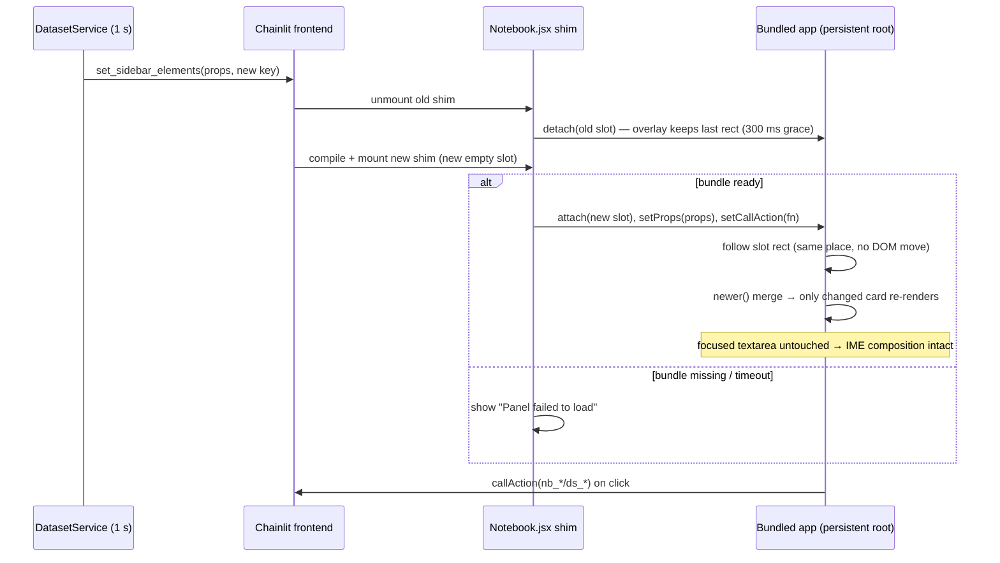

# Feature Plan: Notebook panel as a bundled React app (stop remounts)
Status: Implemented — desktop and phone layouts checked in the browser · Source: chat (dataset download remounts the panel) · Date: 2026-11-13

## 1. Requirement (User Stories & Acceptance Criteria)

**Problem.** While a dataset downloads, `DatasetService._on_bytes` pushes the panel props about once a second (`researchchat/workspace/dataset_service.py:565`, `PROGRESS_INTERVAL = 1.0` at line 50). Each push goes through `_send` (`researchchat/workspace/panel.py:36`), which emits `set_sidebar_elements` with a **new key** (`nb-{next(_keys)}`). Chainlit 2.12 replaces the sidebar elements whenever the key changes, then compiles the custom element again with sucrase, so `public/elements/Notebook.jsx` is **unmounted and mounted again**. Today `window.__rcNotebook` (`Notebook.jsx:20-49`) works around this, but anything left out of it is lost on every tick: Radix overlays, animations, focus, hover, `
` state, scroll inside cards.

**Scope rule from the user:** the change happens in `public/` only. No Python changes.

**US1.** As a researcher, I want the Datasets tab to stay steady while a download is running, so that I can read, filter, open cards and copy code without the UI resetting each second.

**US2.** As a developer, I want the panel built from a normal React project with npm packages (TanStack Query, Zustand, shadcn/ui, lucide-react), so that I can use and test standard libraries instead of only Chainlit's import map.

**Acceptance Criteria**
- **AC1**: Given a download is running and pushing props every second, When a push arrives, Then the panel's React tree is **not** unmounted. Component state such as an open card, an open Select or menu, or the filter input with its cursor is kept.
- **AC2**: Given a push with new `done_bytes`, When it arrives, Then only the affected dataset card re-renders and its progress bar shows the new percent.
- **AC3**: Given an older push arrives after a newer action reply, When the props are merged, Then the newest `version` and `datasets_rev` win, as `newer()` does today (`Notebook.jsx:66`).
- **AC4**: Given any panel button (run, add or delete cell, cancel or delete dataset, switch or create project), When it is clicked, Then the same `nb_*` / `ds_*` action is called with the same payload as today. The list is: nb_add_cell, nb_clear_cell_outputs, nb_clear_outputs, nb_create_project, nb_delete_cell, nb_duplicate_cell, nb_interrupt, nb_list_projects, nb_move_cell, nb_reorder_cell, nb_restart, nb_run_all, nb_run_cell, nb_switch_project, nb_update_cell, ds_cancel, ds_delete.
- **AC5**: Given the user is typing in a cell, When a push arrives, Then the typed text, the focus and the cursor position are kept.
- **AC10**: Given the user is in the middle of an IME composition (Vietnamese Telex or VNI, or CJK) in any panel input, When a push arrives, Then the composition is not ended: no `compositionend` fires and the focused element is never moved in the DOM.
- **AC6**: Given the user opens the panel in a new chat or switches projects, When the element mounts for the first time, Then the app shows that project's props and no state from the old project leaks in.
- **AC7** *(negative)*: Given the bundle fails to load (404 or JS error), When the element mounts, Then the panel shows a short "Panel failed to load" message instead of a blank sidebar, and the chat keeps working.
- **AC8** *(negative)*: Given the action call is rejected or errors, When a button is used, Then the button leaves its busy state and shows the error, as `S.busy` does today.
- **AC9**: The look stays the same: light and dark themes, and Chainlit's font and colour variables. The current `test_panel_ui.py` rules on colours and fonts keep holding.

**Out of scope**
- Any change in `researchchat/` (props shape, push rate, sidebar key).
- New panel features. This is a 1:1 port of what `Notebook.jsx` does now.
- Replacing the code editor (CodeMirror or Monaco). That can come later.

## 2. Codebase Patterns

| Area | Finding | Evidence |
|---|---|---|
| How the panel is shown | One `cl.CustomElement(name="Notebook", display="side")` in the ElementSidebar | `researchchat/workspace/panel.py:54` |
| How updates arrive | The whole `NotebookProps` is re-sent with a new key on each change | `panel.py:36-41` |
| Chainlit behaviour | `set_sidebar_elements` keeps the old state only if the key is the same; custom elements are compiled with sucrase (`transforms:["jsx","typescript","imports"]`) | `.venv/.../chainlit/frontend/dist/assets/index-B2u6IBgX.js` |
| Globals in an element | `props`, `callAction` are injected; imports only resolve against Chainlit's import map | `Notebook.jsx:5-14`, `:313` |
| State across remounts | Module-level store on `window.__rcNotebook` | `Notebook.jsx:20-49` |
| Props merge rule | `newer(a, b)`: higher `version` wins; datasets come from the higher `datasets_rev` | `Notebook.jsx:66-79` |
| Global script | `custom_js = "/public/custom.js"` (sidebar toggle, MutationObserver) | `.chainlit/config.toml:134`, `public/custom.js:122-150` |
| Styling | shadcn components from Chainlit plus a `CSS` string using Chainlit's HSL variables | `Notebook.jsx:106`, `:820` |
| UI tests | Python tests read `Notebook.jsx` and `custom.js` **as text**. They check colours, fonts, the import map, **no new dependencies**, no external scripts, no `dangerouslySetInnerHTML`, and `safeHref` | `tests/test_panel_ui.py` (19 tests) |
| JS tooling | None: no `package.json`, no Node build, no JS tests | repo root |

Note: `test_no_new_dependencies_are_added` and `test_every_imported_module_is_exposed_by_chainlit` encode an earlier decision to use **no npm packages**. This plan reverses that decision on purpose (Question 1).

## 3. Schema & Relationships

### 3.1 Existing Tables
None. The panel works only from `NotebookProps` (`researchchat/workspace/service.py:~60-100`) and action replies.

### 3.2 Relationships (+ ER diagram)
Not applicable. There is no database work.

### 3.3 Proposed Schema Changes
None. The `NotebookProps` contract does not change.

## 4. Implementation Idea

### 4.1 Approach & Files Affected

**Core idea: the app never lives inside Chainlit's sidebar DOM, so a remount never touches it.** *(Revised after Decision D3: moving a DOM node every second breaks Vietnamese IME, so nothing moves.)*

- The bundle runs `createRoot()` **once** on `
`, which is appended to `document.body` and **never re-parented**. It is `position: fixed` and drawn above the sidebar.
- `Notebook.jsx` becomes a thin shim of about 40 lines. It renders an empty **placeholder** `
` that fills the sidebar, then passes `props` and `callAction` to the app's Zustand store.
- The app tracks the placeholder's rectangle (ResizeObserver plus a MutationObserver on the slot and window resize) and sets its own `top/left/width/height` to match. Scrolling happens inside the app's own root, so it is unaffected.
- On a Chainlit remount the old placeholder is removed and a new one appears in the same place, usually in the same frame. The app keeps its last rectangle and only hides itself if no placeholder exists for more than 300 ms (sidebar closed, or another element shown).

Because the focused textarea is never moved, re-parented or re-rendered by the push, the browser's IME composition stays intact (AC5, AC10). All React state survives (AC1). The store merges props with the existing `newer()` rule (AC3). Zustand selectors per dataset id mean only the changed card re-renders (AC2). TanStack Query wraps the action calls as mutations (busy and error state, AC8). The bundle is served by Chainlit from `/public/build/` and loaded by `custom.js` as a same-origin module script. There's no CDN and no Python change.

Trade-offs of the overlay:
- `z-index` must sit above the sidebar but below Chainlit's modals, toasts and Radix portals. The app's own Radix portals render inside `#rc-panel-root`.
- When the sidebar is resized or animates, the overlay follows on the next observer callback. It may lag 1 frame during the slide animation.
- Keyboard focus order: Tab from the chat goes to the placeholder, which forwards focus into the app (`tabIndex=0` on the slot, `onFocus` → focus the first control).

**Files affected**

| | Path | What |
|---|---|---|
| 🆕 | `public/panel/package.json`, `package-lock.json` | React 18, react-dom, zustand, @tanstack/react-query, lucide-react, Radix and shadcn deps, vite, vitest, @testing-library/react, jsdom |
| 🆕 | `public/panel/vite.config.ts` | Library build: one ES module plus a CSS file into `public/build/` with fixed names (`notebook-panel.js`, `notebook-panel.css`) |
| 🆕 | `public/panel/tsconfig.json`, `components.json` | TypeScript and shadcn config |
| 🆕 | `public/panel/src/main.tsx` | Creates the persistent root and exposes `window.__rcPanel = { attach, detach, setProps, setCallAction }` |
| 🆕 | `public/panel/src/store.ts` | Zustand store: `nb` (merged props), UI state (tab, drafts, open cards, filter, sort, focus) |
| 🆕 | `public/panel/src/lib/newer.ts`, `lib/actions.ts`, `lib/markdown.tsx`, `lib/safeHref.ts`, `lib/editing.ts`, `lib/loadCode.ts` | Ported pure helpers from `Notebook.jsx` |
| 🆕 | `public/panel/src/components/{Notebook,CodeCell,NoteCell,BlockMenu,InsertRow,ProjectPicker,DatasetsTab,DatasetCard,DatasetSortSelect}.tsx` | 1:1 port of the current components |
| 🆕 | `public/panel/src/components/ui/*` | shadcn components (card, badge, button, input, progress, dropdown-menu, select) |
| 🆕 | `public/panel/src/styles.css` | The current `CSS` and dataset CSS strings, unchanged, using Chainlit's HSL variables |
| 🆕 | `public/panel/src/**/*.test.tsx` | Vitest tests (Step 7) |
| 🆕 | `public/build/notebook-panel.js`, `.css` | Built output, committed (Question 2) |
| ✏️ | `public/elements/Notebook.jsx` | Shrinks to the shim (about 40 lines plus the fallback message for AC7) |
| ✏️ | `public/custom.js` | Adds a `<script type="module" src="/public/build/notebook-panel.js">` and the CSS `<link>`, both same-origin |
| ✏️ | `tests/test_panel_ui.py` | **Outside `public/`.** Its rules must point at `public/panel/src/` and drop the "no new dependencies" and "import map only" checks (Question 1) |
| ✏️ | `.gitignore` | Adds `public/panel/node_modules/` |

### 4.2 Endpoints
No new HTTP endpoints. The contract between the shim and the bundle replaces them:

| Call | From → to | Purpose |
|---|---|---|
| `__rcPanel.attach(slot)` | shim → bundle | Register the current placeholder; the overlay follows its rectangle |
| `__rcPanel.detach(slot)` | shim → bundle | Forget that placeholder; hide after 300 ms if no other slot appears (no unmount, no DOM move) |
| `__rcPanel.setProps(props)` | shim → bundle | Merge new `NotebookProps` with `newer()` |
| `__rcPanel.setCallAction(fn)` | shim → bundle | Give the app the current Chainlit `callAction` |
| `callAction({name, payload})` | bundle → server | The same `nb_*` / `ds_*` actions as today (AC4) |

Load order: `custom.js` may finish after the element mounts. In that case the shim waits on a `window.__rcPanelReady` promise, with a 10 s timeout that leads to the AC7 fallback.

### 4.3 DTOs
`NotebookProps` and `DatasetProps` stay exactly as defined in `researchchat/workspace/service.py`. The plan adds TypeScript types that mirror them in `public/panel/src/types.ts`. Fields the panel relies on: `version`, `datasets_rev`, `project{id,name}`, `kernel`, `running_cell_id`, `cells[]`, `datasets[]{id,status,size_bytes,done_bytes,position_in_queue,files,url,...}`. No fields are added or removed.

## 5. Security Review

| # | Risk | Where | Mitigation in this plan | Test ref |
|---|---|---|---|---|
| SEC1 | XSS from notes or dataset names | markdown, cards | Keep the React-elements-only markdown, no `dangerouslySetInnerHTML`, a lint rule that bans it, and `safeHref` for links (port of `Notebook.jsx:323-350`) | S1 |
| SEC2 | Supply chain (new npm deps) | `public/panel/package.json` | Pinned versions with a lockfile, `npm audit` in CI, a small dependency list | S2 |
| SEC3 | Loading third-party scripts | `custom.js` | Only same-origin `/public/build/...`; a test keeps the "no external script" rule | S2 |
| SEC4 | Stale or forged props overriding newer ones | store merge | `newer()` stays the only merge path | G2 |
| SEC5 | A global `window.__rcPanel` other scripts could call | `main.tsx` | Same trust level as today's `window.__rcNotebook`; it only accepts props and forwards to `callAction`, and the server validates every action | — |

Authentication, object authorization and rate limits are unchanged: they live in the Python action handlers.

## 6. Workflow Diagram

A sequence diagram, because the fix is about what happens on each push.

## 7. TDD Test Plan

Vitest + React Testing Library + jsdom in `public/panel/`. The Python text tests are kept and adjusted.

### Functional groups

### Group 1 — The root survives Chainlit remounts (AC1, AC6) · integration (shim + bundle in jsdom)
Baseline: Given the app is attached with props v1 and a DatasetCard is open · When the shim is unmounted and a new shim mounts with props v2

| # | Type | Test name | Changed condition | Expected result | Demonstrates |
|---|---|---|---|---|---|
| ✅1 | baseline | `keeps_card_open_across_remount` | — | the card is still open; mount counter = 1 | a push no longer resets UI state |
| ✅2 | edge | `keeps_select_open_across_remount` | the sort Select is open | it stays open, with no animation replay | Radix overlays survive |
| ✅3 | edge | `ten_remounts_mount_once` | 10 remounts in a row | the component mounted once | no leak from repeated attach/detach |
| ✅4 | edge | `root_parent_never_changes` | 10 remounts | `#rc-panel-root.parentNode === document.body` every time | the app DOM is never moved |
| ✅5 | edge | `overlay_follows_new_slot_rect` | the new slot is 20 px wider | the overlay width updates | layout tracks the sidebar |
| ❌1 | negative | `project_switch_resets_project_state` | props v2 has a different `project.id` | drafts and open cards are cleared | no state leaks between projects |
| ❌2 | negative | `detach_without_attach_is_noop` | detach is called before any attach | no throw, no DOM change | safe ordering |
| ❌3 | negative | `hides_when_slot_gone_over_300ms` | no slot for 400 ms (sidebar closed) | overlay hidden, state kept | it doesn't float over the chat |
| ❌4 | negative | `stays_visible_during_quick_swap` | the new slot arrives after 50 ms | no hide or flicker | pushes don't blink |

### Group 2 — Props merge (AC3) · unit (`newer.ts`)
Baseline: Given the stored props have version 5 and datasets_rev 3 · When `setProps` is called

| # | Type | Test name | Changed condition | Expected result | Demonstrates |
|---|---|---|---|---|---|
| ✅1 | baseline | `newer_version_wins` | incoming version 6 | the store holds v6 | fresh data is shown |
| ✅2 | edge | `newer_datasets_rev_wins_on_older_version` | v4, rev 4 | cells from v5, datasets from rev 4 | datasets update apart from cells |
| ❌1 | negative | `older_version_ignored` | v4, rev 3 | the store is unchanged | late pushes can't roll back |
| ❌2 | negative | `equal_version_lower_rev_keeps_datasets` | v5, rev 2 | the datasets are unchanged | — |

### Group 3 — Progress re-renders only one card (AC2) · component
Baseline: Given 3 datasets with one downloading at 10% · When props arrive with that dataset at 40%

| # | Type | Test name | Changed condition | Expected result | Demonstrates |
|---|---|---|---|---|---|
| ✅1 | baseline | `progress_updates_bar` | — | the bar shows 40%, the badge says "40%" | progress is visible |
| ✅2 | edge | `only_changed_card_renders` | render counters on all cards | only the changed card +1 | cheap updates |
| ✅3 | edge | `queued_shows_position` | status queued, position 2 | "2nd in queue", bar at 0 | ported behaviour |
| ❌1 | negative | `zero_size_shows_zero_percent` | `size_bytes` = 0 | 0%, no NaN | no divide-by-zero |

### Group 4 — Typing survives a push (AC5) · integration
Baseline: Given focus is in cell A's textarea with the cursor at 7 and an unsaved draft · When a remount happens

| # | Type | Test name | Changed condition | Expected result | Demonstrates |
|---|---|---|---|---|---|
| ✅1 | baseline | `focus_and_cursor_restored` | — | active element = cell A, selection 7–7 | no lost cursor |
| ✅2 | edge | `draft_kept_over_server_source` | the push carries the old source | the textarea shows the draft | unsaved text wins |
| ✅3 | edge | `ime_composition_survives_push` | `compositionstart` fired, no end yet | no `compositionend`, no blur, same `document.activeElement` (jsdom) **plus a manual check with Vietnamese Telex in Chrome and Firefox** | AC10: Telex/VNI typing isn't cut off |
| ❌1 | negative | `no_focus_steal_when_not_focused` | focus is in the chat input | focus stays in the chat | the panel doesn't grab focus |
| ❌2 | negative | `push_does_not_overwrite_composing_text` | the push carries a new `source` for the composing cell | the textarea value is unchanged until composition ends | server text never clobbers mid-word input |

### Group 5 — Actions (AC4, AC8) · component with a mocked `callAction`
Baseline: Given the app has a callAction mock · When a button is clicked

| # | Type | Test name | Changed condition | Expected result | Demonstrates |
|---|---|---|---|---|---|
| ✅1 | baseline | `run_cell_calls_nb_run_cell` | — | called with `{name:"nb_run_cell", payload:{cell_id}}` | same contract |
| ✅2 | edge | `each_action_payload_matches_today` | table-driven over all 17 actions | the payloads equal the current ones | 1:1 port |
| ✅3 | edge | `uses_latest_callAction_after_remount` | a new fn set after remount | the new fn is called, the old one isn't | no stale closure |
| ❌1 | negative | `rejected_action_clears_busy_and_shows_error` | the mock rejects | the button is enabled again, an error is shown | no stuck spinner |
| ❌2 | negative | `double_click_sends_once` | 2 fast clicks | 1 call | no double run or delete |

### Group 6 — Bundle load fallback (AC7) · shim unit
Baseline: Given the shim mounts · When `__rcPanelReady` never resolves

| # | Type | Test name | Changed condition | Expected result | Demonstrates |
|---|---|---|---|---|---|
| ✅1 | baseline | `shows_fallback_after_timeout` | — | "Panel failed to load" after 10 s (fake timers) | no blank sidebar |
| ✅2 | edge | `late_bundle_replaces_fallback` | it resolves at 3 s | the app is attached, no fallback | slow networks are fine |
| ❌1 | negative | `bundle_throws_shows_fallback` | `attach` throws | fallback shown, error logged | a crash stays inside the panel |

### Security groups

### Group S1 — Rendering stays safe (SEC1) · component + lint
Baseline: none (negatives only)

| # | Type | Test name | Changed condition | Expected result | Demonstrates |
|---|---|---|---|---|---|
| ❌1 | negative | `note_html_rendered_as_text` | the note contains `` | the text shows literally, no element | no XSS |
| ❌2 | negative | `javascript_link_not_linked` | `[x](javascript:alert(1))` | plain text, no `<a>` | safeHref holds |
| ❌3 | negative | `no_dangerouslySetInnerHTML_in_src` | grep over `src/` | 0 hits | rule enforced |

### Group S2 — Dependencies and scripts (SEC2, SEC3) · Python text tests (adjusted)
Baseline: none (negatives only)

| # | Type | Test name | Changed condition | Expected result | Demonstrates |
|---|---|---|---|---|---|
| ❌1 | negative | `no_external_script_or_stylesheet` | custom.js or the build references a non-`/public` URL | the test fails | same-origin only |
| ❌2 | negative | `lockfile_present_and_versions_pinned` | a `^` or `~` range in package.json | the test fails | reproducible builds |
| ❌3 | negative | `colours_and_fonts_rules_on_new_css` | a hex colour in `styles.css` | the test fails | AC9 is kept |

### Coverage (AC → tests, Security → tests)

| AC | Tests |
|---|---|
| AC1 | G1✅1–3, G1❌2 |
| AC2 | G3 |
| AC3 | G2 |
| AC4 | G5✅1–3 |
| AC5 | G4 |
| AC10 | G4✅3, G4❌2, G1✅4 |
| AC6 | G1❌1 |
| AC7 | G6 |
| AC8 | G5❌1–2 |
| AC9 | S2❌3 plus the existing colour and font tests |

| Risk | Tests |
|---|---|
| SEC1 | S1 |
| SEC2 | S2❌2 |
| SEC3 | S2❌1 |
| SEC4 | G2❌1–2 |
| SEC5 | — (accepted, same as today) |

## 8. Questions & Confirmations

**Open question**
1. *(Reworded)* There is a Python test file, `tests/test_panel_ui.py`, that reads the panel code and fails if the panel imports any npm package. It was written for the old "no npm packages" design. With this plan the panel **will** use npm packages, so that test will fail. The file is outside `public/`. May I edit it so it checks the new code in `public/panel/src/` and, instead of "no npm packages", checks "every package version is pinned in a lockfile"? If you say no, I can't use npm packages and the plan can't be done.

**Answered:** see the Decision log.

**Assumptions** (all confirmed by the user, see D5)
- A1: TypeScript for the new app.
- A2: shadcn components copied into `public/panel/src/components/ui/`, styled with Chainlit's CSS variables.
- A3: React 18.3, our own copy inside the bundle.
- A4: Node 20+ and npm.
- A5: Zero changes in `researchchat/`.

No files or data were changed except this plan file.

## Decision log

| # | Question | Answer | What changed in the plan |
|---|---|---|---|
| D2 | Commit the built bundle? | Commit | `public/build/notebook-panel.{js,css}` is committed; no Node needed to run the app |
| D3 | Is cutting off IME composition OK? | **No**: Vietnamese Telex/VNI must not break mid-word | Approach changed from "move the root into the sidebar" to "fixed overlay that never moves, following a placeholder" (4.1, 4.2, 6). Added AC10 and tests G1✅4–5, G1❌3–4, G4✅3, G4❌2 |
| D4 | TanStack Query scope? | Default | Actions and `nb_list_projects` only; datasets still come from props |
| D1 | May `tests/test_panel_ui.py` be edited? | Yes, check the new code | The tests are retargeted to `public/panel/src/`; "no new dependencies" becomes "versions pinned in a lockfile" |
| D5 | Assumptions A1–A5 | All confirmed | TypeScript, shadcn with Chainlit variables, React 18.3 bundled, Node 20+/npm, no `researchchat/` changes |

| D6 | (during implementation) Which shadcn sources? | Chainlit 2.12's own `components/ui/*` from its source map | Every Tailwind class is one Chainlit's prebuilt CSS contains, so no Tailwind build is needed and the look matches the chat |
| D7 | (during implementation) TanStack Query scope | As D4 | `useRunner` (one mutation: busy, error, double-click guard) for button actions; `useProjects` query for the picker; background saves stay plain calls |
| D8 | (during implementation) Progress accessibility | Fixed | The vendor `Progress` now passes `value` to Radix, so screen readers get `aria-valuenow` (stock shadcn drops it) |
| D9 | The fixed overlay leaves the phone sheet empty (Chainlit puts the side view in a dialog). Where should the root live? | Inside the sidebar container | `#rc-panel-root` lives in `#side-view-content`, which a push doesn't replace (checked on desktop and phone). It moves only when Chainlit makes a new container (sidebar opened, layout switch), never on a push. Fixed positioning and rect tracking are removed. Replaces D3's "never re-parent" |
| D10 | (user, during review) Colours and width | Panel blends into the sidebar card; sidebar opens as wide as possible | No panel background of its own. `custom.js` opens the sidebar at 60% (the chat's 40% minimum) once per opening via the resize library's Home key, so a later drag is kept. Side padding around the panel goes from 24px to 12px |

## 9–10. Scaffold report & verification

See [panel-react-build-scaffold-report.md](panel-react-build-scaffold-report.md).
