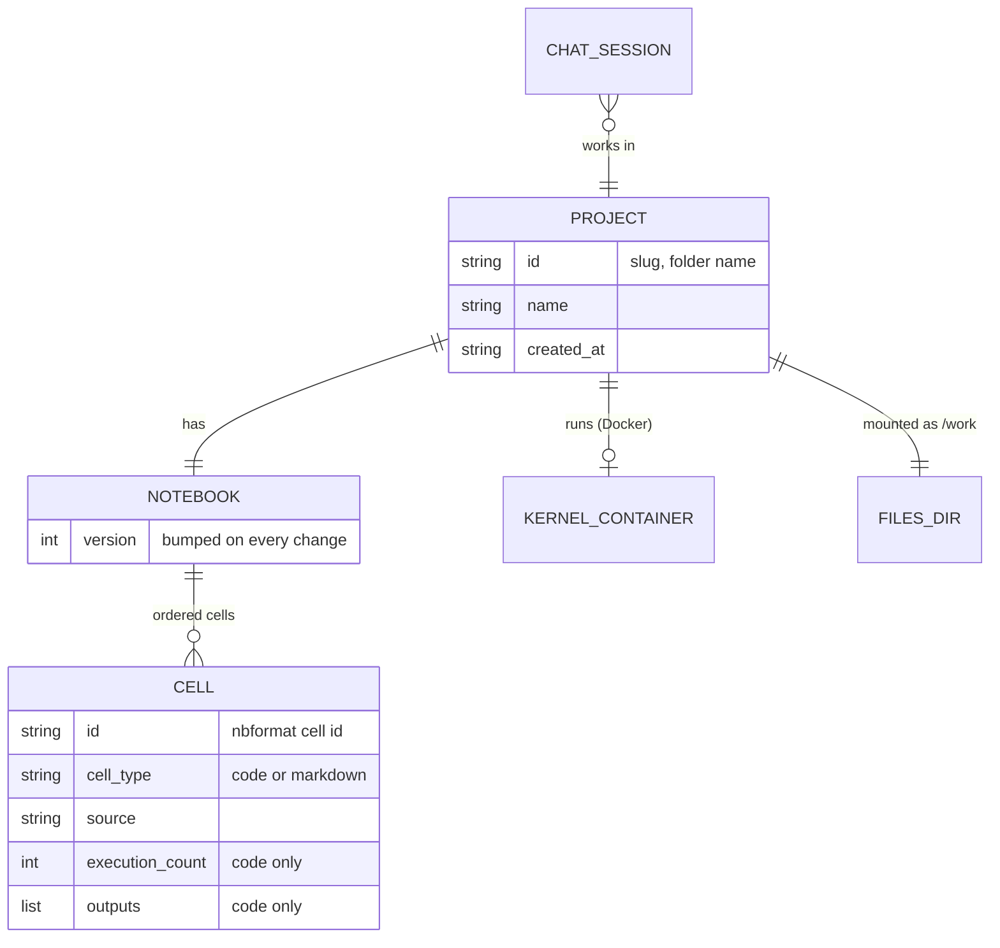
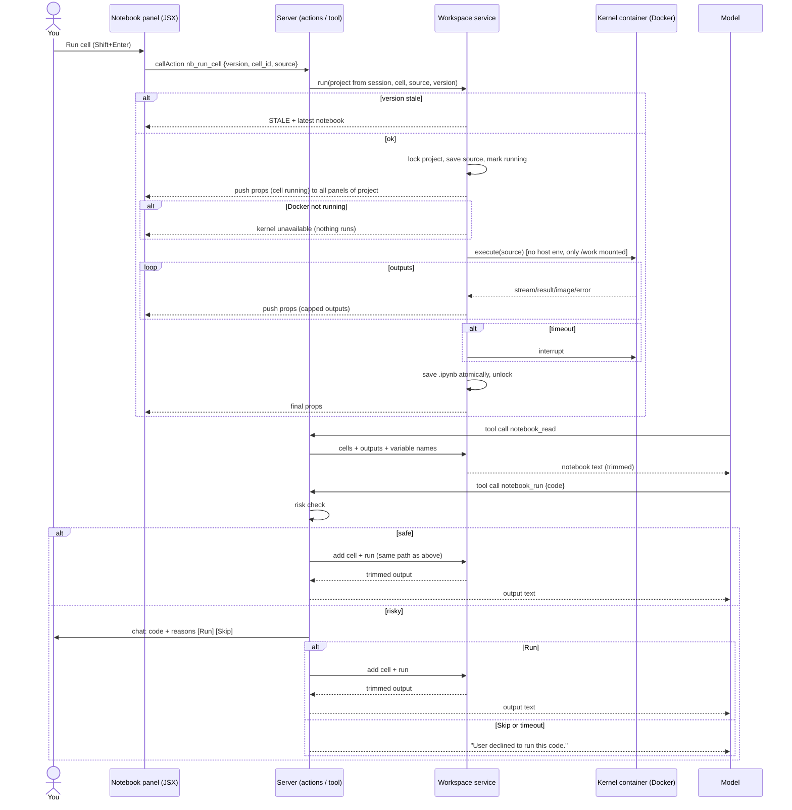

# Feature Plan: Project Notebook Workspace
Status: Scaffolded — awaiting verification · Source: chat request (no ticket) · Date: 2026-11-09

A notebook panel on the right side of the chat. You can add, edit and run Python cells and write notes between them, like Jupyter, and the model can use it too. **Each project has exactly one workspace**: one notebook, one running Python session (kernel) and one files folder. Code runs inside a **Docker container** per project, so it can reach the internet but not the rest of your PC.

## 1. Requirement (User Stories & Acceptance Criteria)

**US1:** As a **researcher**, I want a notebook panel beside the chat where I can write and run Python cells, so that I can analyse data without leaving the app.

**US2:** As a **researcher**, I want each project to have its own workspace (notebook, variables, files), so that work on one topic doesn't mix with another.

**US3:** As a **researcher**, I want the assistant to read my project's notebook and write and run code in it (asking me first only when the code looks risky), so that it can calculate, check data and make charts for me.

**US4:** As a **researcher**, I want to write formatted notes between code cells, so that I can record what I found and why, next to the code that found it.

**Acceptance Criteria** (all proposed, so please confirm or edit them)

| # | Given | When | Then |
|---|---|---|---|
| AC1 | a chat is open in project P | the chat starts | the right panel opens and shows P's notebook (empty for a new project) |
| AC2 | the panel is open | I add a code cell, type code and press Run (or Shift+Enter) | the code runs in P's kernel and its output (printed text, last value, error traceback) appears under the cell with an execution number `[n]` |
| AC3 | cell 1 ran `x = 5` | I run cell 2 with `x * 2` | it shows `10`, because variables persist across cells in the same project |
| AC4 | code makes a matplotlib chart | it runs | the chart shows as an image under the cell |
| AC5 | I edit, delete, move or add cells | — | the notebook is saved to disk right away, and is still there after an app restart (outputs too) |
| AC6 | projects P and Q exist | I set `x = 1` in P | `x` does not exist in Q: separate kernels, notebooks and files |
| AC7 | two chats are open on the same project | one runs a cell | both see the same notebook and share the same variables (one workspace per project) |
| AC8 | a cell runs forever | I press Stop, or the time limit passes | the run is interrupted, the cell shows "Interrupted" or "Timed out", and the kernel keeps the variables made so far |
| AC9 | the kernel is in a bad state | I press Restart | a fresh kernel starts, variables are cleared, and the cells stay |
| AC10 | the Notebook switch is on and the model sends code that passes the risk check | it calls `notebook_run` | the code **runs right away without asking**; a new cell and its output show in the panel, the chat shows a "Ran cell [n]" step, and the model gets the output |
| AC11 | the model sends **risky** code (shell commands, deleting or moving files, installing packages, `eval`/`exec`, uploading data, writing outside the files folder, or code that can't be parsed) | it calls `notebook_run` | the chat shows the code, **why it was flagged**, and **Run / Skip** buttons. It runs only on Run; on Skip or no answer in time nothing runs and the model is told it was declined |
| AC12 | I run code that prints a lot | — | output is cut to the configured limit, with a "[output truncated]" note |
| AC13 | code reads or writes files with relative paths | — | they resolve inside the project's `files/` folder |
| AC14 | a code line or an output is wider than the panel (long line, wide table, traceback, big chart) | it shows | lines are **not wrapped**; that cell's code box or output box gets its **own horizontal scrollbar**, and the panel itself never scrolls sideways |
| AC15 | the panel is open | I add a **note** cell, type Markdown and press Shift+Enter (or click outside it) | the note is saved and shown formatted: headings, **bold**, *italic*, `code`, lists, links. Double-clicking it opens it for editing again |
| AC17 | the Notebook switch is on | the model calls `notebook_read` | it gets every cell in order (code and notes, with `[n]` and trimmed outputs) plus a list of the kernel's variables, without running any of your cells |
| AC18 | a chat is open | I use the **project bar under the chat message box** (current project name, switch list, "New project") | the chat switches to that project: the panel shows its notebook, and code runs in its own container |
| AC19 | code runs in a cell | it tries to read your PC's files outside the project, or read the app's secrets | it can't: the container only sees the project's `files/` folder (as `/work`) and has no host environment variables. It **can** reach the internet |
| AC20 | Docker Desktop isn't running | I press Run, or the model calls `notebook_run` | nothing runs (never on your PC directly); the panel shows "Docker isn't running: start Docker Desktop, then press Restart" |
| AC16 | a notebook has notes between code cells | I press Run all, or the model runs code | notes are skipped: they never go to the kernel, and they have no `[n]` or output |

**Negative paths:** risky model code, Docker not running, container out of memory, switching to a missing project, running a note cell, unknown cell type, a note with raw HTML or a `javascript:` link, invalid project name (path tricks like `../x`), unknown cell id, stale edit (cell changed meanwhile), kernel crash or dead kernel, run while another run is in progress (queued, like Jupyter), model sends empty code, huge output, code that never ends.

**Out of scope (this version):** images, tables and math (LaTeX) inside notes; syntax highlighting or autocomplete (Chainlit custom elements have no code editor library, so cells are plain text boxes); installing packages from the UI or with `%pip` (packages come from the kernel image; to add one, add it to `docker/kernel-requirements.txt` and rebuild); saving chat history per project (Q2: no); multi-user accounts or sharing; other languages; uploading files into the workspace from the UI; exporting or importing notebooks via the UI (the file on disk is a normal `.ipynb` that Jupyter and VS Code open).

## 2. Codebase Patterns

| Area | Finding | Evidence |
|---|---|---|
| Layering | Thin Chainlit hooks in `app.py`; logic in the `researchchat/` package, one module per job | `app.py:22-95`, `researchchat/` |
| Config | `config.toml` read once in `config.py`, checked at startup, exported as constants | `researchchat/config.py:12-55` |
| Tools | One module per tool with `DEFINITION`, `step_title(args)`, `async run(args) -> (shown, result)`; registered in `_MODULES` | `researchchat/tools/__init__.py:12-15`, `tools/read_page.py` |
| Tool UI | Each tool runs in a `cl.Step` inside the reply's `Progress` group | `tools/__init__.py:run_tool_call`, `researchchat/progress.py` |
| Blocking work | Sync libraries run via `asyncio.to_thread` | `tools/web_search.py:run` |
| Errors | Tools raise `ValueError` with short user-facing messages; `run_tool_call` turns them into `Failed: …` | `tools/read_page.py:read_page`, `tools/__init__.py` |
| Security precedent | Allow-list checks before side effects (`check_public_url`) | `tools/read_page.py:check_public_url` |
| Tests | pytest, no network or API key, one file per module, `test_<behaviour>` names | `tests/test_read_page.py`, `pytest.ini` |
| Chainlit UI APIs (2.11) | `cl.ElementSidebar.set_title/set_elements` opens the right panel. `cl.CustomElement(name, props)` loads `public/elements/<name>.jsx`, re-rendered by `element.update()`. The JSX gets `props`, `updateElement`, `callAction` (result returned to the JSX) and `sendUserMessage` | `.venv/.../chainlit/sidebar.py:8-45`, `element.py:468-482`, `server.py:1249-1287`, frontend bundle |
| JSX imports allowed | `react`, `lucide-react`, `@/components/ui/*` (button, textarea, scroll-area, badge, tooltip…), `zod`, `recoil`. **No code editor library** | frontend bundle import map |
| Persistence | No Chainlit data layer (no DB). Everything is in memory, per browser session | `.chainlit/config.toml`, no `DATABASE_URL` |
| Jupyter | `ipykernel`, `jupyter_client`, `nbformat` are **not installed** | `pip list` |

## 3. Schema & Relationships

There's no database, so the "schema" is a **folder layout on disk**. A real `.ipynb` file keeps the notebook readable by Jupyter and VS Code.

### 3.1 Existing Tables
None. The app stores nothing today; chat history lives only in the browser session.

### 3.2 Relationships (+ ER diagram)

| From | To | Cardinality | Link | Meaning |
|---|---|---|---|---|
| Project | Notebook | 1 : 1 | folder `workspaces/<project_id>/notebook.ipynb` | one workspace per project |
| Project | Kernel container | 1 : 0..1 | Docker container `rc-kernel-<project_id>`, tracked in an in-memory registry | started on first run, stopped when idle |
| Project | Files folder | 1 : 1 | `workspaces/<project_id>/files/` | kernel's working directory |
| Notebook | Cell | 1 : N, ordered | `cells[]` in the `.ipynb` | |
| Chat session | Project | N : 1 | `cl.user_session["project_id"]` | many chats can share one project's workspace |



**Risks:** two chats on one project editing at once (lost updates), handled by a per-project lock and a `version` number; a kernel left running after all chats close, handled by idle shutdown; the `.ipynb` getting big from image outputs, handled by an output limit.

### 3.3 Proposed Schema Changes (described, not applied)

```
workspaces/                       # new, git-ignored
  <project_id>/                   # project_id: ^[a-z0-9][a-z0-9-]{0,39}$
    project.json                  # {"name": "Tokyo housing", "created_at": "2026-11-09T10:00:00Z"}
    notebook.ipynb                # nbformat v4.5 (cells have ids); metadata.researchchat.version = int
    files/                        # mounted into the container as /work (its working directory)
  .kernels/                       # connection files for running kernels (key + ports), deleted on stop
```

- Notes are saved as standard nbformat **`markdown` cells** (no `execution_count`, no `outputs`), so Jupyter and VS Code show them as normal notes.

- `project.json` holds the display name (any text), while `project_id` is a safe slug used as the folder name.
- `notebook.ipynb` is written atomically: write to a temp file, then `os.replace`, so a crash never leaves half a file.
- `.gitignore` gets `workspaces/`.
- A `default` project is created on first start. **Migration:** none needed, since no data exists yet. Rollback is deleting `workspaces/`.

New `config.toml` section:
```toml
[notebook]
workspaces_dir = "workspaces"
cell_timeout_seconds = 60        # then interrupt
max_output_chars = 20000         # per cell, text outputs
max_image_kb = 1024              # per image output
kernel_idle_minutes = 30         # stop idle kernels
model_auto_run = true            # AC10: safe model code runs without asking
risky_code_needs_approval = true # AC11: risky model code always asks
read_max_chars = 12000           # AC17: notebook_read size for the model

[notebook.docker]
image = "researchchat-kernel:1"  # built from docker/kernel.Dockerfile
memory = "2g"
cpus = 2
pids_limit = 256
```

## 4. Implementation Idea

### 4.1 Approach & Files Affected

A `researchchat/workspace/` package holds four parts: projects and notebook storage (`store.py`), one **Docker-hosted Jupyter kernel per project** (`kernels.py`), a check that flags risky code (`risk.py`), and a service that edits cells and runs them under a per-project lock (`service.py`). The panel is a Chainlit **CustomElement** (`public/elements/Notebook.jsx`) shown in the **ElementSidebar** on the right. Its buttons call Chainlit **action callbacks**, which return the updated notebook. When anything changes (another chat, the model, a long run streaming output), the server pushes new props to every open panel for that project. The model gets two tools built like `read_page`: `notebook_run` (runs safe code at once, asks with `cl.AskActionMessage` only for risky code) and `notebook_read`.

**How the Docker kernel works**
- One image, `researchchat-kernel:1`, built from `docker/kernel.Dockerfile`: `python:3.12-slim` + `ipykernel`, `numpy`, `pandas`, `matplotlib` (pinned versions), running as a non-root user. This also avoids the Python 3.14 question: only the app runs on 3.14, the kernel runs on 3.12.
- On first run, the app writes a connection file (random key + 5 free ports) and starts:
  `docker run -d --rm --init --name rc-kernel-<id> --user 1000 --read-only --tmpfs /tmp --cap-drop ALL --security-opt no-new-privileges --memory 2g --cpus 2 --pids-limit 256 -v <files>:/work -w /work -v <conn>:/conn:ro -p 127.0.0.1:<ports>:<ports> researchchat-kernel:1 python -m ipykernel_launcher -f /conn/kernel.json`
- The app connects with `jupyter_client.AsyncKernelClient` to `127.0.0.1` with that key. Ports are bound to localhost only, and the key signs every message.
- No host environment variables are passed in, so the OpenRouter key can't leak. The container sees only `/work` (the project's `files/`). It can reach the internet (Q8).
- Stop = `docker kill --signal SIGINT` (the kernel turns it into KeyboardInterrupt). Restart = remove the container and start a new one. Idle = `docker stop`. On app start, leftover `rc-kernel-*` containers are removed.
- The app calls the `docker` command line (no new Python package). If Docker isn't running, the kernel status is `unavailable` and nothing ever runs on the host.

**Risky code check (`risk.py`)** reads the code with Python's `ast` module (plus IPython `!`/`%` lines) and flags: shell commands (`!cmd`, `%%bash`, `%system`, `subprocess`, `os.system`, `os.popen`, `os.exec*`, `os.spawn*`, `pty`); deleting or moving files (`os.remove/unlink/rmdir/rename/replace`, `shutil.rmtree/move`, `Path.unlink/rmdir/rename/replace`); writing to an absolute path or a path with `..`; installing packages (`%pip`, `%conda`, `pip`); dynamic code (`eval`, `exec`, `compile`, `__import__`, `importlib`); low-level access (`ctypes`, `os.fork`, `socket` servers); uploading data (`requests.post/put/patch`, `httpx.post/put/patch`, `smtplib`, `ftplib`); and code that doesn't parse. Reading the web (`requests.get`) is allowed. The check is a **speed bump, not a wall**: determined code can hide from it, which is why the Docker sandbox is the real protection.

**Project bar (AC18), under the chat message box (Q1b = b):**
- `public/custom.js` is loaded through Chainlit's `custom_js` setting in `.chainlit/config.toml`. It finds the message box and adds a small bar under it: current project name, a switch list and "New project", like Claude Code. A `MutationObserver` puts it back when Chainlit redraws the page.
- **Bridge to the server:** the bar has no server access of its own. It sends browser events (`rc:switch-project`, `rc:create-project`) to the Notebook panel, which calls the matching action with `callAction`, so every change still goes through the session-checked actions. The panel answers with an `rc:projects` event (list + current project) that the bar redraws from.
- **If Chainlit's layout changes** and the message box can't be found, the bar shows at the bottom of the notebook panel instead (option a), so switching projects never breaks completely.
- Switching sets `cl.user_session["project_id"]` and reloads the panel.

| File | New/Changed | Purpose |
|---|---|---|
| `researchchat/workspace/__init__.py` | 🆕 | package |
| `researchchat/workspace/store.py` | 🆕 | project ids, folders, load/save `.ipynb` atomically, cell CRUD on the in-memory notebook |
| `researchchat/workspace/kernels.py` | 🆕 | container registry: start (connection file, `docker run`), execute with timeout, collect outputs, interrupt, restart, idle stop, startup cleanup |
| `researchchat/workspace/risk.py` | 🆕 | `check(code) -> list[str]` of reasons; empty list = safe |
| `researchchat/workspace/service.py` | 🆕 | per-project lock + version check; ties store and kernels; produces panel props; notifies open panels |
| `researchchat/workspace/panel.py` | 🆕 | open the sidebar with the `Notebook` element; registers the session's panel for push updates |
| `researchchat/workspace/actions.py` | 🆕 | `@cl.action_callback` handlers (§4.2) |
| `researchchat/tools/notebook_run.py` | 🆕 | model tool: risk check, approval only if risky, add cell, run, return trimmed output |
| `researchchat/tools/notebook_read.py` | 🆕 | model tool: cells + trimmed outputs + variable names |
| `researchchat/tools/__init__.py` | ✏️ | register both tools |
| `researchchat/config.py` | ✏️ | read `[notebook]` and `[notebook.docker]` |
| `app.py` | ✏️ | on chat start: choose project, open panel, refuse a non-local host (Q7); on chat end: unregister panel; import actions |
| `public/elements/Notebook.jsx` | 🆕 | the panel UI |
| `public/custom.js` | 🆕 | the project bar under the message box + event bridge to the panel |
| `.chainlit/config.toml` | ✏️ | `custom_js = "/public/custom.js"` |
| `docker/kernel.Dockerfile` | 🆕 | the kernel image |
| `docker/kernel-requirements.txt` | 🆕 | packages inside the kernel image (separate from the app's `requirements.txt`) |
| `config.toml` | ✏️ | `[notebook]` sections |
| `requirements.txt` | ✏️ | `jupyter_client`, `nbformat` (ipykernel and the data libraries live in the image) |
| `.gitignore` | ✏️ | `workspaces/` |
| `researchchat/settings.py` | ✏️ | "Notebook" switch (assumption H); added during scaffold, changed at implementation |
| `pytest.ini` | ✏️ | `docker` test marker; added during scaffold |
| `README.md` | ✏️ | workspace section: Docker Desktop needed, `docker build` command, what the sandbox does and doesn't protect |
| `tests/test_workspace_store.py`, `tests/test_workspace_risk.py`, `tests/test_workspace_kernels.py`, `tests/test_workspace_service.py`, `tests/test_notebook_tools.py` | 🆕 | §7 |

### 4.2 Endpoints

There's no REST API here. The panel talks to the server through **Chainlit action callbacks** (`callAction({name, payload})`, which returns `{success, response}`). Each one returns the full panel state (`NotebookProps`), or an error.

| Action name | Purpose | Success | Errors |
|---|---|---|---|
| `nb_add_cell` | insert an empty code or note cell after `after_id` (or at end) | NotebookProps | `NOT_FOUND`, `STALE`, `BAD_TYPE` |
| `nb_update_cell` | save edited source (debounced while typing) | NotebookProps | `NOT_FOUND`, `STALE`, `TOO_LARGE` |
| `nb_delete_cell` | remove a cell | NotebookProps | `NOT_FOUND`, `STALE` |
| `nb_move_cell` | move up/down | NotebookProps | `NOT_FOUND`, `STALE` |
| `nb_run_cell` | save source, then run it; outputs stream via push | NotebookProps (final) | `NOT_FOUND`, `NOT_CODE` (it's a note), `KERNEL_DEAD`, `TIMEOUT` (as cell output) |
| `nb_run_all` | run all code cells top to bottom, skipping notes; stop at first error | NotebookProps | as above |
| `nb_interrupt` | stop current run | NotebookProps | — |
| `nb_restart` | restart kernel, clear variables (cells kept, outputs kept) | NotebookProps | — |
| `nb_clear_outputs` | clear all outputs | NotebookProps | `STALE` |
| `nb_list_projects` | projects for the bottom bar | `[{id, name}]` | — |
| `nb_switch_project` | point this chat at another project | NotebookProps of that project | `NOT_FOUND` |
| `nb_create_project` | create a project from a name and switch to it | NotebookProps | `BAD_NAME` |

**Design notes:**
- **Everything goes through actions** because they're Chainlit's only built-in way for a custom element to call the server and get a result back. `sendUserMessage` would pollute the chat.
- **Full state comes back each time:** notebooks are small, and it keeps every panel consistent without merge logic.
- **The project comes from the session, never from the payload.** The server reads `cl.user_session["project_id"]`, so a panel can't touch another project (see Security §5, #2). The only way to change it is `nb_switch_project`, which accepts an existing project id only (checked against the folder list, never used as a path directly).
- **Notes need no action of their own:** Shift+Enter on a note only switches it from edit to formatted view in the panel and saves it with `nb_update_cell`. The server never runs notes.
- **`STALE`:** every editing action sends the `version` it last saw. A mismatch is rejected and the latest state is returned, so the panel just re-renders.

### 4.3 DTOs

**NotebookProps** (server → panel, element `props`)
```json
{
  "project": {"id": "tokyo-housing", "name": "Tokyo housing"},
  "version": 12,
  "kernel": "idle",
  "running_cell_id": null,
  "cells": [
    {"id": "n0t3s1", "type": "markdown", "source": "## Prices\nLoad the **2025** data first.",
     "execution_count": null, "status": "idle", "outputs": []},
    {"id": "a1b2c3", "type": "code", "source": "x = 5\nx * 2", "execution_count": 3, "status": "done",
     "outputs": [{"kind": "result", "text": "10"}]}
  ],
  "error": null
}
```

| Field | Type | Req | Validation | Maps to | Meaning |
|---|---|---|---|---|---|
| project.id | string | ✓ | slug regex | folder name | which workspace this panel shows; shown in the panel header |
| project.name | string | ✓ | 1–80 chars | `project.json.name` | friendly name for the header |
| version | int | ✓ | ≥0 | `notebook.metadata.researchchat.version` | sent back with edits so the server can reject stale ones |
| kernel | enum | ✓ | `off\|starting\|idle\|busy\|dead\|unavailable` | derived | status dot and the Stop/Restart buttons; `unavailable` = Docker not running (AC20) |
| running_cell_id | string\|null | ✓ | | derived | which cell shows the spinner |
| cells[].id | string | ✓ | nbformat id | `cell.id` | stable id for edits (survives reordering) |
| cells[].type | enum | ✓ | `code\|markdown` | `cell.cell_type` | code cells run in the kernel; markdown cells are notes, shown formatted and never run |
| cells[].source | string | ✓ | ≤ 100 KB | `cell.source` | the code, or the note's Markdown text |
| cells[].execution_count | int\|null | ✓ | always null for notes | `cell.execution_count` | the `[n]` label, i.e. run order |
| cells[].status | enum | ✓ | `idle\|queued\|running\|done\|error\|interrupted\|timeout` | derived + stored in cell metadata | the cell's badge |
| cells[].outputs[] | Output[] | ✓ | total ≤ `max_output_chars` | `cell.outputs` (converted) | what to show under the cell |
| error | string\|null | ✓ | | derived | one-line banner for a failed action (e.g. "Notebook changed, reloaded") |

**Output** (simplified from nbformat, so the JSX stays simple)

| Field | Type | Meaning |
|---|---|---|
| kind | `stdout\|stderr\|result\|image\|error` | how to render it |
| text | string | text for stdout/stderr/result; traceback (ANSI codes removed) for error |
| image | string | base64 PNG for `image` (≤ `max_image_kb`); `text/html` outputs are **shown as plain text**, never rendered (XSS, §5) |

**Action payloads** (panel → server, `Action.payload`)

| Action | Fields |
|---|---|
| nb_add_cell | `version:int`, `after_id:string\|null`, `type:"code"\|"markdown"` (default `code`) |
| nb_update_cell / nb_run_cell | `version:int`, `cell_id:string`, `source:string ≤100KB` |
| nb_delete_cell | `version:int`, `cell_id:string` |
| nb_move_cell | `version:int`, `cell_id:string`, `direction:"up"\|"down"` |
| nb_run_all, nb_interrupt, nb_restart, nb_clear_outputs | `version:int` (interrupt and restart ignore staleness) |

Payloads are checked with a small allow-list validator, and unknown fields are ignored. Errors return `{"error": {"code": "STALE", "message": "Notebook changed, reloaded."}, ...NotebookProps}`.

**Panel layout (AC14, AC15)**
- Code boxes and text outputs use a monospace font with `white-space: pre` (no wrapping) inside a box with `overflow-x: auto`, so each one scrolls sideways on its own. The panel has `overflow-x: hidden`.
- Charts keep their real size inside the same kind of scrolling box, so a wide chart can be scrolled instead of shrunk.
- The server never inserts line breaks into outputs; it only cuts the total length (AC12).
- Notes are drawn by a **small Markdown renderer in the JSX** that builds React elements: headings, bold, italic, inline code, code blocks, bullet and numbered lists, and links. Chainlit's custom elements can't import a Markdown library, and building elements (not HTML strings) means note text can never inject HTML (§5 #6).

**Model tool `notebook_read`**: `{}` → text for the model: each cell as `[cell 3, code, run 2]` + source + trimmed output, notes as `[note]` + text, then `variables: df, x, model`. Cut to `read_max_chars` (oldest cells first shortened, with "[n more cells]"). Variable names come from a silent `user_expressions` request, which never runs your cells or changes `[n]`.

**Model tool `notebook_run`**: `{"code": string}` → result text for the model, for example `"[cell 4] out: 10"` or `"[cell 4] error: NameError: name 'y' is not defined"`, trimmed to 4,000 chars. Images are described as `[image 640x480]`, not sent. If declined: `"User declined to run this code."` If risky code is approved, the reasons are kept in the cell metadata so you can see later why it asked.

## 5. Security Review

Running code is the core of this feature. Code runs **inside a Docker container**, so the main protection is that it can't see your PC: only the project's `files/` folder, no host environment variables, limited memory, CPU and processes. Model code runs **without asking** unless the risk check flags it.

| # | Risk | Where | Mitigation in this plan | Test ref |
|---|---|---|---|---|
| 1 | **Prompt injection → code execution.** A page read with `read_page` tells the model to run harmful code | `notebook_run` | code runs only in the container; risky patterns (shell, delete, upload, install, eval) need **your Run click** with the reasons shown | S1, G7 |
| 2 | Access to another project's workspace | all `nb_*` actions | project id comes only from the server session; `nb_switch_project` accepts only ids from the folder list | S2 |
| 3 | Path traversal via project id (`../../Windows`) | project create/switch | strict slug regex; resolved path must stay under `workspaces_dir` | S3 |
| 4 | API key leak to code | container start | no host environment variables are passed to the container | G9❌2 |
| 5 | Exposing the app on the network = code execution for anyone | Chainlit host | startup refuses a non-local host (Q7: yes); README warns | S5 |
| 6 | XSS from cell output or notes | panel rendering | HTML outputs shown as text; images only as base64 PNG in ``; no `dangerouslySetInnerHTML`; note renderer builds React elements and only makes `http`/`https` links | G3❌3 + manual |
| 7 | Resource exhaustion: infinite loop, fork bomb, memory hog, huge output | run | per-cell timeout → interrupt; container `--memory`, `--cpus`, `--pids-limit`; output and image caps; one run at a time per project; idle stop | G3❌2, G4❌1, G9❌4 |
| 8 | Lost or raced edits (two chats, model + user) | edits/runs | per-project `asyncio.Lock`, `version` check (`STALE`), atomic file writes | G2❌1, S8 |
| 9 | Oversized payload (100 MB cell source) | `nb_update_cell` | 100 KB source limit → `TOO_LARGE` | G2❌3 |
| 10 | Container escape or host access | kernel | non-root user, `--cap-drop ALL`, `no-new-privileges`, read-only root, only `/work` mounted; never fall back to running on the host when Docker is down | G9❌1, G9❌3, G9❌5 |
| 11 | Someone else on the PC or network talks to the kernel ports | kernel ports | ports bound to `127.0.0.1` only; every message signed with the random connection key; connection file deleted on stop | G9❌6 |
| 12 | Risk check is bypassed (obfuscated code) | `risk.py` | dynamic code (`eval`, `exec`, `__import__`, `importlib`) and unparseable code are themselves flagged; the container limits what bypassing can do | G7 |
| 13 | Data leaves via the internet (project files uploaded by injected code) | kernel | **Partly accepted** (Q8: internet allowed). Upload calls are flagged by the risk check; plain downloads are not | G7❌10 |
| 14 | Injected text in notebook outputs steers the model via `notebook_read` | `notebook_read` | read-only tool; the result is labelled as data in the tool description; any code it leads to still goes through #1 | G8 |

## 6. Workflow Diagram

A sequence diagram, because the feature is mainly about who talks to whom (panel, server, kernel, model) and where the risk check and the approval gate sit.



## 7. TDD Test Plan

Kernel tests start a real kernel container (marked `@pytest.mark.docker`, about 2–5 s each, skipped with a clear message when Docker isn't running). Everything else uses no kernel, Docker or network.

### Functional groups

### Group 1: Projects (AC1, AC5, AC18) · unit
Baseline: Given an empty temp `workspaces_dir` · When a project "Tokyo housing" is created and its notebook is loaded

| # | Type | Test name | Changed condition | Expected result | Demonstrates |
|---|---|---|---|---|---|
| ✅1 | baseline | `test_new_project_has_empty_notebook_and_files_dir` | — | folder, `project.json`, empty valid `.ipynb`, `files/` exist | a project is a self-contained workspace |
| ✅2 | edge | `test_project_name_becomes_safe_slug` | name "Tokyo Housing!!" | id `tokyo-housing` | any name works, folder names stay safe |
| ✅3 | edge | `test_default_project_created_on_first_start` | no projects | `default` exists | the app is usable right away |
| ✅4 | edge | `test_notebook_round_trips_cells_and_outputs` | save cells + outputs, reload | identical | work survives restarts |
| ✅5 | edge | `test_saved_notebook_is_valid_nbformat` | — | `nbformat.validate` passes | file opens in Jupyter/VS Code |
| ❌1 | negative | `test_save_is_atomic_when_write_fails` | write raises midway | old file intact | a crash never corrupts a notebook |
| ❌2 | negative | `test_duplicate_name_gets_unique_id` | create "Tokyo housing" twice | second id `tokyo-housing-2`, first untouched | projects never overwrite each other |
| ✅6 | edge | `test_switch_project_changes_session_and_panel` | switch to Q | session project Q, Q's notebook returned | the bottom bar switches projects (AC18) |
| ✅7 | edge | `test_create_project_from_bar_switches_to_it` | create "Climate" | new project, session points to it | |
| ❌3 | negative | `test_switch_to_missing_project_is_rejected` | switch to "nope" | `NOT_FOUND`, session unchanged | |

### Group 2: Cell editing (AC5, AC15, AC16) · unit
Baseline: Given a notebook with cells A, B at version 3 · When editing with version 3

| # | Type | Test name | Changed condition | Expected result | Demonstrates |
|---|---|---|---|---|---|
| ✅1 | baseline | `test_update_cell_saves_source_and_bumps_version` | — | source saved, version 4 | edits persist |
| ✅2 | edge | `test_add_cell_after_given_cell` | add after A | order A, new, B | insert where asked |
| ✅3 | edge | `test_add_cell_at_end_when_no_after_id` | after_id null | appended | |
| ✅4 | edge | `test_move_cell_down_and_up` | move A down | order B, A | |
| ✅5 | edge | `test_move_first_cell_up_is_noop` | move A up | unchanged, no error | boundary is safe |
| ✅6 | edge | `test_delete_cell` | delete B | only A left | |
| ✅7 | edge | `test_clear_outputs_keeps_sources` | — | outputs empty, sources kept | |
| ❌1 | negative | `test_stale_version_is_rejected` | version 2 | `STALE`, notebook unchanged, latest returned | concurrent edits never silently overwrite |
| ❌2 | negative | `test_unknown_cell_id_is_rejected` | cell_id "zzz" | `NOT_FOUND`, unchanged | |
| ❌3 | negative | `test_oversized_source_is_rejected` | 101 KB source | `TOO_LARGE`, unchanged | |
| ❌4 | negative | `test_bad_move_direction_is_rejected` | direction "left" | validation error, unchanged | |
| ✅8 | edge | `test_add_note_cell` | add with type markdown | note cell, no execution_count, no outputs | notes can be added (AC15) |
| ✅9 | edge | `test_note_saved_as_markdown_cell_in_ipynb` | add note, reload file | `cell_type` markdown, text kept, `nbformat.validate` passes | notes open in Jupyter too |
| ❌5 | negative | `test_unknown_cell_type_is_rejected` | type "raw" | `BAD_TYPE`, unchanged | |
| ❌6 | negative | `test_running_a_note_is_rejected` | `nb_run_cell` on a note | `NOT_CODE`, nothing sent to the kernel | notes never execute (AC16) |

### Group 3: Running code (AC2, AC3, AC4, AC12, AC13, AC14, AC16) · integration (kernel)
Baseline: Given project P with a running kernel · When a cell is executed

| # | Type | Test name | Changed condition | Expected result | Demonstrates |
|---|---|---|---|---|---|
| ✅1 | baseline | `test_run_shows_last_value_and_execution_count` | `1+1` | result "2", count 1, status done | basic Jupyter behaviour |
| ✅2 | edge | `test_print_goes_to_stdout_output` | `print("hi")` | stdout "hi\n" | |
| ✅3 | edge | `test_variables_persist_between_cells` | `x=5` then `x*2` | "10" | one session per project |
| ✅4 | edge | `test_matplotlib_chart_becomes_png_output` | plot + show | image output, base64 PNG | charts work (if matplotlib installed, Q6) |
| ✅5 | edge | `test_relative_paths_use_project_files_dir` | `open("a.txt","w")` | file in `P/files/` | |
| ✅6 | edge | `test_run_all_stops_at_first_error` | cells ok, error, ok | third not run | Jupyter's run-all behaviour |
| ✅7 | edge | `test_run_all_skips_notes` | code, note, code | both code cells run, note untouched, counts 1 and 2 | (AC16) |
| ✅8 | edge | `test_long_line_output_is_not_wrapped` | print a 2,000-char line | one line, no inserted line breaks | the panel can scroll it sideways (AC14) |
| ❌1 | negative | `test_exception_shows_traceback_and_error_status` | `1/0` | error output with ZeroDivisionError, status error, kernel alive | errors don't kill the session |
| ❌2 | negative | `test_long_output_is_truncated` | print 1 MB | ≤ max chars + "[output truncated]" | |
| ❌3 | negative | `test_html_output_is_returned_as_text` | `display(HTML("<script>"))` | text output, no html kind | (S6) |
| ❌4 | negative | `test_dead_kernel_is_reported_and_restartable` | kill kernel process | `KERNEL_DEAD`, restart works | |

### Group 4: Interrupt, timeout, restart (AC8, AC9) · integration (kernel)
Baseline: Given `x = 1` ran in P · When a long cell `while True: pass` runs

| # | Type | Test name | Changed condition | Expected result | Demonstrates |
|---|---|---|---|---|---|
| ✅1 | baseline | `test_interrupt_stops_run_and_keeps_variables` | interrupt after 1 s | status interrupted, then `x` → 1 | Stop doesn't lose work |
| ❌1 | negative | `test_timeout_interrupts_long_cell` | timeout 2 s, no click | status timeout, kernel idle | runaway code is stopped |
| ✅2 | edge | `test_restart_clears_variables_keeps_cells` | restart | `x` → NameError; cells and sources intact | |
| ✅3 | edge | `test_second_run_waits_for_first` | two runs at once | second queued, runs after | one run at a time per project |
| ✅4 | edge | `test_idle_kernel_is_stopped` | idle time passes (fake clock) | kernel off; next run starts it | no forgotten processes |

### Group 5: One workspace per project (AC6, AC7) · integration (kernel)
Baseline: Given projects P and Q · When code runs in P

| # | Type | Test name | Changed condition | Expected result | Demonstrates |
|---|---|---|---|---|---|
| ✅1 | baseline | `test_projects_have_separate_variables` | `x=1` in P, `x` in Q | NameError in Q | no mixing between projects |
| ✅2 | edge | `test_two_sessions_share_one_project_workspace` | 2 sessions on P | same kernel, both panels get the push | one workspace per project |
| ✅3 | edge | `test_projects_have_separate_files_dirs` | write file in P | not in Q's `files/` | |

### Group 6: Model tool `notebook_run` (AC10, AC11) · unit (risk check real, approval and kernel faked)
Baseline: Given the Notebook switch is on · When the model calls `notebook_run({"code": "2+2"})`

| # | Type | Test name | Changed condition | Expected result | Demonstrates |
|---|---|---|---|---|---|
| ✅1 | baseline | `test_safe_code_runs_without_asking` | — | no prompt, new cell, result "4" sent to model, panel pushed | safe code is automatic (AC10) |
| ✅2 | edge | `test_long_output_is_trimmed_for_model` | 10 KB output | ≤ 4,000 chars to model | model context stays small |
| ✅3 | edge | `test_image_output_is_described_not_sent` | plot | "[image WxH]" | |
| ✅4 | edge | `test_risky_code_runs_after_click` | `!ls`, click Run | prompt shown with reason, then runs | you can allow it (AC11) |
| ❌1 | negative | `test_risky_code_skip_runs_nothing` | `!ls`, click Skip | no cell, no execution, "declined" | you stay in control |
| ❌2 | negative | `test_risky_code_timeout_runs_nothing` | `!ls`, no answer | same as Skip | |
| ❌3 | negative | `test_empty_code_is_rejected_without_asking` | code "" | tool error, no prompt | |
| ❌4 | negative | `test_docker_down_runs_nothing` | Docker unavailable | tool error "Docker isn't running", nothing executed anywhere | never runs on the host (AC20) |

### Group 7: Risk check (AC11) · unit
Baseline: Given `risk.check` · When it reads `df = pd.read_csv("data.csv"); df.describe()`

| # | Type | Test name | Changed condition | Expected result | Demonstrates |
|---|---|---|---|---|---|
| ✅1 | baseline | `test_normal_data_code_is_safe` | — | no reasons | everyday code never asks |
| ✅2 | edge | `test_web_download_is_safe` | `requests.get(url)` | no reasons | reading the web is allowed (Q8) |
| ✅3 | edge | `test_saving_chart_in_work_dir_is_safe` | `plt.savefig("a.png")` | no reasons | |
| ✅4 | edge | `test_danger_words_in_strings_are_safe` | `print("rm -rf / os.system")` | no reasons | the check reads code, not text |
| ❌1 | negative | `test_shell_line_is_risky` | `!rm -rf data` | "runs a shell command" | |
| ❌2 | negative | `test_bash_cell_magic_is_risky` | `%%bash` | "runs a shell command" | |
| ❌3 | negative | `test_subprocess_and_os_system_are_risky` | `subprocess.run(...)`, `os.system(...)` | "runs a shell command" | |
| ❌4 | negative | `test_deleting_files_is_risky` | `os.remove`, `shutil.rmtree`, `Path(p).unlink()` | "deletes files" | |
| ❌5 | negative | `test_moving_files_is_risky` | `shutil.move`, `os.rename` | "moves files" | |
| ❌6 | negative | `test_write_outside_work_dir_is_risky` | `open("/etc/x","w")`, `open("../x","w")` | "writes outside the project folder" | |
| ❌7 | negative | `test_package_install_is_risky` | `%pip install x` | "installs packages" | |
| ❌8 | negative | `test_dynamic_code_is_risky` | `eval(s)`, `exec(s)`, `__import__("os")`, `importlib.import_module(n)` | "runs hidden code" | obfuscation is caught (#12) |
| ❌9 | negative | `test_low_level_access_is_risky` | `import ctypes`, `os.fork()` | "low-level system access" | |
| ❌10 | negative | `test_upload_is_risky` | `requests.post(url, data=...)` | "sends data out" | (#13) |
| ❌11 | negative | `test_unparseable_code_is_risky` | `def (:` | "couldn't check this code" | unknown means ask |
| ❌12 | negative | `test_alias_import_is_still_caught` | `import subprocess as sp; sp.run(...)` | "runs a shell command" | simple renames don't hide calls |

### Group 8: Model tool `notebook_read` (AC17) · unit (kernel faked)
Baseline: Given a notebook with a note, a code cell with output and a code cell never run · When the model calls `notebook_read`

| # | Type | Test name | Changed condition | Expected result | Demonstrates |
|---|---|---|---|---|---|
| ✅1 | baseline | `test_read_returns_cells_in_order_with_outputs` | — | note text, both code cells, `[n]` and output for the first | the model sees your work |
| ✅2 | edge | `test_read_includes_variable_names` | kernel has `df`, `x` | "variables: df, x" | |
| ✅3 | edge | `test_read_does_not_run_cells_or_change_counts` | — | no `execute` of cells, `[n]` unchanged | reading is side-effect free |
| ✅4 | edge | `test_read_with_kernel_off_still_returns_cells` | kernel off | cells returned, "kernel not running" | |
| ❌1 | negative | `test_read_trims_big_notebook` | 100 KB of outputs | ≤ `read_max_chars`, "[n more cells]" | model context stays small |
| ❌2 | negative | `test_read_describes_images_not_sends` | image output | "[image WxH]" | |

### Group 9: Docker sandbox (AC19, AC20) · integration (`@pytest.mark.docker`)
Baseline: Given project P's kernel container is running · When a cell runs

| # | Type | Test name | Changed condition | Expected result | Demonstrates |
|---|---|---|---|---|---|
| ✅1 | baseline | `test_code_runs_in_container_in_work_dir` | `os.getcwd()` | `/work`, inside a container | code never runs on the host |
| ✅2 | edge | `test_file_written_in_cell_appears_in_project_files` | write `a.txt` | file in `workspaces/P/files/` | |
| ✅3 | edge | `test_leftover_containers_removed_on_startup` | stale `rc-kernel-x` | removed | |
| ❌1 | negative | `test_host_files_are_not_visible` | list `/`, read the repo path | no host folders, read fails | (#10) |
| ❌2 | negative | `test_container_has_no_host_env` | `os.environ` | no `OPENROUTER_API_KEY` or other host variables | key can't leak (#4) |
| ❌3 | negative | `test_write_outside_work_fails` | write `/etc/x` | permission error | read-only root (#10) |
| ❌4 | negative | `test_memory_hog_kills_kernel_not_app` | allocate 3 GB | `dead`, restart works, app fine | (#7) |
| ❌5 | negative | `test_docker_down_reports_unavailable` | Docker not reachable | status `unavailable`, nothing runs | no host fallback (AC20) |
| ❌6 | negative | `test_kernel_ports_bound_to_localhost` | inspect container | all ports on `127.0.0.1` | (#11) |

### Security groups

### Group S: Security (§5) · unit + integration
No shared baseline: each row is its own attack.

| # | Type | Test name | Changed condition | Expected result | Demonstrates |
|---|---|---|---|---|---|
| ❌S1 | negative | `test_risky_model_code_never_runs_without_click` | risky code, no click | nothing executed | (#1) injected risky code can't run alone |
| ❌S2 | negative | `test_payload_project_id_is_ignored` | payload `project_id: "q"` from P's session | acts on P only | (#2) |
| ❌S3a | negative | `test_traversal_project_id_rejected` | `../evil` | rejected, nothing created outside root | (#3) |
| ❌S3b | negative | `test_absolute_and_drive_paths_rejected` | `C:\\x`, `/etc` | rejected | (#3) |
| ❌S4 | negative | (= G9❌2) | | | (#4) |
| ❌S5 | negative | `test_startup_refuses_non_local_host` | host 0.0.0.0 | startup error | (#5) |
| ❌S6 | negative | (= G3❌3) | | | (#6) |
| ❌S7 | negative | (= G3❌2, G4❌1) | | | (#7) |
| ❌S8 | negative | (= G2❌1) + `test_concurrent_edits_one_wins_one_stale` | two edits, same version | one saved, one STALE | (#8) |
| ❌S9 | negative | (= G2❌3) | | | (#9) |

### Coverage (AC → tests, Security → tests)

| AC | Tests |
|---|---|
| AC1 | G1✅1, G1✅3 |
| AC2 | G3✅1, G3✅2, G3❌1 |
| AC3 | G3✅3 |
| AC4 | G3✅4 |
| AC5 | G1✅4, G1❌1, G2✅1–7, G2❌1–4 |
| AC6 | G5✅1, G5✅3 |
| AC7 | G5✅2, S8 |
| AC8 | G4✅1, G4❌1 |
| AC9 | G4✅2, G3❌4 |
| AC10 | G6✅1–3, G6❌3 |
| AC11 | G6✅4, G6❌1, G6❌2, G7 |
| AC12 | G3❌2, G6✅2 |
| AC13 | G3✅5, G5✅3 |
| AC14 | G3✅8 + manual check |
| AC15 | G2✅8, G2✅9, G2❌5 + manual check |
| AC16 | G2❌6, G3✅7 |
| AC17 | G8 |
| AC18 | G1✅6, G1✅7, G1❌3 + manual check |
| AC19 | G9✅1, G9❌1–3 |
| AC20 | G6❌4, G9❌5 |

| Risk | Tests |
|---|---|
| #1 | S1, G6❌1, G6❌2, G7 |
| #2 | S2 |
| #3 | S3a, S3b |
| #4 | G9❌2 |
| #5 | S5 |
| #6 | G3❌3 + manual note checks |
| #7 | G3❌2, G4❌1, G4✅3, G4✅4, G9❌4 |
| #8 | G2❌1, S8 |
| #9 | G2❌3 |
| #10 | G9❌1, G9❌3, G9❌5 |
| #11 | G9❌6 |
| #12 | G7❌8, G7❌11, G7❌12 |
| #13 | G7❌10 (rest accepted) |
| #14 | G8✅3 + tool description |

**Total planned: 90 tests** (G1 10, G2 15, G3 12, G4 5, G5 3, G6 8, G7 16, G8 6, G9 9, S 6 new).

**Manual browser checks** (the JSX has no automated tests): panel opens on the right; the project bar sits under the message box, switches projects and creates one, and comes back after the page redraws; with the message box selector broken on purpose, the bar falls back to the bottom of the notebook panel; a risky model command shows its reasons with Run/Skip while safe code just runs; Shift+Enter runs; a long code line, a wide DataFrame and a long traceback each scroll sideways in their own box while the panel stays put; a note renders headings, lists and links, and double-click edits it; a note with `<script>alert(1)</script>` shows as text and `[x](javascript:alert(1))` is not a link; spinner and Stop; chart renders; two tabs on one project both update; Run/Skip flow in chat.

## 8. Questions & Confirmations

All questions are answered (see Decision log).

**Q1b. Where does the project bar go?** **Decided:** (b) under the chat message box, like Claude Code, with a fallback to the bottom of the notebook panel (see §4.1).

**Assumptions** (all accepted 2026-11-09)
- A. The kernel runs in Docker with **Python 3.12** (image `researchchat-kernel:1`); only the app stays on 3.14. Docker Desktop must be running to run code. (Checked: Docker 29.6.1 is installed; the engine wasn't running at planning time.)
- B. Notebook stored as a real `.ipynb` under `workspaces/<project>/`, git-ignored.
- C. Panel uses plain text boxes (no syntax highlighting): Chainlit offers no code editor component.
- D. Cell time limit 60 s, output cap 20,000 characters, container stops after 30 min idle, 2 GB memory, 2 CPUs; all editable in `config.toml`.
- E. Cell outputs are kept in the `.ipynb` (like Jupyter), so results show after a restart.
- F. HTML outputs show as plain text (safety); only text and PNG images are rendered.
- G. App packages added: `jupyter_client`, `nbformat`. `ipykernel`, `numpy`, `pandas`, `matplotlib` go only in the Docker image (Q6).
- H. Both model tools sit behind their own **"Notebook"** switch in the settings panel (shown when the model supports tools).
- I. `%pip install` doesn't work inside the container (read-only); you add packages to `docker/kernel-requirements.txt` and rebuild.
- J. Risky-code list as in §4.1; reading the web is not risky, uploading is.

**Size note:** this is a large feature (about 17 new or changed files plus JSX, 90 tests). It's best built in 3 slices, each one usable: (1) storage + Docker kernel + panel for you, (2) projects and the bottom bar, (3) model tools + risk check.

## Decision log

| Date | Question | Answer | What changed in the plan |
|---|---|---|---|
| 2026-11-09 | Horizontal scrolling for wide content | Yes, wide content must scroll sideways | Added AC14; panel layout rules in §4.3; test G3✅8; manual checks |
| 2026-11-09 | Q3: notes (Markdown cells) | Yes, in v1 | Added US4, AC15, AC16; `type` field on cells and `nb_add_cell`; `NOT_CODE` and `BAD_TYPE` errors; safe note renderer; risk #6 widened; tests G2✅8–9, G2❌5–6, G3✅7; images, tables and math in notes out of scope |
| 2026-11-09 | Q1: projects | A project bar at the bottom, like Claude Code | Added AC18, `nb_list_projects` / `nb_switch_project` / `nb_create_project`, tests G1✅6–7, G1❌3; exact placement is follow-up Q1b |
| 2026-11-09 | Q2: chats per project | No | Out of scope; no data layer |
| 2026-11-09 | Q4: model approval | Auto-run; ask only for dangerous code | AC10/AC11 rewritten; new `risk.py` and Group 7; config `model_auto_run`, `risky_code_needs_approval`; risk #1 and #12 updated |
| 2026-11-09 | Q5: model reads the notebook | Yes | Added AC17, `notebook_read` tool, Group 8, risk #14 |
| 2026-11-09 | Q6: data libraries | Yes | `numpy`, `pandas`, `matplotlib` installed in the Docker image |
| 2026-11-09 | Q7: refuse non-local host | Yes | S5 is now a required test |
| 2026-11-09 | Q8: internet and sandbox | Internet yes, sandbox with Docker | Kernel moved into a per-project container; AC19, AC20; `[notebook.docker]` config; `docker/kernel.Dockerfile`; risks #10, #11, #13; Group 9; Python 3.14 kernel question gone |
| 2026-11-09 | Q1b: where the project bar goes | (b) under the chat message box | `public/custom.js` + `custom_js` setting; event bridge through the Notebook panel; fallback to the panel's bottom; manual checks |
| 2026-11-09 | Assumptions A–J | All accepted | none |

## 9–10. Scaffold report & verification

See [notebook-workspace-scaffold-report.md](notebook-workspace-scaffold-report.md).

---
*Plan mode: no files or data were changed except this plan file.*
