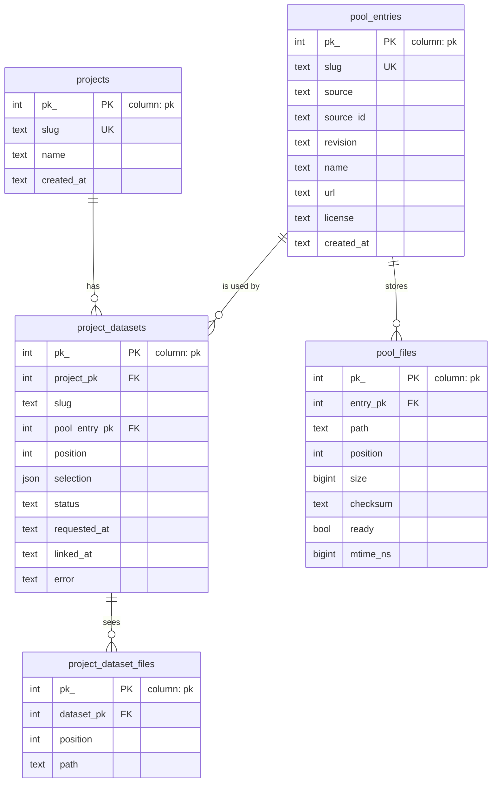
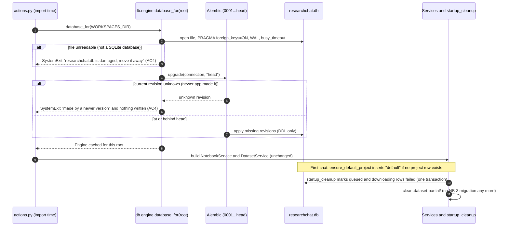

# Feature Plan: Store app data in SQLite, with Alembic migrations
Status: Implemented — workspace reset done, not committed · Source: [STORY-01](../tasks/01-sqlite-storage/STORY-01-store-app-data-in-sqlite.md) (chat request, 2026-11-15) · Date: 2026-11-15

Today the app keeps its own data in **JSON files inside `workspaces/`**, and the code reads and writes them by hand. This plan moves that data into **one SQLite database at `workspaces/researchchat.db`**, and **Alembic** owns the schema and its migrations. **There is no backward compatibility** (D3): existing workspace data is deleted once, and the JSON formats and the NB-3 → NB-4 migration code are removed. Notebooks, project files, pooled dataset bytes and the dataset links stay files on disk.

## 1. Requirement (User Stories & Acceptance Criteria)

### What the workspace folder holds today (the "database" that exists now)

Found by exploring `workspaces/` and the code that writes it:

| Path in `workspaces/` | What it is | Written by | After this change |
|---|---|---|---|
| `<project>/project.json` | `{"name", "created_at"}`, one per project | `store.create_project` (`researchchat/workspace/store.py:94-106`) | **replaced** by the `projects` table |
| `<project>/datasets.json` (format 2) | the project's datasets: `id, pool_entry, selection, status, files[], requested_at, linked_at, error` | `datasets_store.save_project_datasets` (`datasets_store.py:331-334`) | **replaced** by `project_datasets`, `project_dataset_files` |
| `.dataset-pool.json` (format 1) | the shared pool index: entries `id, source, source_id, revision, name, url, license, created_at` + `files[] {path, size, checksum, ready, mtime_ns}` | `DatasetPool.save_index` (`dataset_pool.py:184-196`) | **replaced** by `pool_entries`, `pool_files` |
| `<project>/datasets.json` (format 1) / `.v1`, `<project>/.dataset-partial/` | NB-3 leftovers, read only by the NB-3 → NB-4 migration | `dataset_pool.migrate` | **dropped**, with the migration code (D3) |
| `<project>/notebook.ipynb` | nbformat 4 notebook; `metadata.researchchat.version` is the edit counter | `store.save_notebook` | stays a file (A1, D5) |
| `<project>/files/`, `files/datasets/<id>/*` (symlinks) | the kernel's `/work`; dataset links into the pool | kernels, `DatasetPool._write_link` | stays on disk |
| `.dataset-pool/<entry>/…` | pooled dataset bytes, mounted read-only in kernels | `DatasetPool.store_file` | stays on disk |
| `.dataset-partial/`, `.kernels/` | downloads in progress, kernel connection files | download jobs, `kernels.py:48` | stays (temporary files) |

`.dataset-pool/hf-scikit-learn--iris@0bda0ce/database.sqlite` is **dataset content** (a file of the Iris dataset), not app state.

There are three record types, and two relationships between them. A project has many datasets. Each dataset points to one pool entry. A pool entry can be used by many projects (the pool is shared, D1). Today every lookup across those relationships is a scan in Python over all projects' JSON (`DatasetPool.projects_using`, `dataset_pool.py:322-329`). Nothing stops the files from disagreeing with each other, for example a `datasets.json` that points to a pool entry the index doesn't have (`DatasetService._entry`, `dataset_service.py:283-289`).

### User stories

- **US1:** As the **app maintainer**, I want projects, project datasets and the dataset pool index stored in one SQLite database with Alembic migrations, so that changing the data model later is a reviewed migration instead of another hand-written "format 2 → format 3" JSON converter.
- **US2:** As a **developer**, I want a single standard command to create and apply schema changes, so that a schema change is reviewable code.

### Acceptance criteria (copied as-is from [STORY-01](../tasks/01-sqlite-storage/STORY-01-store-app-data-in-sqlite.md))

| AC | Name | Given | When | Then |
|---|---|---|---|---|
| AC1 | Database created on first start | `workspaces/researchchat.db` doesn't exist | the app starts (or any code first opens the workspace) | the file is created in `workspaces/` and brought to the latest schema before anything reads projects or datasets |
| AC2 | Projects work as before | the database is at the latest schema | a project is created, listed, opened or switched to | it behaves exactly as today (same ids, names, sort order and error messages), the data comes from the database, and no `project.json` is written or read |
| AC3 | Datasets and the shared pool work as before | the database is at the latest schema | datasets are requested, linked, listed, deleted or cleaned up | it behaves exactly as today (same Datasets tab, same assistant results, same errors), the pool is still shared by all projects, and no `datasets.json` / `.dataset-pool.json` is written or read |
| AC4 | A damaged or newer database stops the app clearly | the database file is unreadable, or was made by a newer version of the app | the app starts | startup stops with a message saying what happened and what to do (update the app, or move the file away), and nothing in the database is changed |
| AC5 | Developers manage the schema with Alembic | a developer changes the table definitions | they run `alembic revision --autogenerate -m "…"` and then `alembic upgrade head` from the repo root | a migration file is generated and applied to `workspaces/researchchat.db` |
| AC6 | Notebooks and files stay files, out of the kernel's reach | any of the above has run | I look at a project | `notebook.ipynb`, the `files/` folder, the pooled dataset files and the dataset links are still ordinary files on disk, and notebook code (the kernel) can't read or change the database |
| AC7 | Old formats are gone | the change is done | the code is searched | the JSON-format code, the NB-3 → NB-4 migration and their tests are removed, and nothing refers to them |

**Unhappy paths covered:** tampered rows (G2❌5, G3❌2, G4❌2), duplicate slugs (G2❌6, G3❌5, G4❌4), an unknown database revision or a damaged file (AC4), a dataset that points to an unknown pool entry (G3❌4), a pool entry that is still in use being deleted (G4❌1), a failed save (G3❌1, G4❌3).

**Out of scope**
- **Importing or keeping existing data.** It is deleted once (D3, §3.3 "Existing data").
- Storing notebook cells in the database (A1, D5): the notebook doesn't use the database; only the workspace data does.
- Chat history persistence (Chainlit's data layer). Nothing is persisted today.
- Making `DatasetService` / `DatasetPool` use row-level updates instead of "load all, change, save all" (A4, follow-up).
- Multi-process access (two app servers on one workspace).

## 2. Codebase Patterns

The closest existing features are the **NB-4 dataset pool** (`researchchat/workspace/dataset_pool.py`, plan `docs/plans/done/NB-4-dataset-pool-plan.md`) and the **project store** (`researchchat/workspace/store.py`).

| Area | What exists | Evidence |
|---|---|---|
| Architecture / layering | Chainlit actions → services (`NotebookService`, `DatasetService`) → disk modules (`store`, `datasets_store`, `DatasetPool`). The disk modules "only read and write disk", and the rules live in the services | `datasets_store.py:12-14`, `service.py:166-167`, `actions.py:31,67` |
| How storage is reached | Module-level functions taking `root: Path = WORKSPACES_DIR`; classes take `root` in the constructor. There are about 60 call sites in code and tests | `store.py:94`, `dataset_pool.py:107`, `dataset_service.py:247` |
| Data shapes | Plain `@dataclass`es (`Project`, `ProjectDataset`, `PoolEntry`, `PoolFile`), turned into dicts with `asdict`, and parsed back with hand-written `_…_from_dict` validators | `store.py:43-47`, `datasets_store.py:295-332`, `dataset_pool.py:438-452` |
| Validation on read | Ids are checked against regexes (`PROJECT_ID_RE`, `DATASET_ID_RE`, `ENTRY_ID_RE`) and paths with `safe_relpath` every time they are read back (SEC23) | `store.py:24`, `datasets_store.py:37`, `dataset_pool.py:430-435` |
| Atomic writes | temp file + `os.replace` | `store.py:144-154`, `datasets_store.py:127-134`, `dataset_pool.py:184-196` |
| Corrupt data | file renamed `.bad`, read as empty; a corrupt pool index is rebuilt from the pool folders | `datasets_store.py:307-322`, `dataset_pool.py:166-182, 198-214` |
| Startup work | `startup_cleanup` runs once at the first chat under the pool lock, in a thread: NB-3 migration, then stale downloads → failed, then partial files cleared | `dataset_service.py:742-770`, `app.py:47-56` |
| Concurrency | one app process; `asyncio.Lock`s (an edit lock per project, one pool lock app-wide) | `service.py:181-191`, `dataset_pool.py:109` |
| Error handling | `WorkspaceError(ErrorCode.X, message)`; a startup problem becomes `SystemExit` with steps to follow | `workspace/__init__.py:8-42`, `config.py:96-102` |
| Config | `config.toml` sections read once in `researchchat/config.py`; paths are relative to the repo root | `config.py:63-64` |
| Persistence library / migration tool | **none**: no SQLAlchemy, no Alembic, no ORM | `requirements.txt`; `.venv` has neither package |
| Auth & security | localhost only (`check_local_host`); kernels run in Docker with only `files/` (rw), the connection dir and the pool (ro) mounted | `config.py:108-116`, `kernels.py:256-270` |
| Testing | pytest; every test builds its own `tmp_path / "workspaces"` root and calls the real disk modules; fakes for kernels, HTTP and disk space (`tests/conftest.py`); test comments carry the plan's group ids (`# G6❌1 · Changed: … Then: … Demonstrates: …`) | `tests/test_datasets_store.py:13-45`, `tests/conftest.py` |
| Dead-code check | `vulture` is installed (CLAUDE.md §4 uses it) | `.venv` |

**Baseline before any change:** `pytest -q` → **297 passed** (88 s, 2026-11-15).

## 3. Schema & Relationships

### 3.1 Existing Tables

These are JSON files, not tables. Their fields and rules, as the code enforces them:

| "Table" (file) | Key fields (type, nullable) | Constraints enforced in code | Evidence |
|---|---|---|---|
| `project.json` (one per folder; the **folder name is the id**) | `id` (folder, str ≤ 40), `name` str 1–80, `created_at` ISO-8601 UTC str | `PROJECT_ID_RE ^[a-z0-9][a-z0-9-]{0,39}$`; unique because folders are unique; `_unique_id` adds `-2`, `-3`… | `store.py:24-27, 66-76, 94-106` |
| `datasets.json` format 2, `datasets[]` (one per project) | `id` str ≤ 80; `pool_entry` str; `selection` list[str] **or null (= all files)**; `status` ∈ queued/downloading/ready/failed; `files` **ordered** list[str]; `requested_at` str (queue order); `linked_at` str\|null; `error` str\|null | `DATASET_ID_RE`; `id` unique within the project (`make_id`); status allow-list; `missing` is computed, never stored | `datasets_store.py:282-305` |
| `.dataset-pool.json`, `entries[]` (app-wide) | `id` str (`<slug>@<rev7>`), `source` ∈ huggingface/zenodo, `source_id` str, `revision` str\|null, `name` str ≤ 200, `url` str\|null, `license` str\|null, `created_at` str | `ENTRY_ID_RE`; `id` unique (`add_entry` adds `-2`) | `dataset_pool.py:44, 64-80, 224-233` |
| ↳ `entries[].files[]` | `path` str ≤ 1024 (safe relative POSIX path), `size` int bytes, `checksum` "md5:…"/"sha256:…"\|null, `ready` bool, `mtime_ns` int\|null (**≈1.8 × 10¹⁸**, needs 64-bit) | `safe_relpath`; `path` unique within the entry (`entry.file(path)`) | `dataset_pool.py:55-61`, `.dataset-pool.json` |

### 3.2 Relationships (+ ER diagram)

Every table has an **integer primary key `pk`**, and every foreign key points to a `pk`. The readable slug (the folder name) is a separate **`slug` column with a `UNIQUE` constraint** (Decision log D2).

| From | To | Cardinality | FK / join | Owning side & cascade | Business meaning |
|---|---|---|---|---|---|
| `project_datasets` | `projects` | many → 1 | `project_pk` → `projects.pk` | dataset row; `ON DELETE CASCADE` (no project delete exists yet) | a dataset belongs to one project |
| `project_datasets` | `pool_entries` | many → 1 | `pool_entry_pk` → `pool_entries.pk` | dataset row; **`ON DELETE RESTRICT`** | the pooled version this project uses; a used entry can never be deleted |
| `project_dataset_files` | `project_datasets` | many → 1 | `dataset_pk` → `project_datasets.pk` | file row; `ON DELETE CASCADE` | the files this project sees, in order |
| `pool_files` | `pool_entries` | many → 1 | `entry_pk` → `pool_entries.pk` | file row; `ON DELETE CASCADE` | the files stored once in the pool |

**The pool is shared by all projects** (D1). A pool entry is stored once and isn't owned by any project. Each project's `project_datasets` row points to it. For example, if `default` and `hello-world` both use `zenodo-10117394`, they get two `project_datasets` rows with the same `pool_entry_pk`, and `Rotom.csv` exists once in `.dataset-pool/`. An entry is removed only when no project uses it, and the `RESTRICT` FK enforces that.

`project_dataset_files.path` and `pool_files.path` are **not** linked by a foreign key, on purpose. A project lists files the pool may not have yet (queued) or has lost (`missing`, AC28 of NB-4).

In the diagram, `pk_` stands for the column `pk`, because Mermaid reserves `pk` as a keyword.

**Risks noticed**
- **The pool FK turns a tolerated state into an error.** Today a `datasets.json` may name an entry the index doesn't have. With the FK, a dataset row can only point to an existing entry, so every code path must save the pool entry **before** the project dataset that points to it. `request()` already calls `pool.save_index()` before `_save(pid)` (`dataset_service.py:472`). The existing service tests go through every write path, so a wrong order fails loudly.
- **`PRAGMA foreign_keys` is off by default in SQLite**, per connection. It must be set on every connection (an engine `connect` event), or the FKs do nothing (G1❌1).
- **Full-list saves.** The services save "the whole list". Done naively as DELETE + INSERT, `save_index()` would try to delete an entry that is still referenced and hit `RESTRICT`. It would also give the entry a **new `pk`**, breaking every `project_datasets.pool_entry_pk` that points to it. So pool entries are **upserted on `slug`** (`INSERT … ON CONFLICT(slug) DO UPDATE`), which keeps their `pk` stable, and only entries missing from the list are deleted (§4.1, G4✅5).
- **Slug ↔ pk lookups.** The code passes slugs everywhere, so each save looks up the `pk` for a slug inside the same transaction (the project's `pk`, and each dataset's pool entry `pk`). An unknown slug is refused before anything is written (G3❌4).
- **No N+1 to worry about.** The data is tens of rows, and `projects_using` becomes one indexed query instead of reading every project's JSON.

### 3.3 Proposed Schema Changes (described, not applied)

**Migration file:** `researchchat/db/migrations/versions/0001_initial_schema.py` (revision `"0001"`, `down_revision = None`). There's no prior convention; `alembic.ini` sets `file_template = %%(rev)s_%%(slug)s` and revisions are numbered by hand (`--rev-id 0002`), so the order is obvious in `ls`.

| Table | Column | Type | Null | Default / constraint | Why |
|---|---|---|---|---|---|
| `projects` | `pk` | INTEGER | no | **PK** (SQLite rowid) | internal key that the FKs point to; never leaves the storage layer |
| | `slug` | TEXT | no | **`UNIQUE`** | the project id the code uses (`default`, `hello-world`); still the folder name (`store.project_dir`) |
| | `name` | TEXT | no | `CHECK (length(name) BETWEEN 1 AND 80)` | display name; the DB repeats the rule `create_project` enforces |
| | `created_at` | TEXT | no | — | ISO-8601 UTC string, the same text as today (A9) |
| `pool_entries` | `pk` | INTEGER | no | **PK** | internal key; stays the same when the entry is saved again (upsert on `slug`) |
| | `slug` | TEXT | no | **`UNIQUE`** | `<slug>@<rev7>`; the pool folder name and the symlink target |
| | `source` | TEXT | no | `CHECK (source IN ('huggingface','zenodo'))` | which catalog |
| | `source_id` | TEXT | no | — | the catalog key |
| | `revision` | TEXT | yes | — | HF commit hash; NULL for Zenodo |
| | `name` | TEXT | no | — | title (≤ 200, trimmed on read as today) |
| | `url`, `license` | TEXT | yes | — | details |
| | `created_at` | TEXT | no | `''` | "downloaded …", and the newest-first sort in `find_entries` |
| `pool_files` | `pk` | INTEGER | no | **PK** | internal key |
| | `entry_pk` | INTEGER | no | FK → `pool_entries.pk` `ON DELETE CASCADE` | the entry the file belongs to |
| | `path` | TEXT | no | **`UNIQUE (entry_pk, path)`** | relative path inside the entry folder; unique per entry, as `entry.file(path)` assumes |
| | `position` | INTEGER | no | — | keeps the list order of `entry.files` |
| | `size` | BIGINT | no | — | bytes |
| | `checksum` | TEXT | yes | — | `md5:`/`sha256:` |
| | `ready` | BOOLEAN | no | `false` | verified and in the pool |
| | `mtime_ns` | BIGINT | yes | — | ≈ 1.8 × 10¹⁸, so 64-bit is needed (SQLite INTEGER is 64-bit) |
| `project_datasets` | `pk` | INTEGER | no | **PK** | internal key |
| | `project_pk` | INTEGER | no | FK → `projects.pk` `ON DELETE CASCADE` | owner |
| | `slug` | TEXT | no | **`UNIQUE (project_pk, slug)`** | the dataset id the code and the model use (`zenodo-10117394`); the folder under `files/datasets/`. Unique **within** a project, as today; two projects can both have `zenodo-10117394` |
| | `pool_entry_pk` | INTEGER | no | FK → `pool_entries.pk` **`ON DELETE RESTRICT`** | the pooled version used |
| | `position` | INTEGER | no | — | keeps the list order (the panel lists datasets in that order) |
| | `selection` | JSON (TEXT) | yes | — | list of patterns; **NULL = all files, `[]` stays `[]`**. It's an opaque list that is never queried, so it doesn't get its own table |
| | `status` | TEXT | no | `CHECK (status IN ('queued','downloading','ready','failed'))` | `missing` stays computed |
| | `requested_at` | TEXT | no | `''` | queue order |
| | `linked_at`, `error` | TEXT | yes | — | as today |
| `project_dataset_files` | `pk` | INTEGER | no | **PK** | internal key |
| | `dataset_pk` | INTEGER | no | FK → `project_datasets.pk` `ON DELETE CASCADE` | owner |
| | `position` | INTEGER | no | `UNIQUE (dataset_pk, position)` | the order of `dataset.files` |
| | `path` | TEXT | no | `UNIQUE (dataset_pk, path)` | a file is listed once |

The `app_meta` table from the first draft is **dropped**. It only held the JSON-import marker, and without the import nothing needs it.

**Indexes**
- `ix_pool_entries_source_source_id (source, source_id)` serves `find_entries`, which runs on every dataset request.
- `ix_project_datasets_pool_entry_pk (pool_entry_pk)` serves `projects_using` / `_users_by_entry` (cleanup, "used by" counts) and the FK `RESTRICT` check.
- The `UNIQUE` constraints create the indexes that serve the slug lookups: `projects.slug`, `pool_entries.slug`, `(project_pk, slug)`, `(entry_pk, path)`, `(dataset_pk, position)`.
- **Integer keys are plain `INTEGER PRIMARY KEY`, without `AUTOINCREMENT`.** SQLite may reuse a deleted row's number. That's harmless because a `pk` never leaves the storage layer: nothing caches it or shows it, and the code only knows slugs. SQLite also recommends avoiding `AUTOINCREMENT`.

**Connection settings** (on every connection, through a SQLAlchemy `connect` event): `PRAGMA foreign_keys=ON`, `PRAGMA journal_mode=WAL`, `PRAGMA busy_timeout=5000`. WAL adds `researchchat.db-wal` / `-shm` next to the file in `workspaces/`, which is already in `.gitignore`.

**Applying the migration.** `upgrade head` runs **in the app**, on the first open of a workspace root (A5). `alembic upgrade head` from the shell also works for developers (AC5).

**Rollback.** `0001.downgrade()` drops the five tables. There's no data rollback to an older app version (D3).

**Backward compatibility: none** (D3). The old app version can't read the database, and this version doesn't read the JSON files.

**Existing data: deleted once, by hand, during implementation** (D3). There's no import code. Before the first run of the new code, I will delete these from `workspaces/`. I'll show you the exact list and ask once more right before deleting, because it can't be undone:

| Deleted | Contents today |
|---|---|
| `workspaces/default/` | `project.json`, `notebook.ipynb` (20 cells), `datasets.json`, `datasets.json.v1`, `files/Iris.csv`, 16 dataset link folders |
| `workspaces/hello-world/` | `project.json`, `notebook.ipynb`, `datasets.json`, 1 dataset link folder |
| `workspaces/.dataset-pool/`, `workspaces/.dataset-pool.json` | 16 pooled datasets (the downloaded files) and their index |
| `workspaces/.kernels/` | kernel connection files (empty now) |

After that, the first start creates `researchchat.db` and the `default` project from scratch, as on a new install. Any notebooks you want to keep must be copied out before that step.

## 4. Implementation Idea

### 4.1 Approach & Files Affected

**Approach.** Add a small `researchchat/db/` package: the table definitions (SQLAlchemy **Core** `MetaData`, A3), the engine setup and the Alembic environment. Then **swap only the bodies** of the existing load/save functions in `store.py`, `datasets_store.py` and `DatasetPool` from JSON files to SQL. Their signatures, dataclasses, caches and locks stay as they are, so the services, tools and panel don't change their behaviour (A4).

The database for a workspace is found from its `root`: `database_for(root)` opens `root / "researchchat.db"` once per root, upgrades it, and caches the `Engine`. That lets the roughly 60 existing `root=` call sites and every `tmp_path` test work unchanged, with a separate database per test (A2).

The tables use **integer `pk`s and a unique `slug`** (D2), but the integers stay **inside the I/O functions**. The dataclasses keep their slug fields (`Project.id`, `ProjectDataset.id`, `ProjectDataset.pool_entry`, `PoolEntry.id`), and each save looks up the `pk`s it needs by slug in the same transaction.

Every save is **one transaction**. That replaces the temp-file + `os.replace` pattern and gives the same all-or-nothing guarantee: projects are inserted, a project's datasets are replaced as a whole, and pool entries are upserted on `slug`, with entries no longer listed deleted. Validation on read (`PROJECT_ID_RE`, `DATASET_ID_RE`, `ENTRY_ID_RE`, `safe_relpath`) is kept: a tampered row is **skipped with a warning** (A7).

**Then remove everything the JSON formats and NB-3 needed** (D3, CLAUDE.md §3 "Remove code that your change makes unused"). This goes in a **separate commit**, after the storage swap is green, so each diff is easy to review.

**New files**
| File | Responsibility |
|---|---|
| 🆕 `alembic.ini` | Alembic CLI config: `script_location = researchchat/db/migrations`, `file_template = %%(rev)s_%%(slug)s`, logging |
| 🆕 `researchchat/db/__init__.py` | package docstring (where the DB lives, what is in it, plan link) |
| 🆕 `researchchat/db/schema.py` | `metadata` + the five `Table`s and two indexes from §3.3 (I/O-free, also used by Alembic autogenerate) |
| 🆕 `researchchat/db/engine.py` | `DATABASE_FILE`, `database_for(root) -> Engine` (cached per resolved root), `create_workspace_engine(path)` (PRAGMAs), `upgrade_to_latest(engine)`, and the AC4 checks that turn a bad database into a clear `SystemExit` |
| 🆕 `researchchat/db/migrations/env.py` | Alembic env: uses `schema.metadata` as `target_metadata`, takes the connection from `config.attributes["connection"]` when the app runs it, else opens `WORKSPACES_DIR / DATABASE_FILE`; `render_as_batch=True` (SQLite can't `ALTER` most things) |
| 🆕 `researchchat/db/migrations/script.py.mako` | standard template |
| 🆕 `researchchat/db/migrations/versions/0001_initial_schema.py` | the DDL from §3.3; `downgrade()` drops it |
| 🆕 `tests/test_database.py` | G1 + S1 (§7) |

**Modified files: the storage swap (commit 1)**
| File | Change |
|---|---|
| ✏️ `requirements.txt` | `sqlalchemy>=2.0`, `alembic>=1.13` (needs your OK to install, Q3) |
| ✏️ `config.toml`, `researchchat/config.py` | `[notebook] database_file = "researchchat.db"` → `DATABASE_FILE` (relative to `workspaces_dir`) |
| ✏️ `researchchat/workspace/store.py` | `create_project` inserts a row (then creates the folder, rolling back the row if `mkdir` fails); `list_projects` / `get_project` read rows; `_unique_id` treats an id as taken when a row **or** a folder has it; no `project.json`. Notebook and cell functions untouched |
| ✏️ `researchchat/workspace/datasets_store.py` | `load_project_datasets` / `save_project_datasets` use SQL |
| ✏️ `researchchat/workspace/dataset_pool.py` | `load_index` / `save_index` use SQL (upsert on `slug` + delete-unlisted, in one transaction); `projects_using` becomes one query |
| ✏️ `researchchat/workspace/actions.py` | calls `database_for(WORKSPACES_DIR)` once before building the services, so AC4 stops the app at start instead of at the first click |
| ✏️ `tests/test_workspace_store.py`, `tests/test_datasets_store.py`, `tests/test_dataset_pool.py`, `tests/test_dataset_service.py` | new G2–G4 tests; tests that set up data through JSON now go through the DB (see "Tests removed or rewritten" below) |
| ✏️ `README.md` | "Where your data lives" + "Changing the database schema" (`alembic revision --autogenerate`, `alembic upgrade head`) + "Upgrading from an older checkout: delete `workspaces/`" |

**Removed code: the cleanup (commit 2)**, all found with `grep` and confirmed with `vulture`:
| File | Removed | Why it's unused now |
|---|---|---|
| ✏️ `datasets_store.py` | `DatasetFile`, `DatasetRecord`, `_record_from_dict`, `load_records`, `save_records`, `_write_manifest`, `MANIFEST_FILE`, `MANIFEST_FORMAT`, `MANIFEST_FORMAT_LINKS`, `V1_BACKUP_SUFFIX`, `_project_dataset_from_dict` (its checks move into the row reader), `read_manifest_format`, `back_up_v1_manifest`, `manifest_path`, `PARTIAL_DIR`, `PARTIAL_SUFFIXES`, `partial_root`, `partial_dir` (the NB-3 per-project one), `recover_partials`, `_inside` (only used by `partial_dir`); the NB-3 paragraph of the docstring | JSON formats 1 and 2 and NB-3's per-project partial folders no longer exist |
| ✏️ `dataset_pool.py` | `POOL_INDEX_FILE`, `POOL_INDEX_FORMAT`, `BAD_INDEX_SUFFIX`, `UNKNOWN_SOURCE_ID`, `MigrationReport`, `rebuild_index`, `_files_on_disk`, `_entry_from_dict` (checks move into the row reader), `migrate`, `migrate_project`, `_migrate_record`, `_entry_for_record`, `_restore_metadata`, `_migrate_file`, `_adopt_moved_file`, `move_into_pool`, `forget_cached_index`; the docstring's migration part | the index can't be "lost" separately from the projects any more, and there's no NB-3 data to move |
| ✏️ `dataset_service.py` | `_migrate_if_still_nb3`, `_migrate`, and the migration call in `startup_cleanup` (it keeps: stale downloads → failed, clear `.dataset-partial/`) | same |
| ✏️ `app.py` | the "moves NB-3 datasets into the shared pool" comment line | stale |

Kept on purpose: `checksum_matches` (still used by `recheck_file`), `STOPPED_DURING_DOWNLOAD` (still used by `_fail_stale`), `remove_dataset_dir`, `datasets_root`, the pool's app-wide `partial_dir()`.

**Tests removed or rewritten**
| Test | What happens | Why |
|---|---|---|
| `test_dataset_pool.py`: Group 14 (`test_migration_moves_files_into_pool_and_links_them`, `test_same_dataset_in_two_projects_is_stored_once`, `test_migration_is_safe_to_run_twice`, `test_migration_marks_gone_or_changed_files`, `test_migration_resumes_after_a_crash`, `test_migration_skips_corrupt_manifest`, `test_migration_resumes_after_a_crash_inside_a_project`, `test_project_skipped_by_migration_is_never_overwritten`) and the `nb3_dataset` helper | **removed** | they test the NB-3 migration, which is removed |
| `test_dataset_pool.py::test_corrupt_pool_index_is_rebuilt` | **replaced** by G4❌2 `test_tampered_pool_row_is_skipped` | no JSON index to corrupt |
| `test_datasets_store.py::test_corrupt_manifest_is_set_aside` | **replaced** by G3❌2 `test_tampered_dataset_row_is_skipped` | no manifest file |
| `test_datasets_store.py::test_delete_ignores_tampered_manifests` | **rewritten**: tamper with rows instead of `datasets.json` | the security point (delete never leaves `files/datasets/`) still matters |
| `test_datasets_store.py::test_dataset_paths_stay_inside_dataset_folder` | **trimmed**: the `partial_dir` assertions go | `partial_dir` is removed; the `dataset_dir` / `file_path` checks stay |
| `test_dataset_service.py::test_startup_marks_stale_jobs_failed` | **rewritten**: seed queued/downloading rows with `save_project_datasets`, partial files in the pool's `.dataset-partial/`; the NB-3 `.old` folder part goes | the behaviour stays, the setup used NB-3 records |
| `test_dataset_service.py` around `:290` (`manifest_path(...).exists()`) | **rewritten**: assert there are no rows | no manifest file |
| `test_dataset_service.py::records()` helper | reads through `load_project_datasets` + `pool.entries()` (already does), docstring updated | — |
| `test_workspace_store.py::test_new_project_has_empty_notebook_and_files_dir` | **rewritten** as G2✅1 | it read `project.json` |
| `tests/conftest.py` | nothing (`FakeDatasetService` doesn't touch storage) | — |

Not changed: `service.py`, `kernels.py`, the tools, the panel.

### 4.2 Endpoints

**No endpoints change.** The app has no HTTP API of its own. The Chainlit actions (`nb_list_projects`, `nb_create_project`, `nb_switch_project`, the dataset actions in `actions.py:98-157`) keep their names, payloads and results.

### 4.3 DTOs

**No DTOs change.** `NotebookProps` (`service.py:196-221`), the dataset panel rows and the model-facing `DatasetRecordView` are built from the same dataclasses (`Project`, `ProjectDataset`, `PoolEntry`, `PoolFile`), which keep every field and type. The existing tests in `test_panel_ui.py`, `test_dataset_tools.py` and `test_dataset_service.py` check that.

Row ↔ dataclass mapping (lives in the I/O functions, nowhere else):

| Dataclass field | Column | Note |
|---|---|---|
| `Project.id` | `projects.slug` | `projects.pk` isn't in the dataclass |
| `Project.name / created_at` | `projects.*` | — |
| `ProjectDataset.id` | `project_datasets.slug` | — |
| (the project id passed to `load/save_project_datasets`) | `project_datasets.project_pk` → `projects.slug` | looked up in the same transaction |
| `ProjectDataset.pool_entry` | `project_datasets.pool_entry_pk` → `pool_entries.slug` | joined on read; looked up on save; an unknown slug is refused |
| `ProjectDataset.selection` | `project_datasets.selection` (JSON) | `None` ↔ NULL, `[]` ↔ `'[]'` |
| `ProjectDataset.files` | `project_dataset_files.path` ordered by `position` | — |
| `PoolEntry.id` | `pool_entries.slug` | — |
| `PoolEntry.files` | `pool_files` (by `entry_pk`), ordered by `position` | — |

No `pk` value ever reaches a dataclass, the panel, the model or a log line.

The error shape is unchanged: `WorkspaceError(code, message)`. The only new user-facing text is the AC4 startup message, for example: *"workspaces/researchchat.db was made by a newer ResearchChat (schema 0003, this version knows up to 0001). Update the app, or move the file away to start fresh."*

## 5. Security Review

The app only serves localhost (`config.py:108-116`), and there's no auth layer to change. The relevant attack surface is **code running in the notebook kernel** and **values that came from catalogs or the model**.

| # | Risk | Where | Mitigation in this plan | Test ref |
|---|---|---|---|---|
| SEC1 | Kernel code edits or replaces the app database (e.g. points a dataset at another pool entry, or renames a project to an unsafe id) | `workspaces/researchchat.db` | The file lives at the `workspaces/` root, which is **not mounted**: kernels only get `files/` (rw), `.kernels` (ro) and `.dataset-pool` (ro) (`kernels.py:267-270`) | S1❌1 |
| SEC2 | SQL injection through project names, dataset names, catalog file paths or license text | every write | SQLAlchemy Core statements with bound parameters only; no SQL built from strings; reviewed in the scaffold (V7) | S1❌2 |
| SEC3 | A tampered row becomes a path (`../x` as a slug or file path) and escapes the workspace | reads of `projects`, `project_datasets`, `pool_*` | The existing read-side checks run on every row (`PROJECT_ID_RE`, `DATASET_ID_RE`, `check_entry_id`, `safe_relpath`); a bad row is skipped and logged. `project_dir`, `path_inside` and `link_target` still validate before any file access | G2❌5, G3❌2, G4❌2 |
| SEC4 | A pool entry is deleted while a project still uses it (dangling links, lost data) | `remove_unused_entry`, `save_index` | Unchanged pool-lock rule (SEC9 of NB-4) **plus** FK `ON DELETE RESTRICT` with `foreign_keys=ON` on every connection | G4❌1, G1❌1, G3❌4 |
| SEC5 | Half-written state when a save crashes | every save | one transaction per save | G3❌1, G4❌3 |
| SEC6 | Running against a database from a newer version, which could corrupt it | startup | `upgrade_to_latest` refuses an unknown current revision and stops with AC4's message before any write | G1❌2 |
| SEC7 | Deleting user data by mistake during the one-time reset | implementation step (§3.3) | done by hand, not by app code; exact list shown and confirmed right before | — (manual step) |
| SEC8 | Business-logic races (double linking, cleanup during linking) | `DatasetService` | unchanged: `pool.lock` still serializes them; the DB adds `busy_timeout` | existing `test_cleanup_waits_for_a_project_linking_at_the_same_time` |

Not applicable: authentication, BOLA and function-level authorization (single local user), mass assignment, excessive data exposure, rate limiting (no new inputs or outputs; DTOs are identical), sensitive data at rest (nothing secret is stored).

## 6. Workflow Diagram

This is a **sequence diagram of app start**, where the new behaviour is: open, check, upgrade. After it, the request flows are the same as today, with SQL in place of file I/O.

## 7. TDD Test Plan

All new groups are **integration tests against a real SQLite file in `tmp_path`** (no mocks: the FK, transaction and PRAGMA behaviour is what's under test). They follow the repo's comment style (`# G1❌2 · Changed: … Then: … Demonstrates: …`). Write them in group order: G1 makes the database exist, then G2–G4 move each record type.

### Functional groups

### Group 1 — Schema and migrations  (covers AC1, AC4, AC5, SEC4, SEC6)  · integration
Baseline: Given an empty `tmp_path/workspaces` · When `database_for(root)` is called

| # | Type | Test name | Changed condition (vs baseline) | Expected result (Then) | Demonstrates |
|---|---|---|---|---|---|
| ✅1 | baseline | `test_first_open_creates_database_at_head` | — | `researchchat.db` exists; `alembic_version` = head; all five tables exist | a fresh workspace gets the full schema with no manual step |
| ✅2 | edge | `test_second_open_reuses_database_without_migrating` | called twice (and on a second `Engine`) | same file; no revision applied the second time; rows kept | upgrading at every start is safe |
| ✅3 | edge | `test_migrations_match_table_definitions` | compare `upgrade head` with `schema.metadata` (Alembic `compare_metadata`) | no differences | the migration and the code can't drift (AC5) |
| ✅4 | edge | `test_downgrade_to_base_removes_all_tables` | `downgrade base` after upgrade | no app tables left | the rollback path works |
| ❌1 | negative | `test_foreign_keys_are_enforced_on_every_connection` | insert a `project_datasets` row whose `pool_entry_pk` doesn't exist, on a fresh pooled connection | `IntegrityError`; no row | the FK actually holds (the PRAGMA isn't forgotten) |
| ❌2 | negative | `test_database_from_newer_version_stops_startup` | `alembic_version` set to `"9999"` | `SystemExit` with the "newer version" text; file bytes unchanged | the app never writes to a schema it doesn't know |
| ❌3 | negative | `test_unreadable_database_file_stops_startup` | `researchchat.db` contains random bytes | `SystemExit` with the "damaged" text; file bytes unchanged | a broken file gives steps, not a stack trace |

### Group 2 — Projects in the database  (covers AC2, AC6, SEC3)  · integration
Baseline: Given a workspace at head · When `store.create_project("Tokyo housing", root)` and then `list_projects` / `get_project`

| # | Type | Test name | Changed condition (vs baseline) | Expected result (Then) | Demonstrates |
|---|---|---|---|---|---|
| ✅1 | baseline | `test_new_project_is_a_row_with_notebook_and_files_dir` (rewrite of `test_new_project_has_empty_notebook_and_files_dir`) | — | row `(slug tokyo-housing, "Tokyo housing", created_at)`; folder has `notebook.ipynb` and `files/`; **no** `project.json` | projects live in the DB, notebooks stay files |
| ✅2 | edge | `test_projects_are_listed_by_name_then_id` | three projects, names differing only in case | same order as today (`name.lower()`, then id) | sorting didn't change |
| ✅3 | edge | `test_duplicate_name_gets_unique_id` (existing, unchanged) | same name twice | `tokyo-housing-2` | id rules didn't change |
| ❌1 | negative | `test_bad_project_names_are_rejected_without_a_row` | name `""`, `"   "`, 81 chars | `BAD_NAME`; no row; no folder | validation still runs before any write |
| ❌2 | negative | `test_failed_folder_create_leaves_no_row` | `mkdir` raises `OSError` | error raised; no row | a project is never half-created |
| ❌3 | negative | `test_id_taken_by_a_folder_without_a_row_is_not_reused` | `workspaces/tokyo-housing/` exists, no row | new project gets `tokyo-housing-2`; old folder untouched | a stray folder is never overwritten |
| ❌4 | negative | `test_unknown_project_is_not_found` | `get_project("nope")` | `NOT_FOUND` | same error as today |
| ❌5 | negative | `test_tampered_project_row_is_ignored` | a row with slug `../x` inserted by hand | not listed; `get_project("../x")` → `NOT_FOUND`; nothing outside `root` touched | a tampered row can't become a path |
| ❌6 | negative | `test_duplicate_project_slug_is_refused_by_the_database` | insert a second row with slug `default` directly | `IntegrityError` (UNIQUE); one row | the unique slug holds even when `_unique_id` is bypassed |

### Group 3 — Project datasets in the database  (covers AC3, SEC3, SEC4, SEC5)  · integration
Baseline: Given project `p1` and pool entry `hf-org--name@r1` · When `save_project_datasets("p1", [dataset])` then `load_project_datasets("p1")`

| # | Type | Test name | Changed condition (vs baseline) | Expected result (Then) | Demonstrates |
|---|---|---|---|---|---|
| ✅1 | baseline | `test_project_datasets_round_trip` | — | an equal `ProjectDataset` (every field), same list order | nothing is lost between dataclass and rows |
| ✅2 | edge | `test_selection_none_and_empty_list_stay_distinct` | `selection=None` and `selection=[]` on two datasets | read back as `None` and `[]` | "all files" never turns into "no files" |
| ✅3 | edge | `test_file_order_is_kept` | `files=["b.csv", "a.csv", "dir/c.csv"]` | same order | the panel lists files as before |
| ✅4 | edge | `test_saving_a_shorter_list_removes_dropped_datasets` | save 2, then save 1 | 1 row and its files only | delete still works through "save the list" |
| ✅5 | edge | `test_same_dataset_slug_in_two_projects_is_allowed` | `p1` and `p2` both save `zenodo-10117394` → the same pool entry | two rows, same `pool_entry_pk`; each project loads its own | the shared pool works with per-project unique slugs (D1, D2) |
| ✅6 | edge | `test_integer_keys_never_reach_the_dataclasses` | — | the loaded `ProjectDataset` has exactly today's fields; `pool_entry` is the slug string | the integer keys stay inside the storage layer |
| ❌1 | negative | `test_failed_save_keeps_previous_datasets` | the second insert raises mid-transaction | previous rows unchanged | a crash never leaves half a list |
| ❌2 | negative | `test_tampered_dataset_row_is_skipped` (replaces `test_corrupt_manifest_is_set_aside`) | rows with slug `../x` and status `"hacked"` inserted by hand | skipped with a warning; good rows still returned | tampered data never becomes a path or a status |
| ❌3 | negative | `test_other_projects_datasets_are_not_returned` | `p2` has a dataset too | `load("p1")` returns only `p1`'s | projects only read their own datasets |
| ❌4 | negative | `test_dataset_pointing_to_unknown_pool_entry_is_refused` | `pool_entry="nope"` (no `pool_entries` row has that slug) | refused before any write; previous rows unchanged | the slug → `pk` lookup can't create a dangling reference |
| ❌5 | negative | `test_duplicate_dataset_slug_in_one_project_is_refused` | two datasets with slug `hf-org--name` in one save | `IntegrityError` (UNIQUE); previous rows unchanged | two datasets never share a folder |
| ❌6 | negative | `test_delete_ignores_tampered_rows` (rewrite of `test_delete_ignores_tampered_manifests`) | a dataset row whose file paths point outside `files/datasets/<id>/` | delete removes only `files/datasets/<id>/`; nothing else | delete never follows data it reads back |

### Group 4 — Pool index in the database  (covers AC3, SEC3, SEC4, SEC5)  · integration
Baseline: Given a workspace at head · When `pool.add_entry(entry)`; `pool.save_index()`; a new `DatasetPool(root).entries()`

| # | Type | Test name | Changed condition (vs baseline) | Expected result (Then) | Demonstrates |
|---|---|---|---|---|---|
| ✅1 | baseline | `test_pool_entries_round_trip_with_files_in_order` | — | equal `PoolEntry` with `files` in the same order | the index survives a restart |
| ✅2 | edge | `test_large_mtime_ns_round_trips` | `mtime_ns=1794468807764441482` | the same int | change detection (SEC16 of NB-4) still works |
| ✅3 | edge | `test_projects_using_reads_from_database` | entry used by `p1` and `p2`, not `p3` | `["p1", "p2"]` | "used by" counts come from one query |
| ✅4 | edge | `test_find_entries_newest_first` | two revisions of one dataset | newest `created_at` first | reuse picks the same version as today |
| ✅5 | edge | `test_saving_the_index_again_keeps_entry_keys` | entry used by `p1`; change its files; `save_index()` again | same `pool_entries.pk`; `p1`'s row still points to it; files replaced | an upsert on `slug` never breaks a project's reference |
| ❌1 | negative | `test_entry_in_use_cannot_be_deleted` | delete the entry row while `p1` uses it | `IntegrityError`; entry and files still there | cleanup can never orphan a project |
| ❌2 | negative | `test_tampered_pool_row_is_skipped` (replaces `test_corrupt_pool_index_is_rebuilt`) | rows with entry slug `../x` and file path `../../etc/passwd` | skipped with a warning; good entries returned | a tampered row can't make a link target outside the pool |
| ❌3 | negative | `test_failed_index_save_keeps_previous_index` | an insert raises mid-save | previous entries and files unchanged | the index is all-or-nothing |
| ❌4 | negative | `test_duplicate_pool_slug_is_refused_by_the_database` | insert a second row with an existing entry slug directly | `IntegrityError` (UNIQUE); one row | one folder is never two entries |

### Group 5 — Startup without NB-3  (covers AC3, AC7)  · integration
Baseline: Given a workspace at head with project `p1` · When `DatasetService.startup_cleanup()`

| # | Type | Test name | Changed condition (vs baseline) | Expected result (Then) | Demonstrates |
|---|---|---|---|---|---|
| ✅1 | baseline | `test_startup_marks_stale_jobs_failed` (rewrite) | rows `queued` and `downloading`; files in the pool's `.dataset-partial/` | both `failed` with "app stopped during download"; `.dataset-partial/` gone | the cleanup that remains still works |
| ❌1 | negative | `test_startup_ignores_old_json_files` | a leftover `datasets.json` (format 1) and `.dataset-pool.json` in the workspace | no rows created from them; files untouched; no error | the old formats are really gone, not half-supported |
| ❌2 | negative | `test_no_code_references_removed_formats` | `grep` the package for `datasets.json`, `.dataset-pool.json`, `load_records`, `migrate_project`; run `vulture` on `researchchat/` | no hits; no new unused code | AC7: the removal is complete |

### Security groups

### Group S1 — Database placement and injection  (covers SEC1, SEC2)  · unit / integration
Baseline: Given a workspace at head

| # | Type | Test name | Changed condition (vs baseline) | Expected result (Then) | Demonstrates |
|---|---|---|---|---|---|
| ❌1 | negative | `test_database_file_is_outside_kernel_mounts` | `KernelRegistry.run_arguments(...)` for a project | no mount source is, or contains, `researchchat.db` or the `workspaces/` root | kernel code can't edit app data |
| ❌2 | negative | `test_sql_metacharacters_are_stored_as_plain_text` | project name `x'); DROP TABLE projects; --`, file path `a'b.csv`, license `"; --` | stored and read back verbatim; all tables still exist | values never become SQL |

G5❌2 is a pytest test (the `grep` part); `vulture` also runs in the scaffold's V7 and again before the final commit (changed in the scaffold, see the report).

**Regression:** the whole remaining suite keeps passing (297 today, minus the 8 removed migration tests, with the rewrites above).

### Coverage (AC → tests, Security → tests)

| AC | Baseline | Negatives |
|---|---|---|
| AC1 | G1✅1 | G1❌1 |
| AC2 | G2✅1 | G2❌1–❌6 |
| AC3 | G3✅1, G4✅1, G5✅1 | G3❌1–❌6, G4❌1–❌4 |
| AC4 | G1✅1 | G1❌2, G1❌3 |
| AC5 | G1✅3 | G1✅4 (rollback) |
| AC6 | G2✅1 | S1❌1 |
| AC7 | G5✅1 | G5❌1, G5❌2 |

| Security risk | Tests |
|---|---|
| SEC1 | S1❌1 |
| SEC2 | S1❌2 |
| SEC3 | G2❌5, G3❌2, G3❌6, G4❌2 |
| SEC4 | G1❌1, G3❌4, G4❌1 |
| SEC5 | G3❌1, G4❌3 |
| SEC6 | G1❌2 |
| SEC7 | manual step, confirmed in chat (§3.3) |
| SEC8 | existing `test_cleanup_waits_for_a_project_linking_at_the_same_time` |

**Test count:** G1 7, G2 9, G3 12, G4 9, G5 3, S1 2. That's **42 tests**, of which 7 replace or rewrite existing ones. 8 migration tests are removed.

## 8. Questions & Confirmations

### Questions

**Q3 — May I add `sqlalchemy>=2.0` and `alembic>=1.13` to `requirements.txt` and install them into `.venv` during the scaffold?** → **Answered: yes** (D4).

**Q4 — Should this become a story first?** → **Answered: yes**, one story (D6): [STORY-01](../tasks/01-sqlite-storage/STORY-01-store-app-data-in-sqlite.md).

Q1 (scope) is now settled by the plan as written: the three JSON record types move, everything else stays a file. Q2 (notebook cells) is answered by D5: they stay in the file. Q5 (keep the NB-3 migration) is answered by D3: it's removed.

### Assumptions to confirm

**A1 — Notebooks, files, pool bytes and links stay on disk.**
- *Context:* kernels mount `files/` and `.dataset-pool/` (`kernels.py:267-270`), and the links in `files/datasets/` must be real symlinks.
- *Decision:* only the workspace records move; `notebook.ipynb` stays a file and never touches the database (D5).
- *Why:* those things have to be files for Docker and the kernel.

**A2 — One app-wide database at `workspaces/researchchat.db`, found from `root`.**
- *Context:* you asked for the DB in the workspace folder; the pool is shared by all projects (D1); about 60 call sites and every test pass a `root` folder.
- *Decision:* one file, `<root>/researchchat.db` (name configurable as `[notebook] database_file`), opened through `database_for(root)`, which caches one `Engine` per root. Alternative: pass an `Engine` explicitly through every function and constructor (cleaner dependency injection, about 60 call sites change).
- *Why:* the database location *is* "inside the workspace root", so the root is the one real dependency, and tests stay isolated per `tmp_path`. The cache is a small, deliberate exception to CLAUDE.md's "dependencies through parameters" rule.

**A3 — SQLAlchemy Core (tables), not the ORM.**
- *Context:* the code works with plain dataclasses that services mutate and then save.
- *Decision:* Core `Table`s plus small row ↔ dataclass functions. Alternative: ORM-mapped classes replacing the dataclasses.
- *Why:* Core gives Alembic everything it needs and keeps the services unchanged; the ORM would be a cross-module refactor.

**A4 — Keep the "load everything, change, save everything" style for now.**
- *Context:* `DatasetService` caches and saves each project's list whole; `DatasetPool` caches and saves the index whole.
- *Decision:* one transaction per save, callers unchanged. Alternative: per-row updates from the services.
- *Why:* identical behaviour and a reviewable change. Row-level updates are a follow-up.

**A5 — Migrations run automatically at app start.**
- *Context:* each user has their own database under the gitignored `workspaces/`.
- *Decision:* `database_for` runs `alembic upgrade head` on first open (from `actions.py`). Developers can also run `alembic` from the repo root (AC5).
- *Why:* a forgotten manual step would crash the app on the first click.

**A6 — Old data is deleted once by hand, not by code.**
- *Context:* you said backward compatibility isn't needed and old data can be dropped (D3).
- *Decision:* during implementation, delete the `workspaces/` contents listed in §3.3, after showing you the list once more. No startup code deletes or ignores old files on its own (G5❌1 only checks they're not read). Alternative: startup code that wipes old JSON automatically.
- *Why:* code that deletes user folders is a risk forever; a one-time manual step isn't.

**A7 — A tampered row is skipped and logged.**
- *Context:* today a corrupt file is renamed `.bad` and read as empty.
- *Decision:* validate each row on read, skip a bad one with `log.warning`, never delete on read. A database that isn't a SQLite database stops startup (AC4).
- *Why:* one bad row doesn't hide a whole project's datasets, and reading never destroys data.

**A8 — The pool FK is enforced (`ON DELETE RESTRICT`).**
- *Context:* today a dataset can point to an entry the index lost (`DatasetService._entry` makes a stand-in).
- *Decision:* enforce the FK. `_entry`'s stand-in fallback stays as harmless defensive code, because the cache can still briefly miss an entry. Alternative: no FK.
- *Why:* the shared pool is exactly where a lost reference means lost data.

**A9 — Timestamps stay ISO-8601 text.**
- *Context:* every timestamp is a string like `"2026-11-12T07:33:27+00:00"`, compared and sorted as text.
- *Decision:* `TEXT` columns. Alternative: `DateTime` columns.
- *Why:* no type changes in the dataclasses, and ISO-8601 UTC text sorts correctly.

### Out of scope — follow-ups
- **Row-level updates in `DatasetService` / `DatasetPool`** (A4).
- **Update `docs/explained/workspace-package-explained.md` and `project-workspace-explained.md`**, which describe the JSON files.
- **NB-5's new pool-file fields** (`NB-5-dataset-unpack-preview-plan.md` §3.3) become a `0002` Alembic migration instead of a JSON format bump.

Shall I create stories or backlog items for any of these? I won't write them unless you say so.

## Decision log

| # | Question | Answer | What changed in the plan |
|---|---|---|---|
| D1 | Is the dataset pool shared by all projects, or is there a separate pool per project? | **Shared pool**, as today (2026-11-15) | No design change. §3.2 says this explicitly; A2 and A8 stand |
| D2 | Should the tables use the text slug as the primary key, or an integer key? | **Integer key plus a unique slug column** (2026-11-15) | §3.2, the ER diagram and §3.3: every table has `pk INTEGER PRIMARY KEY`, slugs are `UNIQUE` (dataset slugs per project); FKs point to `pk`. Pool entries are upserted on `slug` so their `pk` stays stable. §4.1/§4.3: `pk`s stay inside the I/O functions. §7: G2❌6, G3✅5, G3✅6, G3❌5, G4✅5, G4❌4 |
| D3 | Do we need backward compatibility with the JSON workspaces and NB-3 data? | **No.** Drop old code and old data (2026-11-15) | Removed the JSON import (old AC4/AC5, `json_import.py`, `test_json_import.py`, old G5), the `*.pre-sqlite` backups (old A6) and the `app_meta` table. Removed the NB-3 → NB-4 migration and all JSON-format code (§4.1 "Removed code", commit 2), and its 8 tests. Added a one-time manual reset of `workspaces/` (§3.3, A6, SEC7), AC7 and the new G5 (startup without NB-3). The diagram now shows start without import. Q1 settled, Q5 answered. 41 tests |
| D4 | May I add and install `sqlalchemy>=2.0` and `alembic>=1.13`? | **Yes** (2026-11-15) | Q3 marked answered; the scaffold may install them (requirements.txt is already in §4.1) |
| D5 | Should notebook cells also go into the database? | **No.** The notebook doesn't use the database; only the workspace data does (2026-11-15) | Q2 removed; A1 and the out-of-scope list now say this. No change to the schema, files or tests |
| D6 | Should this become a story first? | **Yes**, one story (2026-11-15) | Created [STORY-01](../tasks/01-sqlite-storage/STORY-01-store-app-data-in-sqlite.md) (5 pts), the backlog and the epic PRD. The plan's `Source:` line links it. ACs AC1–AC7 are the same in both |
| D7 | SQLAlchemy Core or the ORM (A3)? | **Core** for this story; the ORM can come with the row-level-updates follow-up (2026-11-15) | A3 confirmed; no change to the scaffold |

## 9–10. Scaffold report & verification

See [sqlite-alembic-storage-scaffold-report.md](sqlite-alembic-storage-scaffold-report.md): 40 new failing test skeletons, 297 existing tests passing, migration `0001` written but not run.

## 11. Implementation notes

Implemented 2026-11-15, test by test. **Result: 327 passed** (the 16 Docker kernel tests fail in the last run, and fail the same way on an unmodified copy of HEAD, so that's the local Docker environment; they passed in the run before it). Lint adds no findings; vulture shows no new unused code except test-only helpers and Alembic's revision variables (false positives).

Changes from the plan, each small and kept to the touched area:

| What | Plan said | Done | Why |
|---|---|---|---|
| Where the database is opened at start | `actions.py` | `app.py`, right after `check_setup()` | tests import `actions.py`; opening there would create `researchchat.db` in the real `workspaces/` during every test run. `app.py` is the entry point (CLAUDE.md: concrete objects are created at the entry point) |
| `DatasetService._switch_entry` | "service unchanged" | `pool.save_index()` before `_save(pid)` | a version switch saved the project row before the new pool entry reached the index; with the foreign key that save would fail |
| `DatabaseUnusable` | an exception turned into `SystemExit` by startup | a `SystemExit` subclass | it stops the app with its message wherever it's raised, like `config.check_setup` |
| `engine.py` extras | — | `open_database`, `close_database`, `close_all_databases` (the last two for tests: a test-wide autouse fixture in `conftest.py` closes each test's engine) | — |
| Alembic CLI | `alembic upgrade head` | plus `alembic -x database=path/to/file.db …` | lets a developer (and this check) migrate another file without touching `workspaces/` |
| Also removed | — | `LinkResult` (`link_files` now returns nothing), `forget_cached_index`, `STOPPED_DURING_DOWNLOAD` moved to `dataset_service.py` (its only user) | made unused by removing the NB-3 migration |
| Workspace reset (D3) | delete old data once, by hand, after asking | done 2026-11-15 after the PO's yes: `default/`, `hello-world/`, `.dataset-pool/`, `.dataset-pool.json`, `.kernels/` deleted; fresh `researchchat.db` at schema 0001 with an empty `Default` project | — |
| Commits | storage swap, then removal, as two commits | not committed (only on request); the storage-swap stage is saved as a patch in the session scratchpad | — |

---
No files or data were changed other than this plan file.
